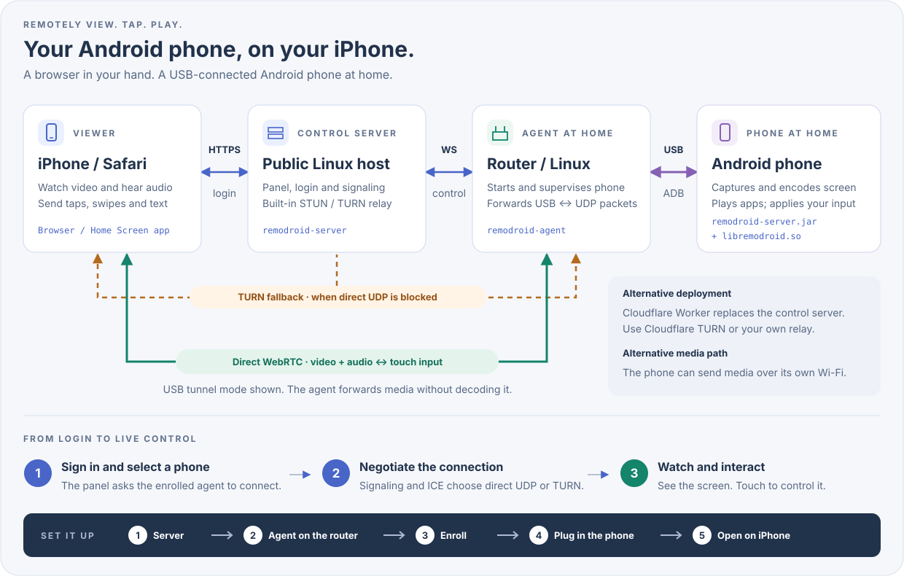

<p align="center"><b>English</b> | <a href="doc/zh/README.md">简体中文</a> | <a href="doc/ja/README.md">日本語</a> | <a href="doc/ko/README.md">한국어</a> | <a href="doc/es/README.md">Español</a> | <a href="doc/pt-BR/README.md">Português (Brasil)</a> | <a href="doc/de/README.md">Deutsch</a> | <a href="doc/fr/README.md">Français</a> | <a href="doc/ru/README.md">Русский</a></p>

# RemoDroid

Control an Android phone from your iPhone's Safari with low latency, good enough for cloud gaming.
The phone stays at home on a USB cable to your router. You watch and tap it from anywhere.
Windows, macOS and Linux computers work too: a small tray app makes them remote desktops in the same panel,
with mouse and keyboard from the browser.

<p align="center"><a href="https://remodroid.pages.dev/"></a></p>

<p align="center"></p>

**How it works, in one paragraph.** A small **server** on a public machine (or a free Cloudflare Worker) hosts the
web page, your login and the connection setup. An **agent** on your home router talks to the phone over USB with
its own built-in ADB (no `adb` needed) and starts a tiny helper on the phone. The helper captures the screen,
encodes it in hardware and sends it as WebRTC straight to Safari, with your touches going back the same way.
The router only forwards packets; nothing is decoded in between.

<details>
<summary>More detail: media paths, TURN, what runs on the phone</summary>

- **Media path.** By default the phone sends its media over the USB cable and the agent puts it on the network as
  UDP, so the phone needs no Wi-Fi. With `[phone] path = wifi` in `agent.ini` the phone uses its own Wi-Fi instead,
  which can be faster when the router is also the Wi-Fi access point.
- **TURN.** When a direct UDP path between the iPhone and your home can't be found (carrier NAT, strict
  firewalls), media goes through the server's built-in TURN relay. It still isn't decoded.
- **On the phone:** `remodroid-server.jar` (screen capture, MediaCodec H.265/H.264, input injection, clipboard,
  screen power, files) and `libremodroid.so` (a WebRTC stack in C: ICE, DTLS-SRTP, SCTP data channels, congestion
  control). Both run as the shell user through `app_process`, so nothing is installed as an app. While you're
  connected the phone's panel is turned off to save power, and its sound plays on your iPhone instead.
- Design notes and decisions: [`plan.md`](plan.md).

</details>

## What you need

RemoDroid is light: the phone does the heavy work (capture and hardware encoding), the router only forwards packets,
and the server only sets up connections. What matters most is **upload speed at home**.

| | Minimum | Recommended | What it uses |
|---|---|---|---|
| **Server** | Any Linux machine with a public IP: 1 CPU, 128 MB RAM, a few MB of disk. Or a free Cloudflare account instead | A small VM in the cloud region **closest to your home** (it carries the stream when TURN is needed), with enough monthly traffic | About 2 MB of RAM and almost no CPU. Bandwidth only when a session falls back to TURN; then the whole stream passes through it (about 4.5 GB per hour at 10 Mbps) |
| **Router** | OpenWrt, Linux (Debian, Ubuntu, CentOS, Alpine) or ASUS Merlin with Koolshare, a USB port and about 2 MB of free storage. CPU: x86, ARM or MIPS | An ARM (aarch64, ARMv7) or x86 router. A weak MIPS router works but may not keep up with the top bitrates | About 2 MB of RAM. CPU only to move packets between USB and UDP; nothing is decoded |
| **Android phone** | Android 8 or newer, USB debugging, a hardware H.264 encoder | Android 12 or newer (for sound) with a hardware H.265 encoder | Its own hardware encoder; the screen is turned off while you're connected |
| **iPhone** | Safari | A recent iOS, for H.265 over WebRTC (older iOS gets H.264 automatically) | Hardware video decoding |
| **Network** | 3–5 Mbps upload at home (720p) | 10–20 Mbps upload at home and the same download on the iPhone (1080p, 60 fps) | 1–20 Mbps per stream (default cap 20 Mbps, 60 fps); the quality adapts automatically |

Expected delay is 40–80 ms when the iPhone reaches your home directly, and about 70–120 ms through TURN.
Memory figures are from a running server and an RT-AC86U agent.

## Install

<p align="center"><a href="https://remodroid.pages.dev/"></a></p>

**The wizard walks you through everything with copy buttons.** Prefer to stay here? Follow these five steps,
the same five as the bottom of the picture.

### 1. Server

On your Linux server:

```sh
curl -fsSL https://remodroid.pages.dev/install_server.sh | sudo sh
```

It picks the right package, installs it, starts the server and prints a link like
`http://<ip>:5580/wizard.html?token=…`.

<!-- downloads:server -->
#### Download the server (v0.4.2)

Pick the row for the machine's CPU (`uname -m`: `x86_64`, `aarch64` = ARM64, `armv7l` = ARMv7, `i686` = x86) and the column for its system. OpenWrt: take the build that `opkg print-architecture` lists. *Any Linux* holds both the server and the agent.

| Server | Debian · Ubuntu | CentOS · Fedora | Alpine | OpenWrt | Any Linux |
|:--|:-:|:-:|:-:|:-:|:-:|
| **x86_64**<br><sub>Intel / AMD 64-bit</sub> | [](https://github.com/yinyue123/RemoDroid/releases/download/v0.4.2/remodroid-server_0.4.2-1_amd64.deb) | [](https://github.com/yinyue123/RemoDroid/releases/download/v0.4.2/remodroid-server-0.4.2-1.x86_64.rpm) | [](https://github.com/yinyue123/RemoDroid/releases/download/v0.4.2/remodroid-server_0.4.2-r1_x86_64.apk) | [](https://github.com/yinyue123/RemoDroid/releases/download/v0.4.2/remodroid-server_0.4.2-1_x86_64.ipk) | [](https://github.com/yinyue123/RemoDroid/releases/download/v0.4.2/remodroid-0.4.2-linux-x86_64.tar.gz) |
| **ARM64**<br><sub>aarch64</sub> | [](https://github.com/yinyue123/RemoDroid/releases/download/v0.4.2/remodroid-server_0.4.2-1_arm64.deb) | [](https://github.com/yinyue123/RemoDroid/releases/download/v0.4.2/remodroid-server-0.4.2-1.aarch64.rpm) | [](https://github.com/yinyue123/RemoDroid/releases/download/v0.4.2/remodroid-server_0.4.2-r1_aarch64.apk) | [](https://github.com/yinyue123/RemoDroid/releases/download/v0.4.2/remodroid-server_0.4.2-1_aarch64_generic.ipk)<br>[](https://github.com/yinyue123/RemoDroid/releases/download/v0.4.2/remodroid-server_0.4.2-1_aarch64_cortex-a53.ipk)<br>[](https://github.com/yinyue123/RemoDroid/releases/download/v0.4.2/remodroid-server_0.4.2-1_aarch64_cortex-a72.ipk) | [](https://github.com/yinyue123/RemoDroid/releases/download/v0.4.2/remodroid-0.4.2-linux-aarch64.tar.gz) |
| **ARMv7**<br><sub>32-bit ARM</sub> | [](https://github.com/yinyue123/RemoDroid/releases/download/v0.4.2/remodroid-server_0.4.2-1_armhf.deb) | [](https://github.com/yinyue123/RemoDroid/releases/download/v0.4.2/remodroid-server-0.4.2-1.armv7hl.rpm) | [](https://github.com/yinyue123/RemoDroid/releases/download/v0.4.2/remodroid-server_0.4.2-r1_armv7.apk) | [](https://github.com/yinyue123/RemoDroid/releases/download/v0.4.2/remodroid-server_0.4.2-1_arm_cortex-a7_neon-vfpv4.ipk)<br>[](https://github.com/yinyue123/RemoDroid/releases/download/v0.4.2/remodroid-server_0.4.2-1_arm_cortex-a9_vfpv3-d16.ipk)<br>[](https://github.com/yinyue123/RemoDroid/releases/download/v0.4.2/remodroid-server_0.4.2-1_arm_cortex-a15_neon-vfpv4.ipk) | [](https://github.com/yinyue123/RemoDroid/releases/download/v0.4.2/remodroid-0.4.2-linux-armv7.tar.gz) |
| **x86**<br><sub>32-bit</sub> | [](https://github.com/yinyue123/RemoDroid/releases/download/v0.4.2/remodroid-server_0.4.2-1_i386.deb) | [](https://github.com/yinyue123/RemoDroid/releases/download/v0.4.2/remodroid-server-0.4.2-1.i686.rpm) | [](https://github.com/yinyue123/RemoDroid/releases/download/v0.4.2/remodroid-server_0.4.2-r1_x86.apk) | [](https://github.com/yinyue123/RemoDroid/releases/download/v0.4.2/remodroid-server_0.4.2-1_i386_pentium4.ipk) | [](https://github.com/yinyue123/RemoDroid/releases/download/v0.4.2/remodroid-0.4.2-linux-x86.tar.gz) |
| **MIPS LE**<br><sub>mipsel</sub> | — | — | — | [](https://github.com/yinyue123/RemoDroid/releases/download/v0.4.2/remodroid-server_0.4.2-1_mipsel_24kc.ipk) | [](https://github.com/yinyue123/RemoDroid/releases/download/v0.4.2/remodroid-0.4.2-linux-mipsel.tar.gz) |
| **MIPS BE**<br><sub>mips</sub> | — | — | — | [](https://github.com/yinyue123/RemoDroid/releases/download/v0.4.2/remodroid-server_0.4.2-1_mips_24kc.ipk) | [](https://github.com/yinyue123/RemoDroid/releases/download/v0.4.2/remodroid-0.4.2-linux-mips.tar.gz) |

Checksums: [SHA256SUMS](https://github.com/yinyue123/RemoDroid/releases/download/v0.4.2/SHA256SUMS)
<!-- /downloads:server -->

Install it and start the service:

```sh
sudo apt install ./remodroid-server_*.deb                  # Debian, Ubuntu
sudo dnf install ./remodroid-server-*.rpm                  # CentOS, Fedora
sudo apk add --allow-untrusted ./remodroid-server_*.apk    # Alpine
opkg install ./remodroid-server_*.ipk                      # OpenWrt

sudo systemctl enable --now remodroid-server               # systemd
rc-update add remodroid-server && rc-service remodroid-server start            # Alpine
/etc/init.d/remodroid-server enable && /etc/init.d/remodroid-server start      # OpenWrt
```

Then open `http://<server>:5580/wizard.html?token=…`. The token is in `/var/lib/remodroid/setup-token`.

<details>
<summary>Any Linux (.tar.gz) by hand</summary>

The tarball holds `bin/`, `web/`, `phone/` and `etc/` (sample ini files and service units). For the server:

```sh
sudo install -m 0755 bin/remodroid-server /usr/bin/
sudo mkdir -p /usr/share/remodroid /etc/remodroid
sudo cp -r web /usr/share/remodroid/web
sudo install -m 0640 etc/server.ini.example /etc/remodroid/server.ini
remodroid-server -c /etc/remodroid/server.ini
```

`etc/remodroid-server.service` is a systemd unit you can copy to `/etc/systemd/system/`.

</details>

**Set it up.** In the wizard, fill in the web port, your **domain** (for automatic HTTPS from Let's Encrypt), the
admin login and the STUN/TURN port. The server restarts on your ports and the panel is ready.

Open these ports in the firewall: **TCP 5580** (only for setup), your web port (**80**) and **443** if you use a
domain, **UDP 3478** and **UDP 49152–49252** (TURN).

<details>
<summary>No server? Use Cloudflare instead</summary>

1. In the Cloudflare dashboard, make a TURN key: **Realtime → TURN Server**.
2. Deploy `worker/`: `cd worker && npm install && npx wrangler deploy`, or import your fork into Cloudflare with
   root directory `worker`.
3. Open `https://remodroid.<you>.workers.dev`. Its wizard asks for the login and the TURN key.

The Worker is the same panel (login, routers, signaling) running on a Durable Object with built-in storage.
Skip the firewall step; Cloudflare's TURN does the relaying.

</details>

<details>
<summary>Server settings after setup</summary>

The wizard writes `/etc/remodroid/server.ini`. Afterwards the same page, behind the login, edits the settings, and
the panel's **Server** tab changes one setting at a time (domain, ports, login, STUN/TURN list).
`remodroid-server -t` checks the file without starting anything. HTTPS certificates renew automatically.
Packages keep your `server.ini` on upgrade.

</details>

### 2. Agent on the router

OpenWrt, Alpine:

```sh
wget -qO- https://remodroid.pages.dev/install_agent.sh | sh
```

Debian, Ubuntu, CentOS, Fedora:

```sh
curl -fsSL https://remodroid.pages.dev/install_agent.sh | sudo sh
```

<!-- downloads:agent -->
#### Download the agent (v0.4.2)

Pick the row for the machine's CPU (`uname -m`: `x86_64`, `aarch64` = ARM64, `armv7l` = ARMv7, `i686` = x86) and the column for its system. OpenWrt: take the build that `opkg print-architecture` lists. *Any Linux* holds both the server and the agent.

| Agent | Debian · Ubuntu | CentOS · Fedora | Alpine | OpenWrt | Any Linux |
|:--|:-:|:-:|:-:|:-:|:-:|
| **x86_64**<br><sub>Intel / AMD 64-bit</sub> | [](https://github.com/yinyue123/RemoDroid/releases/download/v0.4.2/remodroid-agent_0.4.2-1_amd64.deb) | [](https://github.com/yinyue123/RemoDroid/releases/download/v0.4.2/remodroid-agent-0.4.2-1.x86_64.rpm) | [](https://github.com/yinyue123/RemoDroid/releases/download/v0.4.2/remodroid-agent_0.4.2-r1_x86_64.apk) | [](https://github.com/yinyue123/RemoDroid/releases/download/v0.4.2/remodroid-agent_0.4.2-1_x86_64.ipk) | [](https://github.com/yinyue123/RemoDroid/releases/download/v0.4.2/remodroid-0.4.2-linux-x86_64.tar.gz) |
| **ARM64**<br><sub>aarch64</sub> | [](https://github.com/yinyue123/RemoDroid/releases/download/v0.4.2/remodroid-agent_0.4.2-1_arm64.deb) | [](https://github.com/yinyue123/RemoDroid/releases/download/v0.4.2/remodroid-agent-0.4.2-1.aarch64.rpm) | [](https://github.com/yinyue123/RemoDroid/releases/download/v0.4.2/remodroid-agent_0.4.2-r1_aarch64.apk) | [](https://github.com/yinyue123/RemoDroid/releases/download/v0.4.2/remodroid-agent_0.4.2-1_aarch64_generic.ipk)<br>[](https://github.com/yinyue123/RemoDroid/releases/download/v0.4.2/remodroid-agent_0.4.2-1_aarch64_cortex-a53.ipk)<br>[](https://github.com/yinyue123/RemoDroid/releases/download/v0.4.2/remodroid-agent_0.4.2-1_aarch64_cortex-a72.ipk) | [](https://github.com/yinyue123/RemoDroid/releases/download/v0.4.2/remodroid-0.4.2-linux-aarch64.tar.gz) |
| **ARMv7**<br><sub>32-bit ARM</sub> | [](https://github.com/yinyue123/RemoDroid/releases/download/v0.4.2/remodroid-agent_0.4.2-1_armhf.deb) | [](https://github.com/yinyue123/RemoDroid/releases/download/v0.4.2/remodroid-agent-0.4.2-1.armv7hl.rpm) | [](https://github.com/yinyue123/RemoDroid/releases/download/v0.4.2/remodroid-agent_0.4.2-r1_armv7.apk) | [](https://github.com/yinyue123/RemoDroid/releases/download/v0.4.2/remodroid-agent_0.4.2-1_arm_cortex-a7_neon-vfpv4.ipk)<br>[](https://github.com/yinyue123/RemoDroid/releases/download/v0.4.2/remodroid-agent_0.4.2-1_arm_cortex-a9_vfpv3-d16.ipk)<br>[](https://github.com/yinyue123/RemoDroid/releases/download/v0.4.2/remodroid-agent_0.4.2-1_arm_cortex-a15_neon-vfpv4.ipk) | [](https://github.com/yinyue123/RemoDroid/releases/download/v0.4.2/remodroid-0.4.2-linux-armv7.tar.gz) |
| **x86**<br><sub>32-bit</sub> | [](https://github.com/yinyue123/RemoDroid/releases/download/v0.4.2/remodroid-agent_0.4.2-1_i386.deb) | [](https://github.com/yinyue123/RemoDroid/releases/download/v0.4.2/remodroid-agent-0.4.2-1.i686.rpm) | [](https://github.com/yinyue123/RemoDroid/releases/download/v0.4.2/remodroid-agent_0.4.2-r1_x86.apk) | [](https://github.com/yinyue123/RemoDroid/releases/download/v0.4.2/remodroid-agent_0.4.2-1_i386_pentium4.ipk) | [](https://github.com/yinyue123/RemoDroid/releases/download/v0.4.2/remodroid-0.4.2-linux-x86.tar.gz) |
| **MIPS LE**<br><sub>mipsel</sub> | — | — | — | [](https://github.com/yinyue123/RemoDroid/releases/download/v0.4.2/remodroid-agent_0.4.2-1_mipsel_24kc.ipk) | [](https://github.com/yinyue123/RemoDroid/releases/download/v0.4.2/remodroid-0.4.2-linux-mipsel.tar.gz) |
| **MIPS BE**<br><sub>mips</sub> | — | — | — | [](https://github.com/yinyue123/RemoDroid/releases/download/v0.4.2/remodroid-agent_0.4.2-1_mips_24kc.ipk) | [](https://github.com/yinyue123/RemoDroid/releases/download/v0.4.2/remodroid-0.4.2-linux-mips.tar.gz) |

Koolshare / KoolCenter offline installers: [Merlin armv7](https://github.com/yinyue123/RemoDroid/releases/download/v0.4.2/remodroid-0.4.2-merlin-armv7.tar.gz) · [Merlin aarch64](https://github.com/yinyue123/RemoDroid/releases/download/v0.4.2/remodroid-0.4.2-merlin-aarch64.tar.gz). RT-AC86U and RT-AX88U: choose aarch64. These are agent-only plugins, not OpenWrt packages.

Checksums: [SHA256SUMS](https://github.com/yinyue123/RemoDroid/releases/download/v0.4.2/SHA256SUMS)
<!-- /downloads:agent -->

**Which OpenWrt file?** Find your router and its CPU in [doc/openwrt.md](doc/openwrt.md), which also lists
the OpenWrt versions that work.

**OpenWrt with LuCI, no command line:** in LuCI open **System → Software → Upload Package…**, choose the
`.ipk` for your router, and install it. A **Services → RemoDroid** page appears: it pairs the router with your
panel (step 3), starts and stops the agent, and shows whether the panel and the phone are connected.

On other systems, install it and start the service:

```sh
opkg install ./remodroid-agent_*.ipk                       # OpenWrt
sudo apt install ./remodroid-agent_*.deb                   # Debian, Ubuntu
sudo dnf install ./remodroid-agent-*.rpm                   # CentOS, Fedora
sudo apk add --allow-untrusted ./remodroid-agent_*.apk     # Alpine

/etc/init.d/remodroid-agent enable && /etc/init.d/remodroid-agent start        # OpenWrt
sudo systemctl enable --now remodroid-agent                # systemd
rc-update add remodroid-agent && rc-service remodroid-agent start              # Alpine
```

<details>
<summary>Any Linux (.tar.gz) by hand</summary>

For the agent, from the unpacked tarball:

```sh
sudo install -m 0755 bin/remodroid-agent /usr/bin/
sudo ln -s remodroid-agent /usr/bin/remodroid
sudo mkdir -p /usr/share/remodroid /etc/remodroid
sudo cp -r phone/. /usr/share/remodroid/
sudo install -m 0600 etc/agent.ini.example /etc/remodroid/agent.ini
remodroid-agent -c /etc/remodroid/agent.ini
```

`etc/remodroid-agent.service` (systemd) and `etc/remodroid-agent.init` (OpenWrt procd) start it at boot.

</details>

<details>
<summary>ASUS Merlin / Koolshare</summary>

Take the Merlin package above that matches your router's CPU (`uname -m`):

- `remodroid-<version>-merlin-aarch64.tar.gz` for `aarch64`: 64-bit HND models such as RT-AC86U and RT-AX88U
- `remodroid-<version>-merlin-armv7.tar.gz` for `armv7l`: 32-bit ARM models such as RT-AC68U

Install it in **Software Center → Manual installation**. The installer refuses a package for the wrong CPU.
It adds a router page for settings, start/stop, logs and optional autostart. Installing does not start the
agent. Stock Asuswrt-Merlin without the Koolshare/KoolCenter software center isn't supported.
Building, migration and limits: [Merlin packaging](packaging/merlin/README.md).

</details>

### 3. Enroll the router

In the panel, open **Agents → Add**. It shows a command with a one-time code; run it on the router:

```sh
remodroid enroll --panel https://your.panel --code X5SX-K3M7
```

On OpenWrt you can paste the same command into **Services → RemoDroid → Pair** in LuCI instead.

The code works once, for 10 minutes. The router then shows as online; tap it to change its settings.

### 4. Plug in the phone

On the phone, turn on **Developer options → USB debugging**. Plug it into the router's USB port and tap
**Allow** on the "Allow USB debugging?" prompt (tick "Always allow"). That's the only time you touch the phone.

### 5. Open it on the iPhone

Open your panel in Safari, log in, then **Share → Add to Home Screen**. Started from the Home Screen it runs full
screen (Safari can't hide its bars for a normal page). Tap your phone to connect.

### Computers: Windows, macOS, Linux

A computer needs no router: install **RemoDroid** on it, start it, and pair it from its tray (or menu bar) icon
by pasting the line the panel shows under **Agents → Add → Computer**. It runs as the logged-in user, shows a notification
whenever someone connects, and its icon turns red while it is being viewed (**Disconnect viewer** is one click
away). The viewer hears what the computer plays (the **Sound** switch, or `desktop.audio = false` to never
send it), and **Show log** in the icon's menu opens a live log window. Windows 10 1809+ and macOS 13+; Linux needs an X11 session (on GNOME: "GNOME on Xorg").
The picture is encoded on the GPU where there is one (Media Foundation, VideoToolbox, and VA-API on Linux with an
AMD or Intel GPU, a Steam Deck included: H.265 or H.264 at up to 60 fps); otherwise in software (H.264, 30 fps).

<!-- downloads:desktop -->
#### Download RemoDroid for your computer (v0.4.2)

Remote desktop for the computer itself: install it there, then pair it by pasting the line from the panel (Agents → Add → Computer). The macOS build runs on Apple silicon and Intel Macs.

| Computer | **x86_64**<br><sub>Intel / AMD</sub> | **ARM64**<br><sub>Apple silicon, Snapdragon…</sub> |
|:--|:-:|:-:|
| **Windows** 10 1809+, 11 | [](https://github.com/yinyue123/RemoDroid/releases/download/v0.4.2/RemoDroid-0.4.2-windows-x86_64.zip) | [](https://github.com/yinyue123/RemoDroid/releases/download/v0.4.2/RemoDroid-0.4.2-windows-arm64.zip) |
| **macOS** 13+ | [](https://github.com/yinyue123/RemoDroid/releases/download/v0.4.2/RemoDroid-0.4.2-macos.zip) | [](https://github.com/yinyue123/RemoDroid/releases/download/v0.4.2/RemoDroid-0.4.2-macos.zip) |
| **Linux** (X11 session) | [](https://github.com/yinyue123/RemoDroid/releases/download/v0.4.2/remodroid-desktop_0.4.2-1_amd64.deb)<br>[](https://github.com/yinyue123/RemoDroid/releases/download/v0.4.2/remodroid-desktop-0.4.2-1.x86_64.rpm)<br>[](https://github.com/yinyue123/RemoDroid/releases/download/v0.4.2/remodroid-desktop-0.4.2-linux-x86_64.tar.gz) | [](https://github.com/yinyue123/RemoDroid/releases/download/v0.4.2/remodroid-desktop_0.4.2-1_arm64.deb)<br>[](https://github.com/yinyue123/RemoDroid/releases/download/v0.4.2/remodroid-desktop-0.4.2-1.aarch64.rpm)<br>[](https://github.com/yinyue123/RemoDroid/releases/download/v0.4.2/remodroid-desktop-0.4.2-linux-aarch64.tar.gz) |

Checksums: [SHA256SUMS](https://github.com/yinyue123/RemoDroid/releases/download/v0.4.2/SHA256SUMS)
<!-- /downloads:desktop -->

- **Windows**: unzip and run `RemoDroid.exe`. **macOS**: move `RemoDroid.app` to Applications, open it
  (the first time: right-click → Open), and allow **Screen Recording** and **Accessibility** when asked.
  **Linux**: install the `.deb` / `.rpm` and start *RemoDroid* from the app menu. On other distributions take the
  `.AppImage`: `chmod +x` it and run it (`./RemoDroid-*.AppImage desktopd …` is the headless agent). It uses the
  system's GTK 3 and X11 libraries, which every desktop already has.
- No screen or no tray? Run the same line in a terminal (`remodroid-desktopd pair --panel … --code …`), then run
  `remodroid-desktopd` (a systemd user unit comes with the Linux packages).
- Settings are in `desktop.ini` (`%APPDATA%\RemoDroid`, `~/Library/Application Support/RemoDroid`,
  `~/.config/remodroid`) and in the panel. Design: [`multi-platform.md`](multi-platform.md).

## Using it

- **Touch** works as on the phone, multi-touch included. The **floating ball** opens the menu: lock, reconnect,
  full screen, sound, photo upload, clipboard and settings.
- **On a computer** the mouse and keyboard go straight through (keys are physical, so the computer's own layout
  applies; ⌘ and Ctrl swap when only one side is a Mac). From an iPhone: tap to click, long-press to right-click,
  drag with one finger, scroll with two. **Keyboard** opens a floating on-screen keyboard for an iPad or iPhone
  (drag it by its grip; tap **ctrl** then **c** for Ctrl+C), its **⋯** sends text and shortcuts, and **Next screen**
  switches monitors.
- **Games on a computer** (Linux, e.g. a Steam Deck in Desktop Mode): **Gamepad** puts touch controls over the
  picture, laid out like Steam Link's (sticks, D-pad, A/B/X/Y, bumpers, triggers); hold the phone sideways.
  Drag a finger across the picture (anywhere off the buttons) to turn the camera, as in PUBG: the swipe's
  speed tilts the right stick, up, down and sideways. **⚙ → Edit layout** moves any control and makes it
  smaller or bigger; each layout keeps its own arrangement. Its **⚙** picks a layout (Steam Link, Simple, Shooter, Racing), zooms the picture
  (**Fill screen** crops the borders away; the sliders move it), sets the swipe speed (or turns it off, so taps
  on the picture click again) and how see-through the buttons are.
  Controllers paired with the iPhone or iPad (Joy-Con, DualSense, Xbox) work too; Safari exposes them only on an
  HTTPS page. Each becomes a virtual Xbox 360 pad on the computer, which needs a writable `/dev/uinput`: SteamOS
  has it, elsewhere install Steam's udev rules (`steam-devices`).
- **Sound** comes from the phone (Android 12+) and its own speaker goes quiet while you're connected. Tap the
  picture once to unmute it in Safari; the menu's **Sound** switch hands it back to the phone.
- **Update** the server or router later with one command. It updates whichever parts are installed to the latest
  release, keeps `server.ini` / `agent.ini`, and restarts them:

  ```sh
  curl -fsSL https://remodroid.pages.dev/update.sh | sudo sh    # OpenWrt: wget -qO- … | sh
  ```

<details>
<summary>Router commands</summary>

On the router, these talk to the running agent (no adb needed):

```sh
remodroid-agent devices | status | shell … | push | pull | logcat | key | restart-server
```

</details>

## Extras

<details>
<summary><b>AI control</b>: let an AI read the screen and tap for you</summary>

The AI operates the phone through REST under `/api/v1/devices/{id}/`:

- `GET …/ui` returns the screen as JSON (from an in-process UiAutomation on the phone; `uiautomator dump` as a fallback).
- `GET …/screenshot?format=jpeg&max_edge=1280` returns the image (GPU-scaled, compressed in C on the phone, never written to disk).
- `POST …/actions` taps, types, scrolls and waits by selector.

The router agent serves it (`[api] listen` + `token` in `agent.ini`) and the server relays it
(`remodroid-server gentoken NAME`). A workflow the AI works out once is saved under `skills/` and replayed by Python
without model calls; when it meets something new it hands the screen back to the AI.

```sh
export PYTHONPATH=python RD_URL=http://192.168.1.1:8790 RD_TOKEN=…
python3 -m remodroid ui                      # the screen as an outline
python3 -m remodroid tap --rid search --wait-change
python3 skills/settings-search/run.py --query wifi
```

Design: [skill-plan.md](skill-plan.md). Writing skills: [skills/README.md](skills/README.md).

</details>

<details>
<summary><b>Phone notifications</b>: get the phone's notifications on your iPhone or through Bark</summary>

The helper on the phone polls `dumpsys notification` (the only notification content the shell user can see),
drops ongoing and low-importance ones, and sends each new one to connected clients over the viewer WebSocket,
and to [Bark](https://github.com/Finb/Bark) when the server has a `bark_url`. From there you can call the AI
control API (or a skill) to act on it.

- Router, `agent.ini`: `[notify] enabled = true`, plus `min_importance` and an `ignore` list.
- Server, `server.ini`: `[notify] bark_url = https://api.day.app/<key>` (or per router under `[device_notify]`).
  The Bark key stays on the server and is never logged. WebSocket delivery needs no server config.

Sample configs are in `deploy/`.

</details>

## Status

Every test in the table below passes, including real Chrome as the viewer, and sound has been checked on a
Sony SO-51A (Android 12). Not yet checked on real hardware (plan milestone M0): the Java phone server on a range of
phones (capture, encoder settings, input, clipboard, screen power), USB ADB on routers, Safari specifics (H.265
support, hardware decoding), and congestion control on real networks.

## Development

<details>
<summary>What's in this repository</summary>

| Path | What | Language |
|---|---|---|
| `server/` | Control server: login page + cookies (Basic auth for routers), REST API, viewer/agent WebSockets, built-in TURN relay, optional HTTPS with automatic Let's Encrypt (ACME) certificates | C + libev + mbedTLS |
| `agent/` | Router agent: built-in ADB client (usbfs), phone supervisor, UDP relay, WebSocket client, CLI | C + libev |
| `rtc/` | The WebRTC stack shared by the phone and the computers: ICE + TURN client, DTLS-SRTP, SCTP data channels, H.265/H.264 RTP, congestion control; `host.c` runs it on its own thread behind a C interface (`rd_rtc.h`) | C |
| `desktop/` | Remote desktop agents: `core/` (session, input, files, video pipeline, server link), `win/`, `mac/`, `linux/` backends, and `app/` (tray / menu bar apps, headless `remodroid-desktopd`); built as `libremodroid` (.dll / .dylib / .so) | C, Objective-C |
| `android/java/` | Phone server: screen capture, MediaCodec, input injection, clipboard, screen power, files, logcat | Java (app_process) |
| `web/` | iPhone client (PWA): video, sound, multi-touch, floating-ball menu, photo upload, clipboard, all settings; `panel.html` (Devices, Agents, Server tabs) and `wizard.html` (first-run setup) | HTML/CSS/JS |
| `worker/` | The same panel on Cloudflare Workers + a Durable Object, with Cloudflare TURN | JS |
| `wizard/` | The install site (Cloudflare Pages, remodroid.pages.dev), `install_server.sh`, `install_agent.sh`, `update.sh` | HTML, sh |
| `common/` | Shared C: WebSocket framing, tunnel frames, STUN, JSON envelope, ini, utilities | C |
| `third_party/` | Vendored libraries, linked statically: libev, inih, cJSON, picohttpparser, crypt_blowfish, mbedTLS, libsrtp2, usrsctp, minih264, libopus (computers' sound) | C |
| `deploy/` | Example `server.ini` / `agent.ini`, systemd units, OpenRC and procd scripts | |
| `packaging/`, `.github/workflows/` | nFPM package definitions (deb, rpm, apk, ipk) and the CI build/release workflow | |
| `python/`, `skills/`, `.claude/skills/phone/` | AI control: the `remodroid` SDK and `rd` CLI, replayable skills, and the Claude Code skill that uses them | Python |
| `tests/` | End-to-end tests | Node, Python |
| `demo/` | The original mock panel (offline, no server) | HTML |

</details>

<details>
<summary>Build</summary>

Host build (development and tests):

```sh
make            # build/host/remodroid-server, build/host/remodroid-agent
make rtc-tests  # build/host/rtc/rtc_test, rtp_dump (phone stack on the host)
```

Static release binaries for routers and servers (Zig as the cross compiler, musl, everything linked in):

```sh
make dist                   # inside the build container (build/Dockerfile, needs podman/docker)
./build/dist.sh mipsel      # or directly, with `zig` on PATH; targets: x86 x86_64 armv7 aarch64 mipsel mips
```

Results land in `build/out/<arch>/`: about 0.8 MB per binary (1.2 MB on MIPS).

Phone files (`remodroid-server.jar` + `libremodroid.so` per ABI):

```sh
ANDROID_JAR=.../platforms/android-34/android.jar D8=.../build-tools/34.0.0/d8 NDK=.../android-ndk-r27c \
  ./android/build.sh        # build/android/remodroid-server.jar, build/android/<abi>/libremodroid.so
```

</details>

<details>
<summary>Test</summary>

| Command | Covers |
|---|---|
| `make test` | Control plane end to end: real server + agent, a protocol-faithful fake adbd (RSA auth checked with OpenSSL), fake phone; auth, REST, WebSockets, ADB push/shell/sync, tunnel, UDP relay, commands, `agent.ini` edits, CLI, reconnects (48 checks) |
| (in `make test`) | Notification forwarding: the `[notify]` config reaches the phone, a captured notification reaches a viewer over WebSocket, and the server pushes it to a stub Bark endpoint as JSON |
| `python3 tests/python_sdk.py` | The AI control SDK, `rd` CLI and skill runner against a fake phone API: selectors, in-memory screenshots, hand-over to the AI (exit 3), resume with `--from-step` |
| `QEMU=qemu-mipsel node tests/run.mjs build/mipsel` | The same, on the static MIPS router binaries under user-mode emulation |
| `python rtc/test/rtc_interop.py` | Phone WebRTC stack ↔ aiortc: ICE, DTLS-SRTP, SCTP, H.264 decoded frames, data channels |
| `python rtc/test/rtp_depack.py` | H.265 and H.264 packetizers: bit-exact round trip through an independent depacketizer + FFmpeg |
| `python tests/e2e_webrtc.py [--relay]` | Full path: viewer → server → agent → tunnel → phone stack; `--relay` forces the built-in TURN |
| `python tests/e2e_browser.py` | The real web client in headless Chrome against the full stack: video, touch, menu, protocol |
| `node tests/setup.mjs build/host` | First-run wizard (setup token, saving, restart on the new port), login, enrollment codes with the real agent's `enroll`, router settings through the panel, rename, remove |
| `node tests/worker.mjs build/host` | The Cloudflare Worker under `wrangler dev` (after `cd worker && npm install`) with the real agent: setup, login, enrollment, viewer WebSocket and signaling, commands, rename, remove |
| `sudo tests/openwrt.sh IP [VERSION]` | OpenWrt (19.07–24.10) in podman on its own LAN address (macvlan) with LuCI, the agent ipk built from this repository and a server; open `http://IP/` from another device and pair on Services → RemoDroid |
| `make desktop-test && build/host/desktop/desk_test web/app.js` | Desktop core without a display: the key table against the viewer's, input decoding, video sizes, colour conversion, the software encoder |
| `python tests/e2e_desktop.py` | A Linux desktop end to end: pairing with a code, then the real viewer in headless Chrome controlling Xvfb through the server and `remodroid-desktopd`: picture, clicks, wheel, keys, text, clipboard both ways, upload |
| `node tests/tls.mjs build/host` | HTTPS, redirect, `Secure` cookies, viewer and agent over `wss://` (trusted and untrusted CA), certificate reload on SIGHUP; with `PEBBLE_DIR` set, ACME issuance, reuse and automatic renewal against Pebble (Let's Encrypt's test CA) |

The Python tests need `aiortc` (and `playwright` + Chromium for the browser test).

</details>

Design documents: [plan.md](plan.md) (architecture and decisions), [skill-plan.md](skill-plan.md) (AI control),
[packaging/merlin/README.md](packaging/merlin/README.md) (Merlin plugin).
