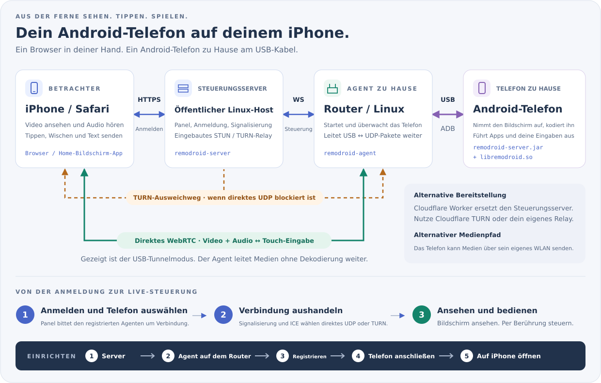

<p align="center"><a href="../../README.md">English</a> | <a href="../zh/README.md">简体中文</a> | <a href="../ja/README.md">日本語</a> | <a href="../ko/README.md">한국어</a> | <a href="../es/README.md">Español</a> | <a href="../pt-BR/README.md">Português (Brasil)</a> | <b>Deutsch</b> | <a href="../fr/README.md">Français</a> | <a href="../ru/README.md">Русский</a></p>

# RemoDroid

Steuere ein Android-Handy oder einen Windows-, Mac- oder Linux-Computer aus Safari auf dem iPhone (oder jedem Browser) mit geringer Latenz, gut genug für Cloud-Gaming.

## Was brauche ich?

**Zwei Teile: ein Panel und RemoDroid auf dem, was du steuern willst.** Das Panel ist die Webseite, auf der du dich anmeldest: Leg es auf **Cloudflare**, wenn du keinen Server hast (kostenlos, keine Maschine zu pflegen), oder auf deinen eigenen **Linux**- oder **Windows**-Server. Dann, um ein **Android-Handy** zu steuern, installiere *RemoDroid für Handys* auf dem Router (oder einem beliebigen Linux-Rechner), an dem das Handy per USB hängt; um einen **Windows-, Mac- oder Linux-Computer** zu steuern, installiere *RemoDroid für Computer* auf diesem Computer. Du schaust und steuerst aus Safari auf dem iPhone oder aus jedem Browser; dort wird nichts installiert.

**Das Panel: wähle eines.**

| Panel auf | Wähle es, wenn | Einrichtung |
|---|---|---|
| [**Cloudflare**](#panel-cloudflare) | du keinen Server hast. Cloudflare hostet die Seite und leitet das Video weiter, wenn ein Netz die direkte Verbindung blockiert (1.000 GB im Monat kostenlos). | Ein paar Minuten im Browser |
| [**Einem Linux-Server**](#panel-linux) | du einen VPS mit öffentlicher IP mietest. Wähle eine Region nah an zu Hause: Er leitet das Video bei Bedarf weiter. | Ein Befehl |
| [**Einem Windows-Server**](#panel-windows) | dasselbe, mit Windows Server 2019 oder neuer (auch Windows 10 oder 11 mit öffentlicher IP). | Entpacken und *Install and start* klicken |

**Dann, auf allem, was du steuern willst:**

| Zum Steuern | Installiere | Wo |
|---|---|---|
| Ein **Android-Handy** | [**RemoDroid für Handys**](#for-phones) | Auf dem Router (OpenWrt, ASUS Merlin oder ein beliebiger Linux-Rechner), an dem das Handy per USB hängt. Auf dem Handy wird nichts installiert. |
| Ein **Windows**-PC | [**RemoDroid für Computer**](#for-computers) | Auf diesem PC (Windows 10 1809 oder neuer) |
| Ein **Mac** | [**RemoDroid für Computer**](#for-computers) | Auf diesem Mac (macOS 13 oder neuer) |
| Ein **Linux**-PC | [**RemoDroid für Computer**](#for-computers) | Auf diesem PC (eine X11-Sitzung) |

Ein Panel bedient beliebig viele Handys und Computer. Jede Einrichtung sind dieselben drei Schritte:
[1. das Panel](#step-panel) → [2. RemoDroid auf dem, was du steuerst](#step-device) → [3. auf dem iPhone öffnen](#step-iphone).

<p align="center"><a href="https://remodroid.pages.dev/de/"></a></p>

<p align="center">Der Assistent stellt dieselben zwei Fragen und führt dich mit Kopierknöpfen bis zum Ende.</p>

## So funktioniert es

<p align="center"></p>

<p align="center"></p>

Das **Panel** liefert die Webseite, deinen Login und den Verbindungsaufbau. **RemoDroid für Handys** auf deinem Router zu Hause spricht mit eingebautem ADB (kein `adb` nötig) über USB mit dem Handy und startet dort einen kleinen Helfer. Der Helfer nimmt den Bildschirm auf, kodiert ihn in Hardware und schickt ihn per WebRTC direkt an Safari; deine Berührungen gehen denselben Weg zurück. Der Router leitet nur Pakete weiter; dazwischen wird nichts dekodiert. **RemoDroid für Computer** tut dasselbe vom Computer selbst aus: Es nimmt den Bildschirm auf, kodiert ihn auf der GPU und nimmt Maus und Tastatur entgegen.

<details>
<summary>Mehr Details: Medienwege, TURN, was auf dem Handy läuft</summary>

- **Medienweg.** Standardmäßig schickt das Handy seine Medien über das USB-Kabel, und das Programm auf dem Router gibt sie als UDP ins Netz, also braucht das Handy kein WLAN. Mit `[phone] path = wifi` in `agent.ini` nutzt das Handy sein eigenes WLAN, was schneller sein kann, wenn der Router zugleich der WLAN-Zugangspunkt ist.
- **TURN.** Wenn zwischen iPhone und Zuhause kein direkter UDP-Weg zu finden ist (Provider-NAT, strenge Firewalls), laufen die Medien über das TURN-Relay des Panels. Dekodiert werden sie auch dann nicht.
- **Auf dem Handy:** `remodroid-server.jar` (Bildschirmaufnahme, MediaCodec H.265/H.264, Eingabe-Injektion, Zwischenablage, Bildschirmstrom, Dateien) und `libremodroid.so` (ein WebRTC-Stack in C: ICE, DTLS-SRTP, SCTP-Datenkanäle, Staukontrolle). Beide laufen über `app_process` als Shell-Benutzer, es wird also nichts als App installiert. Während du verbunden bist, ist der Bildschirm des Handys aus, um Strom zu sparen, und sein Ton spielt auf deinem iPhone.
- Designnotizen und Entscheidungen: [`plan.md`](../../plan.md).

</details>

## Was du brauchst

RemoDroid ist leicht: Das Handy oder der Computer erledigt die schwere Arbeit (Aufnahme und Hardware-Kodierung), der Router leitet nur Pakete weiter und das Panel baut nur Verbindungen auf. Am wichtigsten ist die **Upload-Geschwindigkeit zu Hause**.

| | Minimum | Empfohlen | Was es nutzt |
|---|---|---|---|
| **Panel** | Ein kostenloses Cloudflare-Konto oder ein Linux-Rechner bzw. Windows Server 2019+ mit öffentlicher IP: 1 CPU, 128 MB RAM, ein paar MB Platte | Bei eigenem Server: eine kleine VM in der Cloud-Region **am nächsten zu deinem Zuhause** (sie trägt den Stream, wenn TURN nötig ist), mit genug monatlichem Traffic | Etwa 2 MB RAM und fast keine CPU. Bandbreite nur, wenn eine Sitzung auf TURN ausweicht; dann läuft der ganze Stream hindurch (etwa 4,5 GB pro Stunde bei 10 Mbit/s) |
| **Router** (für ein Handy) | OpenWrt, Linux (Debian, Ubuntu, CentOS, Alpine) oder ASUS Merlin mit Koolshare, ein USB-Port und etwa 2 MB freier Speicher. CPU: x86, ARM oder MIPS | Ein ARM- (aarch64, ARMv7) oder x86-Router. Ein schwacher MIPS-Router geht, schafft aber vielleicht nicht die höchsten Bitraten | Etwa 2 MB RAM. CPU nur, um Pakete zwischen USB und UDP zu verschieben; nichts wird dekodiert |
| **Android-Handy** | Android 8 oder neuer, USB-Debugging, ein H.264-Hardware-Encoder | Android 12 oder neuer (für Ton) mit H.265-Hardware-Encoder | Sein eigener Hardware-Encoder; der Bildschirm ist aus, solange du verbunden bist |
| **Computer** | Windows 10 1809+, macOS 13+ oder Linux mit X11-Sitzung | Ein GPU-Encoder (jeder aktuelle Chip von Intel, AMD, NVIDIA oder Apple) | Sein GPU-Encoder; ohne ihn Software-H.264 mit 30 fps |
| **iPhone** | Safari | Ein aktuelles iOS, für H.265 über WebRTC (ältere iOS-Versionen bekommen automatisch H.264) | Hardware-Videodekodierung |
| **Netz** | 3–5 Mbit/s Upload zu Hause (720p) | 10–20 Mbit/s Upload zu Hause und derselbe Download auf dem iPhone (1080p, 60 fps) | 1–20 Mbit/s pro Stream (Standardgrenze 20 Mbit/s, 60 fps); die Qualität passt sich selbst an |

Die erwartete Verzögerung beträgt 40–80 ms, wenn das iPhone dein Zuhause direkt erreicht, und etwa 70–120 ms über TURN. Die Speicherzahlen stammen von einem laufenden Server und einem RT-AC86U-Router.

## Installation

<a name="step-panel"></a>

### 1. Das Panel

Wähle einen Ort dafür: Cloudflare, einen Linux-Server oder einen Windows-Server. Du kannst später umziehen; Router und Computer werden dann dem neuen Panel neu hinzugefügt.

<a name="panel-cloudflare"></a>

#### Auf Cloudflare (ohne Server)

1. **Einen TURN-Schlüssel anlegen** (er leitet das Video weiter, wenn ein Netz die direkte Verbindung blockiert). Im [Cloudflare-Dashboard](https://dash.cloudflare.com/): **Realtime → TURN Server → Create**. Bewahre **Turn Token ID** und **API Token** auf; kopiere den API Token sofort.
2. **Das Panel bereitstellen.** Forke dieses Repository, dann im Dashboard **Workers & Pages → Create → Import a repository**, wähle deinen Fork und setze das Stammverzeichnis auf `worker`. Danach aktualisiert jeder Push in deinen Fork das Panel von selbst. Oder von einem Computer aus: `cd worker && npm install && npx wrangler deploy`.
3. **Sofort öffnen und die Einrichtung abschließen**, unter `https://remodroid.<du>.workers.dev`: Bis du das tust, legt der erste Besucher den Login fest. Sicherer: gib dem Worker zuerst ein Secret `SETUP_TOKEN` (Settings → Variables and Secrets → Add, Typ *Secret*; eine normale Variable geht bei der nächsten Bereitstellung verloren); die Einrichtungsseite fragt dann danach. Die Einrichtungsseite fragt nach deinem Login und dem TURN-Schlüssel.

In keiner Firewall ist etwas zu öffnen: Cloudflare übernimmt das Weiterleiten. Der Tab **Server** im Panel ändert Login und TURN-Schlüssel später.

<a name="panel-linux"></a>

#### Auf einem Linux-Server

```sh
curl -fsSL https://remodroid.pages.dev/install_server.sh | sudo sh
```

Er wählt das passende Paket, installiert es, startet das Panel und gibt einen Link wie `http://<ip>:5580/wizard.html?token=…` aus. Öffne ihn und trage den Web-Port, deine **Domain** (für automatisches HTTPS von Let's Encrypt), den Admin-Login und den STUN/TURN-Port ein. Das Panel startet auf deinen Ports neu und ist bereit.

Öffne diese Ports in der Firewall: **TCP 5580** (nur zur Einrichtung), deinen Web-Port (**80**) und **443**, wenn du eine Domain nutzt, **UDP 3478** und **UDP 49152–49252** (TURN).

Um ein Paket von Hand zu installieren, nimm es aus der Tabelle unten, dann:

```sh
sudo apt install ./remodroid-server_*.deb                  # Debian, Ubuntu
sudo dnf install ./remodroid-server-*.rpm                  # CentOS, Fedora
sudo apk add --allow-untrusted ./remodroid-server_*.apk    # Alpine

sudo systemctl enable --now remodroid-server               # systemd
rc-update add remodroid-server && rc-service remodroid-server start            # Alpine
```

Dann öffne `http://<server>:5580/wizard.html?token=…`. Das Token steht in `/var/lib/remodroid/setup-token`.

<a name="panel-windows"></a>

#### Auf einem Windows-Server

Windows Server 2019 oder neuer; Windows 10 und 11 gehen auch. Lade das Windows-`.zip` unten herunter, entpacke es in einen Ordner, in dem es bleiben kann, starte **RemoDroidServer.exe** und wähle **Install and start**. Es betreibt das Panel als Windows-Dienst, der mit Windows startet, ob jemand angemeldet ist oder nicht, und gibt es in der Windows-Firewall frei. Dasselbe Fenster legt Administrator, Web-Port, HTTPS-Domain und STUN/TURN fest, startet und stoppt das Panel und zeigt sein Log; sein Symbol bleibt neben der Uhr. Stattdessen in der Eingabeaufforderung: `remodroid-server install` (als Administrator). Öffne in der Firewall deines Cloud-Anbieters dieselben Ports wie unter Linux.

<!-- downloads:server -->
#### Das Panel für einen Linux- oder Windows-Server herunterladen (v0.6.3)

Wähle die Zeile nach der CPU des Servers (`uname -m`: `x86_64`, `aarch64` = ARM64, `armv7l` = ARMv7, `i686` = x86) und die Spalte nach seinem System. *Beliebiges Linux* enthält das Panel und RemoDroid für Handys.

| Panel | Debian · Ubuntu | CentOS · Fedora | Alpine | Beliebiges Linux |
|:--|:-:|:-:|:-:|:-:|
| **x86_64**<br><sub>Intel / AMD 64-Bit</sub> | [](https://github.com/yinyue123/RemoDroid/releases/download/v0.6.3/remodroid-server_0.6.3-1_amd64.deb) | [](https://github.com/yinyue123/RemoDroid/releases/download/v0.6.3/remodroid-server-0.6.3-1.x86_64.rpm) | [](https://github.com/yinyue123/RemoDroid/releases/download/v0.6.3/remodroid-server_0.6.3-r1_x86_64.apk) | [](https://github.com/yinyue123/RemoDroid/releases/download/v0.6.3/remodroid-0.6.3-linux-x86_64.tar.gz) |
| **ARM64**<br><sub>aarch64</sub> | [](https://github.com/yinyue123/RemoDroid/releases/download/v0.6.3/remodroid-server_0.6.3-1_arm64.deb) | [](https://github.com/yinyue123/RemoDroid/releases/download/v0.6.3/remodroid-server-0.6.3-1.aarch64.rpm) | [](https://github.com/yinyue123/RemoDroid/releases/download/v0.6.3/remodroid-server_0.6.3-r1_aarch64.apk) | [](https://github.com/yinyue123/RemoDroid/releases/download/v0.6.3/remodroid-0.6.3-linux-aarch64.tar.gz) |
| **ARMv7**<br><sub>32-Bit-ARM</sub> | [](https://github.com/yinyue123/RemoDroid/releases/download/v0.6.3/remodroid-server_0.6.3-1_armhf.deb) | [](https://github.com/yinyue123/RemoDroid/releases/download/v0.6.3/remodroid-server-0.6.3-1.armv7hl.rpm) | [](https://github.com/yinyue123/RemoDroid/releases/download/v0.6.3/remodroid-server_0.6.3-r1_armv7.apk) | [](https://github.com/yinyue123/RemoDroid/releases/download/v0.6.3/remodroid-0.6.3-linux-armv7.tar.gz) |
| **x86**<br><sub>32-Bit</sub> | [](https://github.com/yinyue123/RemoDroid/releases/download/v0.6.3/remodroid-server_0.6.3-1_i386.deb) | [](https://github.com/yinyue123/RemoDroid/releases/download/v0.6.3/remodroid-server-0.6.3-1.i686.rpm) | [](https://github.com/yinyue123/RemoDroid/releases/download/v0.6.3/remodroid-server_0.6.3-r1_x86.apk) | [](https://github.com/yinyue123/RemoDroid/releases/download/v0.6.3/remodroid-0.6.3-linux-x86.tar.gz) |

Windows-Server: entpacken, **RemoDroidServer.exe** starten und *Install and start* wählen; dasselbe Fenster legt Administrator, Web-Port, HTTPS-Domain und STUN/TURN fest und zeigt das Log.

| Panel | **x86_64**<br><sub>Intel / AMD</sub> | **ARM64**<br><sub>Graviton, Snapdragon…</sub> |
|:--|:-:|:-:|
| **Windows** Server 2019+, 10 1809+, 11 | [](https://github.com/yinyue123/RemoDroid/releases/download/v0.6.3/RemoDroid-Server-0.6.3-windows-x86_64.zip) | [](https://github.com/yinyue123/RemoDroid/releases/download/v0.6.3/RemoDroid-Server-0.6.3-windows-arm64.zip) |

Prüfsummen: [SHA256SUMS](https://github.com/yinyue123/RemoDroid/releases/download/v0.6.3/SHA256SUMS)
<!-- /downloads:server -->

<details>
<summary>Beliebiges Linux (.tar.gz) von Hand</summary>

Das Tarball enthält `bin/`, `web/`, `phone/` und `etc/` (Beispiel-ini-Dateien und Dienst-Units). Für das Panel:

```sh
sudo install -m 0755 bin/remodroid-server /usr/bin/
sudo mkdir -p /usr/share/remodroid /etc/remodroid
sudo cp -r web /usr/share/remodroid/web
sudo install -m 0640 etc/server.ini.example /etc/remodroid/server.ini
remodroid-server -c /etc/remodroid/server.ini
```

`etc/remodroid-server.service` ist eine systemd-Unit, die du nach `/etc/systemd/system/` kopieren kannst.

</details>

<details>
<summary>Panel-Einstellungen nach der Einrichtung</summary>

Der Assistent schreibt `/etc/remodroid/server.ini` (Windows: `%ProgramData%\RemoDroid\server.ini`). Danach ändert dieselbe Seite hinter dem Login die Einstellungen, und der Tab **Server** im Panel ändert eine Einstellung nach der anderen (Domain, Ports, Login, STUN/TURN-Liste). `remodroid-server -t` prüft die Datei, ohne etwas zu starten. HTTPS-Zertifikate erneuern sich selbst. Pakete behalten deine `server.ini` beim Upgrade.

</details>

<a name="step-device"></a>

### 2. RemoDroid auf dem, was du steuerst

<a name="for-phones"></a>

#### Ein Android-Handy: RemoDroid für Handys

Es kommt auf den Router, an den das Handy gesteckt wird (oder einen beliebigen Linux-Rechner mit USB-Port), nicht auf das Handy.

OpenWrt, Alpine:

```sh
wget -qO- https://remodroid.pages.dev/install_agent.sh | sh
```

Debian, Ubuntu, CentOS, Fedora:

```sh
curl -fsSL https://remodroid.pages.dev/install_agent.sh | sudo sh
```

ASUS Merlin mit Koolshare: nimm das Merlin-Paket unten und siehe *ASUS Merlin / Koolshare* weiter unten.

<!-- downloads:agent -->
#### RemoDroid für Handys herunterladen (v0.6.3)

Wähle die Zeile nach der CPU des Geräts (`uname -m`: `x86_64`, `aarch64` = ARM64, `armv7l` = ARMv7, `i686` = x86) und die Spalte nach seinem System. OpenWrt: nimm den Build, den `opkg print-architecture` nennt. *Beliebiges Linux* enthält RemoDroid für Handys und das Panel (auf MIPS nur RemoDroid für Handys).

| Für Handys | Debian · Ubuntu | CentOS · Fedora | Alpine | OpenWrt | Beliebiges Linux |
|:--|:-:|:-:|:-:|:-:|:-:|
| **x86_64**<br><sub>Intel / AMD 64-Bit</sub> | [](https://github.com/yinyue123/RemoDroid/releases/download/v0.6.3/remodroid-agent_0.6.3-1_amd64.deb) | [](https://github.com/yinyue123/RemoDroid/releases/download/v0.6.3/remodroid-agent-0.6.3-1.x86_64.rpm) | [](https://github.com/yinyue123/RemoDroid/releases/download/v0.6.3/remodroid-agent_0.6.3-r1_x86_64.apk) | [](https://github.com/yinyue123/RemoDroid/releases/download/v0.6.3/remodroid-agent_0.6.3-1_x86_64.ipk) | [](https://github.com/yinyue123/RemoDroid/releases/download/v0.6.3/remodroid-0.6.3-linux-x86_64.tar.gz) |
| **ARM64**<br><sub>aarch64</sub> | [](https://github.com/yinyue123/RemoDroid/releases/download/v0.6.3/remodroid-agent_0.6.3-1_arm64.deb) | [](https://github.com/yinyue123/RemoDroid/releases/download/v0.6.3/remodroid-agent-0.6.3-1.aarch64.rpm) | [](https://github.com/yinyue123/RemoDroid/releases/download/v0.6.3/remodroid-agent_0.6.3-r1_aarch64.apk) | [](https://github.com/yinyue123/RemoDroid/releases/download/v0.6.3/remodroid-agent_0.6.3-1_aarch64_generic.ipk)<br>[](https://github.com/yinyue123/RemoDroid/releases/download/v0.6.3/remodroid-agent_0.6.3-1_aarch64_cortex-a53.ipk)<br>[](https://github.com/yinyue123/RemoDroid/releases/download/v0.6.3/remodroid-agent_0.6.3-1_aarch64_cortex-a72.ipk) | [](https://github.com/yinyue123/RemoDroid/releases/download/v0.6.3/remodroid-0.6.3-linux-aarch64.tar.gz) |
| **ARMv7**<br><sub>32-Bit-ARM</sub> | [](https://github.com/yinyue123/RemoDroid/releases/download/v0.6.3/remodroid-agent_0.6.3-1_armhf.deb) | [](https://github.com/yinyue123/RemoDroid/releases/download/v0.6.3/remodroid-agent-0.6.3-1.armv7hl.rpm) | [](https://github.com/yinyue123/RemoDroid/releases/download/v0.6.3/remodroid-agent_0.6.3-r1_armv7.apk) | [](https://github.com/yinyue123/RemoDroid/releases/download/v0.6.3/remodroid-agent_0.6.3-1_arm_cortex-a7_neon-vfpv4.ipk)<br>[](https://github.com/yinyue123/RemoDroid/releases/download/v0.6.3/remodroid-agent_0.6.3-1_arm_cortex-a9_vfpv3-d16.ipk)<br>[](https://github.com/yinyue123/RemoDroid/releases/download/v0.6.3/remodroid-agent_0.6.3-1_arm_cortex-a15_neon-vfpv4.ipk) | [](https://github.com/yinyue123/RemoDroid/releases/download/v0.6.3/remodroid-0.6.3-linux-armv7.tar.gz) |
| **x86**<br><sub>32-Bit</sub> | [](https://github.com/yinyue123/RemoDroid/releases/download/v0.6.3/remodroid-agent_0.6.3-1_i386.deb) | [](https://github.com/yinyue123/RemoDroid/releases/download/v0.6.3/remodroid-agent-0.6.3-1.i686.rpm) | [](https://github.com/yinyue123/RemoDroid/releases/download/v0.6.3/remodroid-agent_0.6.3-r1_x86.apk) | [](https://github.com/yinyue123/RemoDroid/releases/download/v0.6.3/remodroid-agent_0.6.3-1_i386_pentium4.ipk) | [](https://github.com/yinyue123/RemoDroid/releases/download/v0.6.3/remodroid-0.6.3-linux-x86.tar.gz) |
| **MIPS LE**<br><sub>mipsel</sub> | — | — | — | [](https://github.com/yinyue123/RemoDroid/releases/download/v0.6.3/remodroid-agent_0.6.3-1_mipsel_24kc.ipk) | [](https://github.com/yinyue123/RemoDroid/releases/download/v0.6.3/remodroid-0.6.3-linux-mipsel.tar.gz) |
| **MIPS BE**<br><sub>mips</sub> | — | — | — | [](https://github.com/yinyue123/RemoDroid/releases/download/v0.6.3/remodroid-agent_0.6.3-1_mips_24kc.ipk) | [](https://github.com/yinyue123/RemoDroid/releases/download/v0.6.3/remodroid-0.6.3-linux-mips.tar.gz) |

Koolshare-/KoolCenter-Offline-Installer: [Merlin armv7](https://github.com/yinyue123/RemoDroid/releases/download/v0.6.3/remodroid-0.6.3-merlin-armv7.tar.gz) · [Merlin aarch64](https://github.com/yinyue123/RemoDroid/releases/download/v0.6.3/remodroid-0.6.3-merlin-aarch64.tar.gz). RT-AC86U und RT-AX88U: aarch64 wählen. Sie enthalten nur RemoDroid für Handys, als Router-Plugins (keine OpenWrt-Pakete).

Prüfsummen: [SHA256SUMS](https://github.com/yinyue123/RemoDroid/releases/download/v0.6.3/SHA256SUMS)
<!-- /downloads:agent -->

**Welche OpenWrt-Datei?** Such deinen Router und seine CPU in [openwrt.md](openwrt.md), wo auch die OpenWrt-Versionen stehen, die funktionieren.

**OpenWrt mit LuCI, ohne Kommandozeile:** Öffne in LuCI **System → Software → Paket hochladen…**, wähle das `.ipk` für deinen Router und installiere es. Eine Seite **Dienste → RemoDroid** erscheint: Sie fügt den Router deinem Panel hinzu (nächster Schritt), startet und stoppt das Programm und zeigt, ob Panel und Handy verbunden sind.

Auf anderen Systemen installiere das Paket und starte den Dienst:

```sh
opkg install ./remodroid-agent_*.ipk                       # OpenWrt
sudo apt install ./remodroid-agent_*.deb                   # Debian, Ubuntu
sudo dnf install ./remodroid-agent-*.rpm                   # CentOS, Fedora
sudo apk add --allow-untrusted ./remodroid-agent_*.apk     # Alpine

/etc/init.d/remodroid-agent enable && /etc/init.d/remodroid-agent start        # OpenWrt
sudo systemctl enable --now remodroid-agent                # systemd
rc-update add remodroid-agent && rc-service remodroid-agent start              # Alpine
```

<details>
<summary>Beliebiges Linux (.tar.gz) von Hand</summary>

Aus dem entpackten Tarball:

```sh
sudo install -m 0755 bin/remodroid-agent /usr/bin/
sudo ln -s remodroid-agent /usr/bin/remodroid
sudo mkdir -p /usr/share/remodroid /etc/remodroid
sudo cp -r phone/. /usr/share/remodroid/
sudo install -m 0600 etc/agent.ini.example /etc/remodroid/agent.ini
remodroid-agent -c /etc/remodroid/agent.ini
```

`etc/remodroid-agent.service` (systemd) und `etc/remodroid-agent.init` (OpenWrt-procd) starten es beim Booten.

</details>

<details>
<summary>ASUS Merlin / Koolshare</summary>

Nimm das Merlin-Paket oben, das zur CPU deines Routers passt (`uname -m`):

- `remodroid-<version>-merlin-aarch64.tar.gz` für `aarch64`: 64-Bit-HND-Modelle wie RT-AC86U und RT-AX88U
- `remodroid-<version>-merlin-armv7.tar.gz` für `armv7l`: 32-Bit-ARM-Modelle wie RT-AC68U

Installiere es unter **Software Center → Manual installation**. Der Installer lehnt ein Paket für die falsche CPU ab. Er fügt eine Router-Seite für Einstellungen, Start/Stopp, Logs und optionalen Autostart hinzu. Die Installation startet das Programm nicht. Ein reines Asuswrt-Merlin ohne das Software Center von Koolshare/KoolCenter wird nicht unterstützt. Bauen, Migration und Grenzen: [Merlin-Paket](../../packaging/merlin/README.md).

</details>

**Den Router zum Panel hinzufügen.** Öffne im Panel **Agenten → Hinzufügen**. Es zeigt einen Befehl mit einem Einmalcode; führe ihn auf dem Router aus:

```sh
remodroid enroll --panel https://your.panel --code X5SX-K3M7
```

Unter OpenWrt kannst du denselben Befehl stattdessen in LuCI unter **Dienste → RemoDroid → Koppeln** einfügen. Der Code gilt einmal, 10 Minuten lang. Danach zeigt sich der Router online; tippe ihn an, um seine Einstellungen zu ändern.

**Das Handy anschließen.** Schalte auf dem Handy **Entwickleroptionen → USB-Debugging** ein. Steck es in den USB-Port des Routers und tippe bei „USB-Debugging zulassen?“ auf **Zulassen** (mit Haken bei „Immer zulassen“). Das ist das einzige Mal, dass du das Handy anfasst.

<a name="for-computers"></a>

#### Ein Computer: RemoDroid für Computer

Ein Computer braucht keinen Router: Installiere **RemoDroid** darauf, starte es und füge es über das Symbol im Tray (oder in der Menüleiste) dem Panel hinzu, indem du die Zeile einfügst, die das Panel unter **Agenten → Hinzufügen → Computer** zeigt. Es läuft als angemeldeter Benutzer, zeigt eine Benachrichtigung, sobald sich jemand verbindet, und sein Symbol wird rot, solange zugeschaut wird (**Disconnect viewer** ist einen Klick entfernt). Der Zuschauer hört, was der Computer abspielt (der Schalter **Sound**, oder `desktop.audio = false`, um es nie zu senden), und **Show log** im Menü des Symbols öffnet ein Live-Log-Fenster. Windows 10 1809+ und macOS 13+; Linux braucht eine X11-Sitzung (unter GNOME: „GNOME on Xorg“). Das Bild wird auf der GPU kodiert, wo es eine gibt (Media Foundation, VideoToolbox und VA-API unter Linux mit AMD- oder Intel-GPU, auch auf einem Steam Deck: H.265 oder H.264 mit bis zu 60 fps); sonst in Software (H.264, 30 fps).

<!-- downloads:desktop -->
#### RemoDroid für Computer herunterladen (v0.6.3)

Auf dem Computer installieren, den du steuern willst, dann mit der Zeile aus dem Panel koppeln (Agenten → Hinzufügen → Computer). Die macOS-Version läuft auf Macs mit Apple Silicon und Intel.

| Computer | **x86_64**<br><sub>Intel / AMD</sub> | **ARM64**<br><sub>Apple Silicon, Snapdragon…</sub> |
|:--|:-:|:-:|
| **Windows** 10 1809+, 11 | [](https://github.com/yinyue123/RemoDroid/releases/download/v0.6.3/RemoDroid-Computer-0.6.3-windows-x86_64.zip) | [](https://github.com/yinyue123/RemoDroid/releases/download/v0.6.3/RemoDroid-Computer-0.6.3-windows-arm64.zip) |
| **macOS** 13+ | [](https://github.com/yinyue123/RemoDroid/releases/download/v0.6.3/RemoDroid-Computer-0.6.3-macos.zip) | [](https://github.com/yinyue123/RemoDroid/releases/download/v0.6.3/RemoDroid-Computer-0.6.3-macos.zip) |
| **Linux** (X11-Sitzung) | [](https://github.com/yinyue123/RemoDroid/releases/download/v0.6.3/remodroid-desktop_0.6.3-1_amd64.deb)<br>[](https://github.com/yinyue123/RemoDroid/releases/download/v0.6.3/remodroid-desktop-0.6.3-1.x86_64.rpm)<br>[](https://github.com/yinyue123/RemoDroid/releases/download/v0.6.3/remodroid-desktop-0.6.3-linux-x86_64.tar.gz)<br>[](https://github.com/yinyue123/RemoDroid/releases/download/v0.6.3/RemoDroid-Computer-0.6.3-linux-x86_64.AppImage) | [](https://github.com/yinyue123/RemoDroid/releases/download/v0.6.3/remodroid-desktop_0.6.3-1_arm64.deb)<br>[](https://github.com/yinyue123/RemoDroid/releases/download/v0.6.3/remodroid-desktop-0.6.3-1.aarch64.rpm)<br>[](https://github.com/yinyue123/RemoDroid/releases/download/v0.6.3/remodroid-desktop-0.6.3-linux-aarch64.tar.gz)<br>[](https://github.com/yinyue123/RemoDroid/releases/download/v0.6.3/RemoDroid-Computer-0.6.3-linux-aarch64.AppImage) |

Prüfsummen: [SHA256SUMS](https://github.com/yinyue123/RemoDroid/releases/download/v0.6.3/SHA256SUMS)
<!-- /downloads:desktop -->

- **Windows**: entpacken und `RemoDroid.exe` starten. Um auch Fenster von Programmen zu steuern, die als Administrator laufen (Installer, Task-Manager, die Windows-App des Panels selbst), wähle einmal **Control administrator windows…** in seinem Menü und bestätige als Administrator: Es richtet den kleinen Dienst `RemoDroidInput` ein, der ihnen Maus und Tastatur des Zuschauers weiterreicht (`remodroid-input install` / `uninstall` tut dasselbe). UAC-Abfragen bleiben außer Reichweite. **macOS**: `RemoDroid.app` in Programme ziehen, öffnen (beim ersten Mal: Rechtsklick → Öffnen) und **Bildschirmaufnahme** und **Bedienungshilfen** erlauben, wenn es fragt. **Linux**: das `.deb` / `.rpm` installieren und *RemoDroid* aus dem App-Menü starten. Auf anderen Distributionen das `.AppImage` nehmen: `chmod +x` und starten (`./RemoDroid-*.AppImage desktopd …` ist der Agent ohne Oberfläche). Es nutzt die GTK-3- und X11-Bibliotheken des Systems, die jeder Desktop schon hat.
- **Dateien und Zwischenablage wie AirDrop**: Lass Dateien auf den Viewer fallen, und sie landen in `Downloads/RemoDroid` auf dem Computer; lass Dateien auf das RemoDroid-Fenster auf dem Computer fallen (Tray / Menüleiste → *Pairing & status…*), und der Browser des Zuschauers lädt sie herunter. Kopierter Text wird in Chrome und Edge von selbst in beide Richtungen abgeglichen; Safari und Firefox zeigen stattdessen einen Kopieren-Knopf.
- Kein Bildschirm oder kein Tray? Führe dieselbe Zeile im Terminal aus (`remodroid-desktopd pair --panel … --code …`), dann `remodroid-desktopd` (die Linux-Pakete bringen eine systemd-User-Unit mit).
- Die Einstellungen liegen in `desktop.ini` (`%APPDATA%\RemoDroid`, `~/Library/Application Support/RemoDroid`, `~/.config/remodroid`) und im Panel. Design: [`multi-platform.md`](../../multi-platform.md).

<a name="step-iphone"></a>

### 3. Auf dem iPhone öffnen

Öffne dein Panel in Safari, melde dich an, dann **Teilen → Zum Home-Bildschirm**. Vom Home-Bildschirm gestartet läuft es im Vollbild (Safari kann seine Leisten bei einer normalen Seite nicht ausblenden). Tippe auf dein Handy oder deinen Computer, um dich zu verbinden.

## Benutzung

- **Berührungen** funktionieren wie auf dem Handy, Multitouch inklusive. Die **schwebende Kugel** öffnet das Menü: Sperren, neu verbinden, Vollbild, Ton, Foto-Upload, Zwischenablage und Einstellungen.
- **Auf einem Computer** gehen Maus und Tastatur direkt durch (die Tasten sind physisch, also gilt das Layout des Computers; ⌘ und Ctrl tauschen, wenn nur eine Seite ein Mac ist). Auf einem iPhone ist der untere Teil des Bildschirms ein **Trackpad** wie beim Mac: Der Zeiger bewegt sich über ein vergrößertes Bild, damit der Text des Computers lesbar ist, und das Bild scrollt, wenn der Zeiger auf 10 % an den Rand kommt, bis zum Rand des Bildschirms selbst. Tippen klickt, zweimal tippen doppelklickt, tippen und ziehen zieht, Tippen mit zwei Fingern ist ein Rechtsklick, mit zwei Fingern scrollen, spreizen zoomt; **⤢** zeigt den ganzen Bildschirm. Trackpad und Tastatur sind ein Panel in einer Größe: **⌨** in der rechten Ecke seines Kopfs macht daraus die Tastatur, an derselben Stelle **▭** wieder das Trackpad; **⌄** klappt es zu einem Knopf zusammen, Ziehen am Kopf ändert die Größe, und **⚙** stellt die Geschwindigkeit ein. Auf einem iPad oder Desktop schwebt das Panel als Karte, die du am Kopf ziehst ([`trackpad.md`](../../trackpad.md)). Der Menüpunkt **Trackpad** schaltet es auf jedem Gerät ein oder aus, auch im Desktop-Browser (dort ist die Maus ein Finger auf dem Pad: Klicken klickt am Zeiger, Drücken und Bewegen bewegt ihn, das Rad scrollt, Ctrl + Rad zoomt). Ausgeschaltet tippt **Direct** dort, wo du berührst (lange drücken für Rechtsklick), Standard auf einem iPad und mit Maus. Dort öffnet **Keyboard** eine schwebende Bildschirmtastatur (am Griff ziehen; **ctrl** und dann **c** antippen für Ctrl+C), ihr **⋯** sendet Text und Tastenkürzel, und **Next screen** wechselt den Monitor.
- **Spiele auf einem Computer** (Linux, z. B. ein Steam Deck im Desktop-Modus): **Gamepad** legt Touch-Steuerung über das Bild, angeordnet wie bei Steam Link (Sticks, Steuerkreuz, A/B/X/Y, Schultertasten, Trigger); halte das Handy quer. Zieh einen Finger über das Bild (abseits der Knöpfe), um die Kamera zu drehen, wie in PUBG: Die Geschwindigkeit der Wischbewegung neigt den rechten Stick nach oben, unten und zur Seite. **⚙ → Edit layout** verschiebt jedes Bedienelement und macht es kleiner oder größer; jedes Layout behält seine eigene Anordnung. Sein **⚙** wählt ein Layout (Steam Link, Simple, Shooter, Racing), zoomt das Bild (**Fill screen** schneidet die Ränder ab; die Schieberegler verschieben es), stellt die Wischgeschwindigkeit ein (oder schaltet sie ab, damit Tippen aufs Bild wieder klickt) und wie durchscheinend die Knöpfe sind. Mit dem iPhone oder iPad gekoppelte Controller (Joy-Con, DualSense, Xbox) gehen auch; Safari stellt sie nur auf einer HTTPS-Seite bereit. Jeder wird auf dem Computer zu einem virtuellen Xbox-360-Pad, wofür ein beschreibbares `/dev/uinput` nötig ist: SteamOS hat es, anderswo installiere die udev-Regeln von Steam (`steam-devices`).
- Der **Ton** kommt vom Handy (Android 12+), und sein eigener Lautsprecher bleibt still, solange du verbunden bist. Tippe einmal aufs Bild, um ihn in Safari einzuschalten; der Schalter **Sound** im Menü gibt ihn ans Handy zurück.
- **Aktualisiere** Server oder Router später mit einem Befehl. Er bringt die installierten Teile auf die neueste Version, behält `server.ini` / `agent.ini` und startet sie neu:

  ```sh
  curl -fsSL https://remodroid.pages.dev/update.sh | sudo sh    # OpenWrt: wget -qO- … | sh
  ```

<details>
<summary>Router-Befehle</summary>

Auf dem Router sprechen diese mit dem laufenden Programm (kein adb nötig):

```sh
remodroid-agent devices | status | shell … | push | pull | logcat | key | restart-server
```

</details>

## Extras

<details>
<summary><b>KI-Steuerung</b>: eine KI den Bildschirm lesen und für dich tippen lassen</summary>

Die KI bedient das Handy über REST unter `/api/v1/devices/{id}/`:

- `GET …/ui` liefert den Bildschirm als JSON (aus einer UiAutomation im Prozess auf dem Handy; `uiautomator dump` als Rückfall).
- `GET …/screenshot?format=jpeg&max_edge=1280` liefert das Bild (auf der GPU skaliert, auf dem Handy in C komprimiert, nie auf die Platte geschrieben).
- `POST …/actions` tippt, schreibt, scrollt und wartet per Selektor.

Das Programm auf dem Router stellt es bereit (`[api] listen` + `token` in `agent.ini`), der Server reicht es weiter (`remodroid-server gentoken NAME`). Einen Ablauf, den die KI einmal herausfindet, speichert sie unter `skills/`, und Python spielt ihn ohne Modellaufrufe ab; trifft er auf etwas Neues, gibt er den Bildschirm an die KI zurück.

```sh
export PYTHONPATH=python RD_URL=http://192.168.1.1:8790 RD_TOKEN=…
python3 -m remodroid ui                      # the screen as an outline
python3 -m remodroid tap --rid search --wait-change
python3 skills/settings-search/run.py --query wifi
```

Design: [skill-plan.md](../../skill-plan.md). Skills schreiben: [skills/README.md](../../skills/README.md).

</details>

<details>
<summary><b>MCP</b>: Handys und Computer aus Claude, ChatGPT und anderen KI-Assistenten benutzen</summary>

Jedes Handy hat einen MCP-Endpunkt, `https://<panel>/mcp/<benutzer>/<gerät>`, mit Werkzeugen zum Lesen des Bildschirms (`get_ui`, `screenshot`) und zum Bedienen (`wake_phone`, `tap`, `type_text`, `swipe`, `scroll`, `press_key`, `launch_app`, `wait_for`); `wake_phone` findet den Weg am Sperrbildschirm vorbei, und `swipe` kann ein Muster in einem Zug zeichnen. Computer (Windows, macOS, Linux) haben eigene Endpunkte und Werkzeuge: `screenshot`, `click`, `move_mouse`, `drag`, `scroll`, `type_text` und `press_key`. Die Person am Computer erfährt, wenn ein Assistent loslegt, und einen nur ansehbaren Computer kann man nur anschauen. claude.ai und ChatGPT melden sich per OAuth an (du tippst auf einer RemoDroid-Seite auf Erlauben); Claude Code, Claude Desktop, Codex sowie die APIs von Claude und OpenAI nutzen ein API-Token aus dem Panel (Server → API-Tokens). Jedes Token lässt sich dort widerrufen, und eines ohne den Bereich `control` kann nur schauen.

Der Agenten-Tab im Panel verlinkt auf die Anleitung unter `/mcp/help`, die die URLs deiner Handys zeigt, ein Token erstellt und die Einrichtung für jeden Assistenten nennt. Funktioniert mit remodroid-server und dem Worker. Design: [mcp.md](../../mcp.md).

</details>

<details>
<summary><b>Handy-Benachrichtigungen</b>: die Benachrichtigungen des Handys auf dem iPhone oder über Bark bekommen</summary>

Der Helfer auf dem Handy fragt `dumpsys notification` ab (den einzigen Benachrichtigungsinhalt, den der Shell-Benutzer sieht), verwirft laufende und unwichtige und schickt jede neue über den Viewer-WebSocket an verbundene Clients, und an [Bark](https://github.com/Finb/Bark), wenn der Server eine `bark_url` hat. Von dort kannst du die KI-Steuerungs-API (oder einen Skill) aufrufen, um darauf zu reagieren.

- Router, `agent.ini`: `[notify] enabled = true`, dazu `min_importance` und eine `ignore`-Liste.
- Server, `server.ini`: `[notify] bark_url = https://api.day.app/<key>` (oder pro Router unter `[device_notify]`). Der Bark-Schlüssel bleibt auf dem Server und wird nie geloggt. Die Zustellung per WebSocket braucht keine Server-Einstellung.

Beispielkonfigurationen liegen in `deploy/`.

</details>

## Stand

Alle Tests in der Tabelle unten laufen durch, auch mit echtem Chrome als Viewer, und der Ton wurde auf einem Sony SO-51A (Android 12) geprüft. Noch nicht auf echter Hardware geprüft (Plan-Meilenstein M0): der Java-Server auf einer Reihe von Handys (Aufnahme, Encoder-Einstellungen, Eingabe, Zwischenablage, Bildschirmstrom), USB-ADB auf Routern, Safari-Besonderheiten (H.265-Unterstützung, Hardware-Dekodierung) und die Staukontrolle in echten Netzen.

## Entwicklung

<details>
<summary>Was in diesem Repository steckt</summary>

| Pfad | Was | Sprache |
|---|---|---|
| `server/` | Steuerserver (das Panel): Login-Seite + Cookies (Basic-Auth für Router), REST-API, Viewer-/Geräte-WebSockets, eingebautes TURN-Relay, optional HTTPS mit automatischen Let's-Encrypt-Zertifikaten (ACME); unter Windows ein Dienst (`win.c`) und eine Tray-App mit Einstellungsfenster (`win/`) | C + libev + mbedTLS |
| `agent/` | RemoDroid für Handys (auf dem Router): eingebauter ADB-Client (usbfs), Handy-Überwachung, UDP-Relay, WebSocket-Client, CLI | C + libev |
| `rtc/` | Der WebRTC-Stack, den Handy und Computer teilen: ICE + TURN-Client, DTLS-SRTP, SCTP-Datenkanäle, H.265/H.264-RTP, Staukontrolle; `host.c` betreibt ihn in einem eigenen Thread hinter einer C-Schnittstelle (`rd_rtc.h`) | C |
| `desktop/` | RemoDroid für Computer: `core/` (Sitzung, Eingabe, Dateien, Video-Pipeline, Serververbindung), Backends `win/`, `mac/`, `linux/` und `app/` (Tray-/Menüleisten-Apps, `remodroid-desktopd` ohne Oberfläche); gebaut als `libremodroid` (.dll / .dylib / .so) | C, Objective-C |
| `android/java/` | Handy-Server: Bildschirmaufnahme, MediaCodec, Eingabe-Injektion, Zwischenablage, Bildschirmstrom, Dateien, logcat | Java (app_process) |
| `web/` | iPhone-Client (PWA): Video, Ton, Multitouch, Menü der schwebenden Kugel, Foto-Upload, Zwischenablage, alle Einstellungen; `panel.html` (Tabs Geräte, Agenten, Server) und `wizard.html` (Ersteinrichtung) | HTML/CSS/JS |
| `worker/` | Dasselbe Panel auf Cloudflare Workers + einem Durable Object, mit Cloudflare TURN | JS |
| `wizard/` | Die Installationsseite (Cloudflare Pages, remodroid.pages.dev), `install_server.sh`, `install_agent.sh`, `update.sh`; `i18n/` erzeugt jede Sprache aus der englischen Seite | HTML, sh, Python |
| `common/` | Gemeinsames C: WebSocket-Frames, Tunnel-Frames, STUN, JSON-Hülle, ini, Hilfsfunktionen | C |
| `third_party/` | Mitgelieferte, statisch gelinkte Bibliotheken: libev, inih, cJSON, picohttpparser, crypt_blowfish, mbedTLS, libsrtp2, usrsctp, minih264, libopus (Ton der Computer) | C |
| `deploy/` | Beispiel-`server.ini` / `agent.ini`, systemd-Units, OpenRC-Skripte, das procd-Skript des Router-Programms | |
| `packaging/`, `.github/workflows/` | nFPM-Paketdefinitionen (deb, rpm, apk; ipk für den Router), das Zip des Windows-Servers und der CI-Build-/Release-Workflow | |
| `python/`, `skills/`, `.claude/skills/phone/` | KI-Steuerung: das `remodroid`-SDK und die `rd`-CLI, wiederholbare Skills und der Claude-Code-Skill, der sie nutzt | Python |
| `tests/` | End-to-End-Tests | Node, Python |
| `demo/` | Das ursprüngliche Mock-Panel (offline, ohne Server) | HTML |

</details>

<details>
<summary>Bauen</summary>

Host-Build (Entwicklung und Tests):

```sh
make            # build/host/remodroid-server, build/host/remodroid-agent
make rtc-tests  # build/host/rtc/rtc_test, rtp_dump (phone stack on the host)
```

Statische Release-Binaries für Router und Server (Zig als Cross-Compiler, musl, alles gelinkt):

```sh
make dist                   # inside the build container (build/Dockerfile, needs podman/docker)
./build/dist.sh mipsel      # or directly, with `zig` on PATH; targets: x86 x86_64 armv7 aarch64 mipsel mips
```

Die Ergebnisse landen in `build/out/<arch>/`: etwa 0,8 MB pro Binary (1,2 MB auf MIPS, das nur das Router-Programm bekommt).

Der Server für Windows (`remodroid-server.exe` und die Tray-App `RemoDroidServer.exe`), mit Zig cross-gebaut oder nativ in MSYS2:

```sh
make TARGET=win-x86_64 CC="zig cc -target x86_64-windows-gnu" AR="zig ar" WINDRES=llvm-windres
```

Handy-Dateien (`remodroid-server.jar` + `libremodroid.so` pro ABI):

```sh
ANDROID_JAR=.../platforms/android-34/android.jar D8=.../build-tools/34.0.0/d8 NDK=.../android-ndk-r27c \
  ./android/build.sh        # build/android/remodroid-server.jar, build/android/<abi>/libremodroid.so
```

</details>

<details>
<summary>Testen</summary>

| Befehl | Deckt ab |
|---|---|
| `make test` | Steuerebene Ende zu Ende: echter Server + Router-Programm, ein protokolltreuer falscher adbd (RSA-Auth mit OpenSSL geprüft), falsches Handy; Auth, REST, WebSockets, ADB push/shell/sync, Tunnel, UDP-Relay, Befehle, `agent.ini`-Änderungen, CLI, Wiederverbindungen (48 Prüfungen) |
| (in `make test`) | Weiterleitung von Benachrichtigungen: Die `[notify]`-Konfiguration erreicht das Handy, eine erfasste Benachrichtigung erreicht einen Viewer per WebSocket, und der Server schickt sie als JSON an einen Bark-Stub |
| `python3 tests/python_sdk.py` | Das KI-Steuerungs-SDK, die `rd`-CLI und der Skill-Runner gegen eine falsche Handy-API: Selektoren, Screenshots im Speicher, Übergabe an die KI (Exit 3), Fortsetzen mit `--from-step` |
| `QEMU=qemu-mipsel node tests/run.mjs build/mipsel` | Dasselbe mit den statischen MIPS-Router-Binaries unter User-Mode-Emulation |
| `python rtc/test/rtc_interop.py` | Handy-WebRTC-Stack ↔ aiortc: ICE, DTLS-SRTP, SCTP, dekodierte H.264-Frames, Datenkanäle |
| `python rtc/test/rtp_depack.py` | H.265- und H.264-Paketierer: bitgenaue Rundreise durch einen unabhängigen Depaketierer + FFmpeg |
| `python tests/e2e_webrtc.py [--relay]` | Der ganze Weg: Viewer → Server → Router-Programm → Tunnel → Handy-Stack; `--relay` erzwingt das eingebaute TURN |
| `python tests/e2e_browser.py` | Der echte Web-Client in Headless-Chrome gegen den ganzen Stack: Video, Berührung, Menü, Protokoll |
| `node tests/server_windows.mjs build/win-x86_64` | Der Server unter Windows (CI): unter seinem Supervisor, Neustart des Assistenten auf neuem Port, statische Dateien, Login, WebSocket, TURN, `settings` / `configure` und der Windows-Dienst (installieren, neu starten, stoppen, deinstallieren) |
| `node tests/setup.mjs build/host` | Ersteinrichtungsassistent (Setup-Token, Speichern, Neustart auf neuem Port), Login, Registrierungscodes mit dem echten `enroll`, Router-Einstellungen über das Panel, Umbenennen, Entfernen |
| `node tests/worker.mjs build/host` | Der Cloudflare Worker unter `wrangler dev` (nach `cd worker && npm install`) mit dem echten Router-Programm: Einrichtung, Login, Registrierung, Viewer-WebSocket und Signalisierung, Befehle, Umbenennen, Entfernen |
| `sudo tests/openwrt.sh IP [VERSION]` | OpenWrt (19.07–24.10) in podman mit eigener LAN-Adresse (macvlan), mit LuCI, dem aus diesem Repository gebauten ipk und einem Server; öffne `http://IP/` von einem anderen Gerät und kopple unter Dienste → RemoDroid |
| `make desktop-test && build/host/desktop/desk_test web/app.js` | Computer-Kern ohne Bildschirm: die Tastentabelle gegen die des Viewers, Eingabe-Dekodierung, Videogrößen, Farbumwandlung, der Software-Encoder |
| `python tests/e2e_desktop.py` | Ein Linux-Desktop Ende zu Ende: Koppeln mit Code, dann steuert der echte Viewer in Headless-Chrome Xvfb über den Server und `remodroid-desktopd`: Bild, Klicks, Rad, Tasten, Text, Zwischenablage in beide Richtungen, Upload |
| `node tests/tls.mjs build/host` | HTTPS, Weiterleitung, `Secure`-Cookies, Viewer und Router-Programm über `wss://` (vertrauenswürdige und nicht vertrauenswürdige CA), Zertifikat-Neuladen bei SIGHUP; mit gesetztem `PEBBLE_DIR` ACME-Ausstellung, Wiederverwendung und automatische Erneuerung gegen Pebble (die Test-CA von Let's Encrypt) |

Die Python-Tests brauchen `aiortc` (und `playwright` + Chromium für den Browser-Test).

</details>

Designdokumente: [plan.md](../../plan.md) (Architektur und Entscheidungen), [skill-plan.md](../../skill-plan.md) (KI-Steuerung), [packaging/merlin/README.md](../../packaging/merlin/README.md) (Merlin-Plugin).
