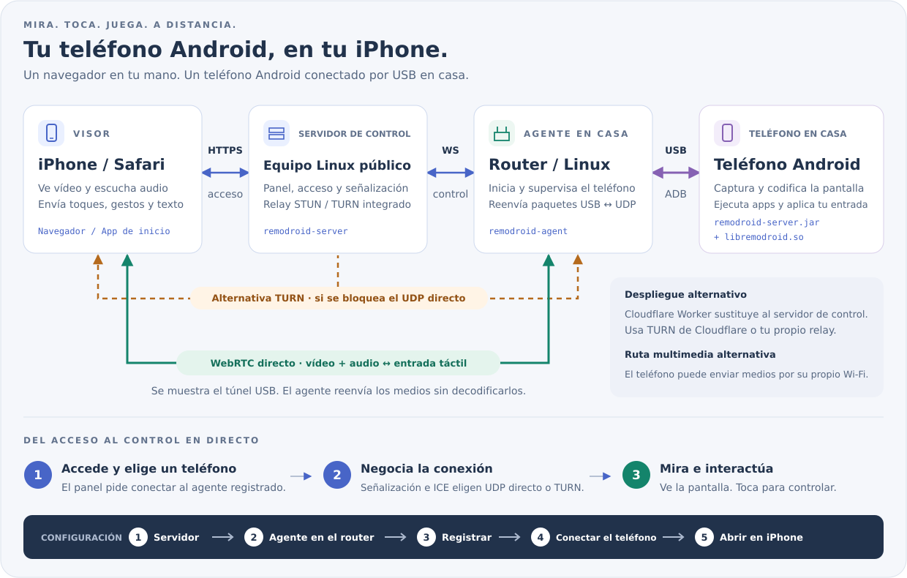

<p align="center"><a href="../../README.md">English</a> | <a href="../zh/README.md">简体中文</a> | <a href="../ja/README.md">日本語</a> | <a href="../ko/README.md">한국어</a> | <b>Español</b> | <a href="../pt-BR/README.md">Português (Brasil)</a> | <a href="../de/README.md">Deutsch</a> | <a href="../fr/README.md">Français</a> | <a href="../ru/README.md">Русский</a></p>

# RemoDroid

Controla un móvil Android, o un ordenador Windows, Mac o Linux, desde Safari en tu iPhone (o cualquier navegador) con baja latencia, suficiente para juegos en la nube.

## ¿Qué necesito?

**Dos piezas: un panel, y RemoDroid en lo que quieres controlar.** El panel es la página web en la que inicias sesión: ponlo en **Cloudflare** si no tienes servidor (gratis, sin máquina que mantener), o en tu propio servidor **Linux** o **Windows**. Luego, para controlar un **móvil Android**, instala *RemoDroid para móviles* en el router (o cualquier equipo Linux) al que el móvil está conectado por USB; para controlar un **ordenador Windows, Mac o Linux**, instala *RemoDroid para ordenadores* en ese ordenador. Miras y controlas desde Safari en tu iPhone, o cualquier navegador; allí no hay nada que instalar.

**El panel: elige uno.**

| Pon el panel en | Elígelo si | Instalación |
|---|---|---|
| [**Cloudflare**](#panel-cloudflare) | No tienes servidor. Cloudflare aloja la página y retransmite el vídeo cuando una red bloquea la conexión directa (1.000 GB al mes gratis). | Unos minutos en el navegador |
| [**Un servidor Linux**](#panel-linux) | Alquilas un VPS con IP pública. Elige una región cerca de casa: retransmite el vídeo cuando hace falta. | Un comando |
| [**Un servidor Windows**](#panel-windows) | Lo mismo, con Windows Server 2019 o posterior (también vale Windows 10 u 11 con IP pública). | Descomprimir y pulsar *Install and start* |

**Después, en cada cosa que quieras controlar:**

| Para controlar | Instala | Dónde |
|---|---|---|
| Un **móvil Android** | [**RemoDroid para móviles**](#for-phones) | En el router (OpenWrt, ASUS Merlin o cualquier equipo Linux) al que el móvil está conectado por USB. No se instala nada en el móvil. |
| Un PC con **Windows** | [**RemoDroid para ordenadores**](#for-computers) | En ese PC (Windows 10 1809 o posterior) |
| Un **Mac** | [**RemoDroid para ordenadores**](#for-computers) | En ese Mac (macOS 13 o posterior) |
| Un PC con **Linux** | [**RemoDroid para ordenadores**](#for-computers) | En ese PC (una sesión X11) |

Un panel sirve para cualquier número de móviles y ordenadores. Toda instalación son los mismos tres pasos:
[1. el panel](#step-panel) → [2. RemoDroid en lo que controlas](#step-device) → [3. ábrelo en tu iPhone](#step-iphone).

<p align="center"><a href="https://remodroid.pages.dev/es/"></a></p>

<p align="center">El asistente hace las mismas dos preguntas y te guía hasta el final con botones para copiar.</p>

## Cómo funciona

<p align="center"></p>

El **panel** sirve la página web, tu inicio de sesión y el establecimiento de la conexión. **RemoDroid para móviles**, en el router de tu casa, habla con el móvil por USB con su propio ADB integrado (sin `adb`) y arranca un pequeño ayudante en el móvil. El ayudante captura la pantalla, la codifica por hardware y la envía por WebRTC directamente a Safari; tus toques vuelven por el mismo camino. El router solo reenvía paquetes; no se decodifica nada por el medio. **RemoDroid para ordenadores** hace lo mismo desde el propio ordenador: captura la pantalla, la codifica en la GPU y recibe el ratón y el teclado.

<details>
<summary>Más detalles: rutas de medios, TURN, qué se ejecuta en el móvil</summary>

- **Ruta de medios.** Por defecto el móvil envía sus medios por el cable USB y el programa del router los pone en la red como UDP, así que el móvil no necesita Wi-Fi. Con `[phone] path = wifi` en `agent.ini` el móvil usa su propia Wi-Fi, lo que puede ser más rápido cuando el router es también el punto de acceso Wi-Fi.
- **TURN.** Cuando no se encuentra una ruta UDP directa entre el iPhone y tu casa (NAT del operador, cortafuegos estrictos), los medios pasan por el relé TURN del panel. Siguen sin decodificarse.
- **En el móvil:** `remodroid-server.jar` (captura de pantalla, MediaCodec H.265/H.264, inyección de entrada, portapapeles, encendido de pantalla, archivos) y `libremodroid.so` (una pila WebRTC en C: ICE, DTLS-SRTP, canales de datos SCTP, control de congestión). Ambos se ejecutan como el usuario shell mediante `app_process`, así que no se instala nada como app. Mientras estás conectado, la pantalla del móvil se apaga para ahorrar energía y su sonido suena en tu iPhone.
- Notas de diseño y decisiones: [`plan.md`](../../plan.md).

</details>

## Qué necesitas

RemoDroid es ligero: el móvil o el ordenador hace el trabajo pesado (captura y codificación por hardware), el router solo reenvía paquetes y el panel solo establece conexiones. Lo que más importa es la **velocidad de subida en casa**.

| | Mínimo | Recomendado | Qué usa |
|---|---|---|---|
| **Panel** | Una cuenta gratuita de Cloudflare, o cualquier máquina Linux o Windows Server 2019+ con IP pública: 1 CPU, 128 MB de RAM, unos MB de disco | En servidor propio: una VM pequeña en la región de la nube **más cercana a tu casa** (lleva el vídeo cuando hace falta TURN), con suficiente tráfico mensual | Unos 2 MB de RAM y casi nada de CPU. Ancho de banda solo cuando una sesión recurre a TURN; entonces todo el vídeo pasa por él (unos 4,5 GB por hora a 10 Mbps) |
| **Router** (para un móvil) | OpenWrt, Linux (Debian, Ubuntu, CentOS, Alpine) o ASUS Merlin con Koolshare, un puerto USB y unos 2 MB libres. CPU: x86, ARM o MIPS | Un router ARM (aarch64, ARMv7) o x86. Uno MIPS débil funciona, pero quizá no llegue a las tasas más altas | Unos 2 MB de RAM. CPU solo para mover paquetes entre USB y UDP; no se decodifica nada |
| **Móvil Android** | Android 8 o posterior, depuración USB, un codificador H.264 por hardware | Android 12 o posterior (para el sonido) con codificador H.265 por hardware | Su propio codificador; la pantalla se apaga mientras estás conectado |
| **Ordenador** | Windows 10 1809+, macOS 13+ o Linux con sesión X11 | Un codificador de GPU (cualquier chip reciente de Intel, AMD, NVIDIA o Apple) | Su codificador de GPU; sin él, H.264 por software a 30 fps |
| **iPhone** | Safari | Un iOS reciente, para H.265 por WebRTC (los antiguos usan H.264 automáticamente) | Decodificación de vídeo por hardware |
| **Red** | 3–5 Mbps de subida en casa (720p) | 10–20 Mbps de subida en casa y lo mismo de bajada en el iPhone (1080p, 60 fps) | 1–20 Mbps por transmisión (tope por defecto 20 Mbps, 60 fps); la calidad se adapta sola |

El retardo esperado es de 40–80 ms cuando el iPhone llega a tu casa directamente, y de unos 70–120 ms por TURN. Las cifras de memoria son de un servidor en marcha y un router RT-AC86U.

## Instalación

<a name="step-panel"></a>

### 1. El panel

Elige un sitio para él: Cloudflare, un servidor Linux o un servidor Windows. Puedes cambiarlo después; entonces los routers y ordenadores se vuelven a añadir al nuevo panel.

<a name="panel-cloudflare"></a>

#### En Cloudflare (sin servidor)

1. **Crea una clave TURN** (retransmite el vídeo cuando una red bloquea la conexión directa). En el [panel de Cloudflare](https://dash.cloudflare.com/): **Realtime → TURN Server → Create**. Guarda su **Turn Token ID** y su **API Token**; copia el API Token enseguida.
2. **Despliega el panel.** Haz un fork de este repositorio y en el panel de Cloudflare **Workers & Pages → Create → Import a repository**, elige tu fork y pon como directorio raíz `worker`. A partir de ahí, cada push a tu fork actualiza el panel solo. O desde un ordenador: `cd worker && npm install && npx wrangler deploy`.
3. **Ábrelo y termina la configuración enseguida**, en `https://remodroid.<tú>.workers.dev`: hasta que lo hagas, el primer visitante elige el inicio de sesión. Para ir sobre seguro, da antes al Worker un secret `SETUP_TOKEN` (Settings → Variables and Secrets → Add, tipo *Secret*; una variable normal se pierde en el siguiente despliegue); la página de configuración te lo pedirá. La página de configuración pide tu inicio de sesión y la clave TURN.

No hay nada que abrir en un cortafuegos: Cloudflare hace la retransmisión. La pestaña **Servidor** del panel cambia después el inicio de sesión y la clave TURN.

<a name="panel-linux"></a>

#### En un servidor Linux

```sh
curl -fsSL https://remodroid.pages.dev/install_server.sh | sudo sh
```

Elige el paquete adecuado, lo instala, arranca el panel y muestra un enlace como `http://<ip>:5580/wizard.html?token=…`. Ábrelo y rellena el puerto web, tu **dominio** (para HTTPS automático de Let's Encrypt), el inicio de sesión del administrador y el puerto STUN/TURN. El panel se reinicia en tus puertos y queda listo.

Abre estos puertos en el cortafuegos: **TCP 5580** (solo para la configuración), tu puerto web (**80**) y el **443** si usas dominio, **UDP 3478** y **UDP 49152–49252** (TURN).

Para instalar un paquete a mano, tómalo de la tabla de abajo y luego:

```sh
sudo apt install ./remodroid-server_*.deb                  # Debian, Ubuntu
sudo dnf install ./remodroid-server-*.rpm                  # CentOS, Fedora
sudo apk add --allow-untrusted ./remodroid-server_*.apk    # Alpine

sudo systemctl enable --now remodroid-server               # systemd
rc-update add remodroid-server && rc-service remodroid-server start            # Alpine
```

Después abre `http://<servidor>:5580/wizard.html?token=…`. El token está en `/var/lib/remodroid/setup-token`.

<a name="panel-windows"></a>

#### En un servidor Windows

Windows Server 2019 o posterior; Windows 10 y 11 también sirven. Descarga el `.zip` de Windows de abajo, descomprímelo en una carpeta donde pueda quedarse, ejecuta **RemoDroidServer.exe** y elige **Install and start**. Ejecuta el panel como servicio de Windows, que arranca con Windows haya o no sesión iniciada, y lo deja pasar por el Firewall de Windows. La misma ventana configura el administrador, el puerto web, el dominio HTTPS y STUN/TURN, inicia y detiene el panel y muestra su registro; su icono queda junto al reloj. Desde un símbolo del sistema: `remodroid-server install` (como administrador). Abre los mismos puertos que en Linux en el cortafuegos de tu proveedor de nube.

<!-- downloads:server -->
#### Descarga el panel para un servidor Linux o Windows (v0.6.3)

Elige la fila por la CPU del servidor (`uname -m`: `x86_64`, `aarch64` = ARM64, `armv7l` = ARMv7, `i686` = x86) y la columna por su sistema. *Cualquier Linux* trae el panel y RemoDroid para móviles.

| Panel | Debian · Ubuntu | CentOS · Fedora | Alpine | Cualquier Linux |
|:--|:-:|:-:|:-:|:-:|
| **x86_64**<br><sub>Intel / AMD de 64 bits</sub> | [](https://github.com/yinyue123/RemoDroid/releases/download/v0.6.3/remodroid-server_0.6.3-1_amd64.deb) | [](https://github.com/yinyue123/RemoDroid/releases/download/v0.6.3/remodroid-server-0.6.3-1.x86_64.rpm) | [](https://github.com/yinyue123/RemoDroid/releases/download/v0.6.3/remodroid-server_0.6.3-r1_x86_64.apk) | [](https://github.com/yinyue123/RemoDroid/releases/download/v0.6.3/remodroid-0.6.3-linux-x86_64.tar.gz) |
| **ARM64**<br><sub>aarch64</sub> | [](https://github.com/yinyue123/RemoDroid/releases/download/v0.6.3/remodroid-server_0.6.3-1_arm64.deb) | [](https://github.com/yinyue123/RemoDroid/releases/download/v0.6.3/remodroid-server-0.6.3-1.aarch64.rpm) | [](https://github.com/yinyue123/RemoDroid/releases/download/v0.6.3/remodroid-server_0.6.3-r1_aarch64.apk) | [](https://github.com/yinyue123/RemoDroid/releases/download/v0.6.3/remodroid-0.6.3-linux-aarch64.tar.gz) |
| **ARMv7**<br><sub>ARM de 32 bits</sub> | [](https://github.com/yinyue123/RemoDroid/releases/download/v0.6.3/remodroid-server_0.6.3-1_armhf.deb) | [](https://github.com/yinyue123/RemoDroid/releases/download/v0.6.3/remodroid-server-0.6.3-1.armv7hl.rpm) | [](https://github.com/yinyue123/RemoDroid/releases/download/v0.6.3/remodroid-server_0.6.3-r1_armv7.apk) | [](https://github.com/yinyue123/RemoDroid/releases/download/v0.6.3/remodroid-0.6.3-linux-armv7.tar.gz) |
| **x86**<br><sub>32 bits</sub> | [](https://github.com/yinyue123/RemoDroid/releases/download/v0.6.3/remodroid-server_0.6.3-1_i386.deb) | [](https://github.com/yinyue123/RemoDroid/releases/download/v0.6.3/remodroid-server-0.6.3-1.i686.rpm) | [](https://github.com/yinyue123/RemoDroid/releases/download/v0.6.3/remodroid-server_0.6.3-r1_x86.apk) | [](https://github.com/yinyue123/RemoDroid/releases/download/v0.6.3/remodroid-0.6.3-linux-x86.tar.gz) |

Servidor Windows: descomprímelo, ejecuta **RemoDroidServer.exe** y elige *Install and start*; la misma ventana configura el administrador, el puerto web, el dominio HTTPS y STUN/TURN, y muestra el registro.

| Panel | **x86_64**<br><sub>Intel / AMD</sub> | **ARM64**<br><sub>Graviton, Snapdragon…</sub> |
|:--|:-:|:-:|
| **Windows** Server 2019+, 10 1809+, 11 | [](https://github.com/yinyue123/RemoDroid/releases/download/v0.6.3/RemoDroid-Server-0.6.3-windows-x86_64.zip) | [](https://github.com/yinyue123/RemoDroid/releases/download/v0.6.3/RemoDroid-Server-0.6.3-windows-arm64.zip) |

Sumas de verificación: [SHA256SUMS](https://github.com/yinyue123/RemoDroid/releases/download/v0.6.3/SHA256SUMS)
<!-- /downloads:server -->

<details>
<summary>Cualquier Linux (.tar.gz) a mano</summary>

El tarball contiene `bin/`, `web/`, `phone/` y `etc/` (ini de ejemplo y unidades de servicio). Para el panel:

```sh
sudo install -m 0755 bin/remodroid-server /usr/bin/
sudo mkdir -p /usr/share/remodroid /etc/remodroid
sudo cp -r web /usr/share/remodroid/web
sudo install -m 0640 etc/server.ini.example /etc/remodroid/server.ini
remodroid-server -c /etc/remodroid/server.ini
```

`etc/remodroid-server.service` es una unidad systemd que puedes copiar a `/etc/systemd/system/`.

</details>

<details>
<summary>Ajustes del panel tras la configuración</summary>

El asistente escribe `/etc/remodroid/server.ini` (Windows: `%ProgramData%\RemoDroid\server.ini`). Después, la misma página, tras el inicio de sesión, edita los ajustes, y la pestaña **Servidor** del panel cambia un ajuste cada vez (dominio, puertos, inicio de sesión, lista STUN/TURN). `remodroid-server -t` comprueba el archivo sin arrancar nada. Los certificados HTTPS se renuevan solos. Los paquetes conservan tu `server.ini` al actualizar.

</details>

<a name="step-device"></a>

### 2. RemoDroid en lo que controlas

<a name="for-phones"></a>

#### Un móvil Android: RemoDroid para móviles

Va en el router al que se conectará el móvil (o en cualquier equipo Linux con puerto USB), no en el móvil.

OpenWrt, Alpine:

```sh
wget -qO- https://remodroid.pages.dev/install_agent.sh | sh
```

Debian, Ubuntu, CentOS, Fedora:

```sh
curl -fsSL https://remodroid.pages.dev/install_agent.sh | sudo sh
```

ASUS Merlin con Koolshare: toma el paquete Merlin de abajo y mira *ASUS Merlin / Koolshare* más abajo.

<!-- downloads:agent -->
#### Descarga RemoDroid para móviles (v0.6.3)

Elige la fila por la CPU de la máquina (`uname -m`: `x86_64`, `aarch64` = ARM64, `armv7l` = ARMv7, `i686` = x86) y la columna por su sistema. OpenWrt: toma la versión que indique `opkg print-architecture`. *Cualquier Linux* trae RemoDroid para móviles y el panel (en MIPS solo RemoDroid para móviles).

| Para móviles | Debian · Ubuntu | CentOS · Fedora | Alpine | OpenWrt | Cualquier Linux |
|:--|:-:|:-:|:-:|:-:|:-:|
| **x86_64**<br><sub>Intel / AMD de 64 bits</sub> | [](https://github.com/yinyue123/RemoDroid/releases/download/v0.6.3/remodroid-agent_0.6.3-1_amd64.deb) | [](https://github.com/yinyue123/RemoDroid/releases/download/v0.6.3/remodroid-agent-0.6.3-1.x86_64.rpm) | [](https://github.com/yinyue123/RemoDroid/releases/download/v0.6.3/remodroid-agent_0.6.3-r1_x86_64.apk) | [](https://github.com/yinyue123/RemoDroid/releases/download/v0.6.3/remodroid-agent_0.6.3-1_x86_64.ipk) | [](https://github.com/yinyue123/RemoDroid/releases/download/v0.6.3/remodroid-0.6.3-linux-x86_64.tar.gz) |
| **ARM64**<br><sub>aarch64</sub> | [](https://github.com/yinyue123/RemoDroid/releases/download/v0.6.3/remodroid-agent_0.6.3-1_arm64.deb) | [](https://github.com/yinyue123/RemoDroid/releases/download/v0.6.3/remodroid-agent-0.6.3-1.aarch64.rpm) | [](https://github.com/yinyue123/RemoDroid/releases/download/v0.6.3/remodroid-agent_0.6.3-r1_aarch64.apk) | [](https://github.com/yinyue123/RemoDroid/releases/download/v0.6.3/remodroid-agent_0.6.3-1_aarch64_generic.ipk)<br>[](https://github.com/yinyue123/RemoDroid/releases/download/v0.6.3/remodroid-agent_0.6.3-1_aarch64_cortex-a53.ipk)<br>[](https://github.com/yinyue123/RemoDroid/releases/download/v0.6.3/remodroid-agent_0.6.3-1_aarch64_cortex-a72.ipk) | [](https://github.com/yinyue123/RemoDroid/releases/download/v0.6.3/remodroid-0.6.3-linux-aarch64.tar.gz) |
| **ARMv7**<br><sub>ARM de 32 bits</sub> | [](https://github.com/yinyue123/RemoDroid/releases/download/v0.6.3/remodroid-agent_0.6.3-1_armhf.deb) | [](https://github.com/yinyue123/RemoDroid/releases/download/v0.6.3/remodroid-agent-0.6.3-1.armv7hl.rpm) | [](https://github.com/yinyue123/RemoDroid/releases/download/v0.6.3/remodroid-agent_0.6.3-r1_armv7.apk) | [](https://github.com/yinyue123/RemoDroid/releases/download/v0.6.3/remodroid-agent_0.6.3-1_arm_cortex-a7_neon-vfpv4.ipk)<br>[](https://github.com/yinyue123/RemoDroid/releases/download/v0.6.3/remodroid-agent_0.6.3-1_arm_cortex-a9_vfpv3-d16.ipk)<br>[](https://github.com/yinyue123/RemoDroid/releases/download/v0.6.3/remodroid-agent_0.6.3-1_arm_cortex-a15_neon-vfpv4.ipk) | [](https://github.com/yinyue123/RemoDroid/releases/download/v0.6.3/remodroid-0.6.3-linux-armv7.tar.gz) |
| **x86**<br><sub>32 bits</sub> | [](https://github.com/yinyue123/RemoDroid/releases/download/v0.6.3/remodroid-agent_0.6.3-1_i386.deb) | [](https://github.com/yinyue123/RemoDroid/releases/download/v0.6.3/remodroid-agent-0.6.3-1.i686.rpm) | [](https://github.com/yinyue123/RemoDroid/releases/download/v0.6.3/remodroid-agent_0.6.3-r1_x86.apk) | [](https://github.com/yinyue123/RemoDroid/releases/download/v0.6.3/remodroid-agent_0.6.3-1_i386_pentium4.ipk) | [](https://github.com/yinyue123/RemoDroid/releases/download/v0.6.3/remodroid-0.6.3-linux-x86.tar.gz) |
| **MIPS LE**<br><sub>mipsel</sub> | — | — | — | [](https://github.com/yinyue123/RemoDroid/releases/download/v0.6.3/remodroid-agent_0.6.3-1_mipsel_24kc.ipk) | [](https://github.com/yinyue123/RemoDroid/releases/download/v0.6.3/remodroid-0.6.3-linux-mipsel.tar.gz) |
| **MIPS BE**<br><sub>mips</sub> | — | — | — | [](https://github.com/yinyue123/RemoDroid/releases/download/v0.6.3/remodroid-agent_0.6.3-1_mips_24kc.ipk) | [](https://github.com/yinyue123/RemoDroid/releases/download/v0.6.3/remodroid-0.6.3-linux-mips.tar.gz) |

Instaladores sin conexión de Koolshare / KoolCenter: [Merlin armv7](https://github.com/yinyue123/RemoDroid/releases/download/v0.6.3/remodroid-0.6.3-merlin-armv7.tar.gz) · [Merlin aarch64](https://github.com/yinyue123/RemoDroid/releases/download/v0.6.3/remodroid-0.6.3-merlin-aarch64.tar.gz). RT-AC86U y RT-AX88U: elige aarch64. Solo contienen RemoDroid para móviles, como plugins del router (no son paquetes de OpenWrt).

Sumas de verificación: [SHA256SUMS](https://github.com/yinyue123/RemoDroid/releases/download/v0.6.3/SHA256SUMS)
<!-- /downloads:agent -->

**¿Qué archivo de OpenWrt?** Busca tu router y su CPU en [openwrt.md](openwrt.md), que también indica las versiones de OpenWrt que funcionan.

**OpenWrt con LuCI, sin línea de comandos:** en LuCI abre **Sistema → Software → Subir paquete…**, elige el `.ipk` de tu router e instálalo. Aparece una página **Servicios → RemoDroid**: añade el router a tu panel (siguiente paso), lo inicia y lo detiene, y muestra si el panel y el móvil están conectados.

En otros sistemas, instala el paquete e inicia el servicio:

```sh
opkg install ./remodroid-agent_*.ipk                       # OpenWrt
sudo apt install ./remodroid-agent_*.deb                   # Debian, Ubuntu
sudo dnf install ./remodroid-agent-*.rpm                   # CentOS, Fedora
sudo apk add --allow-untrusted ./remodroid-agent_*.apk     # Alpine

/etc/init.d/remodroid-agent enable && /etc/init.d/remodroid-agent start        # OpenWrt
sudo systemctl enable --now remodroid-agent                # systemd
rc-update add remodroid-agent && rc-service remodroid-agent start              # Alpine
```

<details>
<summary>Cualquier Linux (.tar.gz) a mano</summary>

Desde el tarball descomprimido:

```sh
sudo install -m 0755 bin/remodroid-agent /usr/bin/
sudo ln -s remodroid-agent /usr/bin/remodroid
sudo mkdir -p /usr/share/remodroid /etc/remodroid
sudo cp -r phone/. /usr/share/remodroid/
sudo install -m 0600 etc/agent.ini.example /etc/remodroid/agent.ini
remodroid-agent -c /etc/remodroid/agent.ini
```

`etc/remodroid-agent.service` (systemd) y `etc/remodroid-agent.init` (procd de OpenWrt) lo arrancan al iniciar.

</details>

<details>
<summary>ASUS Merlin / Koolshare</summary>

Toma el paquete Merlin de arriba que corresponda a la CPU de tu router (`uname -m`):

- `remodroid-<versión>-merlin-aarch64.tar.gz` para `aarch64`: modelos HND de 64 bits como RT-AC86U y RT-AX88U
- `remodroid-<versión>-merlin-armv7.tar.gz` para `armv7l`: modelos ARM de 32 bits como RT-AC68U

Instálalo en **Software Center → Manual installation**. El instalador rechaza un paquete de otra CPU. Añade una página en el router para ajustes, inicio/parada, registros y arranque automático opcional. Instalar no lo arranca. No se admite Asuswrt-Merlin sin el centro de software de Koolshare/KoolCenter. Compilación, migración y límites: [paquete Merlin](../../packaging/merlin/README.md).

</details>

**Añade el router al panel.** En el panel, abre **Agentes → Añadir**. Muestra un comando con un código de un solo uso; ejecútalo en el router:

```sh
remodroid enroll --panel https://your.panel --code X5SX-K3M7
```

En OpenWrt también puedes pegar ese mismo comando en **Servicios → RemoDroid → Emparejar** en LuCI. El código sirve una vez, durante 10 minutos. Después el router aparece en línea; tócalo para cambiar sus ajustes.

**Conecta el móvil.** En el móvil, activa **Opciones para desarrolladores → Depuración USB**. Conéctalo al puerto USB del router y toca **Permitir** en el aviso «¿Permitir depuración USB?» (marca «Permitir siempre»). Es la única vez que tocas el móvil.

<a name="for-computers"></a>

#### Un ordenador: RemoDroid para ordenadores

Un ordenador no necesita router: instala **RemoDroid** en él, ábrelo y añádelo al panel desde el icono de la bandeja (o de la barra de menús) pegando la línea que el panel muestra en **Agentes → Añadir → Ordenador**. Se ejecuta como el usuario con sesión iniciada, muestra una notificación cuando alguien se conecta y su icono se pone rojo mientras lo están viendo (**Disconnect viewer** está a un clic). Quien mira oye lo que suena en el ordenador (el interruptor **Sound**, o `desktop.audio = false` para no enviarlo nunca), y **Show log** en el menú del icono abre una ventana de registro en vivo. Windows 10 1809+ y macOS 13+; Linux necesita una sesión X11 (en GNOME: «GNOME on Xorg»). La imagen se codifica en la GPU si la hay (Media Foundation, VideoToolbox, y VA-API en Linux con GPU AMD o Intel, Steam Deck incluida: H.265 o H.264 hasta 60 fps); si no, por software (H.264, 30 fps).

<!-- downloads:desktop -->
#### Descarga RemoDroid para ordenadores (v0.6.3)

Instálalo en el ordenador que quieres controlar y luego emparéjalo pegando la línea del panel (Agentes → Añadir → Ordenador). La versión de macOS funciona en Mac con Apple silicon e Intel.

| Ordenador | **x86_64**<br><sub>Intel / AMD</sub> | **ARM64**<br><sub>Apple silicon, Snapdragon…</sub> |
|:--|:-:|:-:|
| **Windows** 10 1809+, 11 | [](https://github.com/yinyue123/RemoDroid/releases/download/v0.6.3/RemoDroid-Computer-0.6.3-windows-x86_64.zip) | [](https://github.com/yinyue123/RemoDroid/releases/download/v0.6.3/RemoDroid-Computer-0.6.3-windows-arm64.zip) |
| **macOS** 13+ | [](https://github.com/yinyue123/RemoDroid/releases/download/v0.6.3/RemoDroid-Computer-0.6.3-macos.zip) | [](https://github.com/yinyue123/RemoDroid/releases/download/v0.6.3/RemoDroid-Computer-0.6.3-macos.zip) |
| **Linux** (sesión X11) | [](https://github.com/yinyue123/RemoDroid/releases/download/v0.6.3/remodroid-desktop_0.6.3-1_amd64.deb)<br>[](https://github.com/yinyue123/RemoDroid/releases/download/v0.6.3/remodroid-desktop-0.6.3-1.x86_64.rpm)<br>[](https://github.com/yinyue123/RemoDroid/releases/download/v0.6.3/remodroid-desktop-0.6.3-linux-x86_64.tar.gz)<br>[](https://github.com/yinyue123/RemoDroid/releases/download/v0.6.3/RemoDroid-Computer-0.6.3-linux-x86_64.AppImage) | [](https://github.com/yinyue123/RemoDroid/releases/download/v0.6.3/remodroid-desktop_0.6.3-1_arm64.deb)<br>[](https://github.com/yinyue123/RemoDroid/releases/download/v0.6.3/remodroid-desktop-0.6.3-1.aarch64.rpm)<br>[](https://github.com/yinyue123/RemoDroid/releases/download/v0.6.3/remodroid-desktop-0.6.3-linux-aarch64.tar.gz)<br>[](https://github.com/yinyue123/RemoDroid/releases/download/v0.6.3/RemoDroid-Computer-0.6.3-linux-aarch64.AppImage) |

Sumas de verificación: [SHA256SUMS](https://github.com/yinyue123/RemoDroid/releases/download/v0.6.3/SHA256SUMS)
<!-- /downloads:desktop -->

- **Windows**: descomprímelo y ejecuta `RemoDroid.exe`. Para controlar también ventanas de programas que se ejecutan como administrador (instaladores, el Administrador de tareas, la propia app de Windows del panel), elige una vez **Control administrator windows…** en su menú y confirma como administrador: instala el pequeño servicio `RemoDroidInput`, que les pasa el ratón y el teclado de quien mira (`remodroid-input install` / `uninstall` hace lo mismo). Los avisos de UAC siguen fuera de alcance. **macOS**: mueve `RemoDroid.app` a Aplicaciones, ábrelo (la primera vez: clic derecho → Abrir) y permite **Grabación de pantalla** y **Accesibilidad** cuando lo pida. **Linux**: instala el `.deb` / `.rpm` y abre *RemoDroid* desde el menú de aplicaciones. En otras distribuciones usa el `.AppImage`: `chmod +x` y ejecútalo (`./RemoDroid-*.AppImage desktopd …` es el agente sin interfaz). Usa las bibliotecas GTK 3 y X11 del sistema, que todo escritorio ya tiene.
- **Archivos y portapapeles, como AirDrop**: suelta archivos en el visor y llegan a `Downloads/RemoDroid` del ordenador; suelta archivos en la ventana de RemoDroid del ordenador (bandeja / barra de menús → *Pairing & status…*) y el navegador del visor los descarga. El texto copiado se sincroniza solo en ambos sentidos en Chrome y Edge; Safari y Firefox muestran un botón Copiar.
- ¿Sin pantalla o sin bandeja? Ejecuta la misma línea en un terminal (`remodroid-desktopd pair --panel … --code …`) y luego `remodroid-desktopd` (los paquetes de Linux traen una unidad de usuario de systemd).
- Los ajustes están en `desktop.ini` (`%APPDATA%\RemoDroid`, `~/Library/Application Support/RemoDroid`, `~/.config/remodroid`) y en el panel. Diseño: [`multi-platform.md`](../../multi-platform.md).

<a name="step-iphone"></a>

### 3. Ábrelo en tu iPhone

Abre tu panel en Safari, inicia sesión y luego **Compartir → Añadir a pantalla de inicio**. Abierto desde la pantalla de inicio va a pantalla completa (Safari no puede ocultar sus barras en una página normal). Toca tu móvil u ordenador para conectarte.

## Uso

- El **tacto** funciona como en el móvil, multitáctil incluido. La **bola flotante** abre el menú: bloquear, reconectar, pantalla completa, sonido, subir fotos, portapapeles y ajustes.
- **En un ordenador** el ratón y el teclado pasan tal cual (las teclas son físicas, así que se aplica la distribución del propio ordenador; ⌘ y Ctrl se intercambian cuando solo un lado es Mac). Desde un iPhone, la parte inferior de la pantalla es un **trackpad**, como el de un Mac: el puntero se mueve sobre una imagen ampliada, para que el texto del ordenador se lea, y la imagen se desplaza cuando el puntero llega al 10% del borde, hasta el borde de la propia pantalla. Toca para hacer clic, toca dos veces para doble clic, toca y arrastra para arrastrar, toca con dos dedos para clic derecho, desplaza con dos dedos, sepáralos para hacer zoom; **⤢** muestra la pantalla entera. El trackpad y el teclado son un panel de un solo tamaño: **⌨** en la esquina derecha de su cabecera lo convierte en teclado y, en el mismo sitio, **▭** lo devuelve; **⌄** lo pliega a un botón, arrastrar la cabecera lo redimensiona y **⚙** ajusta la velocidad. En un iPad o un escritorio el panel flota como una tarjeta que arrastras por la cabecera ([`trackpad.md`](../../trackpad.md)). El elemento **Trackpad** del menú lo activa o desactiva en cualquier dispositivo, también en un navegador de escritorio (allí el ratón es un dedo en el pad: clic para hacer clic en el puntero, pulsar y mover para moverlo, la rueda desplaza, Ctrl + rueda hace zoom). Desactivado, **Direct** toca donde tocas (pulsación larga para clic derecho), lo predeterminado en un iPad y con ratón. Ahí, **Keyboard** abre un teclado en pantalla flotante (arrástralo por su asa; toca **ctrl** y luego **c** para Ctrl+C), su **⋯** envía texto y atajos, y **Next screen** cambia de monitor.
- **Juegos en un ordenador** (Linux, p. ej. una Steam Deck en modo escritorio): **Gamepad** pone controles táctiles sobre la imagen, colocados como en Steam Link (sticks, cruceta, A/B/X/Y, gatillos y botones superiores); sujeta el móvil de lado. Desliza un dedo por la imagen (fuera de los botones) para girar la cámara, como en PUBG: la velocidad del deslizamiento inclina el stick derecho, arriba, abajo y a los lados. **⚙ → Edit layout** mueve cualquier control y lo hace más pequeño o más grande; cada distribución guarda la suya. Su **⚙** elige una distribución (Steam Link, Simple, Shooter, Racing), amplía la imagen (**Fill screen** recorta los bordes; los deslizadores la mueven), ajusta la velocidad del deslizamiento (o lo apaga, para que tocar la imagen vuelva a hacer clic) y la transparencia de los botones. Los mandos emparejados con el iPhone o el iPad (Joy-Con, DualSense, Xbox) también funcionan; Safari solo los expone en una página HTTPS. Cada uno se convierte en un mando virtual de Xbox 360 en el ordenador, que necesita un `/dev/uinput` escribible: SteamOS lo tiene; en otros sitios instala las reglas udev de Steam (`steam-devices`).
- El **sonido** sale del móvil (Android 12+) y su altavoz se calla mientras estás conectado. Toca la imagen una vez para quitar el silencio en Safari; el interruptor **Sound** del menú se lo devuelve al móvil.
- **Actualiza** el servidor o el router más tarde con un comando. Actualiza las partes instaladas a la última versión, conserva `server.ini` / `agent.ini` y las reinicia:

  ```sh
  curl -fsSL https://remodroid.pages.dev/update.sh | sudo sh    # OpenWrt: wget -qO- … | sh
  ```

<details>
<summary>Comandos del router</summary>

En el router, estos hablan con el programa en marcha (sin adb):

```sh
remodroid-agent devices | status | shell … | push | pull | logcat | key | restart-server
```

</details>

## Extras

<details>
<summary><b>Control por IA</b>: que una IA lea la pantalla y toque por ti</summary>

La IA maneja el móvil mediante REST bajo `/api/v1/devices/{id}/`:

- `GET …/ui` devuelve la pantalla como JSON (de un UiAutomation dentro del proceso en el móvil; `uiautomator dump` como respaldo).
- `GET …/screenshot?format=jpeg&max_edge=1280` devuelve la imagen (escalada en la GPU, comprimida en C en el móvil, nunca escrita en disco).
- `POST …/actions` toca, escribe, desplaza y espera por selector.

El programa del router lo sirve (`[api] listen` + `token` en `agent.ini`) y el servidor lo retransmite (`remodroid-server gentoken NAME`). Un flujo que la IA resuelve una vez se guarda en `skills/` y Python lo repite sin llamar al modelo; cuando encuentra algo nuevo, devuelve la pantalla a la IA.

```sh
export PYTHONPATH=python RD_URL=http://192.168.1.1:8790 RD_TOKEN=…
python3 -m remodroid ui                      # the screen as an outline
python3 -m remodroid tap --rid search --wait-change
python3 skills/settings-search/run.py --query wifi
```

Diseño: [skill-plan.md](../../skill-plan.md). Escribir skills: [skills/README.md](../../skills/README.md).

</details>

<details>
<summary><b>MCP</b>: usa móviles y ordenadores desde Claude, ChatGPT y otros asistentes de IA</summary>

Cada móvil tiene un endpoint MCP, `https://<panel>/mcp/<usuario>/<dispositivo>`, con herramientas para leer la pantalla (`get_ui`, `screenshot`) y para usarla (`wake_phone`, `tap`, `type_text`, `swipe`, `scroll`, `press_key`, `launch_app`, `wait_for`); `wake_phone` encuentra el camino tras la pantalla de bloqueo y `swipe` puede dibujar un patrón de un solo trazo. Los ordenadores (Windows, macOS, Linux) tienen su propio endpoint y herramientas: `screenshot`, `click`, `move_mouse`, `drag`, `scroll`, `type_text` y `press_key`. La persona frente al ordenador recibe un aviso cuando empieza un asistente, y un ordenador en modo solo vista solo se puede mirar. claude.ai y ChatGPT inician sesión con OAuth (tocas Permitir en una página de RemoDroid); Claude Code, Claude Desktop, Codex y las API de Claude y OpenAI usan un token de API del panel (Servidor → Tokens de API). Cada token se puede revocar allí, y uno sin el ámbito `control` solo puede mirar.

La pestaña Agentes del panel enlaza a la guía en `/mcp/help`, que muestra las URL de tus móviles, crea un token y da la configuración para cada asistente. Funciona en remodroid-server y en el Worker. Diseño: [mcp.md](../../mcp.md).

</details>

<details>
<summary><b>Notificaciones del móvil</b>: recibe las notificaciones del móvil en tu iPhone o mediante Bark</summary>

El ayudante del móvil consulta `dumpsys notification` (el único contenido de notificaciones que ve el usuario shell), descarta las persistentes y las de poca importancia, y envía cada nueva a los clientes conectados por el WebSocket del visor, y a [Bark](https://github.com/Finb/Bark) cuando el servidor tiene un `bark_url`. Desde ahí puedes llamar a la API de control por IA (o a un skill) para actuar.

- Router, `agent.ini`: `[notify] enabled = true`, además de `min_importance` y una lista `ignore`.
- Servidor, `server.ini`: `[notify] bark_url = https://api.day.app/<key>` (o por router bajo `[device_notify]`). La clave de Bark se queda en el servidor y nunca se registra. La entrega por WebSocket no necesita configuración del servidor.

Hay configuraciones de ejemplo en `deploy/`.

</details>

## Estado

Todas las pruebas de la tabla de abajo pasan, incluido Chrome real como visor, y el sonido se ha comprobado en un Sony SO-51A (Android 12). Aún no comprobado en hardware real (hito M0 del plan): el servidor Java del móvil en una variedad de móviles (captura, ajustes del codificador, entrada, portapapeles, encendido de pantalla), el ADB por USB en routers, detalles de Safari (soporte de H.265, decodificación por hardware) y el control de congestión en redes reales.

## Desarrollo

<details>
<summary>Qué hay en este repositorio</summary>

| Ruta | Qué | Lenguaje |
|---|---|---|
| `server/` | Servidor de control (el panel): página de inicio de sesión + cookies (Basic auth para routers), API REST, WebSockets de visor/dispositivo, relé TURN integrado, HTTPS opcional con certificados automáticos de Let's Encrypt (ACME); en Windows un servicio (`win.c`) y una app de bandeja con ventana de ajustes (`win/`) | C + libev + mbedTLS |
| `agent/` | RemoDroid para móviles (en el router): cliente ADB integrado (usbfs), supervisor del móvil, relé UDP, cliente WebSocket, CLI | C + libev |
| `rtc/` | La pila WebRTC compartida por el móvil y los ordenadores: ICE + cliente TURN, DTLS-SRTP, canales de datos SCTP, RTP H.265/H.264, control de congestión; `host.c` la ejecuta en su propio hilo tras una interfaz C (`rd_rtc.h`) | C |
| `desktop/` | RemoDroid para ordenadores: `core/` (sesión, entrada, archivos, cadena de vídeo, enlace con el servidor), backends `win/`, `mac/`, `linux/`, y `app/` (apps de bandeja / barra de menús, `remodroid-desktopd` sin interfaz); se compila como `libremodroid` (.dll / .dylib / .so) | C, Objective-C |
| `android/java/` | Servidor del móvil: captura de pantalla, MediaCodec, inyección de entrada, portapapeles, encendido de pantalla, archivos, logcat | Java (app_process) |
| `web/` | Cliente para iPhone (PWA): vídeo, sonido, multitáctil, menú de bola flotante, subida de fotos, portapapeles, todos los ajustes; `panel.html` (pestañas Dispositivos, Agentes, Servidor) y `wizard.html` (configuración inicial) | HTML/CSS/JS |
| `worker/` | El mismo panel en Cloudflare Workers + un Durable Object, con Cloudflare TURN | JS |
| `wizard/` | El sitio de instalación (Cloudflare Pages, remodroid.pages.dev), `install_server.sh`, `install_agent.sh`, `update.sh`; `i18n/` genera cada idioma a partir de la página en inglés | HTML, sh, Python |
| `common/` | C compartido: tramas WebSocket, tramas de túnel, STUN, sobre JSON, ini, utilidades | C |
| `third_party/` | Bibliotecas incluidas, enlazadas estáticamente: libev, inih, cJSON, picohttpparser, crypt_blowfish, mbedTLS, libsrtp2, usrsctp, minih264, libopus (sonido de los ordenadores) | C |
| `deploy/` | `server.ini` / `agent.ini` de ejemplo, unidades systemd, scripts OpenRC, el script procd del programa del router | |
| `packaging/`, `.github/workflows/` | Definiciones de paquetes nFPM (deb, rpm, apk; ipk para el router), el zip del servidor Windows y el flujo de CI de compilación/publicación | |
| `python/`, `skills/`, `.claude/skills/phone/` | Control por IA: el SDK `remodroid` y la CLI `rd`, skills repetibles y el skill de Claude Code que los usa | Python |
| `tests/` | Pruebas de extremo a extremo | Node, Python |
| `demo/` | El panel de maqueta original (sin conexión, sin servidor) | HTML |

</details>

<details>
<summary>Compilación</summary>

Compilación en el host (desarrollo y pruebas):

```sh
make            # build/host/remodroid-server, build/host/remodroid-agent
make rtc-tests  # build/host/rtc/rtc_test, rtp_dump (phone stack on the host)
```

Binarios estáticos de publicación para routers y servidores (Zig como compilador cruzado, musl, todo enlazado):

```sh
make dist                   # inside the build container (build/Dockerfile, needs podman/docker)
./build/dist.sh mipsel      # or directly, with `zig` on PATH; targets: x86 x86_64 armv7 aarch64 mipsel mips
```

Los resultados quedan en `build/out/<arch>/`: unos 0,8 MB por binario (1,2 MB en MIPS, que solo lleva el programa del router).

El servidor para Windows (`remodroid-server.exe` y la app de bandeja `RemoDroidServer.exe`), compilado en cruzado con Zig o de forma nativa en MSYS2:

```sh
make TARGET=win-x86_64 CC="zig cc -target x86_64-windows-gnu" AR="zig ar" WINDRES=llvm-windres
```

Archivos del móvil (`remodroid-server.jar` + `libremodroid.so` por ABI):

```sh
ANDROID_JAR=.../platforms/android-34/android.jar D8=.../build-tools/34.0.0/d8 NDK=.../android-ndk-r27c \
  ./android/build.sh        # build/android/remodroid-server.jar, build/android/<abi>/libremodroid.so
```

</details>

<details>
<summary>Pruebas</summary>

| Comando | Cubre |
|---|---|
| `make test` | Plano de control de extremo a extremo: servidor + programa del router reales, un adbd falso fiel al protocolo (autenticación RSA comprobada con OpenSSL), móvil falso; autenticación, REST, WebSockets, ADB push/shell/sync, túnel, relé UDP, comandos, ediciones de `agent.ini`, CLI, reconexiones (48 comprobaciones) |
| (en `make test`) | Reenvío de notificaciones: la configuración `[notify]` llega al móvil, una notificación capturada llega a un visor por WebSocket y el servidor la envía como JSON a un endpoint de Bark simulado |
| `python3 tests/python_sdk.py` | El SDK de control por IA, la CLI `rd` y el ejecutor de skills contra una API de móvil falsa: selectores, capturas en memoria, entrega a la IA (salida 3), continuar con `--from-step` |
| `QEMU=qemu-mipsel node tests/run.mjs build/mipsel` | Lo mismo, con los binarios estáticos MIPS del router bajo emulación en modo usuario |
| `python rtc/test/rtc_interop.py` | Pila WebRTC del móvil ↔ aiortc: ICE, DTLS-SRTP, SCTP, fotogramas H.264 decodificados, canales de datos |
| `python rtc/test/rtp_depack.py` | Empaquetadores H.265 y H.264: ida y vuelta exacta bit a bit con un desempaquetador independiente + FFmpeg |
| `python tests/e2e_webrtc.py [--relay]` | Ruta completa: visor → servidor → programa del router → túnel → pila del móvil; `--relay` fuerza el TURN integrado |
| `python tests/e2e_browser.py` | El cliente web real en Chrome sin interfaz contra toda la pila: vídeo, toques, menú, protocolo |
| `node tests/server_windows.mjs build/win-x86_64` | El servidor en Windows (CI): bajo su supervisor, el reinicio del asistente en un puerto nuevo, archivos estáticos, inicio de sesión, WebSocket, TURN, `settings` / `configure` y el servicio de Windows (instalar, reiniciar, detener, desinstalar) |
| `node tests/setup.mjs build/host` | Asistente inicial (token de configuración, guardado, reinicio en el puerto nuevo), inicio de sesión, códigos de registro con el `enroll` real, ajustes del router mediante el panel, renombrar, quitar |
| `node tests/worker.mjs build/host` | El Worker de Cloudflare bajo `wrangler dev` (tras `cd worker && npm install`) con el programa del router real: configuración, inicio de sesión, registro, WebSocket del visor y señalización, comandos, renombrar, quitar |
| `sudo tests/openwrt.sh IP [VERSION]` | OpenWrt (19.07–24.10) en podman con su propia dirección en la LAN (macvlan), con LuCI, el ipk compilado desde este repositorio y un servidor; abre `http://IP/` desde otro dispositivo y empareja en Servicios → RemoDroid |
| `make desktop-test && build/host/desktop/desk_test web/app.js` | Núcleo para ordenadores sin pantalla: la tabla de teclas frente a la del visor, decodificación de entrada, tamaños de vídeo, conversión de color, el codificador por software |
| `python tests/e2e_desktop.py` | Un escritorio Linux de extremo a extremo: emparejamiento con un código y luego el visor real en Chrome sin interfaz controlando Xvfb a través del servidor y `remodroid-desktopd`: imagen, clics, rueda, teclas, texto, portapapeles en ambos sentidos, subida |
| `node tests/tls.mjs build/host` | HTTPS, redirección, cookies `Secure`, visor y programa del router por `wss://` (CA de confianza y no), recarga del certificado con SIGHUP; con `PEBBLE_DIR`, emisión ACME, reutilización y renovación automática contra Pebble (la CA de pruebas de Let's Encrypt) |

Las pruebas en Python necesitan `aiortc` (y `playwright` + Chromium para la del navegador).

</details>

Documentos de diseño: [plan.md](../../plan.md) (arquitectura y decisiones), [skill-plan.md](../../skill-plan.md) (control por IA), [packaging/merlin/README.md](../../packaging/merlin/README.md) (plugin de Merlin).
