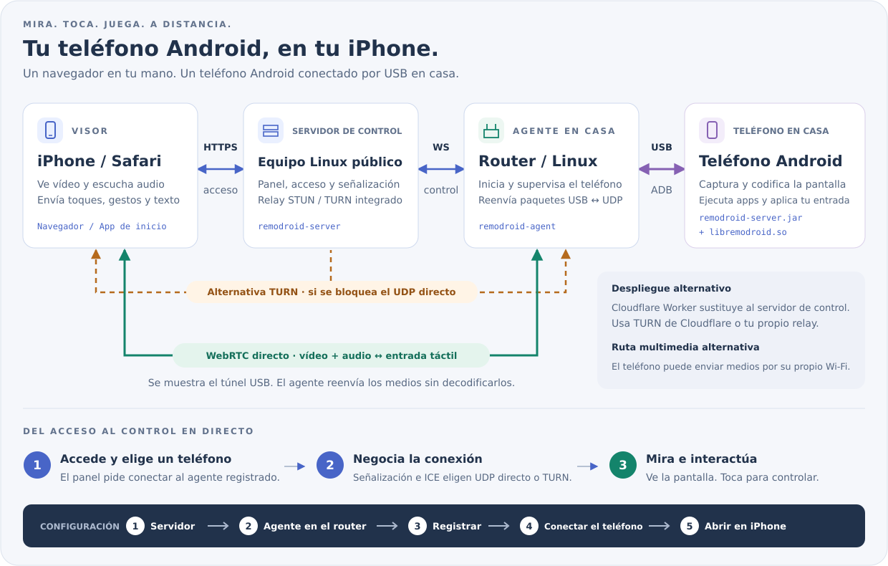

<p align="center"><a href="../../README.md">English</a> | <a href="../zh/README.md">简体中文</a> | <a href="../ja/README.md">日本語</a> | <a href="../ko/README.md">한국어</a> | <b>Español</b> | <a href="../pt-BR/README.md">Português (Brasil)</a> | <a href="../de/README.md">Deutsch</a> | <a href="../fr/README.md">Français</a> | <a href="../ru/README.md">Русский</a></p>

# RemoDroid

Controla un móvil Android desde Safari en tu iPhone con baja latencia, suficiente para jugar en la nube.
El móvil se queda en casa, conectado por USB al router. Lo ves y lo tocas desde cualquier lugar.

<p align="center"><a href="https://remodroid.pages.dev/es/"></a></p>

<p align="center"></p>

**Cómo funciona, en un párrafo.** Un pequeño **servidor** en una máquina pública (o un Cloudflare Worker gratuito)
aloja la página web, tu inicio de sesión y el establecimiento de la conexión. Un **agente** en el router de casa habla
con el móvil por USB con su propio ADB integrado (no hace falta `adb`) y arranca un pequeño ayudante en el móvil.
El ayudante captura la pantalla, la codifica por hardware y la envía por WebRTC directamente a Safari; tus toques
vuelven por el mismo camino. El router solo reenvía paquetes; nada se decodifica por el camino.

<details>
<summary>Más detalles: rutas de los medios, TURN, qué se ejecuta en el móvil</summary>

- **Ruta de los medios.** Por defecto el móvil envía sus medios por el cable USB y el agente los saca a la red como
  UDP, así que el móvil no necesita Wi-Fi. Con `[phone] path = wifi` en `agent.ini` el móvil usa su propio Wi-Fi,
  lo que puede ser más rápido si el router es también el punto de acceso Wi-Fi.
- **TURN.** Cuando no se encuentra una ruta UDP directa entre el iPhone y tu casa (NAT del operador, cortafuegos
  estrictos), los medios pasan por el relé TURN integrado del servidor. Tampoco ahí se decodifican.
- **En el móvil:** `remodroid-server.jar` (captura de pantalla, MediaCodec H.265/H.264, inyección de entrada,
  portapapeles, encendido de pantalla, archivos) y `libremodroid.so` (una pila WebRTC en C: ICE, DTLS-SRTP, canales
  de datos SCTP, control de congestión). Ambos se ejecutan como el usuario shell mediante `app_process`, así que no se
  instala ninguna app. Mientras estás conectado, la pantalla del móvil se apaga para ahorrar energía y su sonido suena
  en el iPhone.
- Notas de diseño y decisiones: [`plan.md`](../../plan.md).

</details>

## Qué necesitas

RemoDroid es ligero: el móvil hace el trabajo pesado (captura y codificación por hardware), el router solo reenvía
paquetes y el servidor solo establece conexiones. Lo que más importa es la **velocidad de subida en casa**.

| | Mínimo | Recomendado | Qué usa |
|---|---|---|---|
| **Servidor** | Cualquier máquina Linux con IP pública: 1 CPU, 128 MB de RAM, unos MB de disco. O, en su lugar, una cuenta gratuita de Cloudflare | Una VM pequeña en la región cloud **más cercana a tu casa** (lleva el vídeo cuando hace falta TURN), con suficiente tráfico mensual | Unos 2 MB de RAM y casi nada de CPU. Ancho de banda solo cuando una sesión recurre a TURN; entonces todo el vídeo pasa por él (unos 4,5 GB por hora a 10 Mbps) |
| **Router** | OpenWrt, Linux (Debian, Ubuntu, CentOS, Alpine) o ASUS Merlin con Koolshare, un puerto USB y unos 2 MB libres. CPU: x86, ARM o MIPS | Un router ARM (aarch64, ARMv7) o x86. Un router MIPS modesto funciona, pero puede no alcanzar los bitrates más altos | Unos 2 MB de RAM. CPU solo para mover paquetes entre USB y UDP; no decodifica nada |
| **Móvil Android** | Android 8 o posterior, depuración USB, codificador H.264 por hardware | Android 12 o posterior (para el sonido) con codificador H.265 por hardware | Su propio codificador por hardware; la pantalla se apaga mientras estás conectado |
| **iPhone** | Safari | Un iOS reciente, para H.265 por WebRTC (los iOS antiguos usan H.264 automáticamente) | Decodificación de vídeo por hardware |
| **Red** | 3–5 Mbps de subida en casa (720p) | 10–20 Mbps de subida en casa y la misma bajada en el iPhone (1080p, 60 fps) | 1–20 Mbps por transmisión (límite por defecto 20 Mbps, 60 fps); la calidad se adapta sola |

El retardo esperado es de 40–80 ms cuando el iPhone llega a tu casa directamente, y de unos 70–120 ms a través de TURN.
Las cifras de memoria son de un servidor en funcionamiento y de un agente en un RT-AC86U.

## Instalación

<p align="center"><a href="https://remodroid.pages.dev/es/"></a></p>

**El asistente te guía en todo, con botones de copiar.** ¿Prefieres quedarte aquí? Sigue estos cinco pasos,
los mismos cinco de la parte inferior de la imagen.

### 1. Servidor

En tu servidor Linux:

```sh
curl -fsSL https://remodroid.pages.dev/install_server.sh | sudo sh
```

Elige el paquete adecuado, lo instala, arranca el servidor y muestra un enlace como
`http://<ip>:5580/wizard.html?token=…`.

<!-- downloads:server -->
#### Descargar el servidor (v0.4)

Elige la fila de la CPU de la máquina (`uname -m`: `x86_64`, `aarch64` = ARM64, `armv7l` = ARMv7, `i686` = x86) y la columna de su sistema. OpenWrt: toma la compilación que indique `opkg print-architecture`. *Cualquier Linux* incluye el servidor y el agente.

| Servidor | Debian · Ubuntu | CentOS · Fedora | Alpine | OpenWrt | Cualquier Linux |
|:--|:-:|:-:|:-:|:-:|:-:|
| **x86_64**<br><sub>Intel / AMD 64 bits</sub> | [](https://github.com/yinyue123/RemoDroid/releases/download/v0.4/remodroid-server_0.4-1_amd64.deb) | [](https://github.com/yinyue123/RemoDroid/releases/download/v0.4/remodroid-server-0.4-1.x86_64.rpm) | [](https://github.com/yinyue123/RemoDroid/releases/download/v0.4/remodroid-server_0.4-r1_x86_64.apk) | [](https://github.com/yinyue123/RemoDroid/releases/download/v0.4/remodroid-server_0.4-1_x86_64.ipk) | [](https://github.com/yinyue123/RemoDroid/releases/download/v0.4/remodroid-0.4-linux-x86_64.tar.gz) |
| **ARM64**<br><sub>aarch64</sub> | [](https://github.com/yinyue123/RemoDroid/releases/download/v0.4/remodroid-server_0.4-1_arm64.deb) | [](https://github.com/yinyue123/RemoDroid/releases/download/v0.4/remodroid-server-0.4-1.aarch64.rpm) | [](https://github.com/yinyue123/RemoDroid/releases/download/v0.4/remodroid-server_0.4-r1_aarch64.apk) | [](https://github.com/yinyue123/RemoDroid/releases/download/v0.4/remodroid-server_0.4-1_aarch64_generic.ipk)<br>[](https://github.com/yinyue123/RemoDroid/releases/download/v0.4/remodroid-server_0.4-1_aarch64_cortex-a53.ipk)<br>[](https://github.com/yinyue123/RemoDroid/releases/download/v0.4/remodroid-server_0.4-1_aarch64_cortex-a72.ipk) | [](https://github.com/yinyue123/RemoDroid/releases/download/v0.4/remodroid-0.4-linux-aarch64.tar.gz) |
| **ARMv7**<br><sub>ARM de 32 bits</sub> | [](https://github.com/yinyue123/RemoDroid/releases/download/v0.4/remodroid-server_0.4-1_armhf.deb) | [](https://github.com/yinyue123/RemoDroid/releases/download/v0.4/remodroid-server-0.4-1.armv7hl.rpm) | [](https://github.com/yinyue123/RemoDroid/releases/download/v0.4/remodroid-server_0.4-r1_armv7.apk) | [](https://github.com/yinyue123/RemoDroid/releases/download/v0.4/remodroid-server_0.4-1_arm_cortex-a7_neon-vfpv4.ipk)<br>[](https://github.com/yinyue123/RemoDroid/releases/download/v0.4/remodroid-server_0.4-1_arm_cortex-a9_vfpv3-d16.ipk)<br>[](https://github.com/yinyue123/RemoDroid/releases/download/v0.4/remodroid-server_0.4-1_arm_cortex-a15_neon-vfpv4.ipk) | [](https://github.com/yinyue123/RemoDroid/releases/download/v0.4/remodroid-0.4-linux-armv7.tar.gz) |
| **x86**<br><sub>32 bits</sub> | [](https://github.com/yinyue123/RemoDroid/releases/download/v0.4/remodroid-server_0.4-1_i386.deb) | [](https://github.com/yinyue123/RemoDroid/releases/download/v0.4/remodroid-server-0.4-1.i686.rpm) | [](https://github.com/yinyue123/RemoDroid/releases/download/v0.4/remodroid-server_0.4-r1_x86.apk) | [](https://github.com/yinyue123/RemoDroid/releases/download/v0.4/remodroid-server_0.4-1_i386_pentium4.ipk) | [](https://github.com/yinyue123/RemoDroid/releases/download/v0.4/remodroid-0.4-linux-x86.tar.gz) |
| **MIPS LE**<br><sub>mipsel</sub> | — | — | — | [](https://github.com/yinyue123/RemoDroid/releases/download/v0.4/remodroid-server_0.4-1_mipsel_24kc.ipk) | [](https://github.com/yinyue123/RemoDroid/releases/download/v0.4/remodroid-0.4-linux-mipsel.tar.gz) |
| **MIPS BE**<br><sub>mips</sub> | — | — | — | [](https://github.com/yinyue123/RemoDroid/releases/download/v0.4/remodroid-server_0.4-1_mips_24kc.ipk) | [](https://github.com/yinyue123/RemoDroid/releases/download/v0.4/remodroid-0.4-linux-mips.tar.gz) |

Sumas de verificación: [SHA256SUMS](https://github.com/yinyue123/RemoDroid/releases/download/v0.4/SHA256SUMS)
<!-- /downloads:server -->

Instálalo y arranca el servicio:

```sh
sudo apt install ./remodroid-server_*.deb                  # Debian, Ubuntu
sudo dnf install ./remodroid-server-*.rpm                  # CentOS, Fedora
sudo apk add --allow-untrusted ./remodroid-server_*.apk    # Alpine
opkg install ./remodroid-server_*.ipk                      # OpenWrt

sudo systemctl enable --now remodroid-server               # systemd
rc-update add remodroid-server && rc-service remodroid-server start            # Alpine
/etc/init.d/remodroid-server enable && /etc/init.d/remodroid-server start      # OpenWrt
```

Luego abre `http://<server>:5580/wizard.html?token=…`. El token está en `/var/lib/remodroid/setup-token`.

<details>
<summary>Cualquier Linux (.tar.gz) a mano</summary>

El tarball contiene `bin/`, `web/`, `phone/` y `etc/` (archivos ini de ejemplo y unidades de servicio). Para el servidor:

```sh
sudo install -m 0755 bin/remodroid-server /usr/bin/
sudo mkdir -p /usr/share/remodroid /etc/remodroid
sudo cp -r web /usr/share/remodroid/web
sudo install -m 0640 etc/server.ini.example /etc/remodroid/server.ini
remodroid-server -c /etc/remodroid/server.ini
```

`etc/remodroid-server.service` es una unidad systemd que puedes copiar a `/etc/systemd/system/`.

</details>

**Configúralo.** En el asistente, rellena el puerto web, tu **dominio** (para HTTPS automático de Let's Encrypt), el
usuario administrador y el puerto STUN/TURN. El servidor se reinicia en tus puertos y el panel queda listo.

Abre estos puertos en el cortafuegos: **TCP 5580** (solo para la configuración), tu puerto web (**80**) y **443** si
usas un dominio, **UDP 3478** y **UDP 49152–49252** (TURN).

<details>
<summary>¿Sin servidor? Usa Cloudflare</summary>

1. En el panel de control de Cloudflare, crea una clave TURN: **Realtime → TURN Server**.
2. Despliega `worker/`: `cd worker && npm install && npx wrangler deploy`, o importa tu fork en Cloudflare con
   root directory `worker`.
3. Abre `https://remodroid.<you>.workers.dev`. Su asistente te pide el usuario y la clave TURN.

El Worker es el mismo panel (inicio de sesión, routers, señalización) sobre un Durable Object con almacenamiento
integrado. Sáltate el paso del cortafuegos; el TURN de Cloudflare hace el relé.

</details>

<details>
<summary>Ajustes del servidor tras la configuración</summary>

El asistente escribe `/etc/remodroid/server.ini`. Después, la misma página (con inicio de sesión) edita los ajustes, y
la pestaña **Server** del panel cambia un ajuste cada vez (dominio, puertos, usuario, lista STUN/TURN).
`remodroid-server -t` comprueba el archivo sin arrancar nada. Los certificados HTTPS se renuevan solos.
Los paquetes conservan tu `server.ini` al actualizar.

</details>

### 2. Agente en el router

OpenWrt, Alpine:

```sh
wget -qO- https://remodroid.pages.dev/install_agent.sh | sh
```

Debian, Ubuntu, CentOS, Fedora:

```sh
curl -fsSL https://remodroid.pages.dev/install_agent.sh | sudo sh
```

<!-- downloads:agent -->
#### Descargar el agente (v0.4)

Elige la fila de la CPU de la máquina (`uname -m`: `x86_64`, `aarch64` = ARM64, `armv7l` = ARMv7, `i686` = x86) y la columna de su sistema. OpenWrt: toma la compilación que indique `opkg print-architecture`. *Cualquier Linux* incluye el servidor y el agente.

| Agente | Debian · Ubuntu | CentOS · Fedora | Alpine | OpenWrt | Cualquier Linux |
|:--|:-:|:-:|:-:|:-:|:-:|
| **x86_64**<br><sub>Intel / AMD 64 bits</sub> | [](https://github.com/yinyue123/RemoDroid/releases/download/v0.4/remodroid-agent_0.4-1_amd64.deb) | [](https://github.com/yinyue123/RemoDroid/releases/download/v0.4/remodroid-agent-0.4-1.x86_64.rpm) | [](https://github.com/yinyue123/RemoDroid/releases/download/v0.4/remodroid-agent_0.4-r1_x86_64.apk) | [](https://github.com/yinyue123/RemoDroid/releases/download/v0.4/remodroid-agent_0.4-1_x86_64.ipk) | [](https://github.com/yinyue123/RemoDroid/releases/download/v0.4/remodroid-0.4-linux-x86_64.tar.gz) |
| **ARM64**<br><sub>aarch64</sub> | [](https://github.com/yinyue123/RemoDroid/releases/download/v0.4/remodroid-agent_0.4-1_arm64.deb) | [](https://github.com/yinyue123/RemoDroid/releases/download/v0.4/remodroid-agent-0.4-1.aarch64.rpm) | [](https://github.com/yinyue123/RemoDroid/releases/download/v0.4/remodroid-agent_0.4-r1_aarch64.apk) | [](https://github.com/yinyue123/RemoDroid/releases/download/v0.4/remodroid-agent_0.4-1_aarch64_generic.ipk)<br>[](https://github.com/yinyue123/RemoDroid/releases/download/v0.4/remodroid-agent_0.4-1_aarch64_cortex-a53.ipk)<br>[](https://github.com/yinyue123/RemoDroid/releases/download/v0.4/remodroid-agent_0.4-1_aarch64_cortex-a72.ipk) | [](https://github.com/yinyue123/RemoDroid/releases/download/v0.4/remodroid-0.4-linux-aarch64.tar.gz) |
| **ARMv7**<br><sub>ARM de 32 bits</sub> | [](https://github.com/yinyue123/RemoDroid/releases/download/v0.4/remodroid-agent_0.4-1_armhf.deb) | [](https://github.com/yinyue123/RemoDroid/releases/download/v0.4/remodroid-agent-0.4-1.armv7hl.rpm) | [](https://github.com/yinyue123/RemoDroid/releases/download/v0.4/remodroid-agent_0.4-r1_armv7.apk) | [](https://github.com/yinyue123/RemoDroid/releases/download/v0.4/remodroid-agent_0.4-1_arm_cortex-a7_neon-vfpv4.ipk)<br>[](https://github.com/yinyue123/RemoDroid/releases/download/v0.4/remodroid-agent_0.4-1_arm_cortex-a9_vfpv3-d16.ipk)<br>[](https://github.com/yinyue123/RemoDroid/releases/download/v0.4/remodroid-agent_0.4-1_arm_cortex-a15_neon-vfpv4.ipk) | [](https://github.com/yinyue123/RemoDroid/releases/download/v0.4/remodroid-0.4-linux-armv7.tar.gz) |
| **x86**<br><sub>32 bits</sub> | [](https://github.com/yinyue123/RemoDroid/releases/download/v0.4/remodroid-agent_0.4-1_i386.deb) | [](https://github.com/yinyue123/RemoDroid/releases/download/v0.4/remodroid-agent-0.4-1.i686.rpm) | [](https://github.com/yinyue123/RemoDroid/releases/download/v0.4/remodroid-agent_0.4-r1_x86.apk) | [](https://github.com/yinyue123/RemoDroid/releases/download/v0.4/remodroid-agent_0.4-1_i386_pentium4.ipk) | [](https://github.com/yinyue123/RemoDroid/releases/download/v0.4/remodroid-0.4-linux-x86.tar.gz) |
| **MIPS LE**<br><sub>mipsel</sub> | — | — | — | [](https://github.com/yinyue123/RemoDroid/releases/download/v0.4/remodroid-agent_0.4-1_mipsel_24kc.ipk) | [](https://github.com/yinyue123/RemoDroid/releases/download/v0.4/remodroid-0.4-linux-mipsel.tar.gz) |
| **MIPS BE**<br><sub>mips</sub> | — | — | — | [](https://github.com/yinyue123/RemoDroid/releases/download/v0.4/remodroid-agent_0.4-1_mips_24kc.ipk) | [](https://github.com/yinyue123/RemoDroid/releases/download/v0.4/remodroid-0.4-linux-mips.tar.gz) |

Instaladores sin conexión para Koolshare / KoolCenter: [Merlin armv7](https://github.com/yinyue123/RemoDroid/releases/download/v0.4/remodroid-0.4-merlin-armv7.tar.gz) · [Merlin aarch64](https://github.com/yinyue123/RemoDroid/releases/download/v0.4/remodroid-0.4-merlin-aarch64.tar.gz). RT-AC86U y RT-AX88U: elige aarch64. Son complementos solo del agente, no paquetes de OpenWrt.

Sumas de verificación: [SHA256SUMS](https://github.com/yinyue123/RemoDroid/releases/download/v0.4/SHA256SUMS)
<!-- /downloads:agent -->

**¿Qué archivo de OpenWrt?** Busca tu router y su CPU en [openwrt.md](openwrt.md), que también indica
las versiones de OpenWrt que funcionan.

**OpenWrt con LuCI, sin línea de comandos:** en LuCI abre **System → Software → Upload Package…**, elige el
`.ipk` de tu router e instálalo. Aparece una página **Services → RemoDroid**: vincula el router con tu panel
(paso 3), arranca y detiene el agente, y muestra si el panel y el móvil están conectados.

En otros sistemas, instálalo y arranca el servicio:

```sh
opkg install ./remodroid-agent_*.ipk                       # OpenWrt
sudo apt install ./remodroid-agent_*.deb                   # Debian, Ubuntu
sudo dnf install ./remodroid-agent-*.rpm                   # CentOS, Fedora
sudo apk add --allow-untrusted ./remodroid-agent_*.apk     # Alpine

/etc/init.d/remodroid-agent enable && /etc/init.d/remodroid-agent start        # OpenWrt
sudo systemctl enable --now remodroid-agent                # systemd
rc-update add remodroid-agent && rc-service remodroid-agent start              # Alpine
```

<details>
<summary>Cualquier Linux (.tar.gz) a mano</summary>

Para el agente, desde el tarball descomprimido:

```sh
sudo install -m 0755 bin/remodroid-agent /usr/bin/
sudo ln -s remodroid-agent /usr/bin/remodroid
sudo mkdir -p /usr/share/remodroid /etc/remodroid
sudo cp -r phone/. /usr/share/remodroid/
sudo install -m 0600 etc/agent.ini.example /etc/remodroid/agent.ini
remodroid-agent -c /etc/remodroid/agent.ini
```

`etc/remodroid-agent.service` (systemd) y `etc/remodroid-agent.init` (procd de OpenWrt) lo arrancan al iniciar.

</details>

<details>
<summary>ASUS Merlin / Koolshare</summary>

Toma el paquete Merlin de arriba que corresponda a la CPU de tu router (`uname -m`):

- `remodroid-<version>-merlin-aarch64.tar.gz` para `aarch64`: modelos HND de 64 bits como RT-AC86U y RT-AX88U
- `remodroid-<version>-merlin-armv7.tar.gz` para `armv7l`: modelos ARM de 32 bits como RT-AC68U

Instálalo en **Software Center → Manual installation**. El instalador rechaza un paquete de otra CPU.
Añade una página en el router para ajustes, arranque/parada, registros y arranque automático opcional. La instalación
no arranca el agente. No se admite Asuswrt-Merlin de serie sin el centro de software Koolshare/KoolCenter.
Compilación, migración y limitaciones: [paquete Merlin](../../packaging/merlin/README.md).

</details>

### 3. Vincula el router

En el panel, abre **Agents → Add**. Muestra un comando con un código de un solo uso; ejecútalo en el router:

```sh
remodroid enroll --panel https://your.panel --code X5SX-K3M7
```

En OpenWrt también puedes pegar el mismo comando en **Services → RemoDroid → Pair** de LuCI.

El código sirve una vez, durante 10 minutos. Después el router aparece en línea; tócalo para cambiar sus ajustes.

### 4. Conecta el móvil

En el móvil, activa **Opciones para desarrolladores → Depuración por USB**. Conéctalo al puerto USB del router y pulsa
**Permitir** en el aviso «¿Permitir depuración por USB?» (marca «Permitir siempre»). Es la única vez que tocas el móvil.

### 5. Ábrelo en el iPhone

Abre tu panel en Safari, inicia sesión y luego **Compartir → Añadir a pantalla de inicio**. Abierto desde la pantalla
de inicio se ejecuta a pantalla completa (Safari no puede ocultar sus barras en una página normal). Toca tu móvil
para conectar.

## Uso

- El **tacto** funciona como en el móvil, multitáctil incluido. La **bola flotante** abre el menú: bloquear, reconectar,
  pantalla completa, sonido, subir fotos, portapapeles y ajustes.
- El **sonido** viene del móvil (Android 12+) y su altavoz se calla mientras estás conectado. Toca la imagen una vez para
  activar el sonido en Safari; el interruptor **Sound** del menú se lo devuelve al móvil.
- **Actualiza** el servidor o el router más adelante con un solo comando. Actualiza lo que esté instalado a la última
  versión, conserva `server.ini` / `agent.ini` y los reinicia:

  ```sh
  curl -fsSL https://remodroid.pages.dev/update.sh | sudo sh    # OpenWrt: wget -qO- … | sh
  ```

<details>
<summary>Comandos del router</summary>

En el router, estos comandos hablan con el agente en ejecución (no hace falta adb):

```sh
remodroid-agent devices | status | shell … | push | pull | logcat | key | restart-server
```

</details>

## Extras

<details>
<summary><b>Control por IA</b>: deja que una IA lea la pantalla y toque por ti</summary>

La IA maneja el móvil mediante REST bajo `/api/v1/devices/{id}/`:

- `GET …/ui` devuelve la pantalla como JSON (de un UiAutomation dentro del proceso en el móvil; `uiautomator dump` como alternativa).
- `GET …/screenshot?format=jpeg&max_edge=1280` devuelve la imagen (escalada por GPU, comprimida en C en el móvil, nunca escrita en disco).
- `POST …/actions` toca, escribe, desplaza y espera por selector.

Lo sirve el agente del router (`[api] listen` + `token` en `agent.ini`) y lo retransmite el servidor
(`remodroid-server gentoken NAME`). Un flujo que la IA resuelve una vez se guarda en `skills/` y Python lo reproduce sin
llamar al modelo; cuando encuentra algo nuevo, devuelve la pantalla a la IA.

```sh
export PYTHONPATH=python RD_URL=http://192.168.1.1:8790 RD_TOKEN=…
python3 -m remodroid ui                      # the screen as an outline
python3 -m remodroid tap --rid search --wait-change
python3 skills/settings-search/run.py --query wifi
```

Diseño: [skill-plan.md](../../skill-plan.md). Cómo escribir skills: [skills/README.md](../../skills/README.md).

</details>

<details>
<summary><b>Notificaciones del móvil</b>: recibe las notificaciones del móvil en el iPhone o mediante Bark</summary>

El ayudante del móvil consulta `dumpsys notification` (el único contenido de notificaciones que ve el usuario shell),
descarta las persistentes y las de baja importancia, y envía cada nueva a los clientes conectados por el WebSocket del
visor, y a [Bark](https://github.com/Finb/Bark) cuando el servidor tiene un `bark_url`. Desde ahí puedes llamar a la
API de control por IA (o a una skill) para actuar.

- Router, `agent.ini`: `[notify] enabled = true`, más `min_importance` y una lista `ignore`.
- Servidor, `server.ini`: `[notify] bark_url = https://api.day.app/<key>` (o por router en `[device_notify]`).
  La clave de Bark se queda en el servidor y nunca se registra. La entrega por WebSocket no necesita configurar el servidor.

Hay configuraciones de ejemplo en `deploy/`.

</details>

## Estado

Todas las pruebas de la tabla de abajo pasan, incluido Chrome real como visor, y el sonido se ha comprobado en un
Sony SO-51A (Android 12). Aún sin comprobar en hardware real (hito M0 del plan): el servidor Java del móvil en varios
móviles (captura, ajustes del codificador, entrada, portapapeles, encendido de pantalla), el ADB por USB en routers, las
particularidades de Safari (soporte de H.265, decodificación por hardware) y el control de congestión en redes reales.

## Desarrollo

<details>
<summary>Qué hay en este repositorio</summary>

| Ruta | Qué | Lenguaje |
|---|---|---|
| `server/` | Servidor de control: página de inicio de sesión + cookies (Basic auth para routers), API REST, WebSockets de visor/agente, relé TURN integrado, HTTPS opcional con certificados automáticos de Let's Encrypt (ACME) | C + libev + mbedTLS |
| `agent/` | Agente del router: cliente ADB integrado (usbfs), supervisor del móvil, relé UDP, cliente WebSocket, CLI | C + libev |
| `rtc/` | Pila WebRTC del móvil: cliente ICE + TURN, DTLS-SRTP, canales de datos SCTP, RTP H.265/H.264, control de congestión | C |
| `android/java/` | Servidor del móvil: captura de pantalla, MediaCodec, inyección de entrada, portapapeles, encendido de pantalla, archivos, logcat | Java (app_process) |
| `web/` | Cliente del iPhone (PWA): vídeo, sonido, multitáctil, menú de bola flotante, subida de fotos, portapapeles, todos los ajustes; `panel.html` (pestañas Devices, Agents, Server) y `wizard.html` (configuración inicial) | HTML/CSS/JS |
| `worker/` | El mismo panel en Cloudflare Workers + un Durable Object, con Cloudflare TURN | JS |
| `wizard/` | El sitio de instalación (Cloudflare Pages, remodroid.pages.dev), `install_server.sh`, `install_agent.sh`, `update.sh` | HTML, sh |
| `common/` | C compartido: tramas WebSocket, tramas del túnel, STUN, sobre JSON, ini, utilidades | C |
| `third_party/` | Bibliotecas incluidas, enlazadas estáticamente: libev, inih, cJSON, picohttpparser, crypt_blowfish, mbedTLS, libsrtp2, usrsctp | C |
| `deploy/` | `server.ini` / `agent.ini` de ejemplo, unidades systemd, scripts OpenRC y procd | |
| `packaging/`, `.github/workflows/` | Definiciones de paquetes nFPM (deb, rpm, apk, ipk) y el flujo de compilación/publicación de CI | |
| `python/`, `skills/`, `.claude/skills/phone/` | Control por IA: el SDK `remodroid` y la CLI `rd`, skills reproducibles y la skill de Claude Code que los usa | Python |
| `tests/` | Pruebas de extremo a extremo | Node, Python |
| `demo/` | El panel de maqueta original (sin conexión, sin servidor) | HTML |

</details>

<details>
<summary>Compilación</summary>

Compilación en el host (desarrollo y pruebas):

```sh
make            # build/host/remodroid-server, build/host/remodroid-agent
make rtc-tests  # build/host/rtc/rtc_test, rtp_dump (phone stack on the host)
```

Binarios estáticos de publicación para routers y servidores (Zig como compilador cruzado, musl, todo enlazado):

```sh
make dist                   # inside the build container (build/Dockerfile, needs podman/docker)
./build/dist.sh mipsel      # or directly, with `zig` on PATH; targets: x86 x86_64 armv7 aarch64 mipsel mips
```

Los resultados quedan en `build/out/<arch>/`: unos 0,8 MB por binario (1,2 MB en MIPS).

Archivos del móvil (`remodroid-server.jar` + `libremodroid.so` por ABI):

```sh
ANDROID_JAR=.../platforms/android-34/android.jar D8=.../build-tools/34.0.0/d8 NDK=.../android-ndk-r27c \
  ./android/build.sh        # build/android/remodroid-server.jar, build/android/<abi>/libremodroid.so
```

</details>

<details>
<summary>Pruebas</summary>

| Comando | Cubre |
|---|---|
| `make test` | Plano de control de extremo a extremo: servidor y agente reales, un adbd falso fiel al protocolo (autenticación RSA comprobada con OpenSSL), móvil falso; autenticación, REST, WebSockets, ADB push/shell/sync, túnel, relé UDP, comandos, ediciones de `agent.ini`, CLI, reconexiones (48 comprobaciones) |
| (en `make test`) | Reenvío de notificaciones: la configuración `[notify]` llega al móvil, una notificación capturada llega a un visor por WebSocket y el servidor la envía como JSON a un endpoint Bark de prueba |
| `python3 tests/python_sdk.py` | El SDK de control por IA, la CLI `rd` y el ejecutor de skills contra una API de móvil falsa: selectores, capturas en memoria, traspaso a la IA (exit 3), reanudación con `--from-step` |
| `QEMU=qemu-mipsel node tests/run.mjs build/mipsel` | Lo mismo, con los binarios estáticos MIPS del router bajo emulación en modo usuario |
| `python rtc/test/rtc_interop.py` | Pila WebRTC del móvil ↔ aiortc: ICE, DTLS-SRTP, SCTP, fotogramas H.264 decodificados, canales de datos |
| `python rtc/test/rtp_depack.py` | Empaquetadores H.265 y H.264: ida y vuelta exacta al bit con un desempaquetador independiente + FFmpeg |
| `python tests/e2e_webrtc.py [--relay]` | Ruta completa: visor → servidor → agente → túnel → pila del móvil; `--relay` fuerza el TURN integrado |
| `python tests/e2e_browser.py` | El cliente web real en Chrome sin interfaz contra toda la pila: vídeo, tacto, menú, protocolo |
| `node tests/setup.mjs build/host` | Asistente inicial (token de configuración, guardado, reinicio en el nuevo puerto), inicio de sesión, códigos de vinculación con el `enroll` del agente real, ajustes del router desde el panel, renombrar, eliminar |
| `node tests/worker.mjs build/host` | El Cloudflare Worker bajo `wrangler dev` (tras `cd worker && npm install`) con el agente real: configuración, inicio de sesión, vinculación, WebSocket del visor y señalización, comandos, renombrar, eliminar |
| `sudo tests/openwrt.sh IP [VERSION]` | OpenWrt (19.07–24.10) en podman con su propia dirección en la LAN (macvlan), con LuCI, el ipk del agente compilado desde este repositorio y un servidor; abre `http://IP/` desde otro dispositivo y vincula en Services → RemoDroid |
| `node tests/tls.mjs build/host` | HTTPS, redirección, cookies `Secure`, visor y agente por `wss://` (CA de confianza y no), recarga del certificado con SIGHUP; con `PEBBLE_DIR`, emisión ACME, reutilización y renovación automática contra Pebble (la CA de pruebas de Let's Encrypt) |

Las pruebas de Python necesitan `aiortc` (y `playwright` + Chromium para la prueba del navegador).

</details>

Documentos de diseño: [plan.md](../../plan.md) (arquitectura y decisiones), [skill-plan.md](../../skill-plan.md) (control por IA),
[packaging/merlin/README.md](../../packaging/merlin/README.md) (complemento Merlin).
