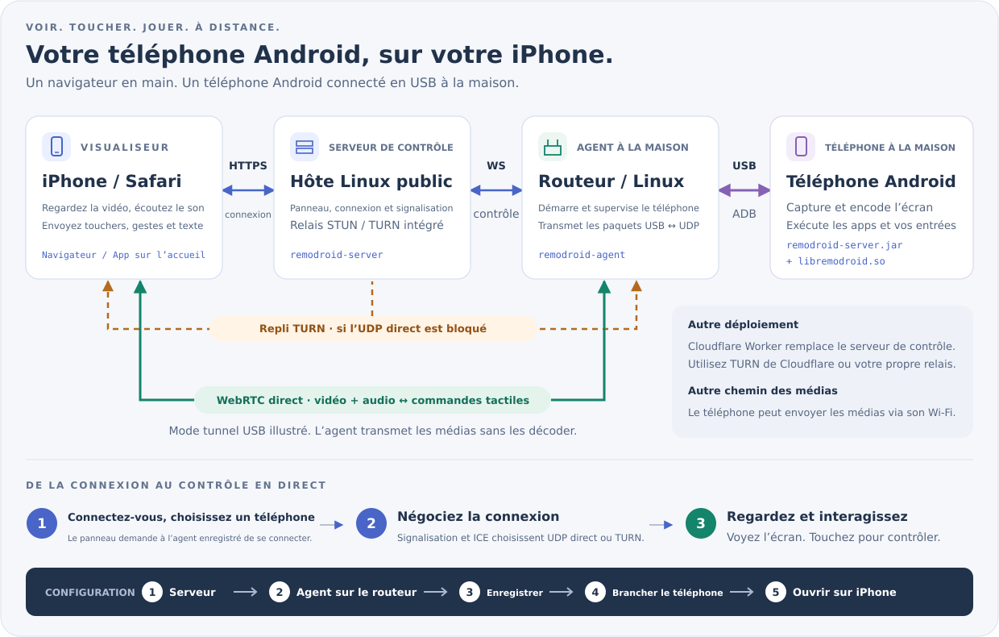

<p align="center"><a href="../../README.md">English</a> | <a href="../zh/README.md">简体中文</a> | <a href="../ja/README.md">日本語</a> | <a href="../ko/README.md">한국어</a> | <a href="../es/README.md">Español</a> | <a href="../pt-BR/README.md">Português (Brasil)</a> | <a href="../de/README.md">Deutsch</a> | <b>Français</b> | <a href="../ru/README.md">Русский</a></p>

# RemoDroid

Contrôlez un téléphone Android, ou un ordinateur Windows, Mac ou Linux, depuis Safari sur votre iPhone (ou n’importe quel navigateur) avec une faible latence, assez bonne pour le jeu en cloud.

## De quoi ai-je besoin ?

**Deux pièces : un panneau, et RemoDroid sur ce que vous voulez contrôler.** Le panneau est la page web où vous vous connectez : mettez-le sur **Cloudflare** si vous n’avez pas de serveur (gratuit, aucune machine à entretenir), ou sur votre propre serveur **Linux** ou **Windows**. Ensuite, pour contrôler un **téléphone Android**, installez *RemoDroid pour téléphones* sur le routeur (ou toute machine Linux) auquel le téléphone est branché en USB ; pour contrôler un **ordinateur Windows, Mac ou Linux**, installez *RemoDroid pour ordinateurs* sur cet ordinateur. Vous regardez et contrôlez depuis Safari sur votre iPhone, ou n’importe quel navigateur ; rien à y installer.

**Le panneau : choisissez-en un.**

| Mettre le panneau sur | Choisissez-le si | Mise en place |
|---|---|---|
| [**Cloudflare**](#panel-cloudflare) | Vous n’avez pas de serveur. Cloudflare héberge la page et relaie la vidéo quand un réseau bloque la connexion directe (1 000 Go par mois gratuits). | Quelques minutes dans le navigateur |
| [**Un serveur Linux**](#panel-linux) | Vous louez un VPS avec une IP publique. Choisissez une région proche de chez vous : il relaie la vidéo si besoin. | Une commande |
| [**Un serveur Windows**](#panel-windows) | Pareil, sous Windows Server 2019 ou plus récent (Windows 10 ou 11 avec une IP publique convient aussi). | Décompresser et cliquer sur *Install and start* |

**Puis, sur chaque chose à contrôler :**

| Pour contrôler | Installez | Où |
|---|---|---|
| Un **téléphone Android** | [**RemoDroid pour téléphones**](#for-phones) | Sur le routeur (OpenWrt, ASUS Merlin ou toute machine Linux) auquel le téléphone est branché en USB. Rien n’est installé sur le téléphone. |
| Un PC **Windows** | [**RemoDroid pour ordinateurs**](#for-computers) | Sur ce PC (Windows 10 1809 ou plus récent) |
| Un **Mac** | [**RemoDroid pour ordinateurs**](#for-computers) | Sur ce Mac (macOS 13 ou plus récent) |
| Un PC **Linux** | [**RemoDroid pour ordinateurs**](#for-computers) | Sur ce PC (une session X11) |

Un panneau gère autant de téléphones et d’ordinateurs que vous voulez. Chaque installation suit les mêmes trois étapes :
[1. le panneau](#step-panel) → [2. RemoDroid sur ce que vous contrôlez](#step-device) → [3. ouvrez-le sur votre iPhone](#step-iphone).

<p align="center"><a href="https://remodroid.pages.dev/fr/"></a></p>

<p align="center">L’assistant pose les mêmes deux questions et vous guide jusqu’au bout, avec des boutons de copie.</p>

## Comment ça marche

<p align="center"></p>

Le **panneau** sert la page web, votre connexion et l’établissement de la liaison. **RemoDroid pour téléphones**, sur le routeur de la maison, parle au téléphone en USB avec son propre ADB intégré (pas besoin d’`adb`) et lance un petit assistant sur le téléphone. L’assistant capture l’écran, l’encode en matériel et l’envoie en WebRTC directement à Safari ; vos touchers reviennent par le même chemin. Le routeur ne fait que relayer des paquets ; rien n’est décodé en route. **RemoDroid pour ordinateurs** fait la même chose depuis l’ordinateur lui-même : il capture l’écran, l’encode sur le GPU et reçoit la souris et le clavier.

<details>
<summary>Plus de détails : chemins des médias, TURN, ce qui tourne sur le téléphone</summary>

- **Chemin des médias.** Par défaut, le téléphone envoie ses médias par le câble USB et le programme du routeur les met sur le réseau en UDP, donc le téléphone n’a pas besoin de Wi-Fi. Avec `[phone] path = wifi` dans `agent.ini`, le téléphone utilise son propre Wi-Fi, ce qui peut être plus rapide quand le routeur est aussi le point d’accès Wi-Fi.
- **TURN.** Quand aucun chemin UDP direct n’est trouvé entre l’iPhone et chez vous (NAT de l’opérateur, pare-feu stricts), les médias passent par le relais TURN du panneau. Ils ne sont toujours pas décodés.
- **Sur le téléphone :** `remodroid-server.jar` (capture d’écran, MediaCodec H.265/H.264, injection d’entrées, presse-papiers, alimentation de l’écran, fichiers) et `libremodroid.so` (une pile WebRTC en C : ICE, DTLS-SRTP, canaux de données SCTP, contrôle de congestion). Les deux tournent en tant qu’utilisateur shell via `app_process`, donc rien n’est installé comme une app. Pendant la connexion, l’écran du téléphone est éteint pour économiser l’énergie et son son sort de votre iPhone.
- Notes de conception et décisions : [`plan.md`](../../plan.md).

</details>

## Ce qu’il vous faut

RemoDroid est léger : le téléphone ou l’ordinateur fait le gros du travail (capture et encodage matériel), le routeur ne fait que relayer des paquets et le panneau ne fait qu’établir les connexions. Le plus important est le **débit montant à la maison**.

| | Minimum | Recommandé | Ce qu’il utilise |
|---|---|---|---|
| **Panneau** | Un compte Cloudflare gratuit, ou toute machine Linux ou Windows Server 2019+ avec une IP publique : 1 CPU, 128 Mo de RAM, quelques Mo de disque | Sur votre serveur : une petite VM dans la région cloud **la plus proche de chez vous** (elle transporte le flux quand TURN est nécessaire), avec assez de trafic mensuel | Environ 2 Mo de RAM et presque pas de CPU. De la bande passante seulement quand une session se rabat sur TURN ; alors tout le flux y passe (environ 4,5 Go par heure à 10 Mb/s) |
| **Routeur** (pour un téléphone) | OpenWrt, Linux (Debian, Ubuntu, CentOS, Alpine) ou ASUS Merlin avec Koolshare, un port USB et environ 2 Mo d’espace libre. CPU : x86, ARM ou MIPS | Un routeur ARM (aarch64, ARMv7) ou x86. Un MIPS faible marche mais risque de ne pas suivre les plus hauts débits | Environ 2 Mo de RAM. Du CPU seulement pour déplacer des paquets entre USB et UDP ; rien n’est décodé |
| **Téléphone Android** | Android 8 ou plus récent, débogage USB, un encodeur H.264 matériel | Android 12 ou plus récent (pour le son) avec un encodeur H.265 matériel | Son propre encodeur matériel ; l’écran est éteint pendant la connexion |
| **Ordinateur** | Windows 10 1809+, macOS 13+ ou Linux avec une session X11 | Un encodeur GPU (toute puce récente Intel, AMD, NVIDIA ou Apple) | Son encodeur GPU ; sans lui, H.264 logiciel à 30 fps |
| **iPhone** | Safari | Un iOS récent, pour le H.265 en WebRTC (les anciens iOS passent automatiquement en H.264) | Décodage vidéo matériel |
| **Réseau** | 3–5 Mb/s montants à la maison (720p) | 10–20 Mb/s montants à la maison et autant en descendant sur l’iPhone (1080p, 60 fps) | 1–20 Mb/s par flux (plafond par défaut 20 Mb/s, 60 fps) ; la qualité s’adapte toute seule |

Le délai attendu est de 40–80 ms quand l’iPhone joint votre maison directement, et d’environ 70–120 ms via TURN. Les chiffres de mémoire viennent d’un serveur en marche et d’un routeur RT-AC86U.

## Installation

<a name="step-panel"></a>

### 1. Le panneau

Choisissez-lui un emplacement : Cloudflare, un serveur Linux ou un serveur Windows. Vous pourrez déménager plus tard ; les routeurs et ordinateurs sont alors ajoutés de nouveau au nouveau panneau.

<a name="panel-cloudflare"></a>

#### Sur Cloudflare (sans serveur)

1. **Créez une clé TURN** (elle relaie la vidéo quand un réseau bloque la connexion directe). Dans le [tableau de bord Cloudflare](https://dash.cloudflare.com/) : **Realtime → TURN Server → Create**. Gardez son **Turn Token ID** et son **API Token** ; copiez l’API Token tout de suite.
2. **Déployez le panneau.** Forkez ce dépôt, puis dans le tableau de bord **Workers & Pages → Create → Import a repository**, choisissez votre fork et mettez le répertoire racine à `worker`. Ensuite chaque push sur votre fork met le panneau à jour tout seul. Ou depuis un ordinateur : `cd worker && npm install && npx wrangler deploy`.
3. **Ouvrez-le et terminez la configuration tout de suite**, à `https://remodroid.<vous>.workers.dev` : tant que ce n’est pas fait, le premier visiteur choisit l’identifiant. Par précaution, donnez d’abord au Worker un secret `SETUP_TOKEN` (Settings → Variables and Secrets → Add, type *Secret* ; une variable ordinaire est perdue au déploiement suivant) ; la page de configuration le demandera. La page de configuration demande votre identifiant et la clé TURN.

Rien à ouvrir dans un pare-feu : Cloudflare s’occupe du relais. L’onglet **Serveur** du panneau change ensuite l’identifiant et la clé TURN.

<a name="panel-linux"></a>

#### Sur un serveur Linux

```sh
curl -fsSL https://remodroid.pages.dev/install_server.sh | sudo sh
```

Il choisit le bon paquet, l’installe, démarre le panneau et affiche un lien comme `http://<ip>:5580/wizard.html?token=…`. Ouvrez-le et renseignez le port web, votre **domaine** (pour le HTTPS automatique de Let's Encrypt), l’identifiant administrateur et le port STUN/TURN. Le panneau redémarre sur vos ports et il est prêt.

Ouvrez ces ports dans le pare-feu : **TCP 5580** (seulement pour la configuration), votre port web (**80**) et **443** si vous utilisez un domaine, **UDP 3478** et **UDP 49152–49252** (TURN).

Pour installer un paquet à la main, prenez-le dans le tableau ci-dessous, puis :

```sh
sudo apt install ./remodroid-server_*.deb                  # Debian, Ubuntu
sudo dnf install ./remodroid-server-*.rpm                  # CentOS, Fedora
sudo apk add --allow-untrusted ./remodroid-server_*.apk    # Alpine

sudo systemctl enable --now remodroid-server               # systemd
rc-update add remodroid-server && rc-service remodroid-server start            # Alpine
```

Ouvrez ensuite `http://<serveur>:5580/wizard.html?token=…`. Le token est dans `/var/lib/remodroid/setup-token`.

<a name="panel-windows"></a>

#### Sur un serveur Windows

Windows Server 2019 ou plus récent ; Windows 10 et 11 fonctionnent aussi. Téléchargez le `.zip` Windows ci-dessous, décompressez-le dans un dossier où il peut rester, lancez **RemoDroidServer.exe** et choisissez **Install and start**. Il fait tourner le panneau comme service Windows, qui démarre avec Windows que quelqu’un soit connecté ou non, et l’autorise dans le pare-feu Windows. La même fenêtre règle l’administrateur, le port web, le domaine HTTPS et STUN/TURN, démarre et arrête le panneau et affiche son journal ; son icône reste près de l’horloge. Depuis une invite de commandes : `remodroid-server install` (en administrateur). Ouvrez les mêmes ports que sous Linux dans le pare-feu de votre fournisseur cloud.

<!-- downloads:server -->
#### Télécharger le panneau pour un serveur Linux ou Windows (v0.6.1)

Choisissez la ligne selon le CPU du serveur (`uname -m` : `x86_64`, `aarch64` = ARM64, `armv7l` = ARMv7, `i686` = x86) et la colonne selon son système. *Tout Linux* contient le panneau et RemoDroid pour téléphones.

| Panneau | Debian · Ubuntu | CentOS · Fedora | Alpine | Tout Linux |
|:--|:-:|:-:|:-:|:-:|
| **x86_64**<br><sub>Intel / AMD 64 bits</sub> | [](https://github.com/yinyue123/RemoDroid/releases/download/v0.6.1/remodroid-server_0.6.1-1_amd64.deb) | [](https://github.com/yinyue123/RemoDroid/releases/download/v0.6.1/remodroid-server-0.6.1-1.x86_64.rpm) | [](https://github.com/yinyue123/RemoDroid/releases/download/v0.6.1/remodroid-server_0.6.1-r1_x86_64.apk) | [](https://github.com/yinyue123/RemoDroid/releases/download/v0.6.1/remodroid-0.6.1-linux-x86_64.tar.gz) |
| **ARM64**<br><sub>aarch64</sub> | [](https://github.com/yinyue123/RemoDroid/releases/download/v0.6.1/remodroid-server_0.6.1-1_arm64.deb) | [](https://github.com/yinyue123/RemoDroid/releases/download/v0.6.1/remodroid-server-0.6.1-1.aarch64.rpm) | [](https://github.com/yinyue123/RemoDroid/releases/download/v0.6.1/remodroid-server_0.6.1-r1_aarch64.apk) | [](https://github.com/yinyue123/RemoDroid/releases/download/v0.6.1/remodroid-0.6.1-linux-aarch64.tar.gz) |
| **ARMv7**<br><sub>ARM 32 bits</sub> | [](https://github.com/yinyue123/RemoDroid/releases/download/v0.6.1/remodroid-server_0.6.1-1_armhf.deb) | [](https://github.com/yinyue123/RemoDroid/releases/download/v0.6.1/remodroid-server-0.6.1-1.armv7hl.rpm) | [](https://github.com/yinyue123/RemoDroid/releases/download/v0.6.1/remodroid-server_0.6.1-r1_armv7.apk) | [](https://github.com/yinyue123/RemoDroid/releases/download/v0.6.1/remodroid-0.6.1-linux-armv7.tar.gz) |
| **x86**<br><sub>32 bits</sub> | [](https://github.com/yinyue123/RemoDroid/releases/download/v0.6.1/remodroid-server_0.6.1-1_i386.deb) | [](https://github.com/yinyue123/RemoDroid/releases/download/v0.6.1/remodroid-server-0.6.1-1.i686.rpm) | [](https://github.com/yinyue123/RemoDroid/releases/download/v0.6.1/remodroid-server_0.6.1-r1_x86.apk) | [](https://github.com/yinyue123/RemoDroid/releases/download/v0.6.1/remodroid-0.6.1-linux-x86.tar.gz) |

Serveur Windows : décompressez, lancez **RemoDroidServer.exe** et choisissez *Install and start* ; la même fenêtre règle l’administrateur, le port web, le domaine HTTPS et STUN/TURN, et affiche le journal.

| Panneau | **x86_64**<br><sub>Intel / AMD</sub> | **ARM64**<br><sub>Graviton, Snapdragon…</sub> |
|:--|:-:|:-:|
| **Windows** Server 2019+, 10 1809+, 11 | [](https://github.com/yinyue123/RemoDroid/releases/download/v0.6.1/RemoDroid-Server-0.6.1-windows-x86_64.zip) | [](https://github.com/yinyue123/RemoDroid/releases/download/v0.6.1/RemoDroid-Server-0.6.1-windows-arm64.zip) |

Sommes de contrôle : [SHA256SUMS](https://github.com/yinyue123/RemoDroid/releases/download/v0.6.1/SHA256SUMS)
<!-- /downloads:server -->

<details>
<summary>Tout Linux (.tar.gz) à la main</summary>

L’archive contient `bin/`, `web/`, `phone/` et `etc/` (fichiers ini d’exemple et unités de service). Pour le panneau :

```sh
sudo install -m 0755 bin/remodroid-server /usr/bin/
sudo mkdir -p /usr/share/remodroid /etc/remodroid
sudo cp -r web /usr/share/remodroid/web
sudo install -m 0640 etc/server.ini.example /etc/remodroid/server.ini
remodroid-server -c /etc/remodroid/server.ini
```

`etc/remodroid-server.service` est une unité systemd à copier dans `/etc/systemd/system/`.

</details>

<details>
<summary>Réglages du panneau après la configuration</summary>

L’assistant écrit `/etc/remodroid/server.ini` (Windows : `%ProgramData%\RemoDroid\server.ini`). Ensuite, la même page, derrière la connexion, modifie les réglages, et l’onglet **Serveur** du panneau change un réglage à la fois (domaine, ports, identifiant, liste STUN/TURN). `remodroid-server -t` vérifie le fichier sans rien démarrer. Les certificats HTTPS se renouvellent seuls. Les paquets conservent votre `server.ini` lors des mises à jour.

</details>

<a name="step-device"></a>

### 2. RemoDroid sur ce que vous contrôlez

<a name="for-phones"></a>

#### Un téléphone Android : RemoDroid pour téléphones

Il va sur le routeur où le téléphone sera branché (ou toute machine Linux avec un port USB), pas sur le téléphone.

OpenWrt, Alpine :

```sh
wget -qO- https://remodroid.pages.dev/install_agent.sh | sh
```

Debian, Ubuntu, CentOS, Fedora :

```sh
curl -fsSL https://remodroid.pages.dev/install_agent.sh | sudo sh
```

ASUS Merlin avec Koolshare : prenez le paquet Merlin ci-dessous et voyez *ASUS Merlin / Koolshare* plus bas.

<!-- downloads:agent -->
#### Télécharger RemoDroid pour téléphones (v0.6.1)

Choisissez la ligne selon le CPU de la machine (`uname -m` : `x86_64`, `aarch64` = ARM64, `armv7l` = ARMv7, `i686` = x86) et la colonne selon son système. OpenWrt : prenez le build indiqué par `opkg print-architecture`. *Tout Linux* contient RemoDroid pour téléphones et le panneau (seulement RemoDroid pour téléphones sur MIPS).

| Pour téléphones | Debian · Ubuntu | CentOS · Fedora | Alpine | OpenWrt | Tout Linux |
|:--|:-:|:-:|:-:|:-:|:-:|
| **x86_64**<br><sub>Intel / AMD 64 bits</sub> | [](https://github.com/yinyue123/RemoDroid/releases/download/v0.6.1/remodroid-agent_0.6.1-1_amd64.deb) | [](https://github.com/yinyue123/RemoDroid/releases/download/v0.6.1/remodroid-agent-0.6.1-1.x86_64.rpm) | [](https://github.com/yinyue123/RemoDroid/releases/download/v0.6.1/remodroid-agent_0.6.1-r1_x86_64.apk) | [](https://github.com/yinyue123/RemoDroid/releases/download/v0.6.1/remodroid-agent_0.6.1-1_x86_64.ipk) | [](https://github.com/yinyue123/RemoDroid/releases/download/v0.6.1/remodroid-0.6.1-linux-x86_64.tar.gz) |
| **ARM64**<br><sub>aarch64</sub> | [](https://github.com/yinyue123/RemoDroid/releases/download/v0.6.1/remodroid-agent_0.6.1-1_arm64.deb) | [](https://github.com/yinyue123/RemoDroid/releases/download/v0.6.1/remodroid-agent-0.6.1-1.aarch64.rpm) | [](https://github.com/yinyue123/RemoDroid/releases/download/v0.6.1/remodroid-agent_0.6.1-r1_aarch64.apk) | [](https://github.com/yinyue123/RemoDroid/releases/download/v0.6.1/remodroid-agent_0.6.1-1_aarch64_generic.ipk)<br>[](https://github.com/yinyue123/RemoDroid/releases/download/v0.6.1/remodroid-agent_0.6.1-1_aarch64_cortex-a53.ipk)<br>[](https://github.com/yinyue123/RemoDroid/releases/download/v0.6.1/remodroid-agent_0.6.1-1_aarch64_cortex-a72.ipk) | [](https://github.com/yinyue123/RemoDroid/releases/download/v0.6.1/remodroid-0.6.1-linux-aarch64.tar.gz) |
| **ARMv7**<br><sub>ARM 32 bits</sub> | [](https://github.com/yinyue123/RemoDroid/releases/download/v0.6.1/remodroid-agent_0.6.1-1_armhf.deb) | [](https://github.com/yinyue123/RemoDroid/releases/download/v0.6.1/remodroid-agent-0.6.1-1.armv7hl.rpm) | [](https://github.com/yinyue123/RemoDroid/releases/download/v0.6.1/remodroid-agent_0.6.1-r1_armv7.apk) | [](https://github.com/yinyue123/RemoDroid/releases/download/v0.6.1/remodroid-agent_0.6.1-1_arm_cortex-a7_neon-vfpv4.ipk)<br>[](https://github.com/yinyue123/RemoDroid/releases/download/v0.6.1/remodroid-agent_0.6.1-1_arm_cortex-a9_vfpv3-d16.ipk)<br>[](https://github.com/yinyue123/RemoDroid/releases/download/v0.6.1/remodroid-agent_0.6.1-1_arm_cortex-a15_neon-vfpv4.ipk) | [](https://github.com/yinyue123/RemoDroid/releases/download/v0.6.1/remodroid-0.6.1-linux-armv7.tar.gz) |
| **x86**<br><sub>32 bits</sub> | [](https://github.com/yinyue123/RemoDroid/releases/download/v0.6.1/remodroid-agent_0.6.1-1_i386.deb) | [](https://github.com/yinyue123/RemoDroid/releases/download/v0.6.1/remodroid-agent-0.6.1-1.i686.rpm) | [](https://github.com/yinyue123/RemoDroid/releases/download/v0.6.1/remodroid-agent_0.6.1-r1_x86.apk) | [](https://github.com/yinyue123/RemoDroid/releases/download/v0.6.1/remodroid-agent_0.6.1-1_i386_pentium4.ipk) | [](https://github.com/yinyue123/RemoDroid/releases/download/v0.6.1/remodroid-0.6.1-linux-x86.tar.gz) |
| **MIPS LE**<br><sub>mipsel</sub> | — | — | — | [](https://github.com/yinyue123/RemoDroid/releases/download/v0.6.1/remodroid-agent_0.6.1-1_mipsel_24kc.ipk) | [](https://github.com/yinyue123/RemoDroid/releases/download/v0.6.1/remodroid-0.6.1-linux-mipsel.tar.gz) |
| **MIPS BE**<br><sub>mips</sub> | — | — | — | [](https://github.com/yinyue123/RemoDroid/releases/download/v0.6.1/remodroid-agent_0.6.1-1_mips_24kc.ipk) | [](https://github.com/yinyue123/RemoDroid/releases/download/v0.6.1/remodroid-0.6.1-linux-mips.tar.gz) |

Installeurs hors ligne Koolshare / KoolCenter : [Merlin armv7](https://github.com/yinyue123/RemoDroid/releases/download/v0.6.1/remodroid-0.6.1-merlin-armv7.tar.gz) · [Merlin aarch64](https://github.com/yinyue123/RemoDroid/releases/download/v0.6.1/remodroid-0.6.1-merlin-aarch64.tar.gz). RT-AC86U et RT-AX88U : prenez aarch64. Ils ne contiennent que RemoDroid pour téléphones, en plugins de routeur (pas des paquets OpenWrt).

Sommes de contrôle : [SHA256SUMS](https://github.com/yinyue123/RemoDroid/releases/download/v0.6.1/SHA256SUMS)
<!-- /downloads:agent -->

**Quel fichier OpenWrt ?** Cherchez votre routeur et son CPU dans [openwrt.md](openwrt.md), qui liste aussi les versions d’OpenWrt qui fonctionnent.

**OpenWrt avec LuCI, sans ligne de commande :** dans LuCI, ouvrez **Système → Logiciels → Téléverser un paquet…**, choisissez le `.ipk` de votre routeur et installez-le. Une page **Services → RemoDroid** apparaît : elle ajoute le routeur à votre panneau (étape suivante), démarre et arrête le programme, et indique si le panneau et le téléphone sont connectés.

Sur les autres systèmes, installez le paquet et démarrez le service :

```sh
opkg install ./remodroid-agent_*.ipk                       # OpenWrt
sudo apt install ./remodroid-agent_*.deb                   # Debian, Ubuntu
sudo dnf install ./remodroid-agent-*.rpm                   # CentOS, Fedora
sudo apk add --allow-untrusted ./remodroid-agent_*.apk     # Alpine

/etc/init.d/remodroid-agent enable && /etc/init.d/remodroid-agent start        # OpenWrt
sudo systemctl enable --now remodroid-agent                # systemd
rc-update add remodroid-agent && rc-service remodroid-agent start              # Alpine
```

<details>
<summary>Tout Linux (.tar.gz) à la main</summary>

Depuis l’archive décompressée :

```sh
sudo install -m 0755 bin/remodroid-agent /usr/bin/
sudo ln -s remodroid-agent /usr/bin/remodroid
sudo mkdir -p /usr/share/remodroid /etc/remodroid
sudo cp -r phone/. /usr/share/remodroid/
sudo install -m 0600 etc/agent.ini.example /etc/remodroid/agent.ini
remodroid-agent -c /etc/remodroid/agent.ini
```

`etc/remodroid-agent.service` (systemd) et `etc/remodroid-agent.init` (procd d’OpenWrt) le lancent au démarrage.

</details>

<details>
<summary>ASUS Merlin / Koolshare</summary>

Prenez le paquet Merlin ci-dessus qui correspond au CPU de votre routeur (`uname -m`) :

- `remodroid-<version>-merlin-aarch64.tar.gz` pour `aarch64` : modèles HND 64 bits comme RT-AC86U et RT-AX88U
- `remodroid-<version>-merlin-armv7.tar.gz` pour `armv7l` : modèles ARM 32 bits comme RT-AC68U

Installez-le dans **Software Center → Manual installation**. L’installeur refuse un paquet pour le mauvais CPU. Il ajoute une page au routeur pour les réglages, le démarrage/l’arrêt, les journaux et un démarrage automatique optionnel. L’installation ne le démarre pas. Un Asuswrt-Merlin de base sans le centre logiciel Koolshare/KoolCenter n’est pas pris en charge. Compilation, migration et limites : [paquet Merlin](../../packaging/merlin/README.md).

</details>

**Ajoutez le routeur au panneau.** Dans le panneau, ouvrez **Agents → Ajouter**. Il affiche une commande avec un code à usage unique ; lancez-la sur le routeur :

```sh
remodroid enroll --panel https://your.panel --code X5SX-K3M7
```

Sous OpenWrt, vous pouvez aussi coller cette même commande dans **Services → RemoDroid → Appairer** dans LuCI. Le code sert une fois, pendant 10 minutes. Le routeur apparaît ensuite en ligne ; touchez-le pour changer ses réglages.

**Branchez le téléphone.** Sur le téléphone, activez **Options pour les développeurs → Débogage USB**. Branchez-le sur le port USB du routeur et touchez **Autoriser** à l’invite « Autoriser le débogage USB ? » (cochez « Toujours autoriser »). C’est la seule fois où vous touchez au téléphone.

<a name="for-computers"></a>

#### Un ordinateur : RemoDroid pour ordinateurs

Un ordinateur n’a pas besoin de routeur : installez **RemoDroid** dessus, lancez-le et ajoutez-le au panneau depuis l’icône de la zone de notification (ou de la barre des menus) en collant la ligne que le panneau affiche dans **Agents → Ajouter → Ordinateur**. Il tourne en tant qu’utilisateur connecté, affiche une notification quand quelqu’un se connecte, et son icône devient rouge pendant qu’on le regarde (**Disconnect viewer** est à un clic). Le spectateur entend ce que joue l’ordinateur (l’interrupteur **Sound**, ou `desktop.audio = false` pour ne jamais l’envoyer), et **Show log** dans le menu de l’icône ouvre une fenêtre de journal en direct. Windows 10 1809+ et macOS 13+ ; Linux a besoin d’une session X11 (sous GNOME : « GNOME on Xorg »). L’image est encodée sur le GPU s’il y en a un (Media Foundation, VideoToolbox, et VA-API sous Linux avec un GPU AMD ou Intel, Steam Deck compris : H.265 ou H.264 jusqu’à 60 fps) ; sinon en logiciel (H.264, 30 fps).

<!-- downloads:desktop -->
#### Télécharger RemoDroid pour ordinateurs (v0.6.1)

Installez-le sur l’ordinateur à contrôler, puis appairez-le en collant la ligne du panneau (Agents → Ajouter → Ordinateur). La version macOS fonctionne sur les Mac Apple silicon et Intel.

| Ordinateur | **x86_64**<br><sub>Intel / AMD</sub> | **ARM64**<br><sub>Apple silicon, Snapdragon…</sub> |
|:--|:-:|:-:|
| **Windows** 10 1809+, 11 | [](https://github.com/yinyue123/RemoDroid/releases/download/v0.6.1/RemoDroid-0.6.1-windows-x86_64.zip) | [](https://github.com/yinyue123/RemoDroid/releases/download/v0.6.1/RemoDroid-0.6.1-windows-arm64.zip) |
| **macOS** 13+ | [](https://github.com/yinyue123/RemoDroid/releases/download/v0.6.1/RemoDroid-0.6.1-macos.zip) | [](https://github.com/yinyue123/RemoDroid/releases/download/v0.6.1/RemoDroid-0.6.1-macos.zip) |
| **Linux** (session X11) | [](https://github.com/yinyue123/RemoDroid/releases/download/v0.6.1/remodroid-desktop_0.6.1-1_amd64.deb)<br>[](https://github.com/yinyue123/RemoDroid/releases/download/v0.6.1/remodroid-desktop-0.6.1-1.x86_64.rpm)<br>[](https://github.com/yinyue123/RemoDroid/releases/download/v0.6.1/remodroid-desktop-0.6.1-linux-x86_64.tar.gz)<br>[](https://github.com/yinyue123/RemoDroid/releases/download/v0.6.1/RemoDroid-0.6.1-linux-x86_64.AppImage) | [](https://github.com/yinyue123/RemoDroid/releases/download/v0.6.1/remodroid-desktop_0.6.1-1_arm64.deb)<br>[](https://github.com/yinyue123/RemoDroid/releases/download/v0.6.1/remodroid-desktop-0.6.1-1.aarch64.rpm)<br>[](https://github.com/yinyue123/RemoDroid/releases/download/v0.6.1/remodroid-desktop-0.6.1-linux-aarch64.tar.gz)<br>[](https://github.com/yinyue123/RemoDroid/releases/download/v0.6.1/RemoDroid-0.6.1-linux-aarch64.AppImage) |

Sommes de contrôle : [SHA256SUMS](https://github.com/yinyue123/RemoDroid/releases/download/v0.6.1/SHA256SUMS)
<!-- /downloads:desktop -->

- **Windows** : décompressez et lancez `RemoDroid.exe`. Pour contrôler aussi les fenêtres de programmes lancés en administrateur (installeurs, Gestionnaire des tâches, l’app Windows du panneau elle-même), choisissez une fois **Control administrator windows…** dans son menu et confirmez en administrateur : il installe le petit service `RemoDroidInput`, qui leur transmet la souris et le clavier du spectateur (`remodroid-input install` / `uninstall` fait de même). Les invites UAC restent hors de portée. **macOS** : déplacez `RemoDroid.app` dans Applications, ouvrez-le (la première fois : clic droit → Ouvrir) et autorisez **Enregistrement de l’écran** et **Accessibilité** quand il le demande. **Linux** : installez le `.deb` / `.rpm` et lancez *RemoDroid* depuis le menu des applications. Sur les autres distributions, prenez le `.AppImage` : `chmod +x` puis lancez-le (`./RemoDroid-*.AppImage desktopd …` est l’agent sans interface). Il utilise les bibliothèques GTK 3 et X11 du système, que tout bureau possède déjà.
- **Fichiers et presse-papiers, comme AirDrop** : déposez des fichiers sur la visionneuse et ils arrivent dans `Downloads/RemoDroid` sur l’ordinateur ; déposez des fichiers sur la fenêtre RemoDroid de l’ordinateur (zone de notification / barre des menus → *Pairing & status…*) et le navigateur du spectateur les télécharge. Le texte copié se synchronise tout seul dans les deux sens sous Chrome et Edge ; Safari et Firefox affichent un bouton Copier.
- Pas d’écran ou pas de zone de notification ? Lancez la même ligne dans un terminal (`remodroid-desktopd pair --panel … --code …`), puis `remodroid-desktopd` (les paquets Linux fournissent une unité utilisateur systemd).
- Les réglages sont dans `desktop.ini` (`%APPDATA%\RemoDroid`, `~/Library/Application Support/RemoDroid`, `~/.config/remodroid`) et dans le panneau. Conception : [`multi-platform.md`](../../multi-platform.md).

<a name="step-iphone"></a>

### 3. Ouvrez-le sur votre iPhone

Ouvrez votre panneau dans Safari, connectez-vous, puis **Partager → Sur l’écran d’accueil**. Lancé depuis l’écran d’accueil, il est en plein écran (Safari ne peut pas masquer ses barres sur une page normale). Touchez votre téléphone ou votre ordinateur pour vous connecter.

## Utilisation

- Le **toucher** marche comme sur le téléphone, multitouch compris. La **boule flottante** ouvre le menu : verrouiller, reconnecter, plein écran, son, envoi de photo, presse-papiers et réglages.
- **Sur un ordinateur**, la souris et le clavier passent directement (les touches sont physiques, donc la disposition de l’ordinateur s’applique ; ⌘ et Ctrl s’échangent quand un seul côté est un Mac). Depuis un iPhone, le bas de l’écran est un **trackpad**, comme celui d’un Mac : le pointeur se déplace sur une image agrandie, pour que le texte de l’ordinateur reste lisible, et l’image défile quand le pointeur arrive à 10 % du bord, jusqu’au bord de l’écran lui-même. Touchez pour cliquer, touchez deux fois pour double-cliquer, touchez puis glissez pour faire glisser, touchez à deux doigts pour un clic droit, faites défiler à deux doigts, écartez-les pour zoomer ; **⤢** montre tout l’écran. Le trackpad et le clavier sont un seul panneau d’une seule taille : **⌨** dans le coin droit de son en-tête le transforme en clavier et, au même endroit, **▭** revient ; **⌄** le replie en bouton, glisser l’en-tête le redimensionne et **⚙** règle la vitesse. Sur un iPad ou un ordinateur de bureau, le panneau flotte comme une carte que vous déplacez par son en-tête ([`trackpad.md`](../../trackpad.md)). L’élément **Trackpad** du menu l’active ou le désactive sur tout appareil, navigateur de bureau compris (la souris y est un doigt sur le pad : cliquer clique au pointeur, appuyer et bouger le déplace, la molette fait défiler, Ctrl + molette zoome). Désactivé, **Direct** touche là où vous touchez (appui long pour un clic droit), le mode par défaut sur un iPad et avec une souris. Là, **Keyboard** ouvre un clavier flottant à l’écran (déplacez-le par sa poignée ; touchez **ctrl** puis **c** pour Ctrl+C), son **⋯** envoie du texte et des raccourcis, et **Next screen** change d’écran.
- **Jeux sur un ordinateur** (Linux, par ex. un Steam Deck en mode Bureau) : **Gamepad** pose des commandes tactiles sur l’image, disposées comme dans Steam Link (sticks, croix directionnelle, A/B/X/Y, gâchettes hautes et basses) ; tenez le téléphone à l’horizontale. Glissez un doigt sur l’image (hors des boutons) pour tourner la caméra, comme dans PUBG : la vitesse du geste incline le stick droit, en haut, en bas et sur les côtés. **⚙ → Edit layout** déplace n’importe quelle commande et la rend plus petite ou plus grande ; chaque disposition garde son arrangement. Son **⚙** choisit une disposition (Steam Link, Simple, Shooter, Racing), zoome l’image (**Fill screen** rogne les bords ; les curseurs la déplacent), règle la vitesse du geste (ou le coupe, pour que toucher l’image clique de nouveau) et la transparence des boutons. Les manettes appairées à l’iPhone ou à l’iPad (Joy-Con, DualSense, Xbox) marchent aussi ; Safari ne les expose que sur une page HTTPS. Chacune devient une manette Xbox 360 virtuelle sur l’ordinateur, ce qui demande un `/dev/uinput` accessible en écriture : SteamOS l’a ; ailleurs, installez les règles udev de Steam (`steam-devices`).
- Le **son** vient du téléphone (Android 12+) et son haut-parleur se tait pendant la connexion. Touchez une fois l’image pour réactiver le son dans Safari ; l’interrupteur **Sound** du menu le rend au téléphone.
- **Mettez à jour** le serveur ou le routeur plus tard en une commande. Elle met les parties installées à la dernière version, garde `server.ini` / `agent.ini` et les redémarre :

  ```sh
  curl -fsSL https://remodroid.pages.dev/update.sh | sudo sh    # OpenWrt: wget -qO- … | sh
  ```

<details>
<summary>Commandes du routeur</summary>

Sur le routeur, ces commandes parlent au programme en marche (sans adb) :

```sh
remodroid-agent devices | status | shell … | push | pull | logcat | key | restart-server
```

</details>

## Extras

<details>
<summary><b>Contrôle par IA</b> : laissez une IA lire l’écran et toucher à votre place</summary>

L’IA pilote le téléphone en REST sous `/api/v1/devices/{id}/` :

- `GET …/ui` renvoie l’écran en JSON (depuis un UiAutomation dans le processus sur le téléphone ; `uiautomator dump` en secours).
- `GET …/screenshot?format=jpeg&max_edge=1280` renvoie l’image (mise à l’échelle sur le GPU, compressée en C sur le téléphone, jamais écrite sur disque).
- `POST …/actions` touche, saisit, fait défiler et attend par sélecteur.

Le programme du routeur le sert (`[api] listen` + `token` dans `agent.ini`) et le serveur le relaie (`remodroid-server gentoken NAME`). Un enchaînement que l’IA trouve une fois est enregistré sous `skills/` et rejoué par Python sans appeler le modèle ; s’il rencontre du nouveau, il rend l’écran à l’IA.

```sh
export PYTHONPATH=python RD_URL=http://192.168.1.1:8790 RD_TOKEN=…
python3 -m remodroid ui                      # the screen as an outline
python3 -m remodroid tap --rid search --wait-change
python3 skills/settings-search/run.py --query wifi
```

Conception : [skill-plan.md](../../skill-plan.md). Écrire des skills : [skills/README.md](../../skills/README.md).

</details>

<details>
<summary><b>MCP</b> : utilisez téléphones et ordinateurs depuis Claude, ChatGPT et d’autres assistants IA</summary>

Chaque téléphone a un point d’accès MCP, `https://<panneau>/mcp/<utilisateur>/<appareil>`, avec des outils pour lire l’écran (`get_ui`, `screenshot`) et s’en servir (`wake_phone`, `tap`, `type_text`, `swipe`, `scroll`, `press_key`, `launch_app`, `wait_for`) ; `wake_phone` trouve le chemin au-delà de l’écran de verrouillage et `swipe` peut tracer un schéma d’un seul geste. Les ordinateurs (Windows, macOS, Linux) ont leur propre point d’accès et leurs outils : `screenshot`, `click`, `move_mouse`, `drag`, `scroll`, `type_text` et `press_key`. La personne devant l’ordinateur est prévenue quand un assistant commence, et un ordinateur en lecture seule ne peut qu’être regardé. claude.ai et ChatGPT se connectent en OAuth (vous touchez Autoriser sur une page RemoDroid) ; Claude Code, Claude Desktop, Codex et les API de Claude et d’OpenAI utilisent un jeton d’API du panneau (Serveur → Jetons d’API). Chaque jeton peut y être révoqué, et un jeton sans la portée `control` ne peut que regarder.

L’onglet Agents du panneau mène au guide `/mcp/help`, qui affiche les URL de vos téléphones, crée un jeton et donne la configuration de chaque assistant. Fonctionne avec remodroid-server et le Worker. Conception : [mcp.md](../../mcp.md).

</details>

<details>
<summary><b>Notifications du téléphone</b> : recevez les notifications du téléphone sur votre iPhone ou via Bark</summary>

L’assistant du téléphone interroge `dumpsys notification` (le seul contenu de notification visible par l’utilisateur shell), écarte celles qui sont permanentes ou peu importantes et envoie chaque nouvelle aux clients connectés par le WebSocket de la visionneuse, et à [Bark](https://github.com/Finb/Bark) quand le serveur a un `bark_url`. De là, vous pouvez appeler l’API de contrôle par IA (ou un skill) pour agir.

- Routeur, `agent.ini` : `[notify] enabled = true`, plus `min_importance` et une liste `ignore`.
- Serveur, `server.ini` : `[notify] bark_url = https://api.day.app/<key>` (ou par routeur sous `[device_notify]`). La clé Bark reste sur le serveur et n’est jamais journalisée. La livraison par WebSocket ne demande aucun réglage du serveur.

Des configurations d’exemple sont dans `deploy/`.

</details>

## État

Tous les tests du tableau ci-dessous passent, y compris avec un vrai Chrome comme visionneuse, et le son a été vérifié sur un Sony SO-51A (Android 12). Pas encore vérifié sur du vrai matériel (jalon M0 du plan) : le serveur Java du téléphone sur un éventail de téléphones (capture, réglages de l’encodeur, entrées, presse-papiers, alimentation de l’écran), l’ADB USB sur les routeurs, les particularités de Safari (prise en charge du H.265, décodage matériel) et le contrôle de congestion sur de vrais réseaux.

## Développement

<details>
<summary>Ce que contient ce dépôt</summary>

| Chemin | Quoi | Langage |
|---|---|---|
| `server/` | Serveur de contrôle (le panneau) : page de connexion + cookies (Basic auth pour les routeurs), API REST, WebSockets visionneuse/appareil, relais TURN intégré, HTTPS optionnel avec certificats Let's Encrypt automatiques (ACME) ; sous Windows un service (`win.c`) et une app de zone de notification avec fenêtre de réglages (`win/`) | C + libev + mbedTLS |
| `agent/` | RemoDroid pour téléphones (sur le routeur) : client ADB intégré (usbfs), superviseur du téléphone, relais UDP, client WebSocket, CLI | C + libev |
| `rtc/` | La pile WebRTC partagée par le téléphone et les ordinateurs : ICE + client TURN, DTLS-SRTP, canaux de données SCTP, RTP H.265/H.264, contrôle de congestion ; `host.c` la fait tourner dans son propre thread derrière une interface C (`rd_rtc.h`) | C |
| `desktop/` | RemoDroid pour ordinateurs : `core/` (session, entrées, fichiers, chaîne vidéo, liaison au serveur), backends `win/`, `mac/`, `linux/`, et `app/` (apps de zone de notification / barre des menus, `remodroid-desktopd` sans interface) ; compilé en `libremodroid` (.dll / .dylib / .so) | C, Objective-C |
| `android/java/` | Serveur du téléphone : capture d’écran, MediaCodec, injection d’entrées, presse-papiers, alimentation de l’écran, fichiers, logcat | Java (app_process) |
| `web/` | Client iPhone (PWA) : vidéo, son, multitouch, menu de la boule flottante, envoi de photos, presse-papiers, tous les réglages ; `panel.html` (onglets Appareils, Agents, Serveur) et `wizard.html` (première configuration) | HTML/CSS/JS |
| `worker/` | Le même panneau sur Cloudflare Workers + un Durable Object, avec Cloudflare TURN | JS |
| `wizard/` | Le site d’installation (Cloudflare Pages, remodroid.pages.dev), `install_server.sh`, `install_agent.sh`, `update.sh` ; `i18n/` génère chaque langue à partir de la page anglaise | HTML, sh, Python |
| `common/` | C partagé : trames WebSocket, trames de tunnel, STUN, enveloppe JSON, ini, utilitaires | C |
| `third_party/` | Bibliothèques fournies, liées statiquement : libev, inih, cJSON, picohttpparser, crypt_blowfish, mbedTLS, libsrtp2, usrsctp, minih264, libopus (son des ordinateurs) | C |
| `deploy/` | `server.ini` / `agent.ini` d’exemple, unités systemd, scripts OpenRC, le script procd du programme du routeur | |
| `packaging/`, `.github/workflows/` | Définitions de paquets nFPM (deb, rpm, apk ; ipk pour le routeur), le zip du serveur Windows et le workflow CI de compilation/publication | |
| `python/`, `skills/`, `.claude/skills/phone/` | Contrôle par IA : le SDK `remodroid` et la CLI `rd`, des skills rejouables et le skill Claude Code qui les utilise | Python |
| `tests/` | Tests de bout en bout | Node, Python |
| `demo/` | Le panneau maquette d’origine (hors ligne, sans serveur) | HTML |

</details>

<details>
<summary>Compilation</summary>

Compilation sur l’hôte (développement et tests) :

```sh
make            # build/host/remodroid-server, build/host/remodroid-agent
make rtc-tests  # build/host/rtc/rtc_test, rtp_dump (phone stack on the host)
```

Binaires statiques de publication pour routeurs et serveurs (Zig comme compilateur croisé, musl, tout lié) :

```sh
make dist                   # inside the build container (build/Dockerfile, needs podman/docker)
./build/dist.sh mipsel      # or directly, with `zig` on PATH; targets: x86 x86_64 armv7 aarch64 mipsel mips
```

Les résultats arrivent dans `build/out/<arch>/` : environ 0,8 Mo par binaire (1,2 Mo sur MIPS, qui n’a que le programme du routeur).

Le serveur pour Windows (`remodroid-server.exe` et l’app de zone de notification `RemoDroidServer.exe`), compilé en croisé avec Zig ou nativement dans MSYS2 :

```sh
make TARGET=win-x86_64 CC="zig cc -target x86_64-windows-gnu" AR="zig ar" WINDRES=llvm-windres
```

Fichiers du téléphone (`remodroid-server.jar` + `libremodroid.so` par ABI) :

```sh
ANDROID_JAR=.../platforms/android-34/android.jar D8=.../build-tools/34.0.0/d8 NDK=.../android-ndk-r27c \
  ./android/build.sh        # build/android/remodroid-server.jar, build/android/<abi>/libremodroid.so
```

</details>

<details>
<summary>Tests</summary>

| Commande | Couvre |
|---|---|
| `make test` | Plan de contrôle de bout en bout : vrais serveur + programme du routeur, un faux adbd fidèle au protocole (authentification RSA vérifiée avec OpenSSL), faux téléphone ; authentification, REST, WebSockets, ADB push/shell/sync, tunnel, relais UDP, commandes, modifications d’`agent.ini`, CLI, reconnexions (48 vérifications) |
| (dans `make test`) | Transfert des notifications : la configuration `[notify]` atteint le téléphone, une notification capturée atteint une visionneuse par WebSocket, et le serveur l’envoie en JSON à un faux point d’accès Bark |
| `python3 tests/python_sdk.py` | Le SDK de contrôle par IA, la CLI `rd` et l’exécuteur de skills face à une fausse API de téléphone : sélecteurs, captures en mémoire, passage de main à l’IA (code 3), reprise avec `--from-step` |
| `QEMU=qemu-mipsel node tests/run.mjs build/mipsel` | La même chose, avec les binaires statiques MIPS du routeur en émulation mode utilisateur |
| `python rtc/test/rtc_interop.py` | Pile WebRTC du téléphone ↔ aiortc : ICE, DTLS-SRTP, SCTP, images H.264 décodées, canaux de données |
| `python rtc/test/rtp_depack.py` | Empaqueteurs H.265 et H.264 : aller-retour exact au bit près par un dépaqueteur indépendant + FFmpeg |
| `python tests/e2e_webrtc.py [--relay]` | Chemin complet : visionneuse → serveur → programme du routeur → tunnel → pile du téléphone ; `--relay` force le TURN intégré |
| `python tests/e2e_browser.py` | Le vrai client web dans Chrome sans interface face à toute la pile : vidéo, toucher, menu, protocole |
| `node tests/server_windows.mjs build/win-x86_64` | Le serveur sous Windows (CI) : sous son superviseur, le redémarrage de l’assistant sur un nouveau port, fichiers statiques, connexion, WebSocket, TURN, `settings` / `configure` et le service Windows (installer, redémarrer, arrêter, désinstaller) |
| `node tests/setup.mjs build/host` | Assistant de première configuration (jeton de configuration, enregistrement, redémarrage sur le nouveau port), connexion, codes d’inscription avec le vrai `enroll`, réglages du routeur par le panneau, renommer, retirer |
| `node tests/worker.mjs build/host` | Le Worker Cloudflare sous `wrangler dev` (après `cd worker && npm install`) avec le vrai programme du routeur : configuration, connexion, inscription, WebSocket de la visionneuse et signalisation, commandes, renommer, retirer |
| `sudo tests/openwrt.sh IP [VERSION]` | OpenWrt (19.07–24.10) dans podman avec sa propre adresse sur le LAN (macvlan), avec LuCI, l’ipk compilé depuis ce dépôt et un serveur ; ouvrez `http://IP/` depuis un autre appareil et appairez dans Services → RemoDroid |
| `make desktop-test && build/host/desktop/desk_test web/app.js` | Cœur pour ordinateurs sans écran : la table des touches face à celle de la visionneuse, décodage des entrées, tailles vidéo, conversion des couleurs, l’encodeur logiciel |
| `python tests/e2e_desktop.py` | Un bureau Linux de bout en bout : appairage avec un code, puis la vraie visionneuse dans Chrome sans interface pilote Xvfb via le serveur et `remodroid-desktopd` : image, clics, molette, touches, texte, presse-papiers dans les deux sens, envoi |
| `node tests/tls.mjs build/host` | HTTPS, redirection, cookies `Secure`, visionneuse et programme du routeur en `wss://` (AC de confiance et non), rechargement du certificat sur SIGHUP ; avec `PEBBLE_DIR`, émission ACME, réutilisation et renouvellement automatique face à Pebble (l’AC de test de Let's Encrypt) |

Les tests Python demandent `aiortc` (et `playwright` + Chromium pour celui du navigateur).

</details>

Documents de conception : [plan.md](../../plan.md) (architecture et décisions), [skill-plan.md](../../skill-plan.md) (contrôle par IA), [packaging/merlin/README.md](../../packaging/merlin/README.md) (plugin Merlin).
