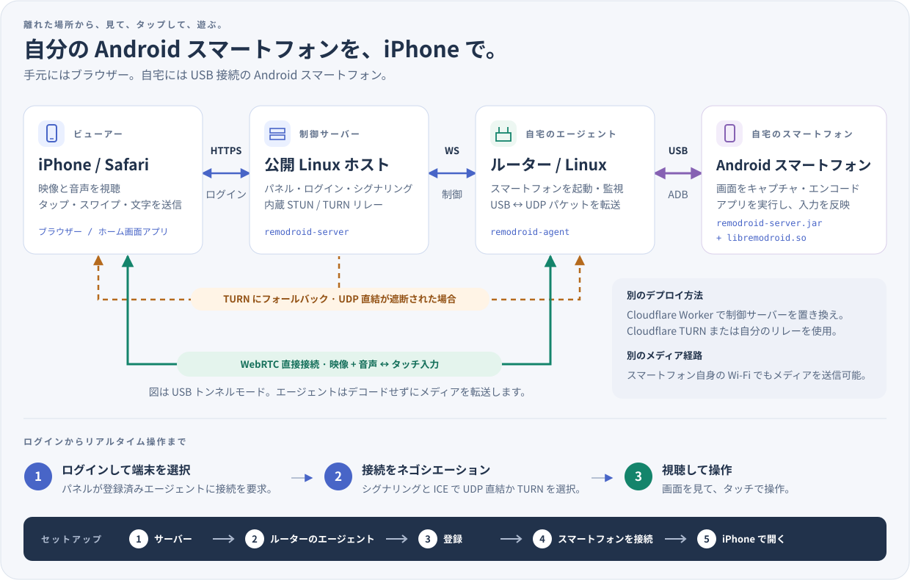

<p align="center"><a href="../../README.md">English</a> | <a href="../zh/README.md">简体中文</a> | <b>日本語</b> | <a href="../ko/README.md">한국어</a> | <a href="../es/README.md">Español</a> | <a href="../pt-BR/README.md">Português (Brasil)</a> | <a href="../de/README.md">Deutsch</a> | <a href="../fr/README.md">Français</a> | <a href="../ru/README.md">Русский</a></p>

# RemoDroid

iPhone の Safari から Android スマートフォンを低遅延で操作できます。クラウドゲームにも十分使える応答速度です。
スマートフォンは自宅に置き、USB ケーブルでルーターにつなぎます。どこからでも画面を見てタップできます。

<p align="center"><a href="https://remodroid.pages.dev/ja/"></a></p>

<p align="center"></p>

**仕組みを一段落で。** 公開マシン上の小さな**サーバー**（または無料の Cloudflare Worker）が、Web ページ、ログイン、接続の確立を担当します。自宅ルーター上の**エージェント**が内蔵 ADB（`adb` は不要）を使って USB 経由でスマートフォンと通信し、小さな補助プログラムをスマートフォンで起動します。補助プログラムは画面をキャプチャし、ハードウェアでエンコードして WebRTC で Safari に直接送ります。タッチ操作は同じ経路を逆向きに戻ります。ルーターはパケットを転送するだけで、途中では一切デコードしません。

<details>
<summary>詳しい説明：メディア経路、TURN、スマートフォンで動くもの</summary>

- **メディア経路。** 標準ではスマートフォンが USB ケーブルでメディアを送り、エージェントが UDP としてネットワークに送出するため、スマートフォンに Wi-Fi は不要です。`agent.ini` に `[phone] path = wifi` を設定するとスマートフォン自身の Wi-Fi を使います。ルーターが Wi-Fi アクセスポイントも兼ねている場合は、その方が速いことがあります。
- **TURN。** iPhone と自宅の間に直接の UDP 経路を確立できない場合（通信事業者の NAT、厳しいファイアウォール）、メディアはサーバー内蔵の TURN リレーを経由します。この場合もデコードは行いません。
- **スマートフォン上：** `remodroid-server.jar`（画面キャプチャ、MediaCodec H.265/H.264、入力注入、クリップボード、画面の電源制御、ファイル）と `libremodroid.so`（C 製 WebRTC スタック：ICE、DTLS-SRTP、SCTP データチャネル、輻輳制御）が動きます。どちらも `app_process` を通じて shell ユーザーとして動くため、アプリはインストールされません。接続中は節電のためスマートフォンのパネルを消灯し、音声は iPhone で再生します。
- 設計のメモと判断：[`plan.md`](../../plan.md)。

</details>

## 必要なもの

RemoDroid は軽量です。重い処理（キャプチャとハードウェアエンコード）はスマートフォンが行い、ルーターはパケット転送、サーバーは接続の確立だけを担当します。最も重要なのは**自宅のアップロード速度**です。

| | 最低要件 | 推奨 | 使用するリソース |
|---|---|---|---|
| **サーバー** | 公開 IP を持つ任意の Linux マシン：CPU 1 個、RAM 128 MB、ディスク数 MB。または無料の Cloudflare アカウント | **自宅に最も近い**クラウドリージョンの小型 VM（TURN が必要なときにストリームを中継）で、月間転送量が十分あるもの | RAM 約 2 MB、CPU はほぼ不使用。セッションが TURN にフォールバックした場合だけ帯域を使用し、そのときはストリーム全体が通過（10 Mbps で毎時約 4.5 GB） |
| **ルーター** | OpenWrt、Linux（Debian、Ubuntu、CentOS、Alpine）、または Koolshare 付き ASUS Merlin。USB ポートと約 2 MB の空きストレージ。CPU：x86、ARM、MIPS | ARM（aarch64、ARMv7）または x86 ルーター。低性能の MIPS ルーターでも動作しますが、最高ビットレートには追いつかない場合があります | RAM 約 2 MB。CPU は USB と UDP の間でパケットを移動するためだけに使用し、デコードはしません |
| **Android スマートフォン** | Android 8 以降、USB デバッグ、H.264 ハードウェアエンコーダー | Android 12 以降（音声用）、H.265 ハードウェアエンコーダー搭載 | 自身のハードウェアエンコーダーを使用。接続中は画面を消灯 |
| **iPhone** | Safari | WebRTC で H.265 を使える新しい iOS（古い iOS には自動的に H.264 を送信） | ハードウェア動画デコード |
| **ネットワーク** | 自宅の上り 3–5 Mbps（720p） | 自宅の上り 10–20 Mbps と同等の iPhone の下り（1080p、60 fps） | ストリームごとに 1–20 Mbps（標準上限 20 Mbps、60 fps）。品質は自動調整 |

iPhone が自宅に直接接続できる場合の想定遅延は 40–80 ms、TURN 経由では約 70–120 ms です。
メモリ使用量は稼働中のサーバーと RT-AC86U 上のエージェントで測定した値です。

## インストール

<p align="center"><a href="https://remodroid.pages.dev/ja/"></a></p>

**ウィザードがすべての手順を案内し、コピーボタンも用意しています。** ここで進めたい場合は、次の 5 ステップに従ってください。図の下部と同じ 5 ステップです。

### 1. サーバー

Linux サーバーで実行します：

```sh
curl -fsSL https://remodroid.pages.dev/install_server.sh | sudo sh
```

適切なパッケージを選択してインストールし、サーバーを起動して、`http://<ip>:5580/wizard.html?token=…` のようなリンクを表示します。

<!-- downloads:server -->
#### サーバーをダウンロード（v0.4）

マシンの CPU に対応する行（`uname -m`：`x86_64`、`aarch64` = ARM64、`armv7l` = ARMv7、`i686` = x86）と、システムに対応する列を選びます。OpenWrt では `opkg print-architecture` に表示されるビルドを選んでください。*任意の Linux* にはサーバーとエージェントの両方が入っています。

| サーバー | Debian · Ubuntu | CentOS · Fedora | Alpine | OpenWrt | 任意の Linux |
|:--|:-:|:-:|:-:|:-:|:-:|
| **x86_64**<br><sub>Intel / AMD 64 ビット</sub> | [](https://github.com/yinyue123/RemoDroid/releases/download/v0.4/remodroid-server_0.4-1_amd64.deb) | [](https://github.com/yinyue123/RemoDroid/releases/download/v0.4/remodroid-server-0.4-1.x86_64.rpm) | [](https://github.com/yinyue123/RemoDroid/releases/download/v0.4/remodroid-server_0.4-r1_x86_64.apk) | [](https://github.com/yinyue123/RemoDroid/releases/download/v0.4/remodroid-server_0.4-1_x86_64.ipk) | [](https://github.com/yinyue123/RemoDroid/releases/download/v0.4/remodroid-0.4-linux-x86_64.tar.gz) |
| **ARM64**<br><sub>aarch64</sub> | [](https://github.com/yinyue123/RemoDroid/releases/download/v0.4/remodroid-server_0.4-1_arm64.deb) | [](https://github.com/yinyue123/RemoDroid/releases/download/v0.4/remodroid-server-0.4-1.aarch64.rpm) | [](https://github.com/yinyue123/RemoDroid/releases/download/v0.4/remodroid-server_0.4-r1_aarch64.apk) | [](https://github.com/yinyue123/RemoDroid/releases/download/v0.4/remodroid-server_0.4-1_aarch64_generic.ipk)<br>[](https://github.com/yinyue123/RemoDroid/releases/download/v0.4/remodroid-server_0.4-1_aarch64_cortex-a53.ipk)<br>[](https://github.com/yinyue123/RemoDroid/releases/download/v0.4/remodroid-server_0.4-1_aarch64_cortex-a72.ipk) | [](https://github.com/yinyue123/RemoDroid/releases/download/v0.4/remodroid-0.4-linux-aarch64.tar.gz) |
| **ARMv7**<br><sub>32 ビット ARM</sub> | [](https://github.com/yinyue123/RemoDroid/releases/download/v0.4/remodroid-server_0.4-1_armhf.deb) | [](https://github.com/yinyue123/RemoDroid/releases/download/v0.4/remodroid-server-0.4-1.armv7hl.rpm) | [](https://github.com/yinyue123/RemoDroid/releases/download/v0.4/remodroid-server_0.4-r1_armv7.apk) | [](https://github.com/yinyue123/RemoDroid/releases/download/v0.4/remodroid-server_0.4-1_arm_cortex-a7_neon-vfpv4.ipk)<br>[](https://github.com/yinyue123/RemoDroid/releases/download/v0.4/remodroid-server_0.4-1_arm_cortex-a9_vfpv3-d16.ipk)<br>[](https://github.com/yinyue123/RemoDroid/releases/download/v0.4/remodroid-server_0.4-1_arm_cortex-a15_neon-vfpv4.ipk) | [](https://github.com/yinyue123/RemoDroid/releases/download/v0.4/remodroid-0.4-linux-armv7.tar.gz) |
| **x86**<br><sub>32 ビット</sub> | [](https://github.com/yinyue123/RemoDroid/releases/download/v0.4/remodroid-server_0.4-1_i386.deb) | [](https://github.com/yinyue123/RemoDroid/releases/download/v0.4/remodroid-server-0.4-1.i686.rpm) | [](https://github.com/yinyue123/RemoDroid/releases/download/v0.4/remodroid-server_0.4-r1_x86.apk) | [](https://github.com/yinyue123/RemoDroid/releases/download/v0.4/remodroid-server_0.4-1_i386_pentium4.ipk) | [](https://github.com/yinyue123/RemoDroid/releases/download/v0.4/remodroid-0.4-linux-x86.tar.gz) |
| **MIPS LE**<br><sub>mipsel</sub> | — | — | — | [](https://github.com/yinyue123/RemoDroid/releases/download/v0.4/remodroid-server_0.4-1_mipsel_24kc.ipk) | [](https://github.com/yinyue123/RemoDroid/releases/download/v0.4/remodroid-0.4-linux-mipsel.tar.gz) |
| **MIPS BE**<br><sub>mips</sub> | — | — | — | [](https://github.com/yinyue123/RemoDroid/releases/download/v0.4/remodroid-server_0.4-1_mips_24kc.ipk) | [](https://github.com/yinyue123/RemoDroid/releases/download/v0.4/remodroid-0.4-linux-mips.tar.gz) |

チェックサム： [SHA256SUMS](https://github.com/yinyue123/RemoDroid/releases/download/v0.4/SHA256SUMS)
<!-- /downloads:server -->

インストールしてサービスを起動します：

```sh
sudo apt install ./remodroid-server_*.deb                  # Debian, Ubuntu
sudo dnf install ./remodroid-server-*.rpm                  # CentOS, Fedora
sudo apk add --allow-untrusted ./remodroid-server_*.apk    # Alpine
opkg install ./remodroid-server_*.ipk                      # OpenWrt

sudo systemctl enable --now remodroid-server               # systemd
rc-update add remodroid-server && rc-service remodroid-server start            # Alpine
/etc/init.d/remodroid-server enable && /etc/init.d/remodroid-server start      # OpenWrt
```

次に `http://<server>:5580/wizard.html?token=…` を開きます。トークンは `/var/lib/remodroid/setup-token` にあります。

<details>
<summary>任意の Linux に手動でインストール（.tar.gz）</summary>

アーカイブには `bin/`、`web/`、`phone/`、`etc/`（ini 設定例とサービスユニット）が入っています。サーバーの場合：

```sh
sudo install -m 0755 bin/remodroid-server /usr/bin/
sudo mkdir -p /usr/share/remodroid /etc/remodroid
sudo cp -r web /usr/share/remodroid/web
sudo install -m 0640 etc/server.ini.example /etc/remodroid/server.ini
remodroid-server -c /etc/remodroid/server.ini
```

`etc/remodroid-server.service` は systemd ユニットです。`/etc/systemd/system/` にコピーできます。

</details>

**セットアップ。** ウィザードで Web ポート、**ドメイン**（Let's Encrypt による自動 HTTPS 用）、管理者のログイン情報、STUN/TURN ポートを入力します。指定したポートでサーバーが再起動し、パネルが使えるようになります。

ファイアウォールで次のポートを開放してください：**TCP 5580**（初期設定時のみ）、Web ポート（**80**）、ドメイン使用時は **443**、**UDP 3478**、**UDP 49152–49252**（TURN）。

<details>
<summary>サーバーがない場合は Cloudflare を使用</summary>

1. Cloudflare ダッシュボードで TURN キーを作成します：**リアルタイム → TURN サーバー**。
2. `worker/` をデプロイします：`cd worker && npm install && npx wrangler deploy`。または、自分のフォークを Cloudflare にインポートし、ルートディレクトリを `worker` に設定します。
3. `https://remodroid.<you>.workers.dev` を開きます。ウィザードでログイン情報と TURN キーを入力します。

Worker は、ストレージ内蔵の Durable Object 上で同じパネル（ログイン、ルーター、シグナリング）を動かします。
ファイアウォールの手順は省略してください。Cloudflare の TURN が中継します。

</details>

<details>
<summary>セットアップ後のサーバー設定</summary>

ウィザードは `/etc/remodroid/server.ini` を書き込みます。その後はログイン後の同じページで設定を編集でき、パネルの**サーバー**タブでは設定を 1 項目ずつ変更できます（ドメイン、ポート、ログイン情報、STUN/TURN 一覧）。
`remodroid-server -t` は何も起動せずにファイルを検査します。HTTPS 証明書は自動更新されます。
パッケージをアップグレードしても `server.ini` は保持されます。

</details>

### 2. ルーターのエージェント

OpenWrt、Alpine：

```sh
wget -qO- https://remodroid.pages.dev/install_agent.sh | sh
```

Debian、Ubuntu、CentOS、Fedora：

```sh
curl -fsSL https://remodroid.pages.dev/install_agent.sh | sudo sh
```

<!-- downloads:agent -->
#### エージェントをダウンロード（v0.4）

マシンの CPU に対応する行（`uname -m`：`x86_64`、`aarch64` = ARM64、`armv7l` = ARMv7、`i686` = x86）と、システムに対応する列を選びます。OpenWrt では `opkg print-architecture` に表示されるビルドを選んでください。*任意の Linux* にはサーバーとエージェントの両方が入っています。

| エージェント | Debian · Ubuntu | CentOS · Fedora | Alpine | OpenWrt | 任意の Linux |
|:--|:-:|:-:|:-:|:-:|:-:|
| **x86_64**<br><sub>Intel / AMD 64 ビット</sub> | [](https://github.com/yinyue123/RemoDroid/releases/download/v0.4/remodroid-agent_0.4-1_amd64.deb) | [](https://github.com/yinyue123/RemoDroid/releases/download/v0.4/remodroid-agent-0.4-1.x86_64.rpm) | [](https://github.com/yinyue123/RemoDroid/releases/download/v0.4/remodroid-agent_0.4-r1_x86_64.apk) | [](https://github.com/yinyue123/RemoDroid/releases/download/v0.4/remodroid-agent_0.4-1_x86_64.ipk) | [](https://github.com/yinyue123/RemoDroid/releases/download/v0.4/remodroid-0.4-linux-x86_64.tar.gz) |
| **ARM64**<br><sub>aarch64</sub> | [](https://github.com/yinyue123/RemoDroid/releases/download/v0.4/remodroid-agent_0.4-1_arm64.deb) | [](https://github.com/yinyue123/RemoDroid/releases/download/v0.4/remodroid-agent-0.4-1.aarch64.rpm) | [](https://github.com/yinyue123/RemoDroid/releases/download/v0.4/remodroid-agent_0.4-r1_aarch64.apk) | [](https://github.com/yinyue123/RemoDroid/releases/download/v0.4/remodroid-agent_0.4-1_aarch64_generic.ipk)<br>[](https://github.com/yinyue123/RemoDroid/releases/download/v0.4/remodroid-agent_0.4-1_aarch64_cortex-a53.ipk)<br>[](https://github.com/yinyue123/RemoDroid/releases/download/v0.4/remodroid-agent_0.4-1_aarch64_cortex-a72.ipk) | [](https://github.com/yinyue123/RemoDroid/releases/download/v0.4/remodroid-0.4-linux-aarch64.tar.gz) |
| **ARMv7**<br><sub>32 ビット ARM</sub> | [](https://github.com/yinyue123/RemoDroid/releases/download/v0.4/remodroid-agent_0.4-1_armhf.deb) | [](https://github.com/yinyue123/RemoDroid/releases/download/v0.4/remodroid-agent-0.4-1.armv7hl.rpm) | [](https://github.com/yinyue123/RemoDroid/releases/download/v0.4/remodroid-agent_0.4-r1_armv7.apk) | [](https://github.com/yinyue123/RemoDroid/releases/download/v0.4/remodroid-agent_0.4-1_arm_cortex-a7_neon-vfpv4.ipk)<br>[](https://github.com/yinyue123/RemoDroid/releases/download/v0.4/remodroid-agent_0.4-1_arm_cortex-a9_vfpv3-d16.ipk)<br>[](https://github.com/yinyue123/RemoDroid/releases/download/v0.4/remodroid-agent_0.4-1_arm_cortex-a15_neon-vfpv4.ipk) | [](https://github.com/yinyue123/RemoDroid/releases/download/v0.4/remodroid-0.4-linux-armv7.tar.gz) |
| **x86**<br><sub>32 ビット</sub> | [](https://github.com/yinyue123/RemoDroid/releases/download/v0.4/remodroid-agent_0.4-1_i386.deb) | [](https://github.com/yinyue123/RemoDroid/releases/download/v0.4/remodroid-agent-0.4-1.i686.rpm) | [](https://github.com/yinyue123/RemoDroid/releases/download/v0.4/remodroid-agent_0.4-r1_x86.apk) | [](https://github.com/yinyue123/RemoDroid/releases/download/v0.4/remodroid-agent_0.4-1_i386_pentium4.ipk) | [](https://github.com/yinyue123/RemoDroid/releases/download/v0.4/remodroid-0.4-linux-x86.tar.gz) |
| **MIPS LE**<br><sub>mipsel</sub> | — | — | — | [](https://github.com/yinyue123/RemoDroid/releases/download/v0.4/remodroid-agent_0.4-1_mipsel_24kc.ipk) | [](https://github.com/yinyue123/RemoDroid/releases/download/v0.4/remodroid-0.4-linux-mipsel.tar.gz) |
| **MIPS BE**<br><sub>mips</sub> | — | — | — | [](https://github.com/yinyue123/RemoDroid/releases/download/v0.4/remodroid-agent_0.4-1_mips_24kc.ipk) | [](https://github.com/yinyue123/RemoDroid/releases/download/v0.4/remodroid-0.4-linux-mips.tar.gz) |

Koolshare / KoolCenter オフラインインストーラー：[Merlin armv7](https://github.com/yinyue123/RemoDroid/releases/download/v0.4/remodroid-0.4-merlin-armv7.tar.gz) · [Merlin aarch64](https://github.com/yinyue123/RemoDroid/releases/download/v0.4/remodroid-0.4-merlin-aarch64.tar.gz)。RT-AC86U と RT-AX88U は aarch64 を選びます。これらはエージェントのみのプラグインで、OpenWrt パッケージではありません。

チェックサム： [SHA256SUMS](https://github.com/yinyue123/RemoDroid/releases/download/v0.4/SHA256SUMS)
<!-- /downloads:agent -->

**どの OpenWrt ファイルを選ぶ？** [openwrt.md](openwrt.md) でルーターと CPU を確認してください。動作する OpenWrt のバージョンも掲載しています。

**LuCI を使う OpenWrt ならコマンドライン不要：** LuCI の**システム → ソフトウェア → パッケージをアップロード…**を開き、ルーターに合う `.ipk` を選んでインストールします。**サービス → RemoDroid** ページが追加されます。ここでルーターをパネルとペアリング（ステップ 3）し、エージェントを起動・停止し、パネルとスマートフォンの接続状態を確認できます。

その他のシステムでは、インストールしてサービスを起動します：

```sh
opkg install ./remodroid-agent_*.ipk                       # OpenWrt
sudo apt install ./remodroid-agent_*.deb                   # Debian, Ubuntu
sudo dnf install ./remodroid-agent-*.rpm                   # CentOS, Fedora
sudo apk add --allow-untrusted ./remodroid-agent_*.apk     # Alpine

/etc/init.d/remodroid-agent enable && /etc/init.d/remodroid-agent start        # OpenWrt
sudo systemctl enable --now remodroid-agent                # systemd
rc-update add remodroid-agent && rc-service remodroid-agent start              # Alpine
```

<details>
<summary>任意の Linux に手動でインストール（.tar.gz）</summary>

エージェントの場合は、アーカイブを展開したディレクトリで実行します：

```sh
sudo install -m 0755 bin/remodroid-agent /usr/bin/
sudo ln -s remodroid-agent /usr/bin/remodroid
sudo mkdir -p /usr/share/remodroid /etc/remodroid
sudo cp -r phone/. /usr/share/remodroid/
sudo install -m 0600 etc/agent.ini.example /etc/remodroid/agent.ini
remodroid-agent -c /etc/remodroid/agent.ini
```

`etc/remodroid-agent.service`（systemd）と `etc/remodroid-agent.init`（OpenWrt procd）で起動時に自動実行できます。

</details>

<details>
<summary>ASUS Merlin / Koolshare</summary>

上記からルーターの CPU（`uname -m`）に合う Merlin パッケージを選びます：

- `remodroid-<version>-merlin-aarch64.tar.gz` は `aarch64` 用：RT-AC86U、RT-AX88U などの 64 ビット HND モデル
- `remodroid-<version>-merlin-armv7.tar.gz` は `armv7l` 用：RT-AC68U などの 32 ビット ARM モデル

**ソフトウェアセンター → 手動インストール**でインストールします。CPU が異なるパッケージは拒否されます。
設定、起動・停止、ログ、任意の自動起動を管理するルーターページが追加されます。インストールだけではエージェントは起動しません。Koolshare/KoolCenter ソフトウェアセンターのない通常の Asuswrt-Merlin は未対応です。
ビルド、移行、制限：[Merlin パッケージ化](../../packaging/merlin/README.md)。

</details>

### 3. ルーターを登録

パネルで**エージェント → 追加**を開きます。使い捨てコードを含むコマンドが表示されるので、ルーターで実行してください：

```sh
remodroid enroll --panel https://your.panel --code X5SX-K3M7
```

OpenWrt では、代わりに LuCI の**サービス → RemoDroid → ペアリング**に同じコマンドを貼り付けられます。

コードは 1 回限り有効で、有効期間は 10 分です。その後ルーターがオンラインと表示されます。タップすると設定を変更できます。

### 4. スマートフォンを接続

スマートフォンの**開発者向けオプション → USB デバッグ**を有効にします。ルーターの USB ポートにつなぎ、「USB デバッグを許可しますか？」で**許可**をタップします（「常に許可」にチェック）。スマートフォンを直接操作するのはこれだけです。

### 5. iPhone で開く

Safari でパネルを開いてログインし、**共有 → ホーム画面に追加**を選びます。ホーム画面から起動すると全画面で動作します（通常のページでは Safari のバーを非表示にできません）。スマートフォンをタップして接続します。

## 使い方

- **タッチ操作**はスマートフォン本体と同様で、マルチタッチにも対応します。**フローティングボール**からメニューを開けます：ロック、再接続、全画面、音声、写真アップロード、クリップボード、設定。
- **音声**はスマートフォン（Android 12+）から届き、接続中は本体のスピーカーが無音になります。Safari では画面を 1 回タップしてミュートを解除します。メニューの**音声**スイッチで再生先をスマートフォンに戻せます。
- あとからコマンド 1 つでサーバーやルーターを**更新**できます。インストール済みのコンポーネントを最新リリースに更新し、`server.ini` / `agent.ini` を保持して再起動します：

  ```sh
  curl -fsSL https://remodroid.pages.dev/update.sh | sudo sh    # OpenWrt: wget -qO- … | sh
  ```

<details>
<summary>ルーターのコマンド</summary>

ルーター上で、以下のコマンドが稼働中のエージェントと通信します（adb 不要）：

```sh
remodroid-agent devices | status | shell … | push | pull | logcat | key | restart-server
```

</details>

## 追加機能

<details>
<summary><b>AI 操作</b>：AI に画面を読ませ、代わりにタップしてもらう</summary>

AI は `/api/v1/devices/{id}/` 配下の REST API でスマートフォンを操作します：

- `GET …/ui` は画面を JSON で返します（スマートフォン上のプロセス内 UiAutomation を使用し、フォールバックは `uiautomator dump`）。
- `GET …/screenshot?format=jpeg&max_edge=1280` は画像を返します（GPU で縮小し、スマートフォン上の C コードで圧縮。ディスクには書き込みません）。
- `POST …/actions` はセレクターでタップ、入力、スクロール、待機を行います。

ルーターのエージェントが API を提供し（`agent.ini` の `[api] listen` + `token`）、サーバーが中継します（`remodroid-server gentoken NAME`）。AI が一度解決したワークフローは `skills/` に保存され、モデルを呼び出さず Python で再実行されます。新しい状況に遭遇したときは画面を AI に戻します。

```sh
export PYTHONPATH=python RD_URL=http://192.168.1.1:8790 RD_TOKEN=…
python3 -m remodroid ui                      # 画面をアウトラインとして表示
python3 -m remodroid tap --rid search --wait-change
python3 skills/settings-search/run.py --query wifi
```

設計：[skill-plan.md](../../skill-plan.md)。スキルの作成：[skills/README.md](../../skills/README.md)。

</details>

<details>
<summary><b>スマートフォンの通知</b>：iPhone または Bark で受け取る</summary>

スマートフォンの補助プログラムは `dumpsys notification`（shell ユーザーが参照できる唯一の通知内容）をポーリングし、継続中の通知と重要度の低い通知を除外します。新しい通知をビューアーの WebSocket で接続中のクライアントに送り、サーバーに `bark_url` があれば [Bark](https://github.com/Finb/Bark) にも送信します。そこから AI 操作 API（またはスキル）を呼び出して通知に対応できます。

- ルーターの `agent.ini`：`[notify] enabled = true`、および `min_importance` と `ignore` リスト。
- サーバーの `server.ini`：`[notify] bark_url = https://api.day.app/<key>`（または `[device_notify]` でルーターごとに設定）。
  Bark キーはサーバーに保持され、ログには記録されません。WebSocket 配信にはサーバー設定は不要です。

設定例は `deploy/` にあります。

</details>

## 現状

下表のテストは、実際の Chrome をビューアーに使うものも含め、すべて通っています。音声は Sony SO-51A（Android 12）で確認済みです。実機では未確認の項目（計画のマイルストーン M0）：各種スマートフォンでの Java スマートフォンサーバー（キャプチャ、エンコーダー設定、入力、クリップボード、画面の電源制御）、ルーター上の USB ADB、Safari 固有の挙動（H.265 対応、ハードウェアデコード）、実ネットワークでの輻輳制御。

## 開発

<details>
<summary>リポジトリの内容</summary>

| パス | 内容 | 言語 |
|---|---|---|
| `server/` | 制御サーバー：ログインページ + Cookie（ルーターは Basic 認証）、REST API、ビューアー/エージェントの WebSocket、内蔵 TURN リレー、任意の HTTPS と Let's Encrypt（ACME）証明書の自動取得 | C + libev + mbedTLS |
| `agent/` | ルーターエージェント：内蔵 ADB クライアント（usbfs）、スマートフォンのプロセス監視、UDP リレー、WebSocket クライアント、CLI | C + libev |
| `rtc/` | スマートフォンの WebRTC スタック：ICE + TURN クライアント、DTLS-SRTP、SCTP データチャネル、H.265/H.264 RTP、輻輳制御 | C |
| `android/java/` | スマートフォンサーバー：画面キャプチャ、MediaCodec、入力注入、クリップボード、画面の電源制御、ファイル、logcat | Java (app_process) |
| `web/` | iPhone クライアント（PWA）：動画、音声、マルチタッチ、フローティングボールメニュー、写真アップロード、クリップボード、全設定。`panel.html`（デバイス、エージェント、サーバーの各タブ）と `wizard.html`（初回設定） | HTML/CSS/JS |
| `worker/` | Cloudflare Workers + Durable Object 上の同じパネル。Cloudflare TURN を使用 | JS |
| `wizard/` | インストールサイト（Cloudflare Pages、remodroid.pages.dev）、`install_server.sh`、`install_agent.sh`、`update.sh` | HTML, sh |
| `common/` | 共通 C コード：WebSocket フレーミング、トンネルフレーム、STUN、JSON エンベロープ、ini、ユーティリティー | C |
| `third_party/` | リポジトリに同梱し静的リンクするライブラリー：libev、inih、cJSON、picohttpparser、crypt_blowfish、mbedTLS、libsrtp2、usrsctp | C |
| `deploy/` | `server.ini` / `agent.ini` の例、systemd ユニット、OpenRC と procd のスクリプト | |
| `packaging/`, `.github/workflows/` | nFPM パッケージ定義（deb、rpm、apk、ipk）と CI ビルド/リリースワークフロー | |
| `python/`, `skills/`, `.claude/skills/phone/` | AI 操作：`remodroid` SDK と `rd` CLI、再実行可能なスキル、それらを使う Claude Code スキル | Python |
| `tests/` | エンドツーエンドテスト | Node, Python |
| `demo/` | 最初の模擬パネル（オフライン、サーバー不要） | HTML |

</details>

<details>
<summary>ビルド</summary>

ホスト上でのビルド（開発とテスト）：

```sh
make            # build/host/remodroid-server, build/host/remodroid-agent
make rtc-tests  # build/host/rtc/rtc_test, rtp_dump （ホスト上でスマートフォンのスタックを実行）
```

ルーターとサーバー用の静的リリースバイナリー（Zig をクロスコンパイラーとして使い、musl とすべての依存関係をリンク）：

```sh
make dist                   # ビルドコンテナー内で実行（build/Dockerfile、podman/docker が必要）
./build/dist.sh mipsel      # PATH に `zig` があれば直接実行も可能。対象： x86 x86_64 armv7 aarch64 mipsel mips
```

出力先は `build/out/<arch>/` です。バイナリー 1 個あたり約 0.8 MB（MIPS では 1.2 MB）。

スマートフォン用ファイル（`remodroid-server.jar` + ABI ごとの `libremodroid.so`）：

```sh
ANDROID_JAR=.../platforms/android-34/android.jar D8=.../build-tools/34.0.0/d8 NDK=.../android-ndk-r27c \
  ./android/build.sh        # build/android/remodroid-server.jar, build/android/<abi>/libremodroid.so
```

</details>

<details>
<summary>テスト</summary>

| コマンド | 対象 |
|---|---|
| `make test` | 制御プレーンのエンドツーエンド：実際のサーバー + エージェント、プロトコルを忠実に再現した模擬 adbd（RSA 認証を OpenSSL で確認）、模擬スマートフォン。認証、REST、WebSocket、ADB push/shell/sync、トンネル、UDP リレー、コマンド、`agent.ini` の編集、CLI、再接続（48 項目） |
| （`make test` に含む） | 通知転送：`[notify]` 設定がスマートフォンに届き、取得した通知が WebSocket でビューアーに届き、サーバーが模擬 Bark エンドポイントに JSON でプッシュ |
| `python3 tests/python_sdk.py` | 模擬スマートフォン API に対する AI 操作 SDK、`rd` CLI、スキルランナー：セレクター、メモリ内スクリーンショット、AI への引き継ぎ（終了コード 3）、`--from-step` による再開 |
| `QEMU=qemu-mipsel node tests/run.mjs build/mipsel` | ユーザーモードエミュレーションで静的 MIPS ルーターバイナリーに対し同じテストを実施 |
| `python rtc/test/rtc_interop.py` | スマートフォンの WebRTC スタック ↔ aiortc：ICE、DTLS-SRTP、SCTP、H.264 デコードフレーム、データチャネル |
| `python rtc/test/rtp_depack.py` | H.265 と H.264 のパケット化：独立した逆パケット化処理 + FFmpeg を通す往復でビット単位の一致を確認 |
| `python tests/e2e_webrtc.py [--relay]` | 全経路：ビューアー → サーバー → エージェント → トンネル → スマートフォンのスタック。`--relay` で内蔵 TURN を強制 |
| `python tests/e2e_browser.py` | ヘッドレス Chrome の実 Web クライアントで全スタックを検証：動画、タッチ、メニュー、プロトコル |
| `node tests/setup.mjs build/host` | 初回ウィザード（設定トークン、保存、新ポートでの再起動）、ログイン、実エージェントの `enroll` を使う登録コード、パネル経由のルーター設定、名前変更、削除 |
| `node tests/worker.mjs build/host` | `wrangler dev` 上の Cloudflare Worker（`cd worker && npm install` 実行後）と実エージェント：設定、ログイン、登録、ビューアー WebSocket とシグナリング、コマンド、名前変更、削除 |
| `sudo tests/openwrt.sh IP [VERSION]` | 専用 LAN アドレス（macvlan）を持つ podman 上の OpenWrt（19.07–24.10）、LuCI、本リポジトリからビルドしたエージェント ipk とサーバー。他の端末で `http://IP/` を開き、サービス → RemoDroid でペアリング |
| `node tests/tls.mjs build/host` | HTTPS、リダイレクト、`Secure` Cookie、`wss://` によるビューアーとエージェントの接続（信頼済み/未信頼 CA）、SIGHUP による証明書再読込。`PEBBLE_DIR` 設定時は Pebble（Let's Encrypt のテスト CA）で ACME 発行、再利用、自動更新 |

Python テストには `aiortc` が必要です（ブラウザーテストには `playwright` + Chromium も必要）。

</details>

設計文書：[plan.md](../../plan.md)（アーキテクチャと判断）、[skill-plan.md](../../skill-plan.md)（AI 操作）、
[packaging/merlin/README.md](../../packaging/merlin/README.md)（Merlin プラグイン）。
