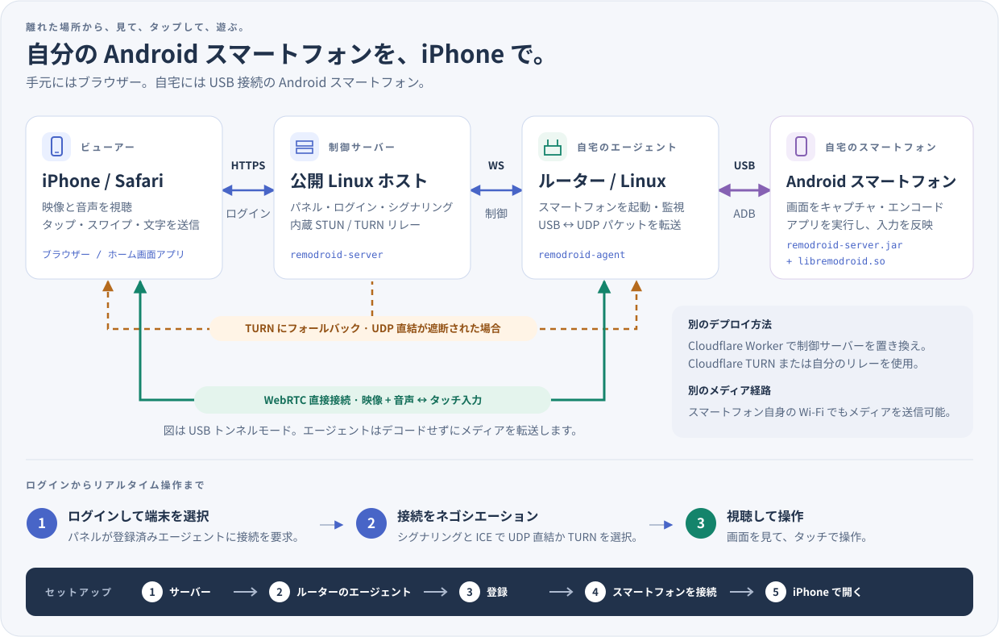

<p align="center"><a href="../../README.md">English</a> | <a href="../zh/README.md">简体中文</a> | <b>日本語</b> | <a href="../ko/README.md">한국어</a> | <a href="../es/README.md">Español</a> | <a href="../pt-BR/README.md">Português (Brasil)</a> | <a href="../de/README.md">Deutsch</a> | <a href="../fr/README.md">Français</a> | <a href="../ru/README.md">Русский</a></p>

# RemoDroid

iPhone の Safari（またはどのブラウザーでも）から、Android スマホや Windows・Mac・Linux のパソコンを低遅延で操作できます。クラウドゲームにも使える速さです。

## 何が必要？

**必要なのは 2 つ：パネルと、操作したい機器に入れる RemoDroid です。** パネルはログインする Web ページです。サーバーがなければ **Cloudflare** に置き（無料、維持するマシンなし）、あれば自分の **Linux** か **Windows** サーバーに置きます。次に、**Android スマホ**を操作するなら、スマホを USB でつなぐルーター（または任意の Linux 機）に *RemoDroid（スマホ用）* を入れます。**Windows・Mac・Linux のパソコン**なら、そのパソコンに *RemoDroid（パソコン用）* を入れます。見るのも操作するのも iPhone の Safari かほかのブラウザーからで、そちらには何も入れません。

**パネル：1 つ選びます。**

| パネルの置き場所 | 向いているのは | セットアップ |
|---|---|---|
| [**Cloudflare**](#panel-cloudflare) | サーバーを持っていない。Cloudflare がページを置き、直接つながらないネットワークでは映像を中継します（月 1,000 GB まで無料）。 | ブラウザーで数分 |
| [**Linux サーバー**](#panel-linux) | グローバル IP のある VPS を借りている。自宅に近いリージョンを選ぶと、必要なときの映像中継に有利です。 | コマンド 1 つ |
| [**Windows サーバー**](#panel-windows) | 同じことを Windows Server 2019 以降で（グローバル IP のある Windows 10 / 11 でも可）。 | 展開して *Install and start* |

**そして、操作したい機器ごとに：**

| 操作するもの | 入れるもの | 入れる場所 |
|---|---|---|
| **Android スマホ** | [**RemoDroid（スマホ用）**](#for-phones) | スマホを USB でつなぐルーター（OpenWrt、ASUS Merlin、または任意の Linux 機）。スマホには何も入れません。 |
| **Windows** パソコン | [**RemoDroid（パソコン用）**](#for-computers) | そのパソコン（Windows 10 1809 以降） |
| **Mac** | [**RemoDroid（パソコン用）**](#for-computers) | その Mac（macOS 13 以降） |
| **Linux** パソコン | [**RemoDroid（パソコン用）**](#for-computers) | そのパソコン（X11 セッション） |

1 つのパネルでスマホもパソコンもいくつでも扱えます。どの組み合わせでも手順は同じ 3 つです：
[1. パネル](#step-panel) → [2. 操作したい機器に RemoDroid](#step-device) → [3. iPhone で開く](#step-iphone)。

<p align="center"><a href="https://remodroid.pages.dev/ja/"></a></p>

<p align="center">ウィザードは同じ 2 つの質問をして、コピーボタン付きで最後まで案内します。</p>

## しくみ

<p align="center"></p>

**パネル**は Web ページ、ログイン、接続の確立を受け持ちます。自宅ルーターの **RemoDroid（スマホ用）** は内蔵の ADB（`adb` 不要）で USB 越しにスマホと話し、スマホ上で小さなヘルパーを起動します。ヘルパーは画面をキャプチャしてハードウェアでエンコードし、WebRTC で Safari へ直接送ります。タッチは同じ経路で戻ります。ルーターはパケットを中継するだけで、途中では何もデコードしません。**RemoDroid（パソコン用）** はパソコン自身で同じことをします：画面をキャプチャし、GPU でエンコードし、マウスとキーボードを受け取ります。

<details>
<summary>詳しく：メディアの経路、TURN、スマホで動くもの</summary>

- **メディアの経路。** 標準ではスマホは USB ケーブルでメディアを送り、ルーター側のプログラムが UDP としてネットワークに出すので、スマホに Wi-Fi は不要です。`agent.ini` で `[phone] path = wifi` にするとスマホ自身の Wi-Fi を使います。ルーターが Wi-Fi アクセスポイントも兼ねている場合はこちらが速いことがあります。
- **TURN。** iPhone と自宅の間で直接の UDP 経路が見つからないとき（キャリア NAT、厳しいファイアウォール）、メディアはパネルの TURN 中継を通ります。それでもデコードはされません。
- **スマホ上：** `remodroid-server.jar`（画面キャプチャ、MediaCodec による H.265/H.264、入力注入、クリップボード、画面の電源、ファイル）と `libremodroid.so`（C で書いた WebRTC スタック：ICE、DTLS-SRTP、SCTP データチャネル、輻輳制御）。どちらも `app_process` 経由で shell ユーザーとして動くので、アプリとしては何もインストールされません。接続中はスマホの画面を消して節電し、音は iPhone から鳴ります。
- 設計メモと判断：[`plan.md`](../../plan.md)。

</details>

## 必要なもの

RemoDroid は軽量です。重い処理（キャプチャとハードウェアエンコード）はスマホやパソコンが行い、ルーターはパケットを中継するだけ、パネルは接続を確立するだけです。いちばん大事なのは**自宅の上り速度**です。

| | 最低 | 推奨 | 使うもの |
|---|---|---|---|
| **パネル** | 無料の Cloudflare アカウント、またはグローバル IP のある Linux マシンか Windows Server 2019+：CPU 1 つ、RAM 128 MB、ディスク数 MB | 自前の場合：**自宅にいちばん近い**クラウドリージョンの小さな VM（TURN が必要なときは映像を運びます）、十分な月間転送量 | RAM 約 2 MB、CPU はほぼゼロ。帯域を使うのは TURN にフォールバックしたときだけで、そのときは映像全体が通ります（10 Mbps で 1 時間あたり約 4.5 GB） |
| **ルーター**（スマホ用） | OpenWrt、Linux（Debian、Ubuntu、CentOS、Alpine）または Koolshare 入りの ASUS Merlin、USB ポート、空き容量約 2 MB。CPU：x86、ARM、MIPS | ARM（aarch64、ARMv7）か x86 のルーター。非力な MIPS ルーターでも動きますが、最高ビットレートには追いつかないことがあります | RAM 約 2 MB。CPU は USB と UDP の間でパケットを運ぶだけで、デコードはしません |
| **Android スマホ** | Android 8 以降、USB デバッグ、ハードウェア H.264 エンコーダー | Android 12 以降（音声のため）、ハードウェア H.265 エンコーダー | 自身のハードウェアエンコーダー。接続中は画面オフ |
| **パソコン** | Windows 10 1809+、macOS 13+、または X11 セッションの Linux | GPU エンコーダー（最近の Intel、AMD、NVIDIA、Apple のチップ） | GPU エンコーダー。なければソフトウェアの H.264、30 fps |
| **iPhone** | Safari | WebRTC で H.265 を使うには新しめの iOS（古い iOS は自動で H.264） | ハードウェアによる映像デコード |
| **ネットワーク** | 自宅の上り 3–5 Mbps（720p） | 自宅の上り 10–20 Mbps、iPhone の下りも同程度（1080p、60 fps） | 1 本あたり 1–20 Mbps（標準の上限は 20 Mbps、60 fps）。画質は自動で調整されます |

iPhone から自宅へ直接つながる場合の遅延は 40–80 ms、TURN 経由だと約 70–120 ms です。メモリの数値は稼働中のサーバーと RT-AC86U ルーターで測ったものです。

## インストール

<a name="step-panel"></a>

### 1. パネル

置き場所を 1 つ選びます：Cloudflare、Linux サーバー、Windows サーバー。あとで移すこともできますが、ルーターやパソコンは新しいパネルに追加し直します。

<a name="panel-cloudflare"></a>

#### Cloudflare に置く（サーバー不要）

1. **TURN キーを作る**（直接つながらないネットワークで映像を中継します）。[Cloudflare ダッシュボード](https://dash.cloudflare.com/)で **Realtime → TURN Server → Create**。**Turn Token ID** と **API Token** を控えます。API Token はすぐにコピーしてください。
2. **パネルをデプロイする。** このリポジトリを fork し、ダッシュボードで **Workers & Pages → Create → Import a repository** から fork を選び、ルートディレクトリを `worker` にします。以後 fork に push するたびにパネルが自動で更新されます。パソコンからなら：`cd worker && npm install && npx wrangler deploy`。
3. **すぐに開いてセットアップを終える。** アドレスは `https://remodroid.<あなた>.workers.dev`。終えるまでは、最初に来た人がログインを決められます。念のため、先に Worker に secret `SETUP_TOKEN` を追加してください（Settings → Variables and Secrets → Add、種類は *Secret*。普通の変数は次のデプロイで消えます）。セットアップページがその値を聞きます。セットアップページではログインと TURN キーを入力します。

ファイアウォールで開けるものはありません。中継は Cloudflare が行います。ログインと TURN キーはあとからパネルの**サーバー**タブで変えられます。

<a name="panel-linux"></a>

#### Linux サーバーに置く

```sh
curl -fsSL https://remodroid.pages.dev/install_server.sh | sudo sh
```

合うパッケージを選んでインストールし、パネルを起動して `http://<ip>:5580/wizard.html?token=…` のようなリンクを表示します。それを開き、Web ポート、**ドメイン**（Let's Encrypt による自動 HTTPS 用）、管理者のログイン、STUN/TURN ポートを入力します。パネルが指定のポートで再起動すれば準備完了です。

ファイアウォールで開けるポート：**TCP 5580**（セットアップ時のみ）、Web ポート（**80**）とドメインを使う場合の **443**、**UDP 3478**、**UDP 49152–49252**（TURN）。

パッケージを手で入れる場合は、下の表から取って：

```sh
sudo apt install ./remodroid-server_*.deb                  # Debian, Ubuntu
sudo dnf install ./remodroid-server-*.rpm                  # CentOS, Fedora
sudo apk add --allow-untrusted ./remodroid-server_*.apk    # Alpine

sudo systemctl enable --now remodroid-server               # systemd
rc-update add remodroid-server && rc-service remodroid-server start            # Alpine
```

次に `http://<サーバー>:5580/wizard.html?token=…` を開きます。token は `/var/lib/remodroid/setup-token` にあります。

<a name="panel-windows"></a>

#### Windows サーバーに置く

Windows Server 2019 以降。Windows 10 と 11 でも動きます。下の Windows 用 `.zip` をダウンロードし、置いたままにできるフォルダーに展開して **RemoDroidServer.exe** を実行し、**Install and start** を選びます。パネルは Windows サービスとして動き、サインインの有無に関係なく Windows と一緒に起動し、Windows ファイアウォールも通します。同じウィンドウで管理者、Web ポート、HTTPS ドメイン、STUN/TURN を設定し、起動・停止とログ表示もできます。アイコンは時計の横に残ります。コマンドプロンプトなら（管理者として）：`remodroid-server install`。クラウド側のファイアウォールでは Linux と同じポートを開けてください。

<!-- downloads:server -->
#### パネルをダウンロード（Linux / Windows サーバー） (v0.6.1)

サーバーの CPU で行を（`uname -m`：`x86_64`、`aarch64` = ARM64、`armv7l` = ARMv7、`i686` = x86）、システムで列を選びます。*任意の Linux* にはパネルと RemoDroid（スマホ用）の両方が入っています。

| パネル | Debian · Ubuntu | CentOS · Fedora | Alpine | 任意の Linux |
|:--|:-:|:-:|:-:|:-:|
| **x86_64**<br><sub>Intel / AMD 64 ビット</sub> | [](https://github.com/yinyue123/RemoDroid/releases/download/v0.6.1/remodroid-server_0.6.1-1_amd64.deb) | [](https://github.com/yinyue123/RemoDroid/releases/download/v0.6.1/remodroid-server-0.6.1-1.x86_64.rpm) | [](https://github.com/yinyue123/RemoDroid/releases/download/v0.6.1/remodroid-server_0.6.1-r1_x86_64.apk) | [](https://github.com/yinyue123/RemoDroid/releases/download/v0.6.1/remodroid-0.6.1-linux-x86_64.tar.gz) |
| **ARM64**<br><sub>aarch64</sub> | [](https://github.com/yinyue123/RemoDroid/releases/download/v0.6.1/remodroid-server_0.6.1-1_arm64.deb) | [](https://github.com/yinyue123/RemoDroid/releases/download/v0.6.1/remodroid-server-0.6.1-1.aarch64.rpm) | [](https://github.com/yinyue123/RemoDroid/releases/download/v0.6.1/remodroid-server_0.6.1-r1_aarch64.apk) | [](https://github.com/yinyue123/RemoDroid/releases/download/v0.6.1/remodroid-0.6.1-linux-aarch64.tar.gz) |
| **ARMv7**<br><sub>32 ビット ARM</sub> | [](https://github.com/yinyue123/RemoDroid/releases/download/v0.6.1/remodroid-server_0.6.1-1_armhf.deb) | [](https://github.com/yinyue123/RemoDroid/releases/download/v0.6.1/remodroid-server-0.6.1-1.armv7hl.rpm) | [](https://github.com/yinyue123/RemoDroid/releases/download/v0.6.1/remodroid-server_0.6.1-r1_armv7.apk) | [](https://github.com/yinyue123/RemoDroid/releases/download/v0.6.1/remodroid-0.6.1-linux-armv7.tar.gz) |
| **x86**<br><sub>32 ビット</sub> | [](https://github.com/yinyue123/RemoDroid/releases/download/v0.6.1/remodroid-server_0.6.1-1_i386.deb) | [](https://github.com/yinyue123/RemoDroid/releases/download/v0.6.1/remodroid-server-0.6.1-1.i686.rpm) | [](https://github.com/yinyue123/RemoDroid/releases/download/v0.6.1/remodroid-server_0.6.1-r1_x86.apk) | [](https://github.com/yinyue123/RemoDroid/releases/download/v0.6.1/remodroid-0.6.1-linux-x86.tar.gz) |

Windows サーバー：展開して **RemoDroidServer.exe** を実行し、*Install and start* を選びます。同じウィンドウで管理者、Web ポート、HTTPS ドメイン、STUN/TURN を設定し、ログも見られます。

| パネル | **x86_64**<br><sub>Intel / AMD</sub> | **ARM64**<br><sub>Graviton、Snapdragon…</sub> |
|:--|:-:|:-:|
| **Windows** Server 2019+, 10 1809+, 11 | [](https://github.com/yinyue123/RemoDroid/releases/download/v0.6.1/RemoDroid-Server-0.6.1-windows-x86_64.zip) | [](https://github.com/yinyue123/RemoDroid/releases/download/v0.6.1/RemoDroid-Server-0.6.1-windows-arm64.zip) |

チェックサム：[SHA256SUMS](https://github.com/yinyue123/RemoDroid/releases/download/v0.6.1/SHA256SUMS)
<!-- /downloads:server -->

<details>
<summary>任意の Linux（.tar.gz）に手で入れる</summary>

tarball には `bin/`、`web/`、`phone/`、`etc/`（ini のサンプルとサービスユニット）が入っています。パネルの場合：

```sh
sudo install -m 0755 bin/remodroid-server /usr/bin/
sudo mkdir -p /usr/share/remodroid /etc/remodroid
sudo cp -r web /usr/share/remodroid/web
sudo install -m 0640 etc/server.ini.example /etc/remodroid/server.ini
remodroid-server -c /etc/remodroid/server.ini
```

`etc/remodroid-server.service` は `/etc/systemd/system/` にコピーできる systemd ユニットです。

</details>

<details>
<summary>セットアップ後のパネルの設定</summary>

ウィザードは `/etc/remodroid/server.ini`（Windows：`%ProgramData%\RemoDroid\server.ini`）に書き込みます。その後は同じページ（ログイン必須）で設定を変えられ、パネルの**サーバー**タブでは 1 項目ずつ変更できます（ドメイン、ポート、ログイン、STUN/TURN の一覧）。`remodroid-server -t` は何も起動せずにファイルだけを検査します。HTTPS 証明書は自動で更新されます。パッケージを更新しても `server.ini` はそのまま残ります。

</details>

<a name="step-device"></a>

### 2. 操作したい機器に RemoDroid

<a name="for-phones"></a>

#### Android スマホ：RemoDroid（スマホ用）

スマホではなく、スマホをつなぐルーター（または USB ポートのある任意の Linux 機）に入れます。

OpenWrt、Alpine：

```sh
wget -qO- https://remodroid.pages.dev/install_agent.sh | sh
```

Debian、Ubuntu、CentOS、Fedora：

```sh
curl -fsSL https://remodroid.pages.dev/install_agent.sh | sudo sh
```

Koolshare 入りの ASUS Merlin：下の Merlin 用パッケージを取り、後述の *ASUS Merlin / Koolshare* を見てください。

<!-- downloads:agent -->
#### RemoDroid（スマホ用）をダウンロード (v0.6.1)

マシンの CPU で行を（`uname -m`：`x86_64`、`aarch64` = ARM64、`armv7l` = ARMv7、`i686` = x86）、システムで列を選びます。OpenWrt：`opkg print-architecture` が示すビルドを選んでください。*任意の Linux* には RemoDroid（スマホ用）とパネルの両方が入っています（MIPS は RemoDroid（スマホ用）のみ）。

| スマホ用 | Debian · Ubuntu | CentOS · Fedora | Alpine | OpenWrt | 任意の Linux |
|:--|:-:|:-:|:-:|:-:|:-:|
| **x86_64**<br><sub>Intel / AMD 64 ビット</sub> | [](https://github.com/yinyue123/RemoDroid/releases/download/v0.6.1/remodroid-agent_0.6.1-1_amd64.deb) | [](https://github.com/yinyue123/RemoDroid/releases/download/v0.6.1/remodroid-agent-0.6.1-1.x86_64.rpm) | [](https://github.com/yinyue123/RemoDroid/releases/download/v0.6.1/remodroid-agent_0.6.1-r1_x86_64.apk) | [](https://github.com/yinyue123/RemoDroid/releases/download/v0.6.1/remodroid-agent_0.6.1-1_x86_64.ipk) | [](https://github.com/yinyue123/RemoDroid/releases/download/v0.6.1/remodroid-0.6.1-linux-x86_64.tar.gz) |
| **ARM64**<br><sub>aarch64</sub> | [](https://github.com/yinyue123/RemoDroid/releases/download/v0.6.1/remodroid-agent_0.6.1-1_arm64.deb) | [](https://github.com/yinyue123/RemoDroid/releases/download/v0.6.1/remodroid-agent-0.6.1-1.aarch64.rpm) | [](https://github.com/yinyue123/RemoDroid/releases/download/v0.6.1/remodroid-agent_0.6.1-r1_aarch64.apk) | [](https://github.com/yinyue123/RemoDroid/releases/download/v0.6.1/remodroid-agent_0.6.1-1_aarch64_generic.ipk)<br>[](https://github.com/yinyue123/RemoDroid/releases/download/v0.6.1/remodroid-agent_0.6.1-1_aarch64_cortex-a53.ipk)<br>[](https://github.com/yinyue123/RemoDroid/releases/download/v0.6.1/remodroid-agent_0.6.1-1_aarch64_cortex-a72.ipk) | [](https://github.com/yinyue123/RemoDroid/releases/download/v0.6.1/remodroid-0.6.1-linux-aarch64.tar.gz) |
| **ARMv7**<br><sub>32 ビット ARM</sub> | [](https://github.com/yinyue123/RemoDroid/releases/download/v0.6.1/remodroid-agent_0.6.1-1_armhf.deb) | [](https://github.com/yinyue123/RemoDroid/releases/download/v0.6.1/remodroid-agent-0.6.1-1.armv7hl.rpm) | [](https://github.com/yinyue123/RemoDroid/releases/download/v0.6.1/remodroid-agent_0.6.1-r1_armv7.apk) | [](https://github.com/yinyue123/RemoDroid/releases/download/v0.6.1/remodroid-agent_0.6.1-1_arm_cortex-a7_neon-vfpv4.ipk)<br>[](https://github.com/yinyue123/RemoDroid/releases/download/v0.6.1/remodroid-agent_0.6.1-1_arm_cortex-a9_vfpv3-d16.ipk)<br>[](https://github.com/yinyue123/RemoDroid/releases/download/v0.6.1/remodroid-agent_0.6.1-1_arm_cortex-a15_neon-vfpv4.ipk) | [](https://github.com/yinyue123/RemoDroid/releases/download/v0.6.1/remodroid-0.6.1-linux-armv7.tar.gz) |
| **x86**<br><sub>32 ビット</sub> | [](https://github.com/yinyue123/RemoDroid/releases/download/v0.6.1/remodroid-agent_0.6.1-1_i386.deb) | [](https://github.com/yinyue123/RemoDroid/releases/download/v0.6.1/remodroid-agent-0.6.1-1.i686.rpm) | [](https://github.com/yinyue123/RemoDroid/releases/download/v0.6.1/remodroid-agent_0.6.1-r1_x86.apk) | [](https://github.com/yinyue123/RemoDroid/releases/download/v0.6.1/remodroid-agent_0.6.1-1_i386_pentium4.ipk) | [](https://github.com/yinyue123/RemoDroid/releases/download/v0.6.1/remodroid-0.6.1-linux-x86.tar.gz) |
| **MIPS LE**<br><sub>mipsel</sub> | — | — | — | [](https://github.com/yinyue123/RemoDroid/releases/download/v0.6.1/remodroid-agent_0.6.1-1_mipsel_24kc.ipk) | [](https://github.com/yinyue123/RemoDroid/releases/download/v0.6.1/remodroid-0.6.1-linux-mipsel.tar.gz) |
| **MIPS BE**<br><sub>mips</sub> | — | — | — | [](https://github.com/yinyue123/RemoDroid/releases/download/v0.6.1/remodroid-agent_0.6.1-1_mips_24kc.ipk) | [](https://github.com/yinyue123/RemoDroid/releases/download/v0.6.1/remodroid-0.6.1-linux-mips.tar.gz) |

Koolshare / KoolCenter のオフラインインストーラー：[Merlin armv7](https://github.com/yinyue123/RemoDroid/releases/download/v0.6.1/remodroid-0.6.1-merlin-armv7.tar.gz) · [Merlin aarch64](https://github.com/yinyue123/RemoDroid/releases/download/v0.6.1/remodroid-0.6.1-merlin-aarch64.tar.gz)。RT-AC86U と RT-AX88U は aarch64 を選びます。中身は RemoDroid（スマホ用）だけのルーター用プラグインです（OpenWrt パッケージではありません）。

チェックサム：[SHA256SUMS](https://github.com/yinyue123/RemoDroid/releases/download/v0.6.1/SHA256SUMS)
<!-- /downloads:agent -->

**どの OpenWrt ファイル？** [openwrt.md](openwrt.md) でルーターとその CPU を探してください。動作する OpenWrt のバージョンも載っています。

**LuCI のある OpenWrt なら、コマンドラインなしで：** LuCI で **システム → ソフトウェア → パッケージをアップロード…** を開き、ルーターに合う `.ipk` を選んでインストールします。**サービス → RemoDroid** のページが現れ、ルーターをパネルに追加し（次の手順）、起動・停止し、パネルとスマホがつながっているかを表示します。

ほかのシステムでは、パッケージを入れてサービスを起動します：

```sh
opkg install ./remodroid-agent_*.ipk                       # OpenWrt
sudo apt install ./remodroid-agent_*.deb                   # Debian, Ubuntu
sudo dnf install ./remodroid-agent-*.rpm                   # CentOS, Fedora
sudo apk add --allow-untrusted ./remodroid-agent_*.apk     # Alpine

/etc/init.d/remodroid-agent enable && /etc/init.d/remodroid-agent start        # OpenWrt
sudo systemctl enable --now remodroid-agent                # systemd
rc-update add remodroid-agent && rc-service remodroid-agent start              # Alpine
```

<details>
<summary>任意の Linux（.tar.gz）に手で入れる</summary>

展開した tarball から：

```sh
sudo install -m 0755 bin/remodroid-agent /usr/bin/
sudo ln -s remodroid-agent /usr/bin/remodroid
sudo mkdir -p /usr/share/remodroid /etc/remodroid
sudo cp -r phone/. /usr/share/remodroid/
sudo install -m 0600 etc/agent.ini.example /etc/remodroid/agent.ini
remodroid-agent -c /etc/remodroid/agent.ini
```

`etc/remodroid-agent.service`（systemd）と `etc/remodroid-agent.init`（OpenWrt の procd）で起動時に立ち上がります。

</details>

<details>
<summary>ASUS Merlin / Koolshare</summary>

ルーターの CPU（`uname -m`）に合う上の Merlin パッケージを選びます：

- `remodroid-<バージョン>-merlin-aarch64.tar.gz`：`aarch64`、RT-AC86U や RT-AX88U などの 64 ビット HND 機種
- `remodroid-<バージョン>-merlin-armv7.tar.gz`：`armv7l`、RT-AC68U などの 32 ビット ARM 機種

**ソフトウェアセンター → 手動インストール** で入れます。CPU の違うパッケージは拒否されます。設定、起動・停止、ログ、任意の自動起動のためのルーターページが追加されます。インストールしただけでは起動しません。Koolshare/KoolCenter のソフトウェアセンターがない素の Asuswrt-Merlin には対応していません。ビルド、移行、制限：[Merlin パッケージ](../../packaging/merlin/README.md)。

</details>

**ルーターをパネルに追加する。** パネルで **エージェント → 追加** を開くと、ワンタイムコード付きのコマンドが表示されます。ルーターで実行します：

```sh
remodroid enroll --panel https://your.panel --code X5SX-K3M7
```

OpenWrt なら同じコマンドを LuCI の **サービス → RemoDroid → ペアリング** に貼り付けても構いません。コードは 1 回限り、10 分間有効です。するとルーターがオンラインと表示され、タップすると設定を変えられます。

**スマホをつなぐ。** スマホで **開発者向けオプション → USB デバッグ** をオンにします。ルーターの USB ポートにつなぎ、「USB デバッグを許可しますか？」で **許可** をタップします（「常に許可」にチェック）。スマホに触るのはこのときだけです。

<a name="for-computers"></a>

#### パソコン：RemoDroid（パソコン用）

パソコンにルーターは要りません。パソコンに **RemoDroid** を入れて起動し、パネルの **エージェント → 追加 → パソコン** に表示される 1 行をトレイ（またはメニューバー）のアイコンに貼り付けてパネルに追加します。ログイン中のユーザーとして動き、誰かがつなぐと通知を出し、見られている間はアイコンが赤くなります（**Disconnect viewer** でワンクリック切断）。ビューアーにはパソコンの音も届きます（**Sound** スイッチ、または `desktop.audio = false` で送らない）。アイコンのメニューの **Show log** でライブのログウィンドウが開きます。Windows 10 1809+、macOS 13+。Linux は X11 セッションが必要です（GNOME なら「GNOME on Xorg」）。GPU があれば映像は GPU でエンコードします（Media Foundation、VideoToolbox、Linux で AMD か Intel の GPU なら VA-API。Steam Deck も含みます：H.265 か H.264、最大 60 fps）。なければソフトウェアで（H.264、30 fps）。

<!-- downloads:desktop -->
#### RemoDroid（パソコン用）をダウンロード (v0.6.1)

操作したいパソコンに入れ、パネルが表示する 1 行を貼り付けてペアリングします（エージェント → 追加 → パソコン）。macOS 版は Apple シリコンと Intel の Mac の両方で動きます。

| パソコン | **x86_64**<br><sub>Intel / AMD</sub> | **ARM64**<br><sub>Apple シリコン、Snapdragon…</sub> |
|:--|:-:|:-:|
| **Windows** 10 1809+, 11 | [](https://github.com/yinyue123/RemoDroid/releases/download/v0.6.1/RemoDroid-0.6.1-windows-x86_64.zip) | [](https://github.com/yinyue123/RemoDroid/releases/download/v0.6.1/RemoDroid-0.6.1-windows-arm64.zip) |
| **macOS** 13+ | [](https://github.com/yinyue123/RemoDroid/releases/download/v0.6.1/RemoDroid-0.6.1-macos.zip) | [](https://github.com/yinyue123/RemoDroid/releases/download/v0.6.1/RemoDroid-0.6.1-macos.zip) |
| **Linux** （X11 セッション） | [](https://github.com/yinyue123/RemoDroid/releases/download/v0.6.1/remodroid-desktop_0.6.1-1_amd64.deb)<br>[](https://github.com/yinyue123/RemoDroid/releases/download/v0.6.1/remodroid-desktop-0.6.1-1.x86_64.rpm)<br>[](https://github.com/yinyue123/RemoDroid/releases/download/v0.6.1/remodroid-desktop-0.6.1-linux-x86_64.tar.gz)<br>[](https://github.com/yinyue123/RemoDroid/releases/download/v0.6.1/RemoDroid-0.6.1-linux-x86_64.AppImage) | [](https://github.com/yinyue123/RemoDroid/releases/download/v0.6.1/remodroid-desktop_0.6.1-1_arm64.deb)<br>[](https://github.com/yinyue123/RemoDroid/releases/download/v0.6.1/remodroid-desktop-0.6.1-1.aarch64.rpm)<br>[](https://github.com/yinyue123/RemoDroid/releases/download/v0.6.1/remodroid-desktop-0.6.1-linux-aarch64.tar.gz)<br>[](https://github.com/yinyue123/RemoDroid/releases/download/v0.6.1/RemoDroid-0.6.1-linux-aarch64.AppImage) |

チェックサム：[SHA256SUMS](https://github.com/yinyue123/RemoDroid/releases/download/v0.6.1/SHA256SUMS)
<!-- /downloads:desktop -->

- **Windows**：展開して `RemoDroid.exe` を実行します。管理者として動くプログラムのウィンドウ（インストーラー、タスクマネージャー、パネル自身の Windows アプリ）も操作したい場合は、メニューで一度 **Control administrator windows…** を選び、管理者として確認します。小さな `RemoDroidInput` サービスが設定され、ビューアーのマウスとキーボードをそれらに渡します（`remodroid-input install` / `uninstall` でも同じ）。UAC のプロンプトは操作できません。**macOS**：`RemoDroid.app` をアプリケーションに移して開き（初回は右クリック → 開く）、求められたら**画面収録**と**アクセシビリティ**を許可します。**Linux**：`.deb` / `.rpm` を入れ、アプリメニューから *RemoDroid* を起動します。ほかのディストリビューションでは `.AppImage` を使います：`chmod +x` して実行します（`./RemoDroid-*.AppImage desktopd …` は画面なしのエージェント）。どのデスクトップにもある GTK 3 と X11 のライブラリを使います。
- **ファイルとクリップボードを AirDrop のように**：ビューアーにファイルをドロップするとパソコンの `Downloads/RemoDroid` に入り、パソコン上の RemoDroid ウィンドウ（トレイ / メニューバー → *Pairing & status…*）にファイルをドロップするとビューアーのブラウザーがダウンロードします。コピーしたテキストは Chrome と Edge では自動で双方向に同期し、Safari と Firefox ではコピーボタンが出ます。
- 画面やトレイがない？ 同じ 1 行をターミナルで実行し（`remodroid-desktopd pair --panel … --code …`）、続けて `remodroid-desktopd` を実行します（Linux のパッケージには systemd のユーザーユニットが付いています）。
- 設定は `desktop.ini`（`%APPDATA%\RemoDroid`、`~/Library/Application Support/RemoDroid`、`~/.config/remodroid`）とパネルにあります。設計：[`multi-platform.md`](../../multi-platform.md)。

<a name="step-iphone"></a>

### 3. iPhone で開く

Safari でパネルを開いてログインし、**共有 → ホーム画面に追加** します。ホーム画面から起動すると全画面になります（Safari は通常のページではバーを隠せません）。スマホかパソコンをタップすると接続します。

## 使い方

- **タッチ**はスマホと同じように、マルチタッチも含めて使えます。**フローティングボール**でメニューが開きます：ロック、再接続、全画面、音、写真のアップロード、クリップボード、設定。
- **パソコンでは**マウスとキーボードがそのまま届きます（キーは物理キーなので、パソコン側の配列が使われます。片方だけが Mac のときは ⌘ と Ctrl が入れ替わります）。iPhone からは画面の下が Mac のような**トラックパッド**になります：ポインターは拡大された映像の上を動くのでパソコンの文字も読め、ポインターが端から 10% 以内に来ると、画面そのものの端まで映像がスクロールします。タップでクリック、2 回タップでダブルクリック、タップしてからドラッグでドラッグ、2 本指タップで右クリック、2 本指でスクロール、広げてズーム。**⤢** で画面全体を表示します。トラックパッドとキーボードは同じ大きさの 1 枚のパネルです：ヘッダー右端の **⌨** でキーボードに、同じ場所の **▭** で戻ります。**⌄** でボタンにたたみ、ヘッダーをドラッグするとサイズが変わり、**⚙** で速さを設定します。iPad やデスクトップではパネルはヘッダーでドラッグできるカードとして浮かびます（[`trackpad.md`](../../trackpad.md)）。メニューの **Trackpad** でどの機器でもオン・オフでき、デスクトップのブラウザーでも使えます（そこではマウスがパッド上の指になります：クリックでポインター位置をクリック、押して動かすとポインターが動き、ホイールでスクロール、Ctrl + ホイールでズーム）。オフにすると **Direct** になり、触れた場所をタップします（長押しで右クリック）。iPad やマウス使用時の標準です。そのときは **Keyboard** でフローティングのスクリーンキーボードが開きます（つまみでドラッグ。**ctrl** に続けて **c** で Ctrl+C）。その **⋯** でテキストやショートカットを送り、**Next screen** でモニターを切り替えます。
- **パソコンでゲーム**（Linux、たとえばデスクトップモードの Steam Deck）：**Gamepad** で映像の上に Steam Link のような配置のタッチ操作を重ねます（スティック、十字キー、A/B/X/Y、バンパー、トリガー）。スマホは横に持ちます。映像の上（ボタン以外）を指でなぞるとカメラが回ります（PUBG のように）：スワイプの速さで右スティックが上下左右に傾きます。**⚙ → Edit layout** でどの操作も移動・拡大縮小でき、レイアウトごとに配置が保存されます。その **⚙** でレイアウト（Steam Link、Simple、Shooter、Racing）を選び、映像を拡大し（**Fill screen** で縁を切り取り、スライダーで動かす）、スワイプの速さを設定し（オフにすると映像のタップがまたクリックになります）、ボタンの透け具合を決めます。iPhone や iPad とペアリングしたコントローラー（Joy-Con、DualSense、Xbox）も使えます。Safari がそれを公開するのは HTTPS のページだけです。それぞれがパソコン上で仮想の Xbox 360 パッドになり、書き込み可能な `/dev/uinput` が必要です。SteamOS にはあり、ほかでは Steam の udev ルール（`steam-devices`）を入れてください。
- **音**はスマホから届き（Android 12+）、接続中はスマホ自身のスピーカーは鳴りません。Safari で映像を 1 回タップするとミュートが外れます。メニューの **Sound** スイッチで音をスマホに戻せます。
- あとから**更新**するときはコマンド 1 つです。入っている部分を最新リリースに更新し、`server.ini` / `agent.ini` を残して再起動します：

  ```sh
  curl -fsSL https://remodroid.pages.dev/update.sh | sudo sh    # OpenWrt: wget -qO- … | sh
  ```

<details>
<summary>ルーターのコマンド</summary>

ルーターで、動いているプログラムとやり取りします（adb 不要）：

```sh
remodroid-agent devices | status | shell … | push | pull | logcat | key | restart-server
```

</details>

## おまけ

<details>
<summary><b>AI 操作</b>：AI に画面を読ませてタップさせる</summary>

AI は `/api/v1/devices/{id}/` 以下の REST でスマホを操作します：

- `GET …/ui` は画面を JSON で返します（スマホ上のプロセス内 UiAutomation から。予備として `uiautomator dump`）。
- `GET …/screenshot?format=jpeg&max_edge=1280` は画像を返します（GPU で縮小し、スマホ上の C で圧縮。ディスクには書きません）。
- `POST …/actions` はセレクターでタップ、入力、スクロール、待機をします。

ルーター側のプログラムが提供し（`agent.ini` の `[api] listen` + `token`）、サーバーが中継します（`remodroid-server gentoken NAME`）。AI が一度見つけた手順は `skills/` に保存され、以後はモデルを呼ばずに Python が再生します。新しい状況に出会うと画面を AI に返します。

```sh
export PYTHONPATH=python RD_URL=http://192.168.1.1:8790 RD_TOKEN=…
python3 -m remodroid ui                      # the screen as an outline
python3 -m remodroid tap --rid search --wait-change
python3 skills/settings-search/run.py --query wifi
```

設計：[skill-plan.md](../../skill-plan.md)。スキルの書き方：[skills/README.md](../../skills/README.md)。

</details>

<details>
<summary><b>MCP</b>：Claude や ChatGPT などの AI アシスタントからスマホやパソコンを使う</summary>

各スマホには MCP エンドポイント `https://<パネル>/mcp/<ユーザー>/<機器>` があり、画面を読むツール（`get_ui`、`screenshot`）と使うツール（`wake_phone`、`tap`、`type_text`、`swipe`、`scroll`、`press_key`、`launch_app`、`wait_for`）を備えています。`wake_phone` はロック画面を越える道を探し、`swipe` はパターンを一筆で描けます。パソコン（Windows、macOS、Linux）には専用のエンドポイントとツールがあります：`screenshot`、`click`、`move_mouse`、`drag`、`scroll`、`type_text`、`press_key`。アシスタントが操作を始めるとパソコンの前の人に知らされ、閲覧専用のパソコンは見ることしかできません。claude.ai と ChatGPT は OAuth でサインインし（RemoDroid のページで「許可」をタップ）、Claude Code、Claude Desktop、Codex、Claude と OpenAI の API はパネルの API トークン（サーバー → API トークン）を使います。どのトークンもそこで取り消せ、`control` スコープのないトークンは見ることしかできません。

パネルの「エージェント」タブから `/mcp/help` のガイドへ行けます。スマホの URL を表示し、トークンを作り、アシスタントごとの設定を示します。remodroid-server と Worker の両方で動きます。設計：[mcp.md](../../mcp.md)。

</details>

<details>
<summary><b>スマホの通知</b>：スマホの通知を iPhone で、または Bark で受け取る</summary>

スマホ上のヘルパーが `dumpsys notification`（shell ユーザーが見られる唯一の通知内容）を定期的に読み、常駐と重要度の低いものを除いて、新しい通知を 1 件ずつビューアーの WebSocket で接続中のクライアントへ、サーバーに `bark_url` があれば [Bark](https://github.com/Finb/Bark) へ送ります。そこから AI 操作の API（やスキル）を呼んで対応できます。

- ルーター、`agent.ini`：`[notify] enabled = true`、加えて `min_importance` と `ignore` リスト。
- サーバー、`server.ini`：`[notify] bark_url = https://api.day.app/<key>`（ルーターごとなら `[device_notify]`）。Bark のキーはサーバーにだけ置かれ、ログには残りません。WebSocket での配信にサーバーの設定は不要です。

設定のサンプルは `deploy/` にあります。

</details>

## 現状

下の表のテストはすべて通っており、実際の Chrome をビューアーにしたものも含みます。音は Sony SO-51A（Android 12）で確認しました。まだ実機で確認していないもの（計画のマイルストーン M0）：さまざまなスマホでの Java 側サーバー（キャプチャ、エンコーダー設定、入力、クリップボード、画面の電源）、ルーターでの USB ADB、Safari の細部（H.265 対応、ハードウェアデコード）、実ネットワークでの輻輳制御。

## 開発

<details>
<summary>このリポジトリの中身</summary>

| パス | 内容 | 言語 |
|---|---|---|
| `server/` | 制御サーバー（パネル）：ログインページ + Cookie（ルーターは Basic 認証）、REST API、ビューアー/機器の WebSocket、内蔵 TURN 中継、Let's Encrypt（ACME）の自動証明書による HTTPS（任意）。Windows ではサービス（`win.c`）と設定ウィンドウ付きのトレイアプリ（`win/`） | C + libev + mbedTLS |
| `agent/` | RemoDroid（スマホ用、ルーター上）：内蔵 ADB クライアント（usbfs）、スマホの監視、UDP 中継、WebSocket クライアント、CLI | C + libev |
| `rtc/` | スマホとパソコンで共通の WebRTC スタック：ICE + TURN クライアント、DTLS-SRTP、SCTP データチャネル、H.265/H.264 RTP、輻輳制御。`host.c` が専用スレッドで動かし、C のインターフェース（`rd_rtc.h`）を提供 | C |
| `desktop/` | RemoDroid（パソコン用）：`core/`（セッション、入力、ファイル、映像パイプライン、サーバーとの接続）、`win/`、`mac/`、`linux/` のバックエンド、`app/`（トレイ / メニューバーのアプリ、画面なしの `remodroid-desktopd`）。`libremodroid`（.dll / .dylib / .so）としてビルド | C、Objective-C |
| `android/java/` | スマホ側サーバー：画面キャプチャ、MediaCodec、入力注入、クリップボード、画面の電源、ファイル、logcat | Java（app_process） |
| `web/` | iPhone クライアント（PWA）：映像、音、マルチタッチ、フローティングボールのメニュー、写真のアップロード、クリップボード、すべての設定。`panel.html`（機器、エージェント、サーバーのタブ）と `wizard.html`（初回セットアップ） | HTML/CSS/JS |
| `worker/` | 同じパネルを Cloudflare Workers + Durable Object で動かしたもの、Cloudflare TURN 付き | JS |
| `wizard/` | インストールサイト（Cloudflare Pages、remodroid.pages.dev）、`install_server.sh`、`install_agent.sh`、`update.sh`。`i18n/` が英語のページから各言語版を生成 | HTML、sh、Python |
| `common/` | 共通の C：WebSocket のフレーム、トンネルのフレーム、STUN、JSON の封筒、ini、ユーティリティ | C |
| `third_party/` | 同梱して静的リンクするライブラリ：libev、inih、cJSON、picohttpparser、crypt_blowfish、mbedTLS、libsrtp2、usrsctp、minih264、libopus（パソコンの音） | C |
| `deploy/` | `server.ini` / `agent.ini` の例、systemd ユニット、OpenRC スクリプト、ルーター側の procd スクリプト | |
| `packaging/`、`.github/workflows/` | nFPM のパッケージ定義（deb、rpm、apk。ルーター側は ipk も）、Windows サーバーの zip、CI のビルド/リリースのワークフロー | |
| `python/`、`skills/`、`.claude/skills/phone/` | AI 操作：`remodroid` SDK と `rd` CLI、再生できるスキル、それらを使う Claude Code のスキル | Python |
| `tests/` | エンドツーエンドのテスト | Node、Python |
| `demo/` | 最初のモックのパネル（オフライン、サーバーなし） | HTML |

</details>

<details>
<summary>ビルド</summary>

ホスト向けビルド（開発とテスト）：

```sh
make            # build/host/remodroid-server, build/host/remodroid-agent
make rtc-tests  # build/host/rtc/rtc_test, rtp_dump (phone stack on the host)
```

ルーターとサーバー向けの静的リリースバイナリ（クロスコンパイラーに Zig、musl、すべて静的リンク）：

```sh
make dist                   # inside the build container (build/Dockerfile, needs podman/docker)
./build/dist.sh mipsel      # or directly, with `zig` on PATH; targets: x86 x86_64 armv7 aarch64 mipsel mips
```

結果は `build/out/<arch>/` に出ます。バイナリ 1 つあたり約 0.8 MB（MIPS は 1.2 MB で、ルーター側だけ）。

Windows 用のサーバー（`remodroid-server.exe` とトレイアプリ `RemoDroidServer.exe`）は Zig でクロスビルドするか、MSYS2 でネイティブにビルドします：

```sh
make TARGET=win-x86_64 CC="zig cc -target x86_64-windows-gnu" AR="zig ar" WINDRES=llvm-windres
```

スマホ用ファイル（`remodroid-server.jar` + ABI ごとの `libremodroid.so`）：

```sh
ANDROID_JAR=.../platforms/android-34/android.jar D8=.../build-tools/34.0.0/d8 NDK=.../android-ndk-r27c \
  ./android/build.sh        # build/android/remodroid-server.jar, build/android/<abi>/libremodroid.so
```

</details>

<details>
<summary>テスト</summary>

| コマンド | 対象 |
|---|---|
| `make test` | 制御系のエンドツーエンド：本物のサーバー + ルーター側プログラム、プロトコルに忠実な偽の adbd（RSA 認証を OpenSSL で検証）、偽のスマホ。認証、REST、WebSocket、ADB の push/shell/sync、トンネル、UDP 中継、コマンド、`agent.ini` の編集、CLI、再接続（48 項目） |
| （`make test` 内） | 通知の転送：`[notify]` の設定がスマホに届き、取得した通知が WebSocket でビューアーに届き、サーバーが偽の Bark エンドポイントに JSON で送る |
| `python3 tests/python_sdk.py` | AI 操作の SDK、`rd` CLI、スキルランナーを偽のスマホ API に対して：セレクター、メモリ上のスクリーンショット、AI への引き渡し（終了コード 3）、`--from-step` での再開 |
| `QEMU=qemu-mipsel node tests/run.mjs build/mipsel` | 同じものを、ユーザーモードのエミュレーションで静的な MIPS ルーター用バイナリに対して |
| `python rtc/test/rtc_interop.py` | スマホの WebRTC スタック ↔ aiortc：ICE、DTLS-SRTP、SCTP、デコードした H.264 フレーム、データチャネル |
| `python rtc/test/rtp_depack.py` | H.265 と H.264 のパケタイザー：独立したデパケタイザー + FFmpeg でビット単位の往復 |
| `python tests/e2e_webrtc.py [--relay]` | 全経路：ビューアー → サーバー → ルーター側 → トンネル → スマホのスタック。`--relay` で内蔵 TURN を強制 |
| `python tests/e2e_browser.py` | 本物の Web クライアントをヘッドレス Chrome で全体に対して：映像、タッチ、メニュー、プロトコル |
| `node tests/server_windows.mjs build/win-x86_64` | Windows 上のサーバー（CI）：スーパーバイザー下での動作、ウィザードによる新ポートでの再起動、静的ファイル、ログイン、WebSocket、TURN、`settings` / `configure`、Windows サービス（インストール、再起動、停止、アンインストール） |
| `node tests/setup.mjs build/host` | 初回ウィザード（セットアップトークン、保存、新ポートでの再起動）、ログイン、本物の `enroll` での登録コード、パネル経由のルーター設定、名前の変更、削除 |
| `node tests/worker.mjs build/host` | `wrangler dev` 上の Cloudflare Worker（先に `cd worker && npm install`）と本物のルーター側プログラム：セットアップ、ログイン、登録、ビューアーの WebSocket とシグナリング、コマンド、名前の変更、削除 |
| `sudo tests/openwrt.sh IP [VERSION]` | podman 上の OpenWrt（19.07–24.10）を LAN 上の自前のアドレス（macvlan）で、LuCI、このリポジトリからビルドした ipk、サーバーとともに。別の機器から `http://IP/` を開き、サービス → RemoDroid でペアリング |
| `make desktop-test && build/host/desktop/desk_test web/app.js` | 画面なしでのパソコン用コア：キー表とビューアーの表の一致、入力のデコード、映像サイズ、色変換、ソフトウェアエンコーダー |
| `python tests/e2e_desktop.py` | Linux デスクトップのエンドツーエンド：コードでペアリングし、ヘッドレス Chrome の本物のビューアーがサーバーと `remodroid-desktopd` 経由で Xvfb を操作：映像、クリック、ホイール、キー、テキスト、双方向のクリップボード、アップロード |
| `node tests/tls.mjs build/host` | HTTPS、リダイレクト、`Secure` Cookie、`wss://` 越しのビューアーとルーター側（信頼済みと未信頼の CA）、SIGHUP での証明書の再読み込み。`PEBBLE_DIR` を設定すると、Pebble（Let's Encrypt のテスト CA）に対して ACME の発行、再利用、自動更新 |

Python のテストには `aiortc` が必要です（ブラウザーのテストには `playwright` + Chromium も）。

</details>

設計文書：[plan.md](../../plan.md)（アーキテクチャと判断）、[skill-plan.md](../../skill-plan.md)（AI 操作）、[packaging/merlin/README.md](../../packaging/merlin/README.md)（Merlin プラグイン）。
