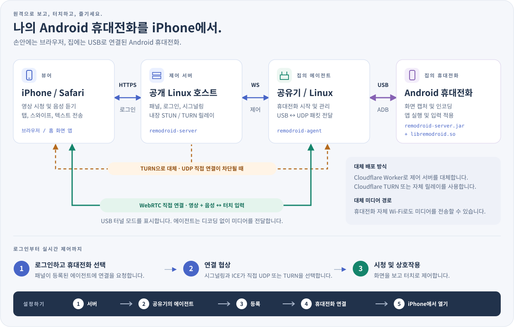

<p align="center"><a href="../../README.md">English</a> | <a href="../zh/README.md">简体中文</a> | <a href="../ja/README.md">日本語</a> | <b>한국어</b> | <a href="../es/README.md">Español</a> | <a href="../pt-BR/README.md">Português (Brasil)</a> | <a href="../de/README.md">Deutsch</a> | <a href="../fr/README.md">Français</a> | <a href="../ru/README.md">Русский</a></p>

# RemoDroid

iPhone의 Safari(또는 어떤 브라우저든)에서 Android 휴대폰이나 Windows·Mac·Linux 컴퓨터를 낮은 지연으로 제어하세요. 클라우드 게임에도 쓸 만큼 빠릅니다.

## 무엇이 필요한가요?

**두 가지입니다: 패널, 그리고 제어할 기기에 설치하는 RemoDroid.** 패널은 로그인하는 웹 페이지입니다. 서버가 없으면 **Cloudflare**에 두고(무료, 관리할 기계 없음), 있으면 직접 운영하는 **Linux**나 **Windows** 서버에 둡니다. 그다음 **Android 휴대폰**을 제어하려면 휴대폰을 USB로 연결한 라우터(또는 아무 Linux 기기)에 *RemoDroid 휴대폰용*을, **Windows·Mac·Linux 컴퓨터**를 제어하려면 그 컴퓨터에 *RemoDroid 컴퓨터용*을 설치합니다. 보고 조작하는 것은 iPhone의 Safari나 다른 브라우저에서 하며, 그쪽에는 아무것도 설치하지 않습니다.

**패널: 하나를 고르세요.**

| 패널 위치 | 이럴 때 | 설치 |
|---|---|---|
| [**Cloudflare**](#panel-cloudflare) | 서버가 없습니다. Cloudflare가 페이지를 호스팅하고, 네트워크가 직접 연결을 막으면 영상을 중계합니다(매월 1,000 GB 무료). | 브라우저에서 몇 분 |
| [**Linux 서버**](#panel-linux) | 공인 IP가 있는 VPS를 빌려 씁니다. 집에서 가까운 지역을 고르세요: 필요할 때 영상을 중계합니다. | 명령 하나 |
| [**Windows 서버**](#panel-windows) | 같은 것을 Windows Server 2019 이상에서(공인 IP가 있는 Windows 10이나 11도 됩니다). | 압축을 풀고 *Install and start* 클릭 |

**그다음, 제어할 기기마다:**

| 제어할 것 | 설치할 것 | 설치 위치 |
|---|---|---|
| **Android 휴대폰** | [**RemoDroid 휴대폰용**](#for-phones) | 휴대폰을 USB로 연결한 라우터(OpenWrt, ASUS Merlin 또는 아무 Linux 기기). 휴대폰에는 아무것도 설치하지 않습니다. |
| **Windows** PC | [**RemoDroid 컴퓨터용**](#for-computers) | 그 PC(Windows 10 1809 이상) |
| **Mac** | [**RemoDroid 컴퓨터용**](#for-computers) | 그 Mac(macOS 13 이상) |
| **Linux** PC | [**RemoDroid 컴퓨터용**](#for-computers) | 그 PC(X11 세션) |

패널 하나로 휴대폰과 컴퓨터를 몇 대든 다룰 수 있습니다. 어떤 조합이든 같은 세 단계입니다:
[1. 패널](#step-panel) → [2. 제어할 기기에 RemoDroid](#step-device) → [3. iPhone에서 열기](#step-iphone).

<p align="center"><a href="https://remodroid.pages.dev/ko/"></a></p>

<p align="center">마법사가 같은 두 질문을 하고, 복사 버튼과 함께 끝까지 안내합니다.</p>

## 작동 방식

<p align="center"></p>

**패널**은 웹 페이지, 로그인, 연결 설정을 맡습니다. 집 라우터의 **RemoDroid 휴대폰용**은 내장 ADB(`adb` 불필요)로 USB를 통해 휴대폰과 통신하고, 휴대폰에서 작은 도우미를 실행합니다. 도우미는 화면을 캡처해 하드웨어로 인코딩하고 WebRTC로 Safari에 바로 보내며, 터치는 같은 길로 돌아옵니다. 라우터는 패킷만 전달하고 중간에서 아무것도 디코딩하지 않습니다. **RemoDroid 컴퓨터용**은 컴퓨터 자체에서 같은 일을 합니다: 화면을 캡처하고, GPU로 인코딩하고, 마우스와 키보드를 받습니다.

<details>
<summary>더 자세히: 미디어 경로, TURN, 휴대폰에서 실행되는 것</summary>

- **미디어 경로.** 기본적으로 휴대폰은 USB 케이블로 미디어를 보내고, 라우터의 프로그램이 이를 UDP로 네트워크에 내보내므로 휴대폰에 Wi-Fi가 필요 없습니다. `agent.ini`에서 `[phone] path = wifi`로 하면 휴대폰 자체의 Wi-Fi를 씁니다. 라우터가 Wi-Fi 액세스 포인트도 겸한다면 이쪽이 더 빠를 수 있습니다.
- **TURN.** iPhone과 집 사이에 직접 UDP 경로를 찾을 수 없을 때(통신사 NAT, 엄격한 방화벽) 미디어는 패널의 TURN 중계를 거칩니다. 그래도 디코딩되지는 않습니다.
- **휴대폰에서:** `remodroid-server.jar`(화면 캡처, MediaCodec H.265/H.264, 입력 주입, 클립보드, 화면 전원, 파일)와 `libremodroid.so`(C로 작성한 WebRTC 스택: ICE, DTLS-SRTP, SCTP 데이터 채널, 혼잡 제어). 둘 다 `app_process`를 통해 shell 사용자로 실행되므로 앱으로 설치되는 것은 없습니다. 연결 중에는 절전을 위해 휴대폰 화면이 꺼지고 소리는 iPhone에서 납니다.
- 설계 메모와 결정: [`plan.md`](../../plan.md).

</details>

## 필요한 것

RemoDroid는 가볍습니다. 무거운 일(캡처와 하드웨어 인코딩)은 휴대폰이나 컴퓨터가 하고, 라우터는 패킷만 전달하며, 패널은 연결만 설정합니다. 가장 중요한 것은 **집의 업로드 속도**입니다.

| | 최소 | 권장 | 사용량 |
|---|---|---|---|
| **패널** | 무료 Cloudflare 계정, 또는 공인 IP가 있는 Linux 기기나 Windows Server 2019+: CPU 1개, RAM 128 MB, 디스크 몇 MB | 직접 운영 시: **집에서 가장 가까운** 클라우드 지역의 작은 VM(TURN이 필요할 때 스트림을 나릅니다), 충분한 월간 트래픽 | RAM 약 2 MB, CPU는 거의 없음. 대역폭은 세션이 TURN으로 넘어갈 때만 쓰며, 그때는 스트림 전체가 지나갑니다(10 Mbps에서 시간당 약 4.5 GB) |
| **라우터**(휴대폰용) | OpenWrt, Linux(Debian, Ubuntu, CentOS, Alpine) 또는 Koolshare가 있는 ASUS Merlin, USB 포트, 약 2 MB의 여유 저장 공간. CPU: x86, ARM, MIPS | ARM(aarch64, ARMv7)이나 x86 라우터. 약한 MIPS 라우터도 되지만 최고 비트레이트를 따라가지 못할 수 있습니다 | RAM 약 2 MB. CPU는 USB와 UDP 사이로 패킷을 옮길 때만 쓰며 디코딩은 하지 않습니다 |
| **Android 휴대폰** | Android 8 이상, USB 디버깅, 하드웨어 H.264 인코더 | Android 12 이상(소리), 하드웨어 H.265 인코더 | 자체 하드웨어 인코더. 연결 중에는 화면이 꺼집니다 |
| **컴퓨터** | Windows 10 1809+, macOS 13+, 또는 X11 세션의 Linux | GPU 인코더(최근의 Intel, AMD, NVIDIA, Apple 칩) | GPU 인코더. 없으면 소프트웨어 H.264, 30 fps |
| **iPhone** | Safari | WebRTC에서 H.265를 쓰려면 최신 iOS(오래된 iOS는 자동으로 H.264) | 하드웨어 영상 디코딩 |
| **네트워크** | 집 업로드 3–5 Mbps(720p) | 집 업로드 10–20 Mbps, iPhone 다운로드도 같은 수준(1080p, 60 fps) | 스트림당 1–20 Mbps(기본 상한 20 Mbps, 60 fps). 화질은 자동으로 조절됩니다 |

iPhone이 집에 직접 연결되면 지연은 40–80 ms, TURN을 거치면 약 70–120 ms입니다. 메모리 수치는 실행 중인 서버와 RT-AC86U 라우터에서 잰 것입니다.

## 설치

<a name="step-panel"></a>

### 1. 패널

둘 곳을 하나 고르세요: Cloudflare, Linux 서버, Windows 서버. 나중에 옮길 수 있지만, 라우터와 컴퓨터는 새 패널에 다시 추가해야 합니다.

<a name="panel-cloudflare"></a>

#### Cloudflare에 두기(서버 없음)

1. **TURN 키 만들기**(네트워크가 직접 연결을 막으면 영상을 중계합니다). [Cloudflare 대시보드](https://dash.cloudflare.com/)에서 **Realtime → TURN Server → Create**. **Turn Token ID**와 **API Token**을 보관하세요. API Token은 바로 복사하세요.
2. **패널 배포.** 이 저장소를 fork한 뒤 대시보드에서 **Workers & Pages → Create → Import a repository**로 fork를 고르고 루트 디렉터리를 `worker`로 설정합니다. 그 뒤로 fork에 push할 때마다 패널이 자동으로 업데이트됩니다. 컴퓨터에서 하려면: `cd worker && npm install && npx wrangler deploy`.
3. **바로 열어 설정을 마치세요.** 주소는 `https://remodroid.<사용자>.workers.dev`입니다. 마치기 전까지는 첫 방문자가 로그인을 정할 수 있습니다. 안전하게, 먼저 Worker에 secret `SETUP_TOKEN`을 추가하세요(Settings → Variables and Secrets → Add, 유형은 *Secret*. 일반 변수는 다음 배포 때 사라집니다). 그러면 설정 페이지가 이 값을 묻습니다. 설정 페이지는 로그인과 TURN 키를 묻습니다.

방화벽에서 열 것은 없습니다: 중계는 Cloudflare가 합니다. 로그인과 TURN 키는 나중에 패널의 **서버** 탭에서 바꿀 수 있습니다.

<a name="panel-linux"></a>

#### Linux 서버에 두기

```sh
curl -fsSL https://remodroid.pages.dev/install_server.sh | sudo sh
```

알맞은 패키지를 골라 설치하고 패널을 시작한 뒤 `http://<ip>:5580/wizard.html?token=…` 같은 링크를 출력합니다. 그 링크를 열어 웹 포트, **도메인**(Let's Encrypt 자동 HTTPS용), 관리자 로그인, STUN/TURN 포트를 입력하세요. 패널이 지정한 포트로 다시 시작되면 준비 완료입니다.

방화벽에서 열 포트: **TCP 5580**(설정할 때만), 웹 포트(**80**)와 도메인을 쓸 때 **443**, **UDP 3478**, **UDP 49152–49252**(TURN).

패키지를 직접 설치하려면 아래 표에서 받아:

```sh
sudo apt install ./remodroid-server_*.deb                  # Debian, Ubuntu
sudo dnf install ./remodroid-server-*.rpm                  # CentOS, Fedora
sudo apk add --allow-untrusted ./remodroid-server_*.apk    # Alpine

sudo systemctl enable --now remodroid-server               # systemd
rc-update add remodroid-server && rc-service remodroid-server start            # Alpine
```

그다음 `http://<서버>:5580/wizard.html?token=…`을 엽니다. token은 `/var/lib/remodroid/setup-token`에 있습니다.

<a name="panel-windows"></a>

#### Windows 서버에 두기

Windows Server 2019 이상, Windows 10과 11도 됩니다. 아래의 Windows용 `.zip`을 받아 계속 둘 폴더에 압축을 풀고 **RemoDroidServer.exe**를 실행해 **Install and start**를 고르세요. 패널은 Windows 서비스로 실행되어 로그인 여부와 상관없이 Windows와 함께 시작되고, Windows 방화벽도 통과시킵니다. 같은 창에서 관리자, 웹 포트, HTTPS 도메인, STUN/TURN을 설정하고, 시작·중지하며 로그를 봅니다. 아이콘은 시계 옆에 남습니다. 명령 프롬프트에서는(관리자로): `remodroid-server install`. 클라우드 방화벽에서 Linux와 같은 포트를 여세요.

<!-- downloads:server -->
#### 패널 다운로드(Linux 또는 Windows 서버) (v0.6.2)

서버의 CPU로 행을(`uname -m`: `x86_64`, `aarch64` = ARM64, `armv7l` = ARMv7, `i686` = x86), 시스템으로 열을 고르세요. *모든 Linux*에는 패널과 RemoDroid 휴대폰용이 모두 들어 있습니다.

| 패널 | Debian · Ubuntu | CentOS · Fedora | Alpine | 모든 Linux |
|:--|:-:|:-:|:-:|:-:|
| **x86_64**<br><sub>Intel / AMD 64비트</sub> | [](https://github.com/yinyue123/RemoDroid/releases/download/v0.6.2/remodroid-server_0.6.2-1_amd64.deb) | [](https://github.com/yinyue123/RemoDroid/releases/download/v0.6.2/remodroid-server-0.6.2-1.x86_64.rpm) | [](https://github.com/yinyue123/RemoDroid/releases/download/v0.6.2/remodroid-server_0.6.2-r1_x86_64.apk) | [](https://github.com/yinyue123/RemoDroid/releases/download/v0.6.2/remodroid-0.6.2-linux-x86_64.tar.gz) |
| **ARM64**<br><sub>aarch64</sub> | [](https://github.com/yinyue123/RemoDroid/releases/download/v0.6.2/remodroid-server_0.6.2-1_arm64.deb) | [](https://github.com/yinyue123/RemoDroid/releases/download/v0.6.2/remodroid-server-0.6.2-1.aarch64.rpm) | [](https://github.com/yinyue123/RemoDroid/releases/download/v0.6.2/remodroid-server_0.6.2-r1_aarch64.apk) | [](https://github.com/yinyue123/RemoDroid/releases/download/v0.6.2/remodroid-0.6.2-linux-aarch64.tar.gz) |
| **ARMv7**<br><sub>32비트 ARM</sub> | [](https://github.com/yinyue123/RemoDroid/releases/download/v0.6.2/remodroid-server_0.6.2-1_armhf.deb) | [](https://github.com/yinyue123/RemoDroid/releases/download/v0.6.2/remodroid-server-0.6.2-1.armv7hl.rpm) | [](https://github.com/yinyue123/RemoDroid/releases/download/v0.6.2/remodroid-server_0.6.2-r1_armv7.apk) | [](https://github.com/yinyue123/RemoDroid/releases/download/v0.6.2/remodroid-0.6.2-linux-armv7.tar.gz) |
| **x86**<br><sub>32비트</sub> | [](https://github.com/yinyue123/RemoDroid/releases/download/v0.6.2/remodroid-server_0.6.2-1_i386.deb) | [](https://github.com/yinyue123/RemoDroid/releases/download/v0.6.2/remodroid-server-0.6.2-1.i686.rpm) | [](https://github.com/yinyue123/RemoDroid/releases/download/v0.6.2/remodroid-server_0.6.2-r1_x86.apk) | [](https://github.com/yinyue123/RemoDroid/releases/download/v0.6.2/remodroid-0.6.2-linux-x86.tar.gz) |

Windows 서버: 압축을 풀고 **RemoDroidServer.exe**를 실행해 *Install and start*를 고르세요. 같은 창에서 관리자, 웹 포트, HTTPS 도메인, STUN/TURN을 설정하고 로그를 봅니다.

| 패널 | **x86_64**<br><sub>Intel / AMD</sub> | **ARM64**<br><sub>Graviton, Snapdragon…</sub> |
|:--|:-:|:-:|
| **Windows** Server 2019+, 10 1809+, 11 | [](https://github.com/yinyue123/RemoDroid/releases/download/v0.6.2/RemoDroid-Server-0.6.2-windows-x86_64.zip) | [](https://github.com/yinyue123/RemoDroid/releases/download/v0.6.2/RemoDroid-Server-0.6.2-windows-arm64.zip) |

체크섬: [SHA256SUMS](https://github.com/yinyue123/RemoDroid/releases/download/v0.6.2/SHA256SUMS)
<!-- /downloads:server -->

<details>
<summary>모든 Linux(.tar.gz)에 직접 설치</summary>

tarball에는 `bin/`, `web/`, `phone/`, `etc/`(ini 예시와 서비스 유닛)가 들어 있습니다. 패널은:

```sh
sudo install -m 0755 bin/remodroid-server /usr/bin/
sudo mkdir -p /usr/share/remodroid /etc/remodroid
sudo cp -r web /usr/share/remodroid/web
sudo install -m 0640 etc/server.ini.example /etc/remodroid/server.ini
remodroid-server -c /etc/remodroid/server.ini
```

`etc/remodroid-server.service`는 `/etc/systemd/system/`에 복사할 수 있는 systemd 유닛입니다.

</details>

<details>
<summary>설정 후 패널 설정</summary>

마법사는 `/etc/remodroid/server.ini`(Windows: `%ProgramData%\RemoDroid\server.ini`)에 기록합니다. 그 뒤로는 같은 페이지(로그인 필요)에서 설정을 바꾸고, 패널의 **서버** 탭은 한 번에 한 항목씩 바꿉니다(도메인, 포트, 로그인, STUN/TURN 목록). `remodroid-server -t`는 아무것도 시작하지 않고 파일만 검사합니다. HTTPS 인증서는 자동으로 갱신됩니다. 패키지를 업그레이드해도 `server.ini`는 그대로 남습니다.

</details>

<a name="step-device"></a>

### 2. 제어할 기기에 RemoDroid

<a name="for-phones"></a>

#### Android 휴대폰: RemoDroid 휴대폰용

휴대폰이 아니라, 휴대폰을 연결할 라우터(또는 USB 포트가 있는 아무 Linux 기기)에 설치합니다.

OpenWrt, Alpine:

```sh
wget -qO- https://remodroid.pages.dev/install_agent.sh | sh
```

Debian, Ubuntu, CentOS, Fedora:

```sh
curl -fsSL https://remodroid.pages.dev/install_agent.sh | sudo sh
```

Koolshare가 있는 ASUS Merlin: 아래의 Merlin 패키지를 받고 뒤의 *ASUS Merlin / Koolshare*를 보세요.

<!-- downloads:agent -->
#### RemoDroid 휴대폰용 다운로드 (v0.6.2)

기기의 CPU로 행을(`uname -m`: `x86_64`, `aarch64` = ARM64, `armv7l` = ARMv7, `i686` = x86), 시스템으로 열을 고르세요. OpenWrt: `opkg print-architecture`가 보여 주는 빌드를 고르세요. *모든 Linux*에는 RemoDroid 휴대폰용과 패널이 모두 들어 있습니다(MIPS는 RemoDroid 휴대폰용만).

| 휴대폰용 | Debian · Ubuntu | CentOS · Fedora | Alpine | OpenWrt | 모든 Linux |
|:--|:-:|:-:|:-:|:-:|:-:|
| **x86_64**<br><sub>Intel / AMD 64비트</sub> | [](https://github.com/yinyue123/RemoDroid/releases/download/v0.6.2/remodroid-agent_0.6.2-1_amd64.deb) | [](https://github.com/yinyue123/RemoDroid/releases/download/v0.6.2/remodroid-agent-0.6.2-1.x86_64.rpm) | [](https://github.com/yinyue123/RemoDroid/releases/download/v0.6.2/remodroid-agent_0.6.2-r1_x86_64.apk) | [](https://github.com/yinyue123/RemoDroid/releases/download/v0.6.2/remodroid-agent_0.6.2-1_x86_64.ipk) | [](https://github.com/yinyue123/RemoDroid/releases/download/v0.6.2/remodroid-0.6.2-linux-x86_64.tar.gz) |
| **ARM64**<br><sub>aarch64</sub> | [](https://github.com/yinyue123/RemoDroid/releases/download/v0.6.2/remodroid-agent_0.6.2-1_arm64.deb) | [](https://github.com/yinyue123/RemoDroid/releases/download/v0.6.2/remodroid-agent-0.6.2-1.aarch64.rpm) | [](https://github.com/yinyue123/RemoDroid/releases/download/v0.6.2/remodroid-agent_0.6.2-r1_aarch64.apk) | [](https://github.com/yinyue123/RemoDroid/releases/download/v0.6.2/remodroid-agent_0.6.2-1_aarch64_generic.ipk)<br>[](https://github.com/yinyue123/RemoDroid/releases/download/v0.6.2/remodroid-agent_0.6.2-1_aarch64_cortex-a53.ipk)<br>[](https://github.com/yinyue123/RemoDroid/releases/download/v0.6.2/remodroid-agent_0.6.2-1_aarch64_cortex-a72.ipk) | [](https://github.com/yinyue123/RemoDroid/releases/download/v0.6.2/remodroid-0.6.2-linux-aarch64.tar.gz) |
| **ARMv7**<br><sub>32비트 ARM</sub> | [](https://github.com/yinyue123/RemoDroid/releases/download/v0.6.2/remodroid-agent_0.6.2-1_armhf.deb) | [](https://github.com/yinyue123/RemoDroid/releases/download/v0.6.2/remodroid-agent-0.6.2-1.armv7hl.rpm) | [](https://github.com/yinyue123/RemoDroid/releases/download/v0.6.2/remodroid-agent_0.6.2-r1_armv7.apk) | [](https://github.com/yinyue123/RemoDroid/releases/download/v0.6.2/remodroid-agent_0.6.2-1_arm_cortex-a7_neon-vfpv4.ipk)<br>[](https://github.com/yinyue123/RemoDroid/releases/download/v0.6.2/remodroid-agent_0.6.2-1_arm_cortex-a9_vfpv3-d16.ipk)<br>[](https://github.com/yinyue123/RemoDroid/releases/download/v0.6.2/remodroid-agent_0.6.2-1_arm_cortex-a15_neon-vfpv4.ipk) | [](https://github.com/yinyue123/RemoDroid/releases/download/v0.6.2/remodroid-0.6.2-linux-armv7.tar.gz) |
| **x86**<br><sub>32비트</sub> | [](https://github.com/yinyue123/RemoDroid/releases/download/v0.6.2/remodroid-agent_0.6.2-1_i386.deb) | [](https://github.com/yinyue123/RemoDroid/releases/download/v0.6.2/remodroid-agent-0.6.2-1.i686.rpm) | [](https://github.com/yinyue123/RemoDroid/releases/download/v0.6.2/remodroid-agent_0.6.2-r1_x86.apk) | [](https://github.com/yinyue123/RemoDroid/releases/download/v0.6.2/remodroid-agent_0.6.2-1_i386_pentium4.ipk) | [](https://github.com/yinyue123/RemoDroid/releases/download/v0.6.2/remodroid-0.6.2-linux-x86.tar.gz) |
| **MIPS LE**<br><sub>mipsel</sub> | — | — | — | [](https://github.com/yinyue123/RemoDroid/releases/download/v0.6.2/remodroid-agent_0.6.2-1_mipsel_24kc.ipk) | [](https://github.com/yinyue123/RemoDroid/releases/download/v0.6.2/remodroid-0.6.2-linux-mipsel.tar.gz) |
| **MIPS BE**<br><sub>mips</sub> | — | — | — | [](https://github.com/yinyue123/RemoDroid/releases/download/v0.6.2/remodroid-agent_0.6.2-1_mips_24kc.ipk) | [](https://github.com/yinyue123/RemoDroid/releases/download/v0.6.2/remodroid-0.6.2-linux-mips.tar.gz) |

Koolshare / KoolCenter 오프라인 설치 파일: [Merlin armv7](https://github.com/yinyue123/RemoDroid/releases/download/v0.6.2/remodroid-0.6.2-merlin-armv7.tar.gz) · [Merlin aarch64](https://github.com/yinyue123/RemoDroid/releases/download/v0.6.2/remodroid-0.6.2-merlin-aarch64.tar.gz). RT-AC86U와 RT-AX88U는 aarch64를 고르세요. 이 파일에는 RemoDroid 휴대폰용만 라우터 플러그인으로 들어 있습니다(OpenWrt 패키지가 아닙니다).

체크섬: [SHA256SUMS](https://github.com/yinyue123/RemoDroid/releases/download/v0.6.2/SHA256SUMS)
<!-- /downloads:agent -->

**어떤 OpenWrt 파일?** [openwrt.md](openwrt.md)에서 라우터와 그 CPU를 찾으세요. 동작하는 OpenWrt 버전도 나와 있습니다.

**LuCI가 있는 OpenWrt, 명령줄 없이:** LuCI에서 **시스템 → 소프트웨어 → 패키지 업로드…**를 열고 라우터에 맞는 `.ipk`를 골라 설치하세요. **서비스 → RemoDroid** 페이지가 생기며, 라우터를 패널에 추가하고(다음 단계), 시작·중지하고, 패널과 휴대폰이 연결되었는지 보여 줍니다.

다른 시스템에서는 패키지를 설치하고 서비스를 시작합니다:

```sh
opkg install ./remodroid-agent_*.ipk                       # OpenWrt
sudo apt install ./remodroid-agent_*.deb                   # Debian, Ubuntu
sudo dnf install ./remodroid-agent-*.rpm                   # CentOS, Fedora
sudo apk add --allow-untrusted ./remodroid-agent_*.apk     # Alpine

/etc/init.d/remodroid-agent enable && /etc/init.d/remodroid-agent start        # OpenWrt
sudo systemctl enable --now remodroid-agent                # systemd
rc-update add remodroid-agent && rc-service remodroid-agent start              # Alpine
```

<details>
<summary>모든 Linux(.tar.gz)에 직접 설치</summary>

압축을 푼 tarball에서:

```sh
sudo install -m 0755 bin/remodroid-agent /usr/bin/
sudo ln -s remodroid-agent /usr/bin/remodroid
sudo mkdir -p /usr/share/remodroid /etc/remodroid
sudo cp -r phone/. /usr/share/remodroid/
sudo install -m 0600 etc/agent.ini.example /etc/remodroid/agent.ini
remodroid-agent -c /etc/remodroid/agent.ini
```

`etc/remodroid-agent.service`(systemd)와 `etc/remodroid-agent.init`(OpenWrt procd)으로 부팅 때 시작됩니다.

</details>

<details>
<summary>ASUS Merlin / Koolshare</summary>

라우터의 CPU(`uname -m`)에 맞는 위의 Merlin 패키지를 고르세요:

- `remodroid-<버전>-merlin-aarch64.tar.gz`: `aarch64`, RT-AC86U와 RT-AX88U 같은 64비트 HND 모델
- `remodroid-<버전>-merlin-armv7.tar.gz`: `armv7l`, RT-AC68U 같은 32비트 ARM 모델

**소프트웨어 센터 → 수동 설치**에서 설치합니다. CPU가 맞지 않는 패키지는 거부됩니다. 설정, 시작·중지, 로그, 선택적 자동 시작을 위한 라우터 페이지가 추가됩니다. 설치만으로는 시작되지 않습니다. Koolshare/KoolCenter 소프트웨어 센터가 없는 기본 Asuswrt-Merlin은 지원하지 않습니다. 빌드, 이전, 제한: [Merlin 패키지](../../packaging/merlin/README.md).

</details>

**라우터를 패널에 추가하기.** 패널에서 **에이전트 → 추가**를 열면 일회용 코드가 든 명령이 나옵니다. 라우터에서 실행하세요:

```sh
remodroid enroll --panel https://your.panel --code X5SX-K3M7
```

OpenWrt에서는 같은 명령을 LuCI의 **서비스 → RemoDroid → 페어링**에 붙여넣어도 됩니다. 코드는 한 번만, 10분 동안 유효합니다. 그러면 라우터가 온라인으로 표시되며, 탭하면 설정을 바꿀 수 있습니다.

**휴대폰 연결하기.** 휴대폰에서 **개발자 옵션 → USB 디버깅**을 켜세요. 라우터의 USB 포트에 연결하고 "USB 디버깅을 허용하시겠습니까?"에서 **허용**을 탭하세요("항상 허용" 체크). 휴대폰을 만지는 것은 이때뿐입니다.

<a name="for-computers"></a>

#### 컴퓨터: RemoDroid 컴퓨터용

컴퓨터에는 라우터가 필요 없습니다. 컴퓨터에 **RemoDroid**를 설치해 실행하고, 패널의 **에이전트 → 추가 → 컴퓨터**에 나오는 한 줄을 트레이(또는 메뉴 막대) 아이콘에 붙여넣어 패널에 추가하세요. 로그인한 사용자로 실행되며, 누가 연결하면 알림을 띄우고, 보고 있는 동안 아이콘이 빨갛게 됩니다(**Disconnect viewer**로 한 번에 끊기). 뷰어는 컴퓨터에서 나는 소리를 듣습니다(**Sound** 스위치, 또는 `desktop.audio = false`로 아예 보내지 않음). 아이콘 메뉴의 **Show log**는 실시간 로그 창을 엽니다. Windows 10 1809+와 macOS 13+, Linux는 X11 세션이 필요합니다(GNOME은 "GNOME on Xorg"). GPU가 있으면 GPU로 인코딩합니다(Media Foundation, VideoToolbox, Linux에서 AMD나 Intel GPU면 VA-API, Steam Deck 포함: H.265나 H.264, 최대 60 fps). 없으면 소프트웨어로(H.264, 30 fps).

<!-- downloads:desktop -->
#### RemoDroid 컴퓨터용 다운로드 (v0.6.2)

제어할 컴퓨터에 설치한 뒤, 패널이 보여 주는 한 줄을 붙여넣어 페어링하세요(에이전트 → 추가 → 컴퓨터). macOS 빌드는 Apple 실리콘과 Intel Mac 모두에서 실행됩니다.

| 컴퓨터 | **x86_64**<br><sub>Intel / AMD</sub> | **ARM64**<br><sub>Apple 실리콘, Snapdragon…</sub> |
|:--|:-:|:-:|
| **Windows** 10 1809+, 11 | [](https://github.com/yinyue123/RemoDroid/releases/download/v0.6.2/RemoDroid-Computer-0.6.2-windows-x86_64.zip) | [](https://github.com/yinyue123/RemoDroid/releases/download/v0.6.2/RemoDroid-Computer-0.6.2-windows-arm64.zip) |
| **macOS** 13+ | [](https://github.com/yinyue123/RemoDroid/releases/download/v0.6.2/RemoDroid-Computer-0.6.2-macos.zip) | [](https://github.com/yinyue123/RemoDroid/releases/download/v0.6.2/RemoDroid-Computer-0.6.2-macos.zip) |
| **Linux** (X11 세션) | [](https://github.com/yinyue123/RemoDroid/releases/download/v0.6.2/remodroid-desktop_0.6.2-1_amd64.deb)<br>[](https://github.com/yinyue123/RemoDroid/releases/download/v0.6.2/remodroid-desktop-0.6.2-1.x86_64.rpm)<br>[](https://github.com/yinyue123/RemoDroid/releases/download/v0.6.2/remodroid-desktop-0.6.2-linux-x86_64.tar.gz)<br>[](https://github.com/yinyue123/RemoDroid/releases/download/v0.6.2/RemoDroid-Computer-0.6.2-linux-x86_64.AppImage) | [](https://github.com/yinyue123/RemoDroid/releases/download/v0.6.2/remodroid-desktop_0.6.2-1_arm64.deb)<br>[](https://github.com/yinyue123/RemoDroid/releases/download/v0.6.2/remodroid-desktop-0.6.2-1.aarch64.rpm)<br>[](https://github.com/yinyue123/RemoDroid/releases/download/v0.6.2/remodroid-desktop-0.6.2-linux-aarch64.tar.gz)<br>[](https://github.com/yinyue123/RemoDroid/releases/download/v0.6.2/RemoDroid-Computer-0.6.2-linux-aarch64.AppImage) |

체크섬: [SHA256SUMS](https://github.com/yinyue123/RemoDroid/releases/download/v0.6.2/SHA256SUMS)
<!-- /downloads:desktop -->

- **Windows**: 압축을 풀고 `RemoDroid.exe`를 실행하세요. 관리자로 실행되는 프로그램의 창(설치 프로그램, 작업 관리자, 패널 자체의 Windows 앱)도 제어하려면 메뉴에서 **Control administrator windows…**를 한 번 고르고 관리자로 확인하세요. 작은 `RemoDroidInput` 서비스가 설정되어 뷰어의 마우스와 키보드를 그 창들에 전달합니다(`remodroid-input install` / `uninstall`도 같습니다). UAC 프롬프트는 조작할 수 없습니다. **macOS**: `RemoDroid.app`을 응용 프로그램으로 옮겨 열고(처음에는 오른쪽 클릭 → 열기), 요청하면 **화면 기록**과 **손쉬운 사용**을 허용하세요. **Linux**: `.deb` / `.rpm`을 설치하고 앱 메뉴에서 *RemoDroid*를 시작하세요. 다른 배포판에서는 `.AppImage`를 쓰세요: `chmod +x` 하고 실행합니다(`./RemoDroid-*.AppImage desktopd …`는 화면 없는 에이전트). 모든 데스크톱에 있는 시스템의 GTK 3와 X11 라이브러리를 씁니다.
- **AirDrop처럼 파일과 클립보드**: 뷰어에 파일을 끌어다 놓으면 컴퓨터의 `Downloads/RemoDroid`에 들어가고, 컴퓨터의 RemoDroid 창(트레이 / 메뉴 막대 → *Pairing & status…*)에 파일을 놓으면 뷰어의 브라우저가 내려받습니다. 복사한 텍스트는 Chrome과 Edge에서 자동으로 양방향 동기화되고, Safari와 Firefox에서는 복사 버튼이 나옵니다.
- 화면이나 트레이가 없나요? 같은 한 줄을 터미널에서 실행하고(`remodroid-desktopd pair --panel … --code …`), 그다음 `remodroid-desktopd`를 실행하세요(Linux 패키지에는 systemd 사용자 유닛이 들어 있습니다).
- 설정은 `desktop.ini`(`%APPDATA%\RemoDroid`, `~/Library/Application Support/RemoDroid`, `~/.config/remodroid`)와 패널에 있습니다. 설계: [`multi-platform.md`](../../multi-platform.md).

<a name="step-iphone"></a>

### 3. iPhone에서 열기

Safari에서 패널을 열고 로그인한 뒤 **공유 → 홈 화면에 추가**를 누르세요. 홈 화면에서 실행하면 전체 화면이 됩니다(Safari는 일반 페이지에서 막대를 숨길 수 없습니다). 휴대폰이나 컴퓨터를 탭하면 연결됩니다.

## 사용하기

- **터치**는 휴대폰에서처럼 멀티터치까지 됩니다. **떠 있는 공**으로 메뉴가 열립니다: 잠금, 다시 연결, 전체 화면, 소리, 사진 업로드, 클립보드, 설정.
- **컴퓨터에서는** 마우스와 키보드가 그대로 전달됩니다(키는 물리 키라서 컴퓨터 자체의 배열이 적용되며, 한쪽만 Mac이면 ⌘와 Ctrl이 바뀝니다). iPhone에서는 화면 아래가 Mac 같은 **트랙패드**가 됩니다: 포인터가 확대된 화면 위를 움직여 컴퓨터의 글자도 읽을 수 있고, 포인터가 가장자리 10% 안으로 오면 화면 자체의 가장자리까지 그림이 스크롤됩니다. 탭은 클릭, 두 번 탭은 더블클릭, 탭한 뒤 끌면 드래그, 두 손가락 탭은 오른쪽 클릭, 두 손가락으로 스크롤, 벌리면 확대. **⤢**는 화면 전체를 보여 줍니다. 트랙패드와 키보드는 같은 크기의 패널 하나입니다: 헤더 오른쪽 모서리의 **⌨**가 키보드로, 같은 자리의 **▭**가 다시 트랙패드로 바꿉니다. **⌄**는 버튼으로 접고, 헤더를 끌면 크기가 바뀌며, **⚙**로 속도를 정합니다. iPad나 데스크톱에서는 패널이 헤더로 끌 수 있는 카드로 떠 있습니다([`trackpad.md`](../../trackpad.md)). 메뉴의 **Trackpad**로 어떤 기기에서든, 데스크톱 브라우저에서도 켜고 끌 수 있습니다(거기서는 마우스가 패드 위의 손가락입니다: 클릭은 포인터 위치 클릭, 누른 채 움직이면 포인터 이동, 휠은 스크롤, Ctrl + 휠은 확대). 끄면 **Direct**가 되어 닿은 곳을 탭합니다(길게 누르면 오른쪽 클릭). iPad와 마우스를 쓸 때의 기본입니다. 이때 **Keyboard**는 떠 있는 화면 키보드를 엽니다(손잡이로 끌기, **ctrl** 다음 **c**를 탭하면 Ctrl+C). 그 **⋯**로 텍스트와 단축키를 보내고, **Next screen**으로 모니터를 바꿉니다.
- **컴퓨터에서 게임**(Linux, 예를 들어 데스크톱 모드의 Steam Deck): **Gamepad**가 화면 위에 Steam Link처럼 배치된 터치 조작을 올립니다(스틱, 방향 패드, A/B/X/Y, 범퍼, 트리거). 휴대폰은 가로로 드세요. 화면 위(버튼 밖 아무 데나)를 손가락으로 쓸면 PUBG처럼 시점이 돕니다: 쓸어내는 속도만큼 오른쪽 스틱이 위아래·옆으로 기웁니다. **⚙ → Edit layout**으로 어떤 조작이든 옮기고 크기를 바꿀 수 있으며, 레이아웃마다 배치가 저장됩니다. 그 **⚙**로 레이아웃(Steam Link, Simple, Shooter, Racing)을 고르고, 화면을 확대하고(**Fill screen**은 테두리를 잘라내며 슬라이더로 옮깁니다), 쓸기 속도를 정하고(끄면 화면 탭이 다시 클릭이 됩니다), 버튼의 투명도를 정합니다. iPhone이나 iPad와 페어링한 컨트롤러(Joy-Con, DualSense, Xbox)도 됩니다. Safari는 HTTPS 페이지에서만 이를 제공합니다. 각각 컴퓨터에서 가상 Xbox 360 패드가 되며, 쓰기 가능한 `/dev/uinput`이 필요합니다. SteamOS에는 있고, 다른 곳에서는 Steam의 udev 규칙(`steam-devices`)을 설치하세요.
- **소리**는 휴대폰에서 나오며(Android 12+), 연결 중에는 휴대폰 자체 스피커가 조용해집니다. Safari에서 화면을 한 번 탭하면 음소거가 풀립니다. 메뉴의 **Sound** 스위치는 소리를 휴대폰으로 돌려줍니다.
- 나중에 서버나 라우터를 명령 하나로 **업데이트**하세요. 설치된 부분을 최신 릴리스로 올리고 `server.ini` / `agent.ini`를 유지한 채 다시 시작합니다:

  ```sh
  curl -fsSL https://remodroid.pages.dev/update.sh | sudo sh    # OpenWrt: wget -qO- … | sh
  ```

<details>
<summary>라우터 명령</summary>

라우터에서 실행 중인 프로그램과 통신합니다(adb 불필요):

```sh
remodroid-agent devices | status | shell … | push | pull | logcat | key | restart-server
```

</details>

## 부가 기능

<details>
<summary><b>AI 제어</b>: AI가 화면을 읽고 대신 탭하게 하기</summary>

AI는 `/api/v1/devices/{id}/` 아래의 REST로 휴대폰을 조작합니다:

- `GET …/ui`는 화면을 JSON으로 돌려줍니다(휴대폰의 프로세스 내 UiAutomation에서, 예비로 `uiautomator dump`).
- `GET …/screenshot?format=jpeg&max_edge=1280`은 이미지를 돌려줍니다(GPU로 축소하고 휴대폰에서 C로 압축, 디스크에 쓰지 않음).
- `POST …/actions`는 선택자로 탭, 입력, 스크롤, 대기를 합니다.

라우터의 프로그램이 제공하고(`agent.ini`의 `[api] listen` + `token`), 서버가 중계합니다(`remodroid-server gentoken NAME`). AI가 한 번 알아낸 작업 흐름은 `skills/`에 저장되어 모델 호출 없이 Python이 재생하며, 새로운 상황을 만나면 화면을 AI에게 돌려줍니다.

```sh
export PYTHONPATH=python RD_URL=http://192.168.1.1:8790 RD_TOKEN=…
python3 -m remodroid ui                      # the screen as an outline
python3 -m remodroid tap --rid search --wait-change
python3 skills/settings-search/run.py --query wifi
```

설계: [skill-plan.md](../../skill-plan.md). 스킬 작성: [skills/README.md](../../skills/README.md).

</details>

<details>
<summary><b>MCP</b>: Claude, ChatGPT 같은 AI 비서에서 휴대폰과 컴퓨터 사용하기</summary>

휴대폰마다 MCP 엔드포인트 `https://<패널>/mcp/<사용자>/<기기>`가 있으며, 화면을 읽는 도구(`get_ui`, `screenshot`)와 조작하는 도구(`wake_phone`, `tap`, `type_text`, `swipe`, `scroll`, `press_key`, `launch_app`, `wait_for`)를 갖추고 있습니다. `wake_phone`은 잠금 화면을 넘는 길을 찾고, `swipe`는 패턴을 한 번에 그릴 수 있습니다. 컴퓨터(Windows, macOS, Linux)에는 자체 엔드포인트와 도구가 있습니다: `screenshot`, `click`, `move_mouse`, `drag`, `scroll`, `type_text`, `press_key`. 비서가 시작하면 컴퓨터 앞의 사람에게 알려지고, 보기 전용 컴퓨터는 볼 수만 있습니다. claude.ai와 ChatGPT는 OAuth로 로그인하고(RemoDroid 페이지에서 허용을 탭), Claude Code, Claude Desktop, Codex, Claude와 OpenAI API는 패널의 API 토큰(서버 → API 토큰)을 씁니다. 모든 토큰은 거기서 취소할 수 있고, `control` 범위가 없는 토큰은 볼 수만 있습니다.

패널의 에이전트 탭에서 `/mcp/help` 안내로 갈 수 있으며, 휴대폰의 URL을 보여 주고 토큰을 만들고 비서마다 설정 방법을 알려 줍니다. remodroid-server와 Worker 모두에서 동작합니다. 설계: [mcp.md](../../mcp.md).

</details>

<details>
<summary><b>휴대폰 알림</b>: 휴대폰의 알림을 iPhone에서, 또는 Bark로 받기</summary>

휴대폰의 도우미가 `dumpsys notification`(shell 사용자가 볼 수 있는 유일한 알림 내용)을 주기적으로 읽어 지속 알림과 중요도 낮은 알림을 빼고, 새 알림을 뷰어 WebSocket으로 연결된 클라이언트에, 서버에 `bark_url`이 있으면 [Bark](https://github.com/Finb/Bark)에 보냅니다. 거기서 AI 제어 API(또는 스킬)를 호출해 처리할 수 있습니다.

- 라우터, `agent.ini`: `[notify] enabled = true`, 그리고 `min_importance`와 `ignore` 목록.
- 서버, `server.ini`: `[notify] bark_url = https://api.day.app/<key>`(라우터별로는 `[device_notify]`). Bark 키는 서버에만 있고 로그에 남지 않습니다. WebSocket 전달에는 서버 설정이 필요 없습니다.

설정 예시는 `deploy/`에 있습니다.

</details>

## 현황

아래 표의 모든 테스트가 통과하며, 실제 Chrome을 뷰어로 쓴 테스트도 포함됩니다. 소리는 Sony SO-51A(Android 12)에서 확인했습니다. 아직 실제 하드웨어에서 확인하지 못한 것(계획의 마일스톤 M0): 여러 휴대폰에서의 Java 서버(캡처, 인코더 설정, 입력, 클립보드, 화면 전원), 라우터의 USB ADB, Safari의 세부 사항(H.265 지원, 하드웨어 디코딩), 실제 네트워크에서의 혼잡 제어.

## 개발

<details>
<summary>이 저장소의 내용</summary>

| 경로 | 내용 | 언어 |
|---|---|---|
| `server/` | 제어 서버(패널): 로그인 페이지 + 쿠키(라우터는 Basic 인증), REST API, 뷰어/기기 WebSocket, 내장 TURN 중계, Let's Encrypt(ACME) 자동 인증서를 쓰는 선택적 HTTPS. Windows에서는 서비스(`win.c`)와 설정 창이 있는 트레이 앱(`win/`) | C + libev + mbedTLS |
| `agent/` | RemoDroid 휴대폰용(라우터): 내장 ADB 클라이언트(usbfs), 휴대폰 감독, UDP 중계, WebSocket 클라이언트, CLI | C + libev |
| `rtc/` | 휴대폰과 컴퓨터가 함께 쓰는 WebRTC 스택: ICE + TURN 클라이언트, DTLS-SRTP, SCTP 데이터 채널, H.265/H.264 RTP, 혼잡 제어. `host.c`가 자체 스레드에서 C 인터페이스(`rd_rtc.h`)로 실행 | C |
| `desktop/` | RemoDroid 컴퓨터용: `core/`(세션, 입력, 파일, 영상 파이프라인, 서버 연결), `win/`, `mac/`, `linux/` 백엔드, `app/`(트레이 / 메뉴 막대 앱, 화면 없는 `remodroid-desktopd`). `libremodroid`(.dll / .dylib / .so)로 빌드 | C, Objective-C |
| `android/java/` | 휴대폰 서버: 화면 캡처, MediaCodec, 입력 주입, 클립보드, 화면 전원, 파일, logcat | Java(app_process) |
| `web/` | iPhone 클라이언트(PWA): 영상, 소리, 멀티터치, 떠 있는 공 메뉴, 사진 업로드, 클립보드, 모든 설정. `panel.html`(기기, 에이전트, 서버 탭)과 `wizard.html`(처음 설정) | HTML/CSS/JS |
| `worker/` | 같은 패널을 Cloudflare Workers + Durable Object에서, Cloudflare TURN과 함께 | JS |
| `wizard/` | 설치 사이트(Cloudflare Pages, remodroid.pages.dev), `install_server.sh`, `install_agent.sh`, `update.sh`. `i18n/`이 영어 페이지에서 각 언어 버전을 만듭니다 | HTML, sh, Python |
| `common/` | 공용 C: WebSocket 프레임, 터널 프레임, STUN, JSON 봉투, ini, 유틸리티 | C |
| `third_party/` | 함께 들어 있고 정적으로 링크되는 라이브러리: libev, inih, cJSON, picohttpparser, crypt_blowfish, mbedTLS, libsrtp2, usrsctp, minih264, libopus(컴퓨터 소리) | C |
| `deploy/` | `server.ini` / `agent.ini` 예시, systemd 유닛, OpenRC 스크립트, 라우터 프로그램의 procd 스크립트 | |
| `packaging/`, `.github/workflows/` | nFPM 패키지 정의(deb, rpm, apk, 라우터용 ipk), Windows 서버의 zip, CI 빌드/릴리스 워크플로 | |
| `python/`, `skills/`, `.claude/skills/phone/` | AI 제어: `remodroid` SDK와 `rd` CLI, 재생 가능한 스킬, 이들을 쓰는 Claude Code 스킬 | Python |
| `tests/` | 종단 간 테스트 | Node, Python |
| `demo/` | 처음의 모의 패널(오프라인, 서버 없음) | HTML |

</details>

<details>
<summary>빌드</summary>

호스트 빌드(개발과 테스트):

```sh
make            # build/host/remodroid-server, build/host/remodroid-agent
make rtc-tests  # build/host/rtc/rtc_test, rtp_dump (phone stack on the host)
```

라우터와 서버용 정적 릴리스 바이너리(교차 컴파일러로 Zig, musl, 모두 정적 링크):

```sh
make dist                   # inside the build container (build/Dockerfile, needs podman/docker)
./build/dist.sh mipsel      # or directly, with `zig` on PATH; targets: x86 x86_64 armv7 aarch64 mipsel mips
```

결과는 `build/out/<arch>/`에 나옵니다: 바이너리당 약 0.8 MB(MIPS는 1.2 MB이며 라우터 프로그램만).

Windows용 서버(`remodroid-server.exe`와 트레이 앱 `RemoDroidServer.exe`)는 Zig로 교차 빌드하거나 MSYS2에서 네이티브로 빌드합니다:

```sh
make TARGET=win-x86_64 CC="zig cc -target x86_64-windows-gnu" AR="zig ar" WINDRES=llvm-windres
```

휴대폰 파일(`remodroid-server.jar` + ABI별 `libremodroid.so`):

```sh
ANDROID_JAR=.../platforms/android-34/android.jar D8=.../build-tools/34.0.0/d8 NDK=.../android-ndk-r27c \
  ./android/build.sh        # build/android/remodroid-server.jar, build/android/<abi>/libremodroid.so
```

</details>

<details>
<summary>테스트</summary>

| 명령 | 범위 |
|---|---|
| `make test` | 제어부 종단 간: 실제 서버 + 라우터 프로그램, 프로토콜에 충실한 가짜 adbd(RSA 인증을 OpenSSL로 확인), 가짜 휴대폰. 인증, REST, WebSocket, ADB push/shell/sync, 터널, UDP 중계, 명령, `agent.ini` 수정, CLI, 재연결(48개 검사) |
| (`make test` 안) | 알림 전달: `[notify]` 설정이 휴대폰에 닿고, 잡힌 알림이 WebSocket으로 뷰어에 닿으며, 서버가 가짜 Bark 엔드포인트에 JSON으로 보냅니다 |
| `python3 tests/python_sdk.py` | AI 제어 SDK, `rd` CLI, 스킬 실행기를 가짜 휴대폰 API에 대해: 선택자, 메모리 속 스크린샷, AI에게 넘기기(종료 코드 3), `--from-step`으로 재개 |
| `QEMU=qemu-mipsel node tests/run.mjs build/mipsel` | 같은 것을 사용자 모드 에뮬레이션에서 정적 MIPS 라우터 바이너리로 |
| `python rtc/test/rtc_interop.py` | 휴대폰 WebRTC 스택 ↔ aiortc: ICE, DTLS-SRTP, SCTP, 디코딩된 H.264 프레임, 데이터 채널 |
| `python rtc/test/rtp_depack.py` | H.265와 H.264 패킷타이저: 독립 디패킷타이저 + FFmpeg로 비트 단위 왕복 |
| `python tests/e2e_webrtc.py [--relay]` | 전체 경로: 뷰어 → 서버 → 라우터 프로그램 → 터널 → 휴대폰 스택. `--relay`는 내장 TURN 강제 |
| `python tests/e2e_browser.py` | 실제 웹 클라이언트를 헤드리스 Chrome에서 전체 스택에 대해: 영상, 터치, 메뉴, 프로토콜 |
| `node tests/server_windows.mjs build/win-x86_64` | Windows의 서버(CI): 감독 프로세스 아래 실행, 마법사의 새 포트 재시작, 정적 파일, 로그인, WebSocket, TURN, `settings` / `configure`, Windows 서비스(설치, 재시작, 중지, 제거) |
| `node tests/setup.mjs build/host` | 처음 설정 마법사(설정 토큰, 저장, 새 포트 재시작), 로그인, 실제 `enroll`로 등록 코드, 패널을 통한 라우터 설정, 이름 바꾸기, 제거 |
| `node tests/worker.mjs build/host` | `wrangler dev`의 Cloudflare Worker(먼저 `cd worker && npm install`)와 실제 라우터 프로그램: 설정, 로그인, 등록, 뷰어 WebSocket과 신호, 명령, 이름 바꾸기, 제거 |
| `sudo tests/openwrt.sh IP [VERSION]` | podman 속 OpenWrt(19.07–24.10)를 LAN의 자체 주소(macvlan)로, LuCI, 이 저장소로 빌드한 ipk, 서버와 함께. 다른 기기에서 `http://IP/`를 열고 서비스 → RemoDroid에서 페어링 |
| `make desktop-test && build/host/desktop/desk_test web/app.js` | 화면 없이 컴퓨터용 코어: 키 표와 뷰어 표의 일치, 입력 디코딩, 영상 크기, 색 변환, 소프트웨어 인코더 |
| `python tests/e2e_desktop.py` | Linux 데스크톱 종단 간: 코드로 페어링한 뒤 헤드리스 Chrome의 실제 뷰어가 서버와 `remodroid-desktopd`를 거쳐 Xvfb를 제어: 화면, 클릭, 휠, 키, 텍스트, 양방향 클립보드, 업로드 |
| `node tests/tls.mjs build/host` | HTTPS, 리디렉션, `Secure` 쿠키, `wss://`로 뷰어와 라우터 프로그램(신뢰된 CA와 아닌 CA), SIGHUP 때 인증서 다시 읽기. `PEBBLE_DIR`을 설정하면 Pebble(Let's Encrypt 테스트 CA)에 대해 ACME 발급, 재사용, 자동 갱신 |

Python 테스트에는 `aiortc`가 필요합니다(브라우저 테스트에는 `playwright` + Chromium도).

</details>

설계 문서: [plan.md](../../plan.md)(아키텍처와 결정), [skill-plan.md](../../skill-plan.md)(AI 제어), [packaging/merlin/README.md](../../packaging/merlin/README.md)(Merlin 플러그인).
