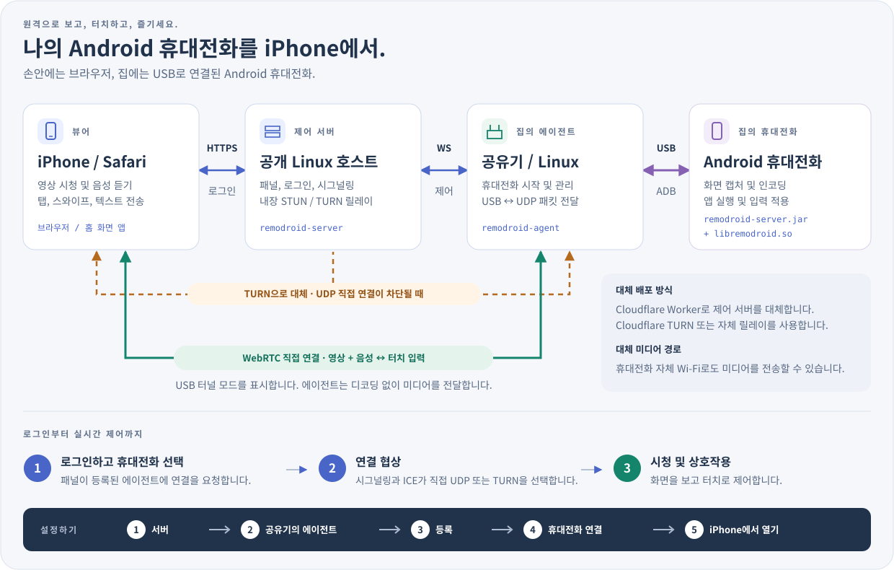

<p align="center"><a href="../../README.md">English</a> | <a href="../zh/README.md">简体中文</a> | <a href="../ja/README.md">日本語</a> | <b>한국어</b> | <a href="../es/README.md">Español</a> | <a href="../pt-BR/README.md">Português (Brasil)</a> | <a href="../de/README.md">Deutsch</a> | <a href="../fr/README.md">Français</a> | <a href="../ru/README.md">Русский</a></p>

# RemoDroid

iPhone의 Safari에서 Android 휴대전화를 낮은 지연 시간으로 제어할 수 있습니다. 클라우드 게임에도 충분한 수준입니다.
휴대전화는 집에 두고 USB 케이블로 공유기에 연결합니다. 어디서나 화면을 보고 터치할 수 있습니다.

<p align="center"><a href="https://remodroid.pages.dev/ko/"></a></p>

<p align="center"></p>

**한 문단으로 설명하는 작동 방식.** 공용 네트워크에 있는 컴퓨터의 작은 **서버**(또는 무료 Cloudflare Worker)가 웹 페이지, 로그인, 연결 설정을 담당합니다. 집 공유기의 **에이전트**는 자체 내장 ADB(`adb` 불필요)로 USB를 통해 휴대전화와 통신하고 휴대전화에서 작은 보조 프로그램을 시작합니다. 보조 프로그램은 화면을 캡처하고 하드웨어로 인코딩하여 WebRTC로 Safari에 직접 보냅니다. 터치는 같은 경로로 돌아갑니다. 공유기는 패킷만 전달하며 중간에서는 아무것도 디코딩하지 않습니다.

<details>
<summary>자세한 설명: 미디어 경로, TURN, 휴대전화에서 실행되는 프로그램</summary>

- **미디어 경로.** 기본적으로 휴대전화가 USB 케이블로 미디어를 보내면 에이전트가 이를 UDP로 네트워크에 전송하므로 휴대전화에 Wi-Fi가 필요 없습니다. `agent.ini`에 `[phone] path = wifi`를 설정하면 휴대전화 자체 Wi-Fi를 사용합니다. 공유기가 Wi-Fi 액세스 포인트도 겸한다면 이쪽이 더 빠를 수 있습니다.
- **TURN.** iPhone과 집 사이에 UDP 직접 경로를 찾을 수 없으면(통신사 NAT, 엄격한 방화벽), 서버 내장 TURN 릴레이를 통해 미디어가 전송됩니다. 이때도 디코딩하지 않습니다.
- **휴대전화에서 실행되는 프로그램:** `remodroid-server.jar`(화면 캡처, MediaCodec H.265/H.264, 입력 주입, 클립보드, 화면 전원, 파일)와 `libremodroid.so`(C로 작성된 WebRTC 스택: ICE, DTLS-SRTP, SCTP 데이터 채널, 혼잡 제어). 둘 다 `app_process`를 통해 shell 사용자로 실행되므로 앱을 설치하지 않습니다. 연결 중에는 전력 절약을 위해 휴대전화 패널이 꺼지고 소리는 iPhone에서 재생됩니다.
- 설계 메모와 결정 사항: [`plan.md`](../../plan.md).

</details>

## 필요한 것

RemoDroid는 가볍습니다. 무거운 작업(캡처와 하드웨어 인코딩)은 휴대전화가 하고, 공유기는 패킷 전달만, 서버는 연결 설정만 담당합니다. 가장 중요한 것은 **집의 업로드 속도**입니다.

| | 최소 사양 | 권장 사양 | 사용하는 자원 |
|---|---|---|---|
| **서버** | 공인 IP가 있는 모든 Linux 컴퓨터: CPU 1개, RAM 128 MB, 디스크 수 MB. 또는 무료 Cloudflare 계정 | **집에서 가장 가까운** 클라우드 리전의 소형 VM(TURN이 필요할 때 스트림을 전달)과 충분한 월간 트래픽 | RAM 약 2 MB, CPU는 거의 사용하지 않음. 세션이 TURN으로 전환될 때만 대역폭 사용. 이때 전체 스트림이 서버를 통과(10 Mbps에서 시간당 약 4.5 GB) |
| **공유기** | OpenWrt, Linux(Debian, Ubuntu, CentOS, Alpine) 또는 Koolshare가 있는 ASUS Merlin, USB 포트, 약 2 MB의 빈 저장 공간. CPU: x86, ARM 또는 MIPS | ARM(aarch64, ARMv7) 또는 x86 공유기. 성능이 낮은 MIPS 공유기도 동작하지만 최고 비트레이트를 따라가지 못할 수 있음 | RAM 약 2 MB. CPU는 USB와 UDP 사이의 패킷 이동에만 사용하며 디코딩하지 않음 |
| **Android 휴대전화** | Android 8 이상, USB 디버깅, H.264 하드웨어 인코더 | Android 12 이상(소리용), H.265 하드웨어 인코더 | 자체 하드웨어 인코더 사용. 연결 중 화면 꺼짐 |
| **iPhone** | Safari | WebRTC에서 H.265를 사용할 수 있는 최신 iOS(구형 iOS는 자동으로 H.264 수신) | 하드웨어 영상 디코딩 |
| **네트워크** | 집 업로드 3–5 Mbps(720p) | 집 업로드 10–20 Mbps와 동일한 iPhone 다운로드 속도(1080p, 60 fps) | 스트림당 1–20 Mbps(기본 상한 20 Mbps, 60 fps). 화질 자동 조절 |

iPhone이 집에 직접 연결될 때 예상 지연 시간은 40–80 ms이며, TURN을 거치면 약 70–120 ms입니다.
메모리 수치는 실행 중인 서버와 RT-AC86U 에이전트에서 측정했습니다.

## 설치

<p align="center"><a href="https://remodroid.pages.dev/ko/"></a></p>

**마법사가 복사 버튼과 함께 모든 과정을 안내합니다.** 여기서 계속하고 싶다면 다음 다섯 단계를 따르세요. 그림 하단의 다섯 단계와 같습니다.

### 1. 서버

Linux 서버에서 실행하세요:

```sh
curl -fsSL https://remodroid.pages.dev/install_server.sh | sudo sh
```

알맞은 패키지를 골라 설치하고 서버를 시작한 다음 `http://<ip>:5580/wizard.html?token=…` 같은 링크를 출력합니다.

<!-- downloads:server -->
#### 서버 다운로드(v0.4)

컴퓨터 CPU에 맞는 행(`uname -m`: `x86_64`, `aarch64` = ARM64, `armv7l` = ARMv7, `i686` = x86)과 시스템에 맞는 열을 선택하세요. *모든 Linux*에는 서버와 에이전트가 모두 들어 있습니다.

| 서버 | Debian · Ubuntu | CentOS · Fedora | Alpine | 모든 Linux |
|:--|:-:|:-:|:-:|:-:|
| **x86_64**<br><sub>Intel / AMD 64비트</sub> | [](https://github.com/yinyue123/RemoDroid/releases/download/v0.4/remodroid-server_0.4-1_amd64.deb) | [](https://github.com/yinyue123/RemoDroid/releases/download/v0.4/remodroid-server-0.4-1.x86_64.rpm) | [](https://github.com/yinyue123/RemoDroid/releases/download/v0.4/remodroid-server_0.4-r1_x86_64.apk) | [](https://github.com/yinyue123/RemoDroid/releases/download/v0.4/remodroid-0.4-linux-x86_64.tar.gz) |
| **ARM64**<br><sub>aarch64</sub> | [](https://github.com/yinyue123/RemoDroid/releases/download/v0.4/remodroid-server_0.4-1_arm64.deb) | [](https://github.com/yinyue123/RemoDroid/releases/download/v0.4/remodroid-server-0.4-1.aarch64.rpm) | [](https://github.com/yinyue123/RemoDroid/releases/download/v0.4/remodroid-server_0.4-r1_aarch64.apk) | [](https://github.com/yinyue123/RemoDroid/releases/download/v0.4/remodroid-0.4-linux-aarch64.tar.gz) |
| **ARMv7**<br><sub>32비트 ARM</sub> | [](https://github.com/yinyue123/RemoDroid/releases/download/v0.4/remodroid-server_0.4-1_armhf.deb) | [](https://github.com/yinyue123/RemoDroid/releases/download/v0.4/remodroid-server-0.4-1.armv7hl.rpm) | [](https://github.com/yinyue123/RemoDroid/releases/download/v0.4/remodroid-server_0.4-r1_armv7.apk) | [](https://github.com/yinyue123/RemoDroid/releases/download/v0.4/remodroid-0.4-linux-armv7.tar.gz) |
| **x86**<br><sub>32비트</sub> | [](https://github.com/yinyue123/RemoDroid/releases/download/v0.4/remodroid-server_0.4-1_i386.deb) | [](https://github.com/yinyue123/RemoDroid/releases/download/v0.4/remodroid-server-0.4-1.i686.rpm) | [](https://github.com/yinyue123/RemoDroid/releases/download/v0.4/remodroid-server_0.4-r1_x86.apk) | [](https://github.com/yinyue123/RemoDroid/releases/download/v0.4/remodroid-0.4-linux-x86.tar.gz) |

체크섬: [SHA256SUMS](https://github.com/yinyue123/RemoDroid/releases/download/v0.4/SHA256SUMS)
<!-- /downloads:server -->

설치하고 서비스를 시작하세요:

```sh
sudo apt install ./remodroid-server_*.deb                  # Debian, Ubuntu
sudo dnf install ./remodroid-server-*.rpm                  # CentOS, Fedora
sudo apk add --allow-untrusted ./remodroid-server_*.apk    # Alpine
opkg install ./remodroid-server_*.ipk                      # OpenWrt

sudo systemctl enable --now remodroid-server               # systemd
rc-update add remodroid-server && rc-service remodroid-server start            # Alpine
/etc/init.d/remodroid-server enable && /etc/init.d/remodroid-server start      # OpenWrt
```

그다음 `http://<server>:5580/wizard.html?token=…`을 여세요. 토큰은 `/var/lib/remodroid/setup-token`에 있습니다.

<details>
<summary>모든 Linux에서 수동 설치(.tar.gz)</summary>

압축 파일에는 `bin/`, `web/`, `phone/`, `etc/`(ini 예제 파일과 서비스 유닛)가 있습니다. 서버의 경우:

```sh
sudo install -m 0755 bin/remodroid-server /usr/bin/
sudo mkdir -p /usr/share/remodroid /etc/remodroid
sudo cp -r web /usr/share/remodroid/web
sudo install -m 0640 etc/server.ini.example /etc/remodroid/server.ini
remodroid-server -c /etc/remodroid/server.ini
```

`etc/remodroid-server.service`는 `/etc/systemd/system/`에 복사할 수 있는 systemd 유닛입니다.

</details>

**설정하기.** 마법사에서 웹 포트, **도메인**(Let's Encrypt를 통한 자동 HTTPS용), 관리자 로그인 정보, STUN/TURN 포트를 입력하세요. 서버가 지정한 포트로 다시 시작하면 패널이 준비됩니다.

방화벽에서 다음 포트를 여세요: **TCP 5580**(초기 설정 전용), 웹 포트(**80**), 도메인 사용 시 **443**, **UDP 3478**, **UDP 49152–49252**(TURN).

<details>
<summary>서버가 없다면 Cloudflare 사용</summary>

1. Cloudflare 대시보드에서 TURN 키를 만드세요: **실시간 → TURN 서버**.
2. `worker/`를 배포하세요: `cd worker && npm install && npx wrangler deploy`. 또는 포크한 저장소를 Cloudflare에 가져오고 루트 디렉터리를 `worker`로 지정하세요.
3. `https://remodroid.<you>.workers.dev`를 여세요. 마법사에서 로그인 정보와 TURN 키를 요청합니다.

Worker는 내장 저장소가 있는 Durable Object에서 같은 패널(로그인, 공유기, 시그널링)을 실행합니다.
방화벽 단계는 건너뛰세요. Cloudflare TURN이 중계를 담당합니다.

</details>

<details>
<summary>초기 설정 이후의 서버 설정</summary>

마법사는 `/etc/remodroid/server.ini`를 기록합니다. 이후 로그인한 뒤 같은 페이지에서 설정을 편집할 수 있으며, 패널의 **서버** 탭에서는 항목을 하나씩 변경할 수 있습니다(도메인, 포트, 로그인 정보, STUN/TURN 목록).
`remodroid-server -t`는 아무것도 시작하지 않고 파일을 검사합니다. HTTPS 인증서는 자동 갱신됩니다.
패키지는 업그레이드할 때 `server.ini`를 보존합니다.

</details>

### 2. 공유기의 에이전트

OpenWrt, Alpine:

```sh
wget -qO- https://remodroid.pages.dev/install_agent.sh | sh
```

Debian, Ubuntu, CentOS, Fedora:

```sh
curl -fsSL https://remodroid.pages.dev/install_agent.sh | sudo sh
```

<!-- downloads:agent -->
#### 에이전트 다운로드(v0.4)

컴퓨터 CPU에 맞는 행(`uname -m`: `x86_64`, `aarch64` = ARM64, `armv7l` = ARMv7, `i686` = x86)과 시스템에 맞는 열을 선택하세요. OpenWrt에서는 `opkg print-architecture`에 표시되는 빌드를 선택하세요. *모든 Linux*에는 서버와 에이전트가 모두 들어 있습니다.

| 에이전트 | Debian · Ubuntu | CentOS · Fedora | Alpine | OpenWrt | 모든 Linux |
|:--|:-:|:-:|:-:|:-:|:-:|
| **x86_64**<br><sub>Intel / AMD 64비트</sub> | [](https://github.com/yinyue123/RemoDroid/releases/download/v0.4/remodroid-agent_0.4-1_amd64.deb) | [](https://github.com/yinyue123/RemoDroid/releases/download/v0.4/remodroid-agent-0.4-1.x86_64.rpm) | [](https://github.com/yinyue123/RemoDroid/releases/download/v0.4/remodroid-agent_0.4-r1_x86_64.apk) | [](https://github.com/yinyue123/RemoDroid/releases/download/v0.4/remodroid-agent_0.4-1_x86_64.ipk) | [](https://github.com/yinyue123/RemoDroid/releases/download/v0.4/remodroid-0.4-linux-x86_64.tar.gz) |
| **ARM64**<br><sub>aarch64</sub> | [](https://github.com/yinyue123/RemoDroid/releases/download/v0.4/remodroid-agent_0.4-1_arm64.deb) | [](https://github.com/yinyue123/RemoDroid/releases/download/v0.4/remodroid-agent-0.4-1.aarch64.rpm) | [](https://github.com/yinyue123/RemoDroid/releases/download/v0.4/remodroid-agent_0.4-r1_aarch64.apk) | [](https://github.com/yinyue123/RemoDroid/releases/download/v0.4/remodroid-agent_0.4-1_aarch64_generic.ipk)<br>[](https://github.com/yinyue123/RemoDroid/releases/download/v0.4/remodroid-agent_0.4-1_aarch64_cortex-a53.ipk)<br>[](https://github.com/yinyue123/RemoDroid/releases/download/v0.4/remodroid-agent_0.4-1_aarch64_cortex-a72.ipk) | [](https://github.com/yinyue123/RemoDroid/releases/download/v0.4/remodroid-0.4-linux-aarch64.tar.gz) |
| **ARMv7**<br><sub>32비트 ARM</sub> | [](https://github.com/yinyue123/RemoDroid/releases/download/v0.4/remodroid-agent_0.4-1_armhf.deb) | [](https://github.com/yinyue123/RemoDroid/releases/download/v0.4/remodroid-agent-0.4-1.armv7hl.rpm) | [](https://github.com/yinyue123/RemoDroid/releases/download/v0.4/remodroid-agent_0.4-r1_armv7.apk) | [](https://github.com/yinyue123/RemoDroid/releases/download/v0.4/remodroid-agent_0.4-1_arm_cortex-a7_neon-vfpv4.ipk)<br>[](https://github.com/yinyue123/RemoDroid/releases/download/v0.4/remodroid-agent_0.4-1_arm_cortex-a9_vfpv3-d16.ipk)<br>[](https://github.com/yinyue123/RemoDroid/releases/download/v0.4/remodroid-agent_0.4-1_arm_cortex-a15_neon-vfpv4.ipk) | [](https://github.com/yinyue123/RemoDroid/releases/download/v0.4/remodroid-0.4-linux-armv7.tar.gz) |
| **x86**<br><sub>32비트</sub> | [](https://github.com/yinyue123/RemoDroid/releases/download/v0.4/remodroid-agent_0.4-1_i386.deb) | [](https://github.com/yinyue123/RemoDroid/releases/download/v0.4/remodroid-agent-0.4-1.i686.rpm) | [](https://github.com/yinyue123/RemoDroid/releases/download/v0.4/remodroid-agent_0.4-r1_x86.apk) | [](https://github.com/yinyue123/RemoDroid/releases/download/v0.4/remodroid-agent_0.4-1_i386_pentium4.ipk) | [](https://github.com/yinyue123/RemoDroid/releases/download/v0.4/remodroid-0.4-linux-x86.tar.gz) |
| **MIPS LE**<br><sub>mipsel</sub> | — | — | — | [](https://github.com/yinyue123/RemoDroid/releases/download/v0.4/remodroid-agent_0.4-1_mipsel_24kc.ipk) | [](https://github.com/yinyue123/RemoDroid/releases/download/v0.4/remodroid-0.4-linux-mipsel.tar.gz) |
| **MIPS BE**<br><sub>mips</sub> | — | — | — | [](https://github.com/yinyue123/RemoDroid/releases/download/v0.4/remodroid-agent_0.4-1_mips_24kc.ipk) | [](https://github.com/yinyue123/RemoDroid/releases/download/v0.4/remodroid-0.4-linux-mips.tar.gz) |

Koolshare / KoolCenter 오프라인 설치 파일: [Merlin armv7](https://github.com/yinyue123/RemoDroid/releases/download/v0.4/remodroid-0.4-merlin-armv7.tar.gz) · [Merlin aarch64](https://github.com/yinyue123/RemoDroid/releases/download/v0.4/remodroid-0.4-merlin-aarch64.tar.gz). RT-AC86U와 RT-AX88U는 aarch64를 선택하세요. 에이전트만 포함하는 플러그인이며 OpenWrt 패키지가 아닙니다.

체크섬: [SHA256SUMS](https://github.com/yinyue123/RemoDroid/releases/download/v0.4/SHA256SUMS)
<!-- /downloads:agent -->

**어떤 OpenWrt 파일을 선택하나요?** [openwrt.md](openwrt.md)에서 공유기와 CPU를 찾으세요. 동작하는 OpenWrt 버전도 나와 있습니다.

**LuCI가 있는 OpenWrt에서는 명령줄 불필요:** LuCI에서 **시스템 → 소프트웨어 → 패키지 업로드…**를 열고 공유기에 맞는 `.ipk`를 선택해 설치하세요. **서비스 → RemoDroid** 페이지가 생깁니다. 여기에서 공유기를 패널과 페어링하고(3단계), 에이전트를 시작·중지하며, 패널과 휴대전화의 연결 여부를 확인할 수 있습니다.

다른 시스템에서는 설치하고 서비스를 시작하세요:

```sh
opkg install ./remodroid-agent_*.ipk                       # OpenWrt
sudo apt install ./remodroid-agent_*.deb                   # Debian, Ubuntu
sudo dnf install ./remodroid-agent-*.rpm                   # CentOS, Fedora
sudo apk add --allow-untrusted ./remodroid-agent_*.apk     # Alpine

/etc/init.d/remodroid-agent enable && /etc/init.d/remodroid-agent start        # OpenWrt
sudo systemctl enable --now remodroid-agent                # systemd
rc-update add remodroid-agent && rc-service remodroid-agent start              # Alpine
```

<details>
<summary>모든 Linux에서 수동 설치(.tar.gz)</summary>

에이전트는 압축을 푼 디렉터리에서 다음을 실행하세요:

```sh
sudo install -m 0755 bin/remodroid-agent /usr/bin/
sudo ln -s remodroid-agent /usr/bin/remodroid
sudo mkdir -p /usr/share/remodroid /etc/remodroid
sudo cp -r phone/. /usr/share/remodroid/
sudo install -m 0600 etc/agent.ini.example /etc/remodroid/agent.ini
remodroid-agent -c /etc/remodroid/agent.ini
```

`etc/remodroid-agent.service`(systemd)와 `etc/remodroid-agent.init`(OpenWrt procd)은 부팅 시 에이전트를 시작합니다.

</details>

<details>
<summary>ASUS Merlin / Koolshare</summary>

위에서 공유기 CPU(`uname -m`)에 맞는 Merlin 패키지를 선택하세요:

- `remodroid-<version>-merlin-aarch64.tar.gz`는 `aarch64`용: RT-AC86U, RT-AX88U 같은 64비트 HND 모델
- `remodroid-<version>-merlin-armv7.tar.gz`는 `armv7l`용: RT-AC68U 같은 32비트 ARM 모델

**소프트웨어 센터 → 수동 설치**에서 설치하세요. 설치 프로그램은 CPU가 다른 패키지를 거부합니다.
설정, 시작/중지, 로그, 선택적 자동 시작을 위한 공유기 페이지가 추가됩니다. 설치만으로 에이전트가 시작되지는 않습니다. Koolshare/KoolCenter 소프트웨어 센터가 없는 기본 Asuswrt-Merlin은 지원하지 않습니다.
빌드, 마이그레이션, 제한 사항: [Merlin 패키징](../../packaging/merlin/README.md).

</details>

### 3. 공유기 등록

패널에서 **에이전트 → 추가**를 여세요. 일회용 코드가 포함된 명령이 표시됩니다. 공유기에서 실행하세요:

```sh
remodroid enroll --panel https://your.panel --code X5SX-K3M7
```

OpenWrt에서는 대신 LuCI의 **서비스 → RemoDroid → 페어링**에 같은 명령을 붙여 넣을 수 있습니다.

코드는 한 번만 사용할 수 있으며 10분 동안 유효합니다. 이후 공유기가 온라인으로 표시됩니다. 탭하면 설정을 변경할 수 있습니다.

### 4. 휴대전화 연결

휴대전화에서 **개발자 옵션 → USB 디버깅**을 켜세요. 공유기의 USB 포트에 연결하고 “USB 디버깅을 허용하시겠습니까?” 메시지에서 **허용**을 누르세요(“항상 허용” 선택). 휴대전화를 직접 만지는 것은 이때뿐입니다.

### 5. iPhone에서 열기

Safari에서 패널을 열고 로그인한 뒤 **공유 → 홈 화면에 추가**를 선택하세요. 홈 화면에서 시작하면 전체 화면으로 실행됩니다(Safari는 일반 페이지에서 막대를 숨길 수 없습니다). 휴대전화를 탭해 연결하세요.

## 사용법

- **터치**는 휴대전화와 동일하게 작동하며 멀티터치도 지원합니다. **플로팅 볼**은 잠금, 다시 연결, 전체 화면, 소리, 사진 업로드, 클립보드, 설정 메뉴를 엽니다.
- **소리**는 휴대전화(Android 12+)에서 오며 연결 중에는 휴대전화 스피커가 무음이 됩니다. Safari에서 화면을 한 번 탭하면 음소거가 해제됩니다. 메뉴의 **소리** 스위치로 재생을 휴대전화에 돌려줄 수 있습니다.
- 나중에 명령 하나로 서버나 공유기를 **업데이트**할 수 있습니다. 설치된 구성 요소를 최신 릴리스로 업데이트하고 `server.ini` / `agent.ini`를 보존한 뒤 다시 시작합니다:

  ```sh
  curl -fsSL https://remodroid.pages.dev/update.sh | sudo sh    # OpenWrt: wget -qO- … | sh
  ```

<details>
<summary>공유기 명령</summary>

공유기에서 다음 명령으로 실행 중인 에이전트와 통신합니다(adb 불필요):

```sh
remodroid-agent devices | status | shell … | push | pull | logcat | key | restart-server
```

</details>

## 추가 기능

<details>
<summary><b>AI 제어</b>: AI가 화면을 읽고 대신 탭하도록 하기</summary>

AI는 `/api/v1/devices/{id}/` 아래의 REST API로 휴대전화를 조작합니다:

- `GET …/ui`는 화면을 JSON으로 반환합니다(휴대전화의 프로세스 내 UiAutomation 사용, 대체 수단은 `uiautomator dump`).
- `GET …/screenshot?format=jpeg&max_edge=1280`는 이미지를 반환합니다(GPU로 크기 조절, 휴대전화에서 C로 압축, 디스크에 기록하지 않음).
- `POST …/actions`는 선택자를 통해 탭, 입력, 스크롤, 대기를 수행합니다.

공유기 에이전트가 API를 제공하고(`agent.ini`의 `[api] listen` + `token`), 서버가 중계합니다(`remodroid-server gentoken NAME`). AI가 한 번 알아낸 작업 흐름은 `skills/`에 저장되어 모델 호출 없이 Python으로 재실행됩니다. 새로운 상황을 만나면 화면을 AI에 돌려줍니다.

```sh
export PYTHONPATH=python RD_URL=http://192.168.1.1:8790 RD_TOKEN=…
python3 -m remodroid ui                      # 화면을 개요로 표시
python3 -m remodroid tap --rid search --wait-change
python3 skills/settings-search/run.py --query wifi
```

설계: [skill-plan.md](../../skill-plan.md). 스킬 작성: [skills/README.md](../../skills/README.md).

</details>

<details>
<summary><b>휴대전화 알림</b>: iPhone 또는 Bark로 받기</summary>

휴대전화의 보조 프로그램은 `dumpsys notification`(shell 사용자가 볼 수 있는 유일한 알림 내용)을 폴링하며, 지속적이거나 중요도가 낮은 알림을 버립니다. 새 알림은 뷰어 WebSocket을 통해 연결된 클라이언트에 보내고, 서버에 `bark_url`이 있으면 [Bark](https://github.com/Finb/Bark)에도 보냅니다. 이후 AI 제어 API(또는 스킬)를 호출해 알림에 대응할 수 있습니다.

- 공유기 `agent.ini`: `[notify] enabled = true`, 그리고 `min_importance`와 `ignore` 목록.
- 서버 `server.ini`: `[notify] bark_url = https://api.day.app/<key>`(또는 `[device_notify]`에서 공유기별 설정).
  Bark 키는 서버에만 보관되며 로그에 기록되지 않습니다. WebSocket 전달은 서버 설정이 필요 없습니다.

설정 예제는 `deploy/`에 있습니다.

</details>

## 상태

아래 표의 모든 테스트가 통과했으며 실제 Chrome을 뷰어로 사용하는 테스트도 포함됩니다. 소리는 Sony SO-51A(Android 12)에서 확인했습니다. 아직 실제 하드웨어에서 확인하지 않은 항목(계획 마일스톤 M0): 여러 휴대전화의 Java 휴대전화 서버(캡처, 인코더 설정, 입력, 클립보드, 화면 전원), 공유기의 USB ADB, Safari 특성(H.265 지원, 하드웨어 디코딩), 실제 네트워크의 혼잡 제어.

## 개발

<details>
<summary>저장소 내용</summary>

| 경로 | 내용 | 언어 |
|---|---|---|
| `server/` | 제어 서버: 로그인 페이지 + 쿠키(공유기용 Basic 인증), REST API, 뷰어/에이전트 WebSocket, 내장 TURN 릴레이, 자동 Let's Encrypt(ACME) 인증서를 사용하는 선택적 HTTPS | C + libev + mbedTLS |
| `agent/` | 공유기 에이전트: 내장 ADB 클라이언트(usbfs), 휴대전화 프로세스 관리, UDP 릴레이, WebSocket 클라이언트, CLI | C + libev |
| `rtc/` | 휴대전화 WebRTC 스택: ICE + TURN 클라이언트, DTLS-SRTP, SCTP 데이터 채널, H.265/H.264 RTP, 혼잡 제어 | C |
| `android/java/` | 휴대전화 서버: 화면 캡처, MediaCodec, 입력 주입, 클립보드, 화면 전원, 파일, logcat | Java (app_process) |
| `web/` | iPhone 클라이언트(PWA): 영상, 소리, 멀티터치, 플로팅 볼 메뉴, 사진 업로드, 클립보드, 모든 설정. `panel.html`(기기, 에이전트, 서버 탭)과 `wizard.html`(최초 실행 설정) | HTML/CSS/JS |
| `worker/` | Cloudflare Workers + Durable Object에서 실행되는 같은 패널, Cloudflare TURN 사용 | JS |
| `wizard/` | 설치 사이트(Cloudflare Pages, remodroid.pages.dev), `install_server.sh`, `install_agent.sh`, `update.sh` | HTML, sh |
| `common/` | 공통 C 코드: WebSocket 프레이밍, 터널 프레임, STUN, JSON 봉투, ini, 유틸리티 | C |
| `third_party/` | 저장소에 포함되어 정적으로 링크되는 라이브러리: libev, inih, cJSON, picohttpparser, crypt_blowfish, mbedTLS, libsrtp2, usrsctp | C |
| `deploy/` | `server.ini` / `agent.ini` 예제, systemd 유닛, OpenRC 및 procd 스크립트 | |
| `packaging/`, `.github/workflows/` | nFPM 패키지 정의(deb, rpm, apk, ipk)와 CI 빌드/릴리스 작업 흐름 | |
| `python/`, `skills/`, `.claude/skills/phone/` | AI 제어: `remodroid` SDK와 `rd` CLI, 재실행 가능한 스킬, 이를 사용하는 Claude Code 스킬 | Python |
| `tests/` | 엔드투엔드 테스트 | Node, Python |
| `demo/` | 최초의 모의 패널(오프라인, 서버 없음) | HTML |

</details>

<details>
<summary>빌드</summary>

호스트 빌드(개발 및 테스트):

```sh
make            # build/host/remodroid-server, build/host/remodroid-agent
make rtc-tests  # build/host/rtc/rtc_test, rtp_dump (호스트에서 휴대전화 스택 실행)
```

공유기와 서버용 정적 릴리스 바이너리(Zig를 크로스 컴파일러로 사용, musl, 모든 종속성 링크):

```sh
make dist                   # 빌드 컨테이너 내부에서 실행(build/Dockerfile, podman/docker 필요)
./build/dist.sh mipsel      # PATH에 `zig`가 있으면 직접 실행 가능. 대상: x86 x86_64 armv7 aarch64 mipsel mips
```

결과는 `build/out/<arch>/`에 저장됩니다. 바이너리당 약 0.8 MB(MIPS는 1.2 MB)입니다.

휴대전화 파일(`remodroid-server.jar` + ABI별 `libremodroid.so`):

```sh
ANDROID_JAR=.../platforms/android-34/android.jar D8=.../build-tools/34.0.0/d8 NDK=.../android-ndk-r27c \
  ./android/build.sh        # build/android/remodroid-server.jar, build/android/<abi>/libremodroid.so
```

</details>

<details>
<summary>테스트</summary>

| 명령 | 검증 범위 |
|---|---|
| `make test` | 제어 평면 엔드투엔드: 실제 서버 + 에이전트, 프로토콜에 충실한 모의 adbd(OpenSSL로 RSA 인증 검사), 모의 휴대전화. 인증, REST, WebSocket, ADB push/shell/sync, 터널, UDP 릴레이, 명령, `agent.ini` 편집, CLI, 재연결(48개 검사) |
| (`make test`에 포함) | 알림 전달: `[notify]` 설정이 휴대전화에 도달하고, 캡처된 알림이 WebSocket으로 뷰어에 도달하며, 서버가 모의 Bark 엔드포인트에 JSON으로 전송 |
| `python3 tests/python_sdk.py` | 모의 휴대전화 API를 대상으로 AI 제어 SDK, `rd` CLI, 스킬 실행기 검증: 선택자, 메모리 내 스크린샷, AI에 제어권 전달(종료 코드 3), `--from-step`으로 재개 |
| `QEMU=qemu-mipsel node tests/run.mjs build/mipsel` | 사용자 모드 에뮬레이션에서 정적 MIPS 공유기 바이너리에 동일한 테스트 수행 |
| `python rtc/test/rtc_interop.py` | 휴대전화 WebRTC 스택 ↔ aiortc: ICE, DTLS-SRTP, SCTP, H.264 디코딩 프레임, 데이터 채널 |
| `python rtc/test/rtp_depack.py` | H.265 및 H.264 패킷화: 독립적인 역패킷화 도구 + FFmpeg를 거치는 비트 단위 일치 왕복 검증 |
| `python tests/e2e_webrtc.py [--relay]` | 전체 경로: 뷰어 → 서버 → 에이전트 → 터널 → 휴대전화 스택. `--relay`는 내장 TURN 강제 사용 |
| `python tests/e2e_browser.py` | 헤드리스 Chrome에서 실제 웹 클라이언트로 전체 스택 검증: 영상, 터치, 메뉴, 프로토콜 |
| `node tests/setup.mjs build/host` | 최초 실행 마법사(설정 토큰, 저장, 새 포트에서 재시작), 로그인, 실제 에이전트의 `enroll`을 사용하는 등록 코드, 패널을 통한 공유기 설정, 이름 변경, 제거 |
| `node tests/worker.mjs build/host` | `wrangler dev`에서 실행되는 Cloudflare Worker(`cd worker && npm install` 이후)와 실제 에이전트: 설정, 로그인, 등록, 뷰어 WebSocket과 시그널링, 명령, 이름 변경, 제거 |
| `sudo tests/openwrt.sh IP [VERSION]` | 독립 LAN 주소(macvlan)를 갖는 podman의 OpenWrt(19.07–24.10), LuCI, 이 저장소에서 빌드한 에이전트 ipk와 서버. 다른 기기에서 `http://IP/`를 열어 서비스 → RemoDroid에서 페어링 |
| `node tests/tls.mjs build/host` | HTTPS, 리디렉션, `Secure` 쿠키, `wss://`를 통한 뷰어와 에이전트(신뢰하는 CA 및 신뢰하지 않는 CA), SIGHUP 시 인증서 다시 로드. `PEBBLE_DIR` 설정 시 Pebble(Let's Encrypt 테스트 CA)로 ACME 발급, 재사용, 자동 갱신 검증 |

Python 테스트에는 `aiortc`가 필요합니다(브라우저 테스트에는 `playwright` + Chromium도 필요).

</details>

설계 문서: [plan.md](../../plan.md)(아키텍처와 결정 사항), [skill-plan.md](../../skill-plan.md)(AI 제어),
[packaging/merlin/README.md](../../packaging/merlin/README.md)(Merlin 플러그인).
