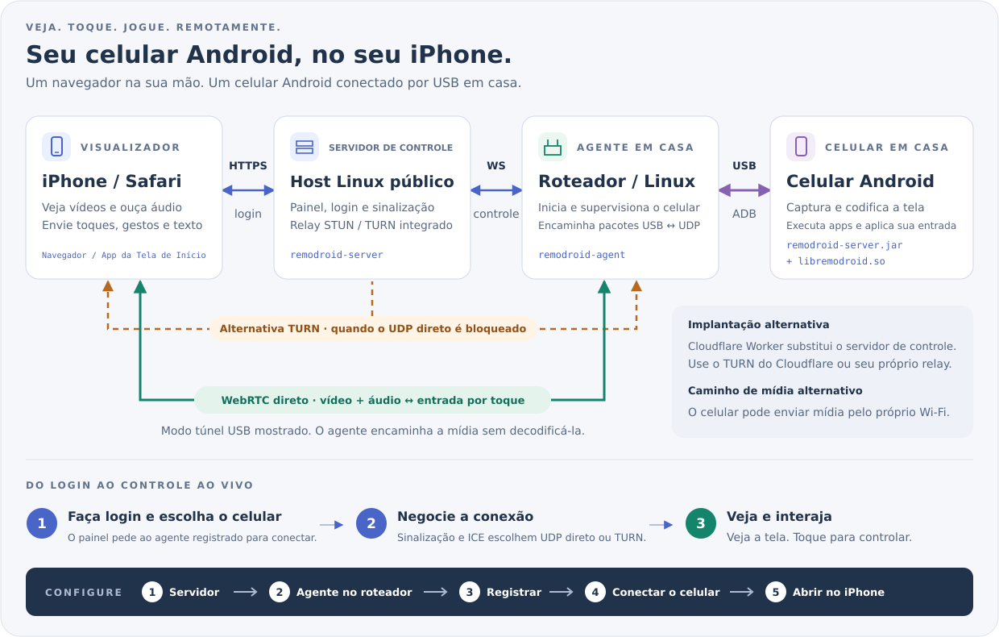

<p align="center"><a href="../../README.md">English</a> | <a href="../zh/README.md">简体中文</a> | <a href="../ja/README.md">日本語</a> | <a href="../ko/README.md">한국어</a> | <a href="../es/README.md">Español</a> | <b>Português (Brasil)</b> | <a href="../de/README.md">Deutsch</a> | <a href="../fr/README.md">Français</a> | <a href="../ru/README.md">Русский</a></p>

# RemoDroid

Controle um celular Android, ou um computador Windows, Mac ou Linux, pelo Safari do iPhone (ou qualquer navegador) com baixa latência, boa o bastante para jogos na nuvem.

## Do que eu preciso?

**Duas partes: um painel, e o RemoDroid no que você quer controlar.** O painel é a página web em que você faz login: coloque-o no **Cloudflare** se não tiver servidor (grátis, nenhuma máquina para manter) ou no seu próprio servidor **Linux** ou **Windows**. Depois, para controlar um **celular Android**, instale o *RemoDroid para celulares* no roteador (ou qualquer máquina Linux) em que o celular está ligado por USB; para controlar um **computador Windows, Mac ou Linux**, instale o *RemoDroid para computadores* nesse computador. Você vê e controla pelo Safari do iPhone, ou qualquer navegador; ali não há nada para instalar.

**O painel: escolha um.**

| Coloque o painel em | Escolha quando | Instalação |
|---|---|---|
| [**Cloudflare**](#panel-cloudflare) | Você não tem servidor. O Cloudflare hospeda a página e retransmite o vídeo quando uma rede bloqueia a conexão direta (1.000 GB por mês grátis). | Alguns minutos no navegador |
| [**Um servidor Linux**](#panel-linux) | Você aluga uma VPS com IP público. Escolha uma região perto de casa: ela retransmite o vídeo quando preciso. | Um comando |
| [**Um servidor Windows**](#panel-windows) | O mesmo, no Windows Server 2019 ou mais novo (Windows 10 ou 11 com IP público também serve). | Descompactar e clicar em *Install and start* |

**Depois, em cada coisa que você quer controlar:**

| Para controlar | Instale | Onde |
|---|---|---|
| Um **celular Android** | [**RemoDroid para celulares**](#for-phones) | No roteador (OpenWrt, ASUS Merlin ou qualquer máquina Linux) em que o celular está ligado por USB. Nada é instalado no celular. |
| Um PC com **Windows** | [**RemoDroid para computadores**](#for-computers) | Nesse PC (Windows 10 1809 ou mais novo) |
| Um **Mac** | [**RemoDroid para computadores**](#for-computers) | Nesse Mac (macOS 13 ou mais novo) |
| Um PC com **Linux** | [**RemoDroid para computadores**](#for-computers) | Nesse PC (uma sessão X11) |

Um painel atende quantos celulares e computadores você quiser. Toda instalação são os mesmos três passos:
[1. o painel](#step-panel) → [2. o RemoDroid no que você controla](#step-device) → [3. abra no iPhone](#step-iphone).

<p align="center"><a href="https://remodroid.pages.dev/pt-BR/"></a></p>

<p align="center">O assistente faz as mesmas duas perguntas e guia você até o fim, com botões de copiar.</p>

## Como funciona

<p align="center"></p>

<p align="center"></p>

O **painel** hospeda a página web, o seu login e o estabelecimento da conexão. O **RemoDroid para celulares**, no roteador de casa, fala com o celular por USB com o próprio ADB embutido (sem precisar de `adb`) e inicia um pequeno ajudante no celular. O ajudante captura a tela, codifica por hardware e envia via WebRTC direto ao Safari, com seus toques voltando pelo mesmo caminho. O roteador só repassa pacotes; nada é decodificado no meio. O **RemoDroid para computadores** faz o mesmo a partir do próprio computador: captura a tela, codifica na GPU e recebe mouse e teclado.

<details>
<summary>Mais detalhes: caminhos da mídia, TURN, o que roda no celular</summary>

- **Caminho da mídia.** Por padrão o celular envia a mídia pelo cabo USB e o programa no roteador a coloca na rede como UDP, então o celular não precisa de Wi-Fi. Com `[phone] path = wifi` no `agent.ini` o celular usa o próprio Wi-Fi, o que pode ser mais rápido quando o roteador também é o ponto de acesso Wi-Fi.
- **TURN.** Quando não se encontra um caminho UDP direto entre o iPhone e sua casa (NAT da operadora, firewalls rígidos), a mídia passa pelo relay TURN do painel. Mesmo assim não é decodificada.
- **No celular:** `remodroid-server.jar` (captura de tela, MediaCodec H.265/H.264, injeção de entrada, área de transferência, energia da tela, arquivos) e `libremodroid.so` (uma pilha WebRTC em C: ICE, DTLS-SRTP, canais de dados SCTP, controle de congestionamento). Os dois rodam como o usuário shell via `app_process`, então nada é instalado como app. Enquanto você está conectado, a tela do celular se apaga para economizar energia e o som toca no seu iPhone.
- Notas de design e decisões: [`plan.md`](../../plan.md).

</details>

## Do que você precisa

O RemoDroid é leve: o celular ou o computador faz o trabalho pesado (captura e codificação por hardware), o roteador só repassa pacotes e o painel só estabelece conexões. O que mais importa é a **velocidade de upload em casa**.

| | Mínimo | Recomendado | O que usa |
|---|---|---|---|
| **Painel** | Uma conta grátis do Cloudflare, ou qualquer máquina Linux ou Windows Server 2019+ com IP público: 1 CPU, 128 MB de RAM, alguns MB de disco | Em servidor próprio: uma VM pequena na região da nuvem **mais perto da sua casa** (ela carrega o vídeo quando o TURN é necessário), com tráfego mensal suficiente | Cerca de 2 MB de RAM e quase nada de CPU. Banda só quando uma sessão cai no TURN; aí o vídeo inteiro passa por ela (cerca de 4,5 GB por hora a 10 Mbps) |
| **Roteador** (para um celular) | OpenWrt, Linux (Debian, Ubuntu, CentOS, Alpine) ou ASUS Merlin com Koolshare, uma porta USB e cerca de 2 MB livres. CPU: x86, ARM ou MIPS | Um roteador ARM (aarch64, ARMv7) ou x86. Um MIPS fraco funciona, mas pode não acompanhar as taxas mais altas | Cerca de 2 MB de RAM. CPU só para mover pacotes entre USB e UDP; nada é decodificado |
| **Celular Android** | Android 8 ou mais novo, depuração USB, um codificador H.264 por hardware | Android 12 ou mais novo (para o som) com codificador H.265 por hardware | O próprio codificador; a tela se apaga enquanto você está conectado |
| **Computador** | Windows 10 1809+, macOS 13+ ou Linux com sessão X11 | Um codificador de GPU (qualquer chip recente da Intel, AMD, NVIDIA ou Apple) | O codificador da GPU; sem ele, H.264 por software a 30 fps |
| **iPhone** | Safari | Um iOS recente, para H.265 via WebRTC (iOS antigos usam H.264 automaticamente) | Decodificação de vídeo por hardware |
| **Rede** | 3–5 Mbps de upload em casa (720p) | 10–20 Mbps de upload em casa e o mesmo de download no iPhone (1080p, 60 fps) | 1–20 Mbps por transmissão (limite padrão 20 Mbps, 60 fps); a qualidade se adapta sozinha |

O atraso esperado é de 40–80 ms quando o iPhone chega à sua casa diretamente, e de cerca de 70–120 ms pelo TURN. Os números de memória são de um servidor rodando e de um roteador RT-AC86U.

## Instalação

<a name="step-panel"></a>

### 1. O painel

Escolha um lugar para ele: Cloudflare, um servidor Linux ou um servidor Windows. Dá para mudar depois; aí os roteadores e computadores são adicionados de novo ao novo painel.

<a name="panel-cloudflare"></a>

#### No Cloudflare (sem servidor)

1. **Crie uma chave TURN** (ela retransmite o vídeo quando uma rede bloqueia a conexão direta). No [painel do Cloudflare](https://dash.cloudflare.com/): **Realtime → TURN Server → Create**. Guarde o **Turn Token ID** e o **API Token**; copie o API Token na hora.
2. **Publique o painel.** Faça um fork deste repositório e, no painel do Cloudflare, **Workers & Pages → Create → Import a repository**, escolha seu fork e defina o diretório raiz como `worker`. A partir daí, cada push no seu fork atualiza o painel sozinho. Ou de um computador: `cd worker && npm install && npx wrangler deploy`.
3. **Abra e termine a configuração na hora**, em `https://remodroid.<você>.workers.dev`: até você terminar, o primeiro visitante escolhe o login. Por segurança, dê antes ao Worker um secret `SETUP_TOKEN` (Settings → Variables and Secrets → Add, tipo *Secret*; uma variável comum se perde na próxima publicação); a página de configuração vai pedi-lo. A página de configuração pede o seu login e a chave TURN.

Não há nada para abrir no firewall: o Cloudflare faz a retransmissão. A aba **Servidor** do painel muda o login e a chave TURN depois.

<a name="panel-linux"></a>

#### Num servidor Linux

```sh
curl -fsSL https://remodroid.pages.dev/install_server.sh | sudo sh
```

Ele escolhe o pacote certo, instala, inicia o painel e mostra um link como `http://<ip>:5580/wizard.html?token=…`. Abra-o e preencha a porta web, seu **domínio** (para HTTPS automático do Let's Encrypt), o login do administrador e a porta STUN/TURN. O painel reinicia nas suas portas e fica pronto.

Libere estas portas no firewall: **TCP 5580** (só para a configuração), sua porta web (**80**) e a **443** se usar domínio, **UDP 3478** e **UDP 49152–49252** (TURN).

Para instalar um pacote à mão, pegue-o na tabela abaixo e depois:

```sh
sudo apt install ./remodroid-server_*.deb                  # Debian, Ubuntu
sudo dnf install ./remodroid-server-*.rpm                  # CentOS, Fedora
sudo apk add --allow-untrusted ./remodroid-server_*.apk    # Alpine

sudo systemctl enable --now remodroid-server               # systemd
rc-update add remodroid-server && rc-service remodroid-server start            # Alpine
```

Depois abra `http://<servidor>:5580/wizard.html?token=…`. O token está em `/var/lib/remodroid/setup-token`.

<a name="panel-windows"></a>

#### Num servidor Windows

Windows Server 2019 ou mais novo; Windows 10 e 11 também servem. Baixe o `.zip` do Windows abaixo, descompacte numa pasta onde ele possa ficar, rode o **RemoDroidServer.exe** e escolha **Install and start**. Ele roda o painel como serviço do Windows, que inicia com o Windows com ou sem alguém logado, e o libera no Firewall do Windows. A mesma janela define o administrador, a porta web, o domínio HTTPS e STUN/TURN, inicia e para o painel e mostra o log; o ícone fica ao lado do relógio. Pelo prompt de comando: `remodroid-server install` (como administrador). Libere as mesmas portas do Linux no firewall do seu provedor de nuvem.

<!-- downloads:server -->
#### Baixe o painel para um servidor Linux ou Windows (v0.6.4)

Escolha a linha pela CPU do servidor (`uname -m`: `x86_64`, `aarch64` = ARM64, `armv7l` = ARMv7, `i686` = x86) e a coluna pelo sistema. *Qualquer Linux* traz o painel e o RemoDroid para celulares.

| Painel | Debian · Ubuntu | CentOS · Fedora | Alpine | Qualquer Linux |
|:--|:-:|:-:|:-:|:-:|
| **x86_64**<br><sub>Intel / AMD 64 bits</sub> | [](https://github.com/yinyue123/RemoDroid/releases/download/v0.6.4/remodroid-server_0.6.4-1_amd64.deb) | [](https://github.com/yinyue123/RemoDroid/releases/download/v0.6.4/remodroid-server-0.6.4-1.x86_64.rpm) | [](https://github.com/yinyue123/RemoDroid/releases/download/v0.6.4/remodroid-server_0.6.4-r1_x86_64.apk) | [](https://github.com/yinyue123/RemoDroid/releases/download/v0.6.4/remodroid-0.6.4-linux-x86_64.tar.gz) |
| **ARM64**<br><sub>aarch64</sub> | [](https://github.com/yinyue123/RemoDroid/releases/download/v0.6.4/remodroid-server_0.6.4-1_arm64.deb) | [](https://github.com/yinyue123/RemoDroid/releases/download/v0.6.4/remodroid-server-0.6.4-1.aarch64.rpm) | [](https://github.com/yinyue123/RemoDroid/releases/download/v0.6.4/remodroid-server_0.6.4-r1_aarch64.apk) | [](https://github.com/yinyue123/RemoDroid/releases/download/v0.6.4/remodroid-0.6.4-linux-aarch64.tar.gz) |
| **ARMv7**<br><sub>ARM 32 bits</sub> | [](https://github.com/yinyue123/RemoDroid/releases/download/v0.6.4/remodroid-server_0.6.4-1_armhf.deb) | [](https://github.com/yinyue123/RemoDroid/releases/download/v0.6.4/remodroid-server-0.6.4-1.armv7hl.rpm) | [](https://github.com/yinyue123/RemoDroid/releases/download/v0.6.4/remodroid-server_0.6.4-r1_armv7.apk) | [](https://github.com/yinyue123/RemoDroid/releases/download/v0.6.4/remodroid-0.6.4-linux-armv7.tar.gz) |
| **x86**<br><sub>32 bits</sub> | [](https://github.com/yinyue123/RemoDroid/releases/download/v0.6.4/remodroid-server_0.6.4-1_i386.deb) | [](https://github.com/yinyue123/RemoDroid/releases/download/v0.6.4/remodroid-server-0.6.4-1.i686.rpm) | [](https://github.com/yinyue123/RemoDroid/releases/download/v0.6.4/remodroid-server_0.6.4-r1_x86.apk) | [](https://github.com/yinyue123/RemoDroid/releases/download/v0.6.4/remodroid-0.6.4-linux-x86.tar.gz) |

Servidor Windows: descompacte, rode o **RemoDroidServer.exe** e escolha *Install and start*; a mesma janela define o administrador, a porta web, o domínio HTTPS e STUN/TURN, e mostra o log.

| Painel | **x86_64**<br><sub>Intel / AMD</sub> | **ARM64**<br><sub>Graviton, Snapdragon…</sub> |
|:--|:-:|:-:|
| **Windows** Server 2019+, 10 1809+, 11 | [](https://github.com/yinyue123/RemoDroid/releases/download/v0.6.4/RemoDroid-Server-0.6.4-windows-x86_64.zip) | [](https://github.com/yinyue123/RemoDroid/releases/download/v0.6.4/RemoDroid-Server-0.6.4-windows-arm64.zip) |

Somas de verificação: [SHA256SUMS](https://github.com/yinyue123/RemoDroid/releases/download/v0.6.4/SHA256SUMS)
<!-- /downloads:server -->

<details>
<summary>Qualquer Linux (.tar.gz) à mão</summary>

O tarball traz `bin/`, `web/`, `phone/` e `etc/` (ini de exemplo e unidades de serviço). Para o painel:

```sh
sudo install -m 0755 bin/remodroid-server /usr/bin/
sudo mkdir -p /usr/share/remodroid /etc/remodroid
sudo cp -r web /usr/share/remodroid/web
sudo install -m 0640 etc/server.ini.example /etc/remodroid/server.ini
remodroid-server -c /etc/remodroid/server.ini
```

`etc/remodroid-server.service` é uma unidade systemd que você pode copiar para `/etc/systemd/system/`.

</details>

<details>
<summary>Configurações do painel depois da instalação</summary>

O assistente grava `/etc/remodroid/server.ini` (Windows: `%ProgramData%\RemoDroid\server.ini`). Depois, a mesma página, protegida pelo login, edita as configurações, e a aba **Servidor** do painel muda uma configuração por vez (domínio, portas, login, lista STUN/TURN). `remodroid-server -t` verifica o arquivo sem iniciar nada. Os certificados HTTPS se renovam sozinhos. Os pacotes mantêm seu `server.ini` na atualização.

</details>

<a name="step-device"></a>

### 2. O RemoDroid no que você controla

<a name="for-phones"></a>

#### Um celular Android: RemoDroid para celulares

Ele vai no roteador em que o celular será ligado (ou em qualquer máquina Linux com porta USB), não no celular.

OpenWrt, Alpine:

```sh
wget -qO- https://remodroid.pages.dev/install_agent.sh | sh
```

Debian, Ubuntu, CentOS, Fedora:

```sh
curl -fsSL https://remodroid.pages.dev/install_agent.sh | sudo sh
```

ASUS Merlin com Koolshare: pegue o pacote Merlin abaixo e veja *ASUS Merlin / Koolshare* mais adiante.

<!-- downloads:agent -->
#### Baixe o RemoDroid para celulares (v0.6.4)

Escolha a linha pela CPU da máquina (`uname -m`: `x86_64`, `aarch64` = ARM64, `armv7l` = ARMv7, `i686` = x86) e a coluna pelo sistema. OpenWrt: pegue a versão que o `opkg print-architecture` lista. *Qualquer Linux* traz o RemoDroid para celulares e o painel (em MIPS só o RemoDroid para celulares).

| Para celulares | Debian · Ubuntu | CentOS · Fedora | Alpine | OpenWrt | Qualquer Linux |
|:--|:-:|:-:|:-:|:-:|:-:|
| **x86_64**<br><sub>Intel / AMD 64 bits</sub> | [](https://github.com/yinyue123/RemoDroid/releases/download/v0.6.4/remodroid-agent_0.6.4-1_amd64.deb) | [](https://github.com/yinyue123/RemoDroid/releases/download/v0.6.4/remodroid-agent-0.6.4-1.x86_64.rpm) | [](https://github.com/yinyue123/RemoDroid/releases/download/v0.6.4/remodroid-agent_0.6.4-r1_x86_64.apk) | [](https://github.com/yinyue123/RemoDroid/releases/download/v0.6.4/remodroid-agent_0.6.4-1_x86_64.ipk) | [](https://github.com/yinyue123/RemoDroid/releases/download/v0.6.4/remodroid-0.6.4-linux-x86_64.tar.gz) |
| **ARM64**<br><sub>aarch64</sub> | [](https://github.com/yinyue123/RemoDroid/releases/download/v0.6.4/remodroid-agent_0.6.4-1_arm64.deb) | [](https://github.com/yinyue123/RemoDroid/releases/download/v0.6.4/remodroid-agent-0.6.4-1.aarch64.rpm) | [](https://github.com/yinyue123/RemoDroid/releases/download/v0.6.4/remodroid-agent_0.6.4-r1_aarch64.apk) | [](https://github.com/yinyue123/RemoDroid/releases/download/v0.6.4/remodroid-agent_0.6.4-1_aarch64_generic.ipk)<br>[](https://github.com/yinyue123/RemoDroid/releases/download/v0.6.4/remodroid-agent_0.6.4-1_aarch64_cortex-a53.ipk)<br>[](https://github.com/yinyue123/RemoDroid/releases/download/v0.6.4/remodroid-agent_0.6.4-1_aarch64_cortex-a72.ipk) | [](https://github.com/yinyue123/RemoDroid/releases/download/v0.6.4/remodroid-0.6.4-linux-aarch64.tar.gz) |
| **ARMv7**<br><sub>ARM 32 bits</sub> | [](https://github.com/yinyue123/RemoDroid/releases/download/v0.6.4/remodroid-agent_0.6.4-1_armhf.deb) | [](https://github.com/yinyue123/RemoDroid/releases/download/v0.6.4/remodroid-agent-0.6.4-1.armv7hl.rpm) | [](https://github.com/yinyue123/RemoDroid/releases/download/v0.6.4/remodroid-agent_0.6.4-r1_armv7.apk) | [](https://github.com/yinyue123/RemoDroid/releases/download/v0.6.4/remodroid-agent_0.6.4-1_arm_cortex-a7_neon-vfpv4.ipk)<br>[](https://github.com/yinyue123/RemoDroid/releases/download/v0.6.4/remodroid-agent_0.6.4-1_arm_cortex-a9_vfpv3-d16.ipk)<br>[](https://github.com/yinyue123/RemoDroid/releases/download/v0.6.4/remodroid-agent_0.6.4-1_arm_cortex-a15_neon-vfpv4.ipk) | [](https://github.com/yinyue123/RemoDroid/releases/download/v0.6.4/remodroid-0.6.4-linux-armv7.tar.gz) |
| **x86**<br><sub>32 bits</sub> | [](https://github.com/yinyue123/RemoDroid/releases/download/v0.6.4/remodroid-agent_0.6.4-1_i386.deb) | [](https://github.com/yinyue123/RemoDroid/releases/download/v0.6.4/remodroid-agent-0.6.4-1.i686.rpm) | [](https://github.com/yinyue123/RemoDroid/releases/download/v0.6.4/remodroid-agent_0.6.4-r1_x86.apk) | [](https://github.com/yinyue123/RemoDroid/releases/download/v0.6.4/remodroid-agent_0.6.4-1_i386_pentium4.ipk) | [](https://github.com/yinyue123/RemoDroid/releases/download/v0.6.4/remodroid-0.6.4-linux-x86.tar.gz) |
| **MIPS LE**<br><sub>mipsel</sub> | — | — | — | [](https://github.com/yinyue123/RemoDroid/releases/download/v0.6.4/remodroid-agent_0.6.4-1_mipsel_24kc.ipk) | [](https://github.com/yinyue123/RemoDroid/releases/download/v0.6.4/remodroid-0.6.4-linux-mipsel.tar.gz) |
| **MIPS BE**<br><sub>mips</sub> | — | — | — | [](https://github.com/yinyue123/RemoDroid/releases/download/v0.6.4/remodroid-agent_0.6.4-1_mips_24kc.ipk) | [](https://github.com/yinyue123/RemoDroid/releases/download/v0.6.4/remodroid-0.6.4-linux-mips.tar.gz) |

Instaladores offline do Koolshare / KoolCenter: [Merlin armv7](https://github.com/yinyue123/RemoDroid/releases/download/v0.6.4/remodroid-0.6.4-merlin-armv7.tar.gz) · [Merlin aarch64](https://github.com/yinyue123/RemoDroid/releases/download/v0.6.4/remodroid-0.6.4-merlin-aarch64.tar.gz). RT-AC86U e RT-AX88U: escolha aarch64. Eles trazem só o RemoDroid para celulares, como plugins do roteador (não são pacotes OpenWrt).

Somas de verificação: [SHA256SUMS](https://github.com/yinyue123/RemoDroid/releases/download/v0.6.4/SHA256SUMS)
<!-- /downloads:agent -->

**Qual arquivo do OpenWrt?** Procure seu roteador e a CPU dele em [openwrt.md](openwrt.md), que também lista as versões do OpenWrt que funcionam.

**OpenWrt com LuCI, sem linha de comando:** no LuCI abra **Sistema → Software → Enviar pacote…**, escolha o `.ipk` do seu roteador e instale. Aparece uma página **Serviços → RemoDroid**: ela adiciona o roteador ao seu painel (próximo passo), inicia e para o programa e mostra se o painel e o celular estão conectados.

Em outros sistemas, instale o pacote e inicie o serviço:

```sh
opkg install ./remodroid-agent_*.ipk                       # OpenWrt
sudo apt install ./remodroid-agent_*.deb                   # Debian, Ubuntu
sudo dnf install ./remodroid-agent-*.rpm                   # CentOS, Fedora
sudo apk add --allow-untrusted ./remodroid-agent_*.apk     # Alpine

/etc/init.d/remodroid-agent enable && /etc/init.d/remodroid-agent start        # OpenWrt
sudo systemctl enable --now remodroid-agent                # systemd
rc-update add remodroid-agent && rc-service remodroid-agent start              # Alpine
```

<details>
<summary>Qualquer Linux (.tar.gz) à mão</summary>

A partir do tarball descompactado:

```sh
sudo install -m 0755 bin/remodroid-agent /usr/bin/
sudo ln -s remodroid-agent /usr/bin/remodroid
sudo mkdir -p /usr/share/remodroid /etc/remodroid
sudo cp -r phone/. /usr/share/remodroid/
sudo install -m 0600 etc/agent.ini.example /etc/remodroid/agent.ini
remodroid-agent -c /etc/remodroid/agent.ini
```

`etc/remodroid-agent.service` (systemd) e `etc/remodroid-agent.init` (procd do OpenWrt) o iniciam no boot.

</details>

<details>
<summary>ASUS Merlin / Koolshare</summary>

Pegue o pacote Merlin acima que corresponde à CPU do seu roteador (`uname -m`):

- `remodroid-<versão>-merlin-aarch64.tar.gz` para `aarch64`: modelos HND de 64 bits como RT-AC86U e RT-AX88U
- `remodroid-<versão>-merlin-armv7.tar.gz` para `armv7l`: modelos ARM de 32 bits como RT-AC68U

Instale em **Software Center → Manual installation**. O instalador recusa um pacote de outra CPU. Ele adiciona uma página no roteador para configurações, iniciar/parar, logs e início automático opcional. Instalar não inicia o programa. O Asuswrt-Merlin puro, sem a central de software Koolshare/KoolCenter, não é suportado. Compilação, migração e limites: [pacote Merlin](../../packaging/merlin/README.md).

</details>

**Adicione o roteador ao painel.** No painel, abra **Agentes → Adicionar**. Ele mostra um comando com um código de uso único; rode no roteador:

```sh
remodroid enroll --panel https://your.panel --code X5SX-K3M7
```

No OpenWrt você também pode colar o mesmo comando em **Serviços → RemoDroid → Parear** no LuCI. O código vale uma vez, por 10 minutos. Depois o roteador aparece online; toque nele para mudar as configurações.

**Ligue o celular.** No celular, ative **Opções do desenvolvedor → Depuração USB**. Ligue-o na porta USB do roteador e toque em **Permitir** no aviso "Permitir depuração USB?" (marque "Sempre permitir"). É a única vez que você mexe no celular.

<a name="for-computers"></a>

#### Um computador: RemoDroid para computadores

Um computador não precisa de roteador: instale o **RemoDroid** nele, abra e adicione-o ao painel pelo ícone na bandeja (ou na barra de menus), colando a linha que o painel mostra em **Agentes → Adicionar → Computador**. Ele roda como o usuário logado, mostra uma notificação quando alguém se conecta e o ícone fica vermelho enquanto está sendo visto (**Disconnect viewer** está a um clique). Quem vê ouve o que toca no computador (a chave **Sound**, ou `desktop.audio = false` para nunca enviar), e **Show log** no menu do ícone abre uma janela de log ao vivo. Windows 10 1809+ e macOS 13+; Linux precisa de uma sessão X11 (no GNOME: "GNOME on Xorg"). A imagem é codificada na GPU quando há uma (Media Foundation, VideoToolbox e VA-API no Linux com GPU AMD ou Intel, Steam Deck incluído: H.265 ou H.264 até 60 fps); senão por software (H.264, 30 fps).

<!-- downloads:desktop -->
#### Baixe o RemoDroid para computadores (v0.6.4)

Instale no computador que você quer controlar e pareie colando a linha do painel (Agentes → Adicionar → Computador). A versão para macOS roda em Macs com Apple silicon e Intel.

| Computador | **x86_64**<br><sub>Intel / AMD</sub> | **ARM64**<br><sub>Apple silicon, Snapdragon…</sub> |
|:--|:-:|:-:|
| **Windows** 10 1809+, 11 | [](https://github.com/yinyue123/RemoDroid/releases/download/v0.6.4/RemoDroid-Computer-0.6.4-windows-x86_64.zip) | [](https://github.com/yinyue123/RemoDroid/releases/download/v0.6.4/RemoDroid-Computer-0.6.4-windows-arm64.zip) |
| **macOS** 13+ | [](https://github.com/yinyue123/RemoDroid/releases/download/v0.6.4/RemoDroid-Computer-0.6.4-macos.zip) | [](https://github.com/yinyue123/RemoDroid/releases/download/v0.6.4/RemoDroid-Computer-0.6.4-macos.zip) |
| **Linux** (sessão X11) | [](https://github.com/yinyue123/RemoDroid/releases/download/v0.6.4/remodroid-desktop_0.6.4-1_amd64.deb)<br>[](https://github.com/yinyue123/RemoDroid/releases/download/v0.6.4/remodroid-desktop-0.6.4-1.x86_64.rpm)<br>[](https://github.com/yinyue123/RemoDroid/releases/download/v0.6.4/remodroid-desktop-0.6.4-linux-x86_64.tar.gz)<br>[](https://github.com/yinyue123/RemoDroid/releases/download/v0.6.4/RemoDroid-Computer-0.6.4-linux-x86_64.AppImage) | [](https://github.com/yinyue123/RemoDroid/releases/download/v0.6.4/remodroid-desktop_0.6.4-1_arm64.deb)<br>[](https://github.com/yinyue123/RemoDroid/releases/download/v0.6.4/remodroid-desktop-0.6.4-1.aarch64.rpm)<br>[](https://github.com/yinyue123/RemoDroid/releases/download/v0.6.4/remodroid-desktop-0.6.4-linux-aarch64.tar.gz)<br>[](https://github.com/yinyue123/RemoDroid/releases/download/v0.6.4/RemoDroid-Computer-0.6.4-linux-aarch64.AppImage) |

Somas de verificação: [SHA256SUMS](https://github.com/yinyue123/RemoDroid/releases/download/v0.6.4/SHA256SUMS)
<!-- /downloads:desktop -->

- **Windows**: descompacte e rode `RemoDroid.exe`. Para controlar também janelas de programas que rodam como administrador (instaladores, Gerenciador de Tarefas, o próprio app do painel no Windows), escolha uma vez **Control administrator windows…** no menu e confirme como administrador: ele configura o pequeno serviço `RemoDroidInput`, que repassa a eles o mouse e o teclado de quem vê (`remodroid-input install` / `uninstall` faz o mesmo). Os avisos do UAC continuam fora de alcance. **macOS**: mova o `RemoDroid.app` para Aplicativos, abra (na primeira vez: clique com o botão direito → Abrir) e permita **Gravação de Tela** e **Acessibilidade** quando pedir. **Linux**: instale o `.deb` / `.rpm` e abra o *RemoDroid* pelo menu de aplicativos. Em outras distribuições use o `.AppImage`: `chmod +x` e rode (`./RemoDroid-*.AppImage desktopd …` é o agente sem interface). Ele usa as bibliotecas GTK 3 e X11 do sistema, que todo desktop já tem.
- **Arquivos e área de transferência, como o AirDrop**: solte arquivos no visualizador e eles vão para `Downloads/RemoDroid` no computador; solte arquivos na janela do RemoDroid no computador (bandeja / barra de menus → *Pairing & status…*) e o navegador de quem vê os baixa. O texto copiado sincroniza sozinho nos dois sentidos no Chrome e no Edge; Safari e Firefox mostram um botão Copiar.
- Sem tela ou sem bandeja? Rode a mesma linha num terminal (`remodroid-desktopd pair --panel … --code …`) e depois `remodroid-desktopd` (os pacotes Linux trazem uma unidade de usuário do systemd).
- As configurações ficam no `desktop.ini` (`%APPDATA%\RemoDroid`, `~/Library/Application Support/RemoDroid`, `~/.config/remodroid`) e no painel. Design: [`multi-platform.md`](../../multi-platform.md).

<a name="step-iphone"></a>

### 3. Abra no iPhone

Abra seu painel no Safari, faça login e toque em **Compartilhar → Adicionar à Tela de Início**. Aberto pela Tela de Início ele fica em tela cheia (o Safari não esconde as barras numa página comum). Toque no seu celular ou computador para conectar.

## Uso

- O **toque** funciona como no celular, multitoque incluído. A **bolinha flutuante** abre o menu: bloquear, reconectar, tela cheia, som, enviar foto, área de transferência e configurações.
- **Num computador** o mouse e o teclado passam direto (as teclas são físicas, então vale o layout do próprio computador; ⌘ e Ctrl se trocam quando só um lado é Mac). No iPhone, a parte de baixo da tela é um **trackpad**, como o de um Mac: o ponteiro se move sobre uma imagem ampliada, para o texto do computador ficar legível, e a imagem rola quando o ponteiro chega a 10% da borda, até a borda da própria tela. Toque para clicar, toque duas vezes para clique duplo, toque e arraste para arrastar, toque com dois dedos para clique direito, role com dois dedos, afaste-os para dar zoom; **⤢** mostra a tela inteira. O trackpad e o teclado são um painel de um tamanho só: **⌨** no canto direito do cabeçalho o transforma em teclado e, no mesmo lugar, **▭** volta; **⌄** recolhe num botão, arrastar o cabeçalho muda o tamanho e **⚙** ajusta a velocidade. No iPad ou num desktop o painel flutua como um cartão que você arrasta pelo cabeçalho ([`trackpad.md`](../../trackpad.md)). O item **Trackpad** do menu liga ou desliga em qualquer aparelho, também num navegador de desktop (ali o mouse é um dedo no pad: clique para clicar no ponteiro, aperte e mova para movê-lo, a roda rola, Ctrl + roda dá zoom). Desligado, **Direct** toca onde você toca (pressione e segure para clique direito), o padrão no iPad e com mouse. Ali, **Keyboard** abre um teclado na tela flutuante (arraste pela alça; toque em **ctrl** e depois em **c** para Ctrl+C), o **⋯** dele envia texto e atalhos, e **Next screen** troca de monitor.
- **Jogos num computador** (Linux, por exemplo um Steam Deck no modo desktop): **Gamepad** coloca controles de toque sobre a imagem, dispostos como no Steam Link (analógicos, direcional, A/B/X/Y, bumpers, gatilhos); segure o celular deitado. Arraste um dedo pela imagem (fora dos botões) para girar a câmera, como no PUBG: a velocidade do gesto inclina o analógico direito, para cima, para baixo e para os lados. **⚙ → Edit layout** move qualquer controle e o deixa menor ou maior; cada layout guarda o seu arranjo. O **⚙** dele escolhe um layout (Steam Link, Simple, Shooter, Racing), amplia a imagem (**Fill screen** corta as bordas; os controles deslizantes a movem), ajusta a velocidade do gesto (ou o desliga, para que tocar na imagem volte a clicar) e a transparência dos botões. Controles pareados com o iPhone ou iPad (Joy-Con, DualSense, Xbox) também funcionam; o Safari só os expõe numa página HTTPS. Cada um vira um controle virtual de Xbox 360 no computador, que precisa de um `/dev/uinput` gravável: o SteamOS tem; em outros sistemas instale as regras udev do Steam (`steam-devices`).
- O **som** vem do celular (Android 12+) e o alto-falante dele fica mudo enquanto você está conectado. Toque na imagem uma vez para tirar o mudo no Safari; a chave **Sound** do menu devolve o som ao celular.
- **Atualize** o servidor ou o roteador depois com um comando. Ele atualiza as partes instaladas para a versão mais recente, mantém `server.ini` / `agent.ini` e as reinicia:

  ```sh
  curl -fsSL https://remodroid.pages.dev/update.sh | sudo sh    # OpenWrt: wget -qO- … | sh
  ```

<details>
<summary>Comandos do roteador</summary>

No roteador, estes conversam com o programa em execução (sem adb):

```sh
remodroid-agent devices | status | shell … | push | pull | logcat | key | restart-server
```

</details>

## Extras

<details>
<summary><b>Controle por IA</b>: deixe uma IA ler a tela e tocar por você</summary>

A IA opera o celular por REST em `/api/v1/devices/{id}/`:

- `GET …/ui` devolve a tela em JSON (de um UiAutomation dentro do processo no celular; `uiautomator dump` como reserva).
- `GET …/screenshot?format=jpeg&max_edge=1280` devolve a imagem (redimensionada na GPU, comprimida em C no celular, nunca gravada em disco).
- `POST …/actions` toca, digita, rola e espera por seletor.

O programa do roteador serve isso (`[api] listen` + `token` no `agent.ini`) e o servidor retransmite (`remodroid-server gentoken NAME`). Um fluxo que a IA descobre uma vez fica salvo em `skills/` e o Python o repete sem chamar o modelo; quando encontra algo novo, devolve a tela à IA.

```sh
export PYTHONPATH=python RD_URL=http://192.168.1.1:8790 RD_TOKEN=…
python3 -m remodroid ui                      # the screen as an outline
python3 -m remodroid tap --rid search --wait-change
python3 skills/settings-search/run.py --query wifi
```

Design: [skill-plan.md](../../skill-plan.md). Escrever skills: [skills/README.md](../../skills/README.md).

</details>

<details>
<summary><b>MCP</b>: use celulares e computadores pelo Claude, ChatGPT e outros assistentes de IA</summary>

Cada celular tem um endpoint MCP, `https://<painel>/mcp/<usuário>/<aparelho>`, com ferramentas para ler a tela (`get_ui`, `screenshot`) e para usá-la (`wake_phone`, `tap`, `type_text`, `swipe`, `scroll`, `press_key`, `launch_app`, `wait_for`); `wake_phone` encontra o caminho após a tela de bloqueio e `swipe` desenha um padrão num só toque. Os computadores (Windows, macOS, Linux) têm o próprio endpoint e ferramentas: `screenshot`, `click`, `move_mouse`, `drag`, `scroll`, `type_text` e `press_key`. A pessoa no computador é avisada quando um assistente começa, e um computador só de visualização só pode ser olhado. claude.ai e ChatGPT entram com OAuth (você toca em Permitir numa página do RemoDroid); Claude Code, Claude Desktop, Codex e as APIs do Claude e da OpenAI usam um token de API do painel (Servidor → Tokens de API). Cada token pode ser revogado ali, e um token sem o escopo `control` só pode olhar.

A aba Agentes do painel leva ao guia em `/mcp/help`, que mostra as URLs dos seus celulares, cria um token e dá a configuração de cada assistente. Funciona no remodroid-server e no Worker. Design: [mcp.md](../../mcp.md).

</details>

<details>
<summary><b>Notificações do celular</b>: receba as notificações do celular no iPhone ou pelo Bark</summary>

O ajudante no celular consulta `dumpsys notification` (o único conteúdo de notificação que o usuário shell vê), descarta as contínuas e as de baixa importância e envia cada nova aos clientes conectados pelo WebSocket do visualizador, e ao [Bark](https://github.com/Finb/Bark) quando o servidor tem um `bark_url`. Dali você pode chamar a API de controle por IA (ou uma skill) para agir.

- Roteador, `agent.ini`: `[notify] enabled = true`, mais `min_importance` e uma lista `ignore`.
- Servidor, `server.ini`: `[notify] bark_url = https://api.day.app/<key>` (ou por roteador em `[device_notify]`). A chave do Bark fica no servidor e nunca vai para o log. A entrega por WebSocket não precisa de configuração no servidor.

Há configurações de exemplo em `deploy/`.

</details>

## Situação

Todos os testes da tabela abaixo passam, incluindo o Chrome real como visualizador, e o som foi conferido num Sony SO-51A (Android 12). Ainda não conferido em hardware real (marco M0 do plano): o servidor Java do celular em vários aparelhos (captura, ajustes do codificador, entrada, área de transferência, energia da tela), o ADB por USB em roteadores, particularidades do Safari (suporte a H.265, decodificação por hardware) e o controle de congestionamento em redes reais.

## Desenvolvimento

<details>
<summary>O que há neste repositório</summary>

| Caminho | O quê | Linguagem |
|---|---|---|
| `server/` | Servidor de controle (o painel): página de login + cookies (Basic auth para roteadores), API REST, WebSockets do visualizador/aparelho, relay TURN embutido, HTTPS opcional com certificados automáticos do Let's Encrypt (ACME); no Windows um serviço (`win.c`) e um app de bandeja com janela de configurações (`win/`) | C + libev + mbedTLS |
| `agent/` | RemoDroid para celulares (no roteador): cliente ADB embutido (usbfs), supervisor do celular, relay UDP, cliente WebSocket, CLI | C + libev |
| `rtc/` | A pilha WebRTC compartilhada pelo celular e pelos computadores: ICE + cliente TURN, DTLS-SRTP, canais de dados SCTP, RTP H.265/H.264, controle de congestionamento; `host.c` a roda numa thread própria atrás de uma interface C (`rd_rtc.h`) | C |
| `desktop/` | RemoDroid para computadores: `core/` (sessão, entrada, arquivos, pipeline de vídeo, ligação com o servidor), backends `win/`, `mac/`, `linux/` e `app/` (apps de bandeja / barra de menus, `remodroid-desktopd` sem interface); compilado como `libremodroid` (.dll / .dylib / .so) | C, Objective-C |
| `android/java/` | Servidor do celular: captura de tela, MediaCodec, injeção de entrada, área de transferência, energia da tela, arquivos, logcat | Java (app_process) |
| `web/` | Cliente do iPhone (PWA): vídeo, som, multitoque, menu da bolinha flutuante, envio de fotos, área de transferência, todas as configurações; `panel.html` (abas Aparelhos, Agentes, Servidor) e `wizard.html` (configuração inicial) | HTML/CSS/JS |
| `worker/` | O mesmo painel no Cloudflare Workers + um Durable Object, com Cloudflare TURN | JS |
| `wizard/` | O site de instalação (Cloudflare Pages, remodroid.pages.dev), `install_server.sh`, `install_agent.sh`, `update.sh`; `i18n/` gera cada idioma a partir da página em inglês | HTML, sh, Python |
| `common/` | C compartilhado: quadros WebSocket, quadros de túnel, STUN, envelope JSON, ini, utilitários | C |
| `third_party/` | Bibliotecas incluídas, ligadas estaticamente: libev, inih, cJSON, picohttpparser, crypt_blowfish, mbedTLS, libsrtp2, usrsctp, minih264, libopus (som dos computadores) | C |
| `deploy/` | `server.ini` / `agent.ini` de exemplo, unidades systemd, scripts OpenRC, o script procd do programa do roteador | |
| `packaging/`, `.github/workflows/` | Definições de pacotes nFPM (deb, rpm, apk; ipk para o roteador), o zip do servidor Windows e o fluxo de CI de build/publicação | |
| `python/`, `skills/`, `.claude/skills/phone/` | Controle por IA: o SDK `remodroid` e a CLI `rd`, skills que se repetem e a skill do Claude Code que os usa | Python |
| `tests/` | Testes de ponta a ponta | Node, Python |
| `demo/` | O painel de demonstração original (offline, sem servidor) | HTML |

</details>

<details>
<summary>Build</summary>

Build no host (desenvolvimento e testes):

```sh
make            # build/host/remodroid-server, build/host/remodroid-agent
make rtc-tests  # build/host/rtc/rtc_test, rtp_dump (phone stack on the host)
```

Binários estáticos de lançamento para roteadores e servidores (Zig como compilador cruzado, musl, tudo ligado):

```sh
make dist                   # inside the build container (build/Dockerfile, needs podman/docker)
./build/dist.sh mipsel      # or directly, with `zig` on PATH; targets: x86 x86_64 armv7 aarch64 mipsel mips
```

Os resultados ficam em `build/out/<arch>/`: cerca de 0,8 MB por binário (1,2 MB no MIPS, que recebe só o programa do roteador).

O servidor para Windows (`remodroid-server.exe` e o app de bandeja `RemoDroidServer.exe`), compilado em cruzado com Zig ou nativamente no MSYS2:

```sh
make TARGET=win-x86_64 CC="zig cc -target x86_64-windows-gnu" AR="zig ar" WINDRES=llvm-windres
```

Arquivos do celular (`remodroid-server.jar` + `libremodroid.so` por ABI):

```sh
ANDROID_JAR=.../platforms/android-34/android.jar D8=.../build-tools/34.0.0/d8 NDK=.../android-ndk-r27c \
  ./android/build.sh        # build/android/remodroid-server.jar, build/android/<abi>/libremodroid.so
```

</details>

<details>
<summary>Testes</summary>

| Comando | Cobre |
|---|---|
| `make test` | Plano de controle de ponta a ponta: servidor + programa do roteador reais, um adbd falso fiel ao protocolo (autenticação RSA conferida com OpenSSL), celular falso; autenticação, REST, WebSockets, ADB push/shell/sync, túnel, relay UDP, comandos, edições do `agent.ini`, CLI, reconexões (48 verificações) |
| (no `make test`) | Encaminhamento de notificações: a configuração `[notify]` chega ao celular, uma notificação capturada chega a um visualizador por WebSocket e o servidor a envia como JSON a um endpoint Bark simulado |
| `python3 tests/python_sdk.py` | O SDK de controle por IA, a CLI `rd` e o executor de skills contra uma API de celular falsa: seletores, capturas em memória, entrega à IA (saída 3), retomar com `--from-step` |
| `QEMU=qemu-mipsel node tests/run.mjs build/mipsel` | O mesmo, com os binários estáticos MIPS do roteador em emulação de modo usuário |
| `python rtc/test/rtc_interop.py` | Pilha WebRTC do celular ↔ aiortc: ICE, DTLS-SRTP, SCTP, quadros H.264 decodificados, canais de dados |
| `python rtc/test/rtp_depack.py` | Empacotadores H.265 e H.264: ida e volta exata bit a bit por um desempacotador independente + FFmpeg |
| `python tests/e2e_webrtc.py [--relay]` | Caminho completo: visualizador → servidor → programa do roteador → túnel → pilha do celular; `--relay` força o TURN embutido |
| `python tests/e2e_browser.py` | O cliente web real no Chrome headless contra a pilha inteira: vídeo, toque, menu, protocolo |
| `node tests/server_windows.mjs build/win-x86_64` | O servidor no Windows (CI): sob o supervisor, o reinício do assistente numa porta nova, arquivos estáticos, login, WebSocket, TURN, `settings` / `configure` e o serviço do Windows (instalar, reiniciar, parar, desinstalar) |
| `node tests/setup.mjs build/host` | Assistente inicial (token de configuração, salvar, reinício na porta nova), login, códigos de registro com o `enroll` real, configurações do roteador pelo painel, renomear, remover |
| `node tests/worker.mjs build/host` | O Worker do Cloudflare sob `wrangler dev` (depois de `cd worker && npm install`) com o programa do roteador real: configuração, login, registro, WebSocket do visualizador e sinalização, comandos, renomear, remover |
| `sudo tests/openwrt.sh IP [VERSION]` | OpenWrt (19.07–24.10) no podman com endereço próprio na LAN (macvlan), com LuCI, o ipk compilado deste repositório e um servidor; abra `http://IP/` de outro aparelho e pareie em Serviços → RemoDroid |
| `make desktop-test && build/host/desktop/desk_test web/app.js` | Núcleo para computadores sem tela: a tabela de teclas contra a do visualizador, decodificação de entrada, tamanhos de vídeo, conversão de cor, o codificador por software |
| `python tests/e2e_desktop.py` | Um desktop Linux de ponta a ponta: pareamento com código e depois o visualizador real no Chrome headless controlando o Xvfb pelo servidor e `remodroid-desktopd`: imagem, cliques, roda, teclas, texto, área de transferência nos dois sentidos, envio |
| `node tests/tls.mjs build/host` | HTTPS, redirecionamento, cookies `Secure`, visualizador e programa do roteador por `wss://` (CA confiável e não confiável), recarga do certificado com SIGHUP; com `PEBBLE_DIR`, emissão ACME, reutilização e renovação automática contra o Pebble (a CA de teste do Let's Encrypt) |

Os testes em Python precisam do `aiortc` (e do `playwright` + Chromium para o do navegador).

</details>

Documentos de design: [plan.md](../../plan.md) (arquitetura e decisões), [skill-plan.md](../../skill-plan.md) (controle por IA), [packaging/merlin/README.md](../../packaging/merlin/README.md) (plugin Merlin).
