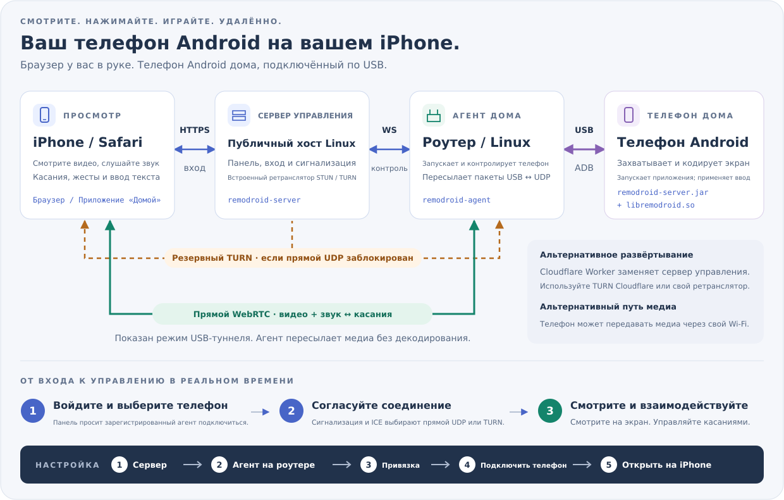

<p align="center"><a href="../../README.md">English</a> | <a href="../zh/README.md">简体中文</a> | <a href="../ja/README.md">日本語</a> | <a href="../ko/README.md">한국어</a> | <a href="../es/README.md">Español</a> | <a href="../pt-BR/README.md">Português (Brasil)</a> | <a href="../de/README.md">Deutsch</a> | <a href="../fr/README.md">Français</a> | <b>Русский</b></p>

# RemoDroid

Управляйте Android-телефоном или компьютером с Windows, Mac или Linux из Safari на iPhone (или любого браузера) с низкой задержкой — достаточной для облачных игр.

## Что мне нужно?

**Две вещи: панель и RemoDroid на том, чем вы хотите управлять.** Панель — это веб-страница, в которую вы входите: разместите её на **Cloudflare**, если у вас нет сервера (бесплатно, никакой машины обслуживать не нужно), или на своём **Linux**- или **Windows**-сервере. Затем, чтобы управлять **Android-телефоном**, установите *RemoDroid для телефонов* на роутер (или любую Linux-машину), к которому телефон подключён по USB; чтобы управлять **компьютером с Windows, Mac или Linux** — *RemoDroid для компьютеров* на этот компьютер. Смотрите и управляйте из Safari на iPhone или любого браузера; туда ничего ставить не нужно.

**Панель: выберите одно.**

| Где панель | Выбирайте, если | Установка |
|---|---|---|
| [**Cloudflare**](#panel-cloudflare) | У вас нет сервера. Cloudflare размещает страницу и ретранслирует видео, когда сеть блокирует прямое соединение (1 000 ГБ в месяц бесплатно). | Несколько минут в браузере |
| [**Linux-сервер**](#panel-linux) | Вы арендуете VPS с публичным IP. Выберите регион поближе к дому: при необходимости он ретранслирует видео. | Одна команда |
| [**Windows-сервер**](#panel-windows) | То же самое на Windows Server 2019 или новее (подойдёт и Windows 10 или 11 с публичным IP). | Распаковать и нажать *Install and start* |

**Затем — на каждом устройстве, которым управляете:**

| Чтобы управлять | Установите | Куда |
|---|---|---|
| **Android-телефоном** | [**RemoDroid для телефонов**](#for-phones) | На роутер (OpenWrt, ASUS Merlin или любая Linux-машина), к которому телефон подключён по USB. На телефон ничего не ставится. |
| ПК с **Windows** | [**RemoDroid для компьютеров**](#for-computers) | На этот ПК (Windows 10 1809 или новее) |
| **Mac** | [**RemoDroid для компьютеров**](#for-computers) | На этот Mac (macOS 13 или новее) |
| ПК с **Linux** | [**RemoDroid для компьютеров**](#for-computers) | На этот ПК (сеанс X11) |

Одна панель обслуживает сколько угодно телефонов и компьютеров. Любая установка — это те же три шага:
[1. панель](#step-panel) → [2. RemoDroid на том, чем вы управляете](#step-device) → [3. откройте на iPhone](#step-iphone).

<p align="center"><a href="https://remodroid.pages.dev/ru/"></a></p>

<p align="center">Мастер задаёт те же два вопроса и проводит до конца, с кнопками копирования.</p>

## Как это работает

<p align="center"></p>

**Панель** отдаёт веб-страницу, ваш вход и установку соединения. **RemoDroid для телефонов** на домашнем роутере общается с телефоном по USB через встроенный ADB (`adb` не нужен) и запускает на телефоне маленький помощник. Помощник захватывает экран, кодирует его аппаратно и отправляет по WebRTC прямо в Safari; ваши касания идут обратно тем же путём. Роутер только пересылает пакеты; по пути ничего не декодируется. **RemoDroid для компьютеров** делает то же самое на самом компьютере: захватывает экран, кодирует на GPU и принимает мышь и клавиатуру.

<details>
<summary>Подробнее: пути медиа, TURN, что работает на телефоне</summary>

- **Путь медиа.** По умолчанию телефон отправляет медиа по USB-кабелю, а программа на роутере выдаёт их в сеть как UDP, так что телефону Wi-Fi не нужен. С `[phone] path = wifi` в `agent.ini` телефон использует собственный Wi-Fi, что может быть быстрее, если роутер одновременно и точка доступа Wi-Fi.
- **TURN.** Когда прямой UDP-путь между iPhone и вашим домом найти не удаётся (NAT оператора, строгие файрволы), медиа идут через TURN-ретранслятор панели. Они и тогда не декодируются.
- **На телефоне:** `remodroid-server.jar` (захват экрана, MediaCodec H.265/H.264, внедрение ввода, буфер обмена, питание экрана, файлы) и `libremodroid.so` (стек WebRTC на C: ICE, DTLS-SRTP, каналы данных SCTP, управление перегрузкой). Оба работают от пользователя shell через `app_process`, так что как приложение ничего не устанавливается. Пока вы подключены, экран телефона выключен для экономии энергии, а звук играет на iPhone.
- Заметки о дизайне и решения: [`plan.md`](../../plan.md).

</details>

## Что понадобится

RemoDroid лёгкий: тяжёлую работу (захват и аппаратное кодирование) делает телефон или компьютер, роутер только пересылает пакеты, а панель только устанавливает соединения. Важнее всего **скорость отдачи дома**.

| | Минимум | Рекомендуется | Что использует |
|---|---|---|---|
| **Панель** | Бесплатный аккаунт Cloudflare или любая Linux-машина либо Windows Server 2019+ с публичным IP: 1 CPU, 128 МБ RAM, несколько МБ диска | На своём сервере: небольшая ВМ в облачном регионе **ближе всего к дому** (она несёт поток, когда нужен TURN), с достаточным месячным трафиком | Около 2 МБ RAM и почти никакого CPU. Канал — только когда сеанс уходит на TURN; тогда через неё идёт весь поток (около 4,5 ГБ в час при 10 Мбит/с) |
| **Роутер** (для телефона) | OpenWrt, Linux (Debian, Ubuntu, CentOS, Alpine) или ASUS Merlin с Koolshare, USB-порт и около 2 МБ свободного места. CPU: x86, ARM или MIPS | Роутер на ARM (aarch64, ARMv7) или x86. Слабый MIPS-роутер работает, но может не потянуть максимальные битрейты | Около 2 МБ RAM. CPU только на перекладывание пакетов между USB и UDP; ничего не декодируется |
| **Android-телефон** | Android 8 или новее, отладка по USB, аппаратный кодировщик H.264 | Android 12 или новее (для звука) с аппаратным кодировщиком H.265 | Собственный аппаратный кодировщик; экран выключен, пока вы подключены |
| **Компьютер** | Windows 10 1809+, macOS 13+ или Linux с сеансом X11 | Кодировщик GPU (любой современный чип Intel, AMD, NVIDIA или Apple) | Кодировщик GPU; без него — программный H.264 на 30 fps |
| **iPhone** | Safari | Свежая iOS, для H.265 через WebRTC (старые iOS автоматически получают H.264) | Аппаратное декодирование видео |
| **Сеть** | 3–5 Мбит/с отдачи дома (720p) | 10–20 Мбит/с отдачи дома и столько же приёма на iPhone (1080p, 60 fps) | 1–20 Мбит/с на поток (по умолчанию не больше 20 Мбит/с, 60 fps); качество подстраивается само |

Ожидаемая задержка — 40–80 мс, когда iPhone достаёт до дома напрямую, и около 70–120 мс через TURN. Цифры памяти — с работающего сервера и роутера RT-AC86U.

## Установка

<a name="step-panel"></a>

### 1. Панель

Выберите для неё место: Cloudflare, Linux-сервер или Windows-сервер. Переехать можно и потом; тогда роутеры и компьютеры добавляются в новую панель заново.

<a name="panel-cloudflare"></a>

#### На Cloudflare (без сервера)

1. **Создайте TURN-ключ** (он ретранслирует видео, когда сеть блокирует прямое соединение). В [панели Cloudflare](https://dash.cloudflare.com/): **Realtime → TURN Server → Create**. Сохраните его **Turn Token ID** и **API Token**; API Token скопируйте сразу.
2. **Разверните панель.** Сделайте fork этого репозитория, затем в панели Cloudflare **Workers & Pages → Create → Import a repository**, выберите свой fork и укажите корневой каталог `worker`. После этого каждый push в ваш fork сам обновляет панель. Или с компьютера: `cd worker && npm install && npx wrangler deploy`.
3. **Сразу откройте её и завершите настройку**, по адресу `https://remodroid.<вы>.workers.dev`: пока вы этого не сделали, логин задаёт первый посетитель. Для надёжности сначала дайте Worker secret `SETUP_TOKEN` (Settings → Variables and Secrets → Add, тип *Secret*; обычная переменная теряется при следующем развёртывании); страница настройки его запросит. Страница настройки спрашивает ваш логин и TURN-ключ.

В файрволе ничего открывать не нужно: ретрансляцией занимается Cloudflare. Логин и TURN-ключ потом меняются на вкладке **Сервер** панели.

<a name="panel-linux"></a>

#### На Linux-сервере

```sh
curl -fsSL https://remodroid.pages.dev/install_server.sh | sudo sh
```

Он выбирает подходящий пакет, устанавливает его, запускает панель и выводит ссылку вида `http://<ip>:5580/wizard.html?token=…`. Откройте её и заполните веб-порт, ваш **домен** (для автоматического HTTPS от Let's Encrypt), логин администратора и порт STUN/TURN. Панель перезапустится на ваших портах и будет готова.

Откройте в файрволе эти порты: **TCP 5580** (только для настройки), ваш веб-порт (**80**) и **443**, если используете домен, **UDP 3478** и **UDP 49152–49252** (TURN).

Чтобы установить пакет вручную, возьмите его из таблицы ниже, затем:

```sh
sudo apt install ./remodroid-server_*.deb                  # Debian, Ubuntu
sudo dnf install ./remodroid-server-*.rpm                  # CentOS, Fedora
sudo apk add --allow-untrusted ./remodroid-server_*.apk    # Alpine

sudo systemctl enable --now remodroid-server               # systemd
rc-update add remodroid-server && rc-service remodroid-server start            # Alpine
```

Затем откройте `http://<сервер>:5580/wizard.html?token=…`. Токен лежит в `/var/lib/remodroid/setup-token`.

<a name="panel-windows"></a>

#### На Windows-сервере

Windows Server 2019 или новее; Windows 10 и 11 тоже подходят. Скачайте Windows-`.zip` ниже, распакуйте в папку, где он может остаться, запустите **RemoDroidServer.exe** и выберите **Install and start**. Панель работает как служба Windows, которая стартует вместе с Windows, даже если никто не вошёл, и пропускается брандмауэром Windows. В том же окне задаются администратор, веб-порт, HTTPS-домен и STUN/TURN, панель запускается и останавливается, там же её журнал; значок остаётся у часов. Или из командной строки: `remodroid-server install` (от администратора). Откройте в файрволе облачного провайдера те же порты, что и для Linux.

<!-- downloads:server -->
#### Скачать панель для Linux- или Windows-сервера (v0.6.2)

Строку выбирайте по CPU сервера (`uname -m`: `x86_64`, `aarch64` = ARM64, `armv7l` = ARMv7, `i686` = x86), столбец — по системе. *Любой Linux* содержит и панель, и RemoDroid для телефонов.

| Панель | Debian · Ubuntu | CentOS · Fedora | Alpine | Любой Linux |
|:--|:-:|:-:|:-:|:-:|
| **x86_64**<br><sub>Intel / AMD 64 бит</sub> | [](https://github.com/yinyue123/RemoDroid/releases/download/v0.6.2/remodroid-server_0.6.2-1_amd64.deb) | [](https://github.com/yinyue123/RemoDroid/releases/download/v0.6.2/remodroid-server-0.6.2-1.x86_64.rpm) | [](https://github.com/yinyue123/RemoDroid/releases/download/v0.6.2/remodroid-server_0.6.2-r1_x86_64.apk) | [](https://github.com/yinyue123/RemoDroid/releases/download/v0.6.2/remodroid-0.6.2-linux-x86_64.tar.gz) |
| **ARM64**<br><sub>aarch64</sub> | [](https://github.com/yinyue123/RemoDroid/releases/download/v0.6.2/remodroid-server_0.6.2-1_arm64.deb) | [](https://github.com/yinyue123/RemoDroid/releases/download/v0.6.2/remodroid-server-0.6.2-1.aarch64.rpm) | [](https://github.com/yinyue123/RemoDroid/releases/download/v0.6.2/remodroid-server_0.6.2-r1_aarch64.apk) | [](https://github.com/yinyue123/RemoDroid/releases/download/v0.6.2/remodroid-0.6.2-linux-aarch64.tar.gz) |
| **ARMv7**<br><sub>32-битный ARM</sub> | [](https://github.com/yinyue123/RemoDroid/releases/download/v0.6.2/remodroid-server_0.6.2-1_armhf.deb) | [](https://github.com/yinyue123/RemoDroid/releases/download/v0.6.2/remodroid-server-0.6.2-1.armv7hl.rpm) | [](https://github.com/yinyue123/RemoDroid/releases/download/v0.6.2/remodroid-server_0.6.2-r1_armv7.apk) | [](https://github.com/yinyue123/RemoDroid/releases/download/v0.6.2/remodroid-0.6.2-linux-armv7.tar.gz) |
| **x86**<br><sub>32 бит</sub> | [](https://github.com/yinyue123/RemoDroid/releases/download/v0.6.2/remodroid-server_0.6.2-1_i386.deb) | [](https://github.com/yinyue123/RemoDroid/releases/download/v0.6.2/remodroid-server-0.6.2-1.i686.rpm) | [](https://github.com/yinyue123/RemoDroid/releases/download/v0.6.2/remodroid-server_0.6.2-r1_x86.apk) | [](https://github.com/yinyue123/RemoDroid/releases/download/v0.6.2/remodroid-0.6.2-linux-x86.tar.gz) |

Windows-сервер: распакуйте, запустите **RemoDroidServer.exe** и выберите *Install and start*; в том же окне задаются администратор, веб-порт, HTTPS-домен и STUN/TURN, там же журнал.

| Панель | **x86_64**<br><sub>Intel / AMD</sub> | **ARM64**<br><sub>Graviton, Snapdragon…</sub> |
|:--|:-:|:-:|
| **Windows** Server 2019+, 10 1809+, 11 | [](https://github.com/yinyue123/RemoDroid/releases/download/v0.6.2/RemoDroid-Server-0.6.2-windows-x86_64.zip) | [](https://github.com/yinyue123/RemoDroid/releases/download/v0.6.2/RemoDroid-Server-0.6.2-windows-arm64.zip) |

Контрольные суммы: [SHA256SUMS](https://github.com/yinyue123/RemoDroid/releases/download/v0.6.2/SHA256SUMS)
<!-- /downloads:server -->

<details>
<summary>Любой Linux (.tar.gz) вручную</summary>

В архиве есть `bin/`, `web/`, `phone/` и `etc/` (примеры ini и юниты служб). Для панели:

```sh
sudo install -m 0755 bin/remodroid-server /usr/bin/
sudo mkdir -p /usr/share/remodroid /etc/remodroid
sudo cp -r web /usr/share/remodroid/web
sudo install -m 0640 etc/server.ini.example /etc/remodroid/server.ini
remodroid-server -c /etc/remodroid/server.ini
```

`etc/remodroid-server.service` — юнит systemd, который можно скопировать в `/etc/systemd/system/`.

</details>

<details>
<summary>Настройки панели после установки</summary>

Мастер записывает `/etc/remodroid/server.ini` (Windows: `%ProgramData%\RemoDroid\server.ini`). Дальше та же страница, за входом, меняет настройки, а вкладка **Сервер** панели меняет их по одной (домен, порты, логин, список STUN/TURN). `remodroid-server -t` проверяет файл, ничего не запуская. HTTPS-сертификаты продлеваются сами. Пакеты при обновлении сохраняют ваш `server.ini`.

</details>

<a name="step-device"></a>

### 2. RemoDroid на том, чем вы управляете

<a name="for-phones"></a>

#### Android-телефон: RemoDroid для телефонов

Он ставится на роутер, к которому будет подключён телефон (или на любую Linux-машину с USB-портом), а не на телефон.

OpenWrt, Alpine:

```sh
wget -qO- https://remodroid.pages.dev/install_agent.sh | sh
```

Debian, Ubuntu, CentOS, Fedora:

```sh
curl -fsSL https://remodroid.pages.dev/install_agent.sh | sudo sh
```

ASUS Merlin с Koolshare: возьмите пакет Merlin ниже и посмотрите *ASUS Merlin / Koolshare* дальше.

<!-- downloads:agent -->
#### Скачать RemoDroid для телефонов (v0.6.2)

Строку выбирайте по CPU устройства (`uname -m`: `x86_64`, `aarch64` = ARM64, `armv7l` = ARMv7, `i686` = x86), столбец — по системе. OpenWrt: берите сборку, которую называет `opkg print-architecture`. *Любой Linux* содержит RemoDroid для телефонов и панель (на MIPS — только RemoDroid для телефонов).

| Для телефонов | Debian · Ubuntu | CentOS · Fedora | Alpine | OpenWrt | Любой Linux |
|:--|:-:|:-:|:-:|:-:|:-:|
| **x86_64**<br><sub>Intel / AMD 64 бит</sub> | [](https://github.com/yinyue123/RemoDroid/releases/download/v0.6.2/remodroid-agent_0.6.2-1_amd64.deb) | [](https://github.com/yinyue123/RemoDroid/releases/download/v0.6.2/remodroid-agent-0.6.2-1.x86_64.rpm) | [](https://github.com/yinyue123/RemoDroid/releases/download/v0.6.2/remodroid-agent_0.6.2-r1_x86_64.apk) | [](https://github.com/yinyue123/RemoDroid/releases/download/v0.6.2/remodroid-agent_0.6.2-1_x86_64.ipk) | [](https://github.com/yinyue123/RemoDroid/releases/download/v0.6.2/remodroid-0.6.2-linux-x86_64.tar.gz) |
| **ARM64**<br><sub>aarch64</sub> | [](https://github.com/yinyue123/RemoDroid/releases/download/v0.6.2/remodroid-agent_0.6.2-1_arm64.deb) | [](https://github.com/yinyue123/RemoDroid/releases/download/v0.6.2/remodroid-agent-0.6.2-1.aarch64.rpm) | [](https://github.com/yinyue123/RemoDroid/releases/download/v0.6.2/remodroid-agent_0.6.2-r1_aarch64.apk) | [](https://github.com/yinyue123/RemoDroid/releases/download/v0.6.2/remodroid-agent_0.6.2-1_aarch64_generic.ipk)<br>[](https://github.com/yinyue123/RemoDroid/releases/download/v0.6.2/remodroid-agent_0.6.2-1_aarch64_cortex-a53.ipk)<br>[](https://github.com/yinyue123/RemoDroid/releases/download/v0.6.2/remodroid-agent_0.6.2-1_aarch64_cortex-a72.ipk) | [](https://github.com/yinyue123/RemoDroid/releases/download/v0.6.2/remodroid-0.6.2-linux-aarch64.tar.gz) |
| **ARMv7**<br><sub>32-битный ARM</sub> | [](https://github.com/yinyue123/RemoDroid/releases/download/v0.6.2/remodroid-agent_0.6.2-1_armhf.deb) | [](https://github.com/yinyue123/RemoDroid/releases/download/v0.6.2/remodroid-agent-0.6.2-1.armv7hl.rpm) | [](https://github.com/yinyue123/RemoDroid/releases/download/v0.6.2/remodroid-agent_0.6.2-r1_armv7.apk) | [](https://github.com/yinyue123/RemoDroid/releases/download/v0.6.2/remodroid-agent_0.6.2-1_arm_cortex-a7_neon-vfpv4.ipk)<br>[](https://github.com/yinyue123/RemoDroid/releases/download/v0.6.2/remodroid-agent_0.6.2-1_arm_cortex-a9_vfpv3-d16.ipk)<br>[](https://github.com/yinyue123/RemoDroid/releases/download/v0.6.2/remodroid-agent_0.6.2-1_arm_cortex-a15_neon-vfpv4.ipk) | [](https://github.com/yinyue123/RemoDroid/releases/download/v0.6.2/remodroid-0.6.2-linux-armv7.tar.gz) |
| **x86**<br><sub>32 бит</sub> | [](https://github.com/yinyue123/RemoDroid/releases/download/v0.6.2/remodroid-agent_0.6.2-1_i386.deb) | [](https://github.com/yinyue123/RemoDroid/releases/download/v0.6.2/remodroid-agent-0.6.2-1.i686.rpm) | [](https://github.com/yinyue123/RemoDroid/releases/download/v0.6.2/remodroid-agent_0.6.2-r1_x86.apk) | [](https://github.com/yinyue123/RemoDroid/releases/download/v0.6.2/remodroid-agent_0.6.2-1_i386_pentium4.ipk) | [](https://github.com/yinyue123/RemoDroid/releases/download/v0.6.2/remodroid-0.6.2-linux-x86.tar.gz) |
| **MIPS LE**<br><sub>mipsel</sub> | — | — | — | [](https://github.com/yinyue123/RemoDroid/releases/download/v0.6.2/remodroid-agent_0.6.2-1_mipsel_24kc.ipk) | [](https://github.com/yinyue123/RemoDroid/releases/download/v0.6.2/remodroid-0.6.2-linux-mipsel.tar.gz) |
| **MIPS BE**<br><sub>mips</sub> | — | — | — | [](https://github.com/yinyue123/RemoDroid/releases/download/v0.6.2/remodroid-agent_0.6.2-1_mips_24kc.ipk) | [](https://github.com/yinyue123/RemoDroid/releases/download/v0.6.2/remodroid-0.6.2-linux-mips.tar.gz) |

Офлайн-установщики Koolshare / KoolCenter: [Merlin armv7](https://github.com/yinyue123/RemoDroid/releases/download/v0.6.2/remodroid-0.6.2-merlin-armv7.tar.gz) · [Merlin aarch64](https://github.com/yinyue123/RemoDroid/releases/download/v0.6.2/remodroid-0.6.2-merlin-aarch64.tar.gz). RT-AC86U и RT-AX88U: выбирайте aarch64. В них только RemoDroid для телефонов в виде плагинов роутера (это не пакеты OpenWrt).

Контрольные суммы: [SHA256SUMS](https://github.com/yinyue123/RemoDroid/releases/download/v0.6.2/SHA256SUMS)
<!-- /downloads:agent -->

**Какой файл для OpenWrt?** Найдите свой роутер и его CPU в [openwrt.md](openwrt.md), там же перечислены работающие версии OpenWrt.

**OpenWrt с LuCI, без командной строки:** в LuCI откройте **Система → ПО → Загрузить пакет…**, выберите `.ipk` для своего роутера и установите. Появится страница **Службы → RemoDroid**: она добавляет роутер в вашу панель (следующий шаг), запускает и останавливает программу и показывает, подключены ли панель и телефон.

На других системах установите пакет и запустите службу:

```sh
opkg install ./remodroid-agent_*.ipk                       # OpenWrt
sudo apt install ./remodroid-agent_*.deb                   # Debian, Ubuntu
sudo dnf install ./remodroid-agent-*.rpm                   # CentOS, Fedora
sudo apk add --allow-untrusted ./remodroid-agent_*.apk     # Alpine

/etc/init.d/remodroid-agent enable && /etc/init.d/remodroid-agent start        # OpenWrt
sudo systemctl enable --now remodroid-agent                # systemd
rc-update add remodroid-agent && rc-service remodroid-agent start              # Alpine
```

<details>
<summary>Любой Linux (.tar.gz) вручную</summary>

Из распакованного архива:

```sh
sudo install -m 0755 bin/remodroid-agent /usr/bin/
sudo ln -s remodroid-agent /usr/bin/remodroid
sudo mkdir -p /usr/share/remodroid /etc/remodroid
sudo cp -r phone/. /usr/share/remodroid/
sudo install -m 0600 etc/agent.ini.example /etc/remodroid/agent.ini
remodroid-agent -c /etc/remodroid/agent.ini
```

`etc/remodroid-agent.service` (systemd) и `etc/remodroid-agent.init` (procd в OpenWrt) запускают его при загрузке.

</details>

<details>
<summary>ASUS Merlin / Koolshare</summary>

Возьмите пакет Merlin выше, подходящий к CPU вашего роутера (`uname -m`):

- `remodroid-<версия>-merlin-aarch64.tar.gz` для `aarch64`: 64-битные модели HND, такие как RT-AC86U и RT-AX88U
- `remodroid-<версия>-merlin-armv7.tar.gz` для `armv7l`: 32-битные модели ARM, такие как RT-AC68U

Установите его в **Software Center → Manual installation**. Установщик откажется от пакета для чужого CPU. Он добавляет страницу роутера для настроек, запуска/остановки, журналов и необязательного автозапуска. После установки программа сама не запускается. Чистый Asuswrt-Merlin без центра ПО Koolshare/KoolCenter не поддерживается. Сборка, переход и ограничения: [пакет Merlin](../../packaging/merlin/README.md).

</details>

**Добавьте роутер в панель.** В панели откройте **Агенты → Добавить**. Там будет команда с одноразовым кодом; выполните её на роутере:

```sh
remodroid enroll --panel https://your.panel --code X5SX-K3M7
```

В OpenWrt ту же команду можно вставить в LuCI в **Службы → RemoDroid → Привязать**. Код работает один раз, 10 минут. После этого роутер появится в сети; нажмите на него, чтобы изменить настройки.

**Подключите телефон.** На телефоне включите **Для разработчиков → Отладка по USB**. Подключите его к USB-порту роутера и нажмите **Разрешить** в запросе «Разрешить отладку по USB?» (отметьте «Всегда разрешать»). Это единственный раз, когда нужно трогать телефон.

<a name="for-computers"></a>

#### Компьютер: RemoDroid для компьютеров

Компьютеру роутер не нужен: установите на него **RemoDroid**, запустите и добавьте его в панель через значок в трее (или в строке меню), вставив строку, которую панель показывает в **Агенты → Добавить → Компьютер**. Он работает от вошедшего пользователя, показывает уведомление, когда кто-то подключается, а его значок краснеет, пока на компьютер смотрят (**Disconnect viewer** — в один клик). Зритель слышит, что играет на компьютере (переключатель **Sound** или `desktop.audio = false`, чтобы никогда не отправлять), а **Show log** в меню значка открывает окно журнала в реальном времени. Windows 10 1809+ и macOS 13+; для Linux нужен сеанс X11 (в GNOME: «GNOME on Xorg»). Картинка кодируется на GPU, если он есть (Media Foundation, VideoToolbox и VA-API в Linux с GPU AMD или Intel, включая Steam Deck: H.265 или H.264 до 60 fps); иначе программно (H.264, 30 fps).

<!-- downloads:desktop -->
#### Скачать RemoDroid для компьютеров (v0.6.2)

Установите на компьютер, которым хотите управлять, затем привяжите его, вставив строку из панели (Агенты → Добавить → Компьютер). Версия для macOS работает на Mac с Apple silicon и Intel.

| Компьютер | **x86_64**<br><sub>Intel / AMD</sub> | **ARM64**<br><sub>Apple silicon, Snapdragon…</sub> |
|:--|:-:|:-:|
| **Windows** 10 1809+, 11 | [](https://github.com/yinyue123/RemoDroid/releases/download/v0.6.2/RemoDroid-Computer-0.6.2-windows-x86_64.zip) | [](https://github.com/yinyue123/RemoDroid/releases/download/v0.6.2/RemoDroid-Computer-0.6.2-windows-arm64.zip) |
| **macOS** 13+ | [](https://github.com/yinyue123/RemoDroid/releases/download/v0.6.2/RemoDroid-Computer-0.6.2-macos.zip) | [](https://github.com/yinyue123/RemoDroid/releases/download/v0.6.2/RemoDroid-Computer-0.6.2-macos.zip) |
| **Linux** (сеанс X11) | [](https://github.com/yinyue123/RemoDroid/releases/download/v0.6.2/remodroid-desktop_0.6.2-1_amd64.deb)<br>[](https://github.com/yinyue123/RemoDroid/releases/download/v0.6.2/remodroid-desktop-0.6.2-1.x86_64.rpm)<br>[](https://github.com/yinyue123/RemoDroid/releases/download/v0.6.2/remodroid-desktop-0.6.2-linux-x86_64.tar.gz)<br>[](https://github.com/yinyue123/RemoDroid/releases/download/v0.6.2/RemoDroid-Computer-0.6.2-linux-x86_64.AppImage) | [](https://github.com/yinyue123/RemoDroid/releases/download/v0.6.2/remodroid-desktop_0.6.2-1_arm64.deb)<br>[](https://github.com/yinyue123/RemoDroid/releases/download/v0.6.2/remodroid-desktop-0.6.2-1.aarch64.rpm)<br>[](https://github.com/yinyue123/RemoDroid/releases/download/v0.6.2/remodroid-desktop-0.6.2-linux-aarch64.tar.gz)<br>[](https://github.com/yinyue123/RemoDroid/releases/download/v0.6.2/RemoDroid-Computer-0.6.2-linux-aarch64.AppImage) |

Контрольные суммы: [SHA256SUMS](https://github.com/yinyue123/RemoDroid/releases/download/v0.6.2/SHA256SUMS)
<!-- /downloads:desktop -->

- **Windows**: распакуйте и запустите `RemoDroid.exe`. Чтобы управлять и окнами программ, запущенных от администратора (установщики, Диспетчер задач, собственное Windows-приложение панели), один раз выберите в его меню **Control administrator windows…** и подтвердите от администратора: он установит маленькую службу `RemoDroidInput`, которая передаёт им мышь и клавиатуру зрителя (`remodroid-input install` / `uninstall` делает то же). Запросы UAC остаются недоступны. **macOS**: перенесите `RemoDroid.app` в «Программы», откройте (в первый раз: правый клик → Открыть) и разрешите **Запись экрана** и **Универсальный доступ**, когда он попросит. **Linux**: установите `.deb` / `.rpm` и запустите *RemoDroid* из меню приложений. В других дистрибутивах берите `.AppImage`: `chmod +x` и запустите (`./RemoDroid-*.AppImage desktopd …` — агент без интерфейса). Он использует системные библиотеки GTK 3 и X11, которые есть на любом рабочем столе.
- **Файлы и буфер обмена, как AirDrop**: перетащите файлы на окно просмотра — они попадут в `Downloads/RemoDroid` на компьютере; перетащите файлы на окно RemoDroid на компьютере (трей / строка меню → *Pairing & status…*) — браузер зрителя их скачает. Скопированный текст в Chrome и Edge сам синхронизируется в обе стороны; Safari и Firefox показывают кнопку «Копировать».
- Нет экрана или трея? Выполните ту же строку в терминале (`remodroid-desktopd pair --panel … --code …`), затем `remodroid-desktopd` (в Linux-пакетах есть пользовательский юнит systemd).
- Настройки лежат в `desktop.ini` (`%APPDATA%\RemoDroid`, `~/Library/Application Support/RemoDroid`, `~/.config/remodroid`) и в панели. Дизайн: [`multi-platform.md`](../../multi-platform.md).

<a name="step-iphone"></a>

### 3. Откройте на iPhone

Откройте панель в Safari, войдите, затем **Поделиться → На экран «Домой»**. Запущенная с экрана «Домой», она открывается на весь экран (Safari не может скрыть панели для обычной страницы). Нажмите на телефон или компьютер, чтобы подключиться.

## Использование

- **Касания** работают как на телефоне, включая мультитач. **Плавающий шарик** открывает меню: блокировка, переподключение, полный экран, звук, загрузка фото, буфер обмена и настройки.
- **На компьютере** мышь и клавиатура идут напрямую (клавиши физические, поэтому действует раскладка самого компьютера; ⌘ и Ctrl меняются местами, когда Mac только с одной стороны). С iPhone нижняя часть экрана — это **трекпад**, как у Mac: указатель двигается по увеличенной картинке, чтобы текст компьютера читался, а картинка прокручивается, когда указатель подходит на 10% к краю, вплоть до края самого экрана. Касание — щелчок, два касания — двойной щелчок, касание и перетаскивание — перетаскивание, касание двумя пальцами — правый щелчок, прокрутка двумя пальцами, разведение — масштаб; **⤢** показывает весь экран. Трекпад и клавиатура — одна панель одного размера: **⌨** в правом углу её заголовка превращает её в клавиатуру, а на том же месте **▭** возвращает обратно; **⌄** сворачивает её в кнопку, перетаскивание заголовка меняет размер, **⚙** задаёт скорость. На iPad или компьютере панель плавает карточкой, которую вы двигаете за заголовок ([`trackpad.md`](../../trackpad.md)). Пункт меню **Trackpad** включает и выключает её на любом устройстве, в том числе в браузере на компьютере (там мышь — это палец на панели: щелчок щёлкает в месте указателя, нажать и двигать — двигать его, колёсико прокручивает, Ctrl + колёсико масштабирует). В выключенном виде **Direct** нажимает там, где вы касаетесь (долгое нажатие — правый щелчок); это вариант по умолчанию на iPad и с мышью. Там **Keyboard** открывает плавающую экранную клавиатуру (перетаскивайте за ручку; нажмите **ctrl**, затем **c** для Ctrl+C), её **⋯** отправляет текст и сочетания клавиш, а **Next screen** переключает мониторы.
- **Игры на компьютере** (Linux, например Steam Deck в режиме рабочего стола): **Gamepad** накладывает на картинку сенсорное управление в раскладке как у Steam Link (стики, крестовина, A/B/X/Y, бамперы, триггеры); держите телефон горизонтально. Проведите пальцем по картинке (мимо кнопок), чтобы поворачивать камеру, как в PUBG: скорость движения наклоняет правый стик вверх, вниз и в стороны. **⚙ → Edit layout** перемещает любой элемент и делает его меньше или больше; каждая раскладка хранит своё расположение. Её **⚙** выбирает раскладку (Steam Link, Simple, Shooter, Racing), увеличивает картинку (**Fill screen** обрезает края; ползунки её двигают), задаёт скорость свайпа (или выключает его, чтобы касание картинки снова было щелчком) и прозрачность кнопок. Контроллеры, сопряжённые с iPhone или iPad (Joy-Con, DualSense, Xbox), тоже работают; Safari даёт к ним доступ только на HTTPS-странице. Каждый становится на компьютере виртуальным геймпадом Xbox 360, для чего нужен доступный на запись `/dev/uinput`: в SteamOS он есть, в других системах установите udev-правила Steam (`steam-devices`).
- **Звук** идёт с телефона (Android 12+), а его собственный динамик молчит, пока вы подключены. Коснитесь картинки один раз, чтобы включить звук в Safari; переключатель **Sound** в меню возвращает его телефону.
- **Обновляйте** сервер или роутер потом одной командой. Она обновляет установленные части до последней версии, сохраняет `server.ini` / `agent.ini` и перезапускает их:

  ```sh
  curl -fsSL https://remodroid.pages.dev/update.sh | sudo sh    # OpenWrt: wget -qO- … | sh
  ```

<details>
<summary>Команды роутера</summary>

На роутере эти команды говорят с работающей программой (adb не нужен):

```sh
remodroid-agent devices | status | shell … | push | pull | logcat | key | restart-server
```

</details>

## Дополнительно

<details>
<summary><b>Управление ИИ</b>: пусть ИИ читает экран и нажимает за вас</summary>

ИИ управляет телефоном через REST под `/api/v1/devices/{id}/`:

- `GET …/ui` возвращает экран в виде JSON (из UiAutomation внутри процесса на телефоне; запасной вариант — `uiautomator dump`).
- `GET …/screenshot?format=jpeg&max_edge=1280` возвращает изображение (масштабируется на GPU, сжимается на C на телефоне, никогда не пишется на диск).
- `POST …/actions` нажимает, вводит, прокручивает и ждёт по селектору.

Программа на роутере это предоставляет (`[api] listen` + `token` в `agent.ini`), а сервер ретранслирует (`remodroid-server gentoken NAME`). Сценарий, который ИИ один раз отработал, сохраняется в `skills/` и воспроизводится на Python без вызовов модели; встретив что-то новое, он возвращает экран ИИ.

```sh
export PYTHONPATH=python RD_URL=http://192.168.1.1:8790 RD_TOKEN=…
python3 -m remodroid ui                      # the screen as an outline
python3 -m remodroid tap --rid search --wait-change
python3 skills/settings-search/run.py --query wifi
```

Дизайн: [skill-plan.md](../../skill-plan.md). Как писать навыки: [skills/README.md](../../skills/README.md).

</details>

<details>
<summary><b>MCP</b>: телефоны и компьютеры из Claude, ChatGPT и других ИИ-ассистентов</summary>

У каждого телефона есть MCP-эндпоинт `https://<панель>/mcp/<пользователь>/<устройство>` с инструментами для чтения экрана (`get_ui`, `screenshot`) и работы с ним (`wake_phone`, `tap`, `type_text`, `swipe`, `scroll`, `press_key`, `launch_app`, `wait_for`); `wake_phone` находит путь за экран блокировки, а `swipe` рисует графический ключ одним движением. У компьютеров (Windows, macOS, Linux) свой эндпоинт и инструменты: `screenshot`, `click`, `move_mouse`, `drag`, `scroll`, `type_text` и `press_key`. Человек за компьютером получает уведомление, когда начинает работу ассистент, а компьютер в режиме «только просмотр» можно лишь смотреть. claude.ai и ChatGPT входят через OAuth (вы нажимаете «Разрешить» на странице RemoDroid); Claude Code, Claude Desktop, Codex и API Claude и OpenAI используют API-токен из панели (Сервер → API-токены). Любой токен можно там отозвать, а токен без области `control` может только смотреть.

Вкладка «Агенты» панели ведёт к руководству `/mcp/help`, которое показывает URL ваших телефонов, создаёт токен и даёт настройку для каждого ассистента. Работает и в remodroid-server, и в Worker. Дизайн: [mcp.md](../../mcp.md).

</details>

<details>
<summary><b>Уведомления телефона</b>: получайте уведомления телефона на iPhone или через Bark</summary>

Помощник на телефоне опрашивает `dumpsys notification` (единственное содержимое уведомлений, которое видит пользователь shell), отбрасывает постоянные и малозначимые и отправляет каждое новое подключённым клиентам через WebSocket окна просмотра, а также в [Bark](https://github.com/Finb/Bark), если у сервера есть `bark_url`. Оттуда можно вызвать API управления ИИ (или навык), чтобы отреагировать.

- Роутер, `agent.ini`: `[notify] enabled = true`, плюс `min_importance` и список `ignore`.
- Сервер, `server.ini`: `[notify] bark_url = https://api.day.app/<key>` (или для каждого роутера в `[device_notify]`). Ключ Bark остаётся на сервере и никогда не попадает в журнал. Доставка по WebSocket не требует настроек сервера.

Примеры конфигураций лежат в `deploy/`.

</details>

## Состояние

Все тесты из таблицы ниже проходят, включая настоящий Chrome в роли зрителя, а звук проверен на Sony SO-51A (Android 12). Ещё не проверено на реальном оборудовании (этап M0 плана): Java-сервер телефона на разных телефонах (захват, настройки кодировщика, ввод, буфер обмена, питание экрана), USB ADB на роутерах, особенности Safari (поддержка H.265, аппаратное декодирование) и управление перегрузкой в реальных сетях.

## Разработка

<details>
<summary>Что в этом репозитории</summary>

| Путь | Что | Язык |
|---|---|---|
| `server/` | Сервер управления (панель): страница входа + cookie (Basic-аутентификация для роутеров), REST API, WebSocket-соединения зрителя/устройства, встроенный TURN-ретранслятор, необязательный HTTPS с автоматическими сертификатами Let's Encrypt (ACME); в Windows — служба (`win.c`) и приложение в трее с окном настроек (`win/`) | C + libev + mbedTLS |
| `agent/` | RemoDroid для телефонов (на роутере): встроенный ADB-клиент (usbfs), надзор за телефоном, UDP-ретранслятор, WebSocket-клиент, CLI | C + libev |
| `rtc/` | Общий для телефона и компьютеров стек WebRTC: ICE + TURN-клиент, DTLS-SRTP, каналы данных SCTP, RTP H.265/H.264, управление перегрузкой; `host.c` запускает его в отдельном потоке за C-интерфейсом (`rd_rtc.h`) | C |
| `desktop/` | RemoDroid для компьютеров: `core/` (сеанс, ввод, файлы, видеоконвейер, связь с сервером), бэкенды `win/`, `mac/`, `linux/` и `app/` (приложения для трея / строки меню, `remodroid-desktopd` без интерфейса); собирается как `libremodroid` (.dll / .dylib / .so) | C, Objective-C |
| `android/java/` | Сервер на телефоне: захват экрана, MediaCodec, внедрение ввода, буфер обмена, питание экрана, файлы, logcat | Java (app_process) |
| `web/` | Клиент для iPhone (PWA): видео, звук, мультитач, меню плавающего шарика, загрузка фото, буфер обмена, все настройки; `panel.html` (вкладки «Устройства», «Агенты», «Сервер») и `wizard.html` (первоначальная настройка) | HTML/CSS/JS |
| `worker/` | Та же панель на Cloudflare Workers + Durable Object, с Cloudflare TURN | JS |
| `wizard/` | Сайт установки (Cloudflare Pages, remodroid.pages.dev), `install_server.sh`, `install_agent.sh`, `update.sh`; `i18n/` собирает каждый язык из английской страницы | HTML, sh, Python |
| `common/` | Общий C: кадры WebSocket, кадры туннеля, STUN, JSON-конверт, ini, утилиты | C |
| `third_party/` | Встроенные, статически линкуемые библиотеки: libev, inih, cJSON, picohttpparser, crypt_blowfish, mbedTLS, libsrtp2, usrsctp, minih264, libopus (звук компьютеров) | C |
| `deploy/` | Примеры `server.ini` / `agent.ini`, юниты systemd, скрипты OpenRC, procd-скрипт программы роутера | |
| `packaging/`, `.github/workflows/` | Описания пакетов nFPM (deb, rpm, apk; ipk для роутера), zip Windows-сервера и CI-процесс сборки/выпуска | |
| `python/`, `skills/`, `.claude/skills/phone/` | Управление ИИ: SDK `remodroid` и CLI `rd`, воспроизводимые навыки и навык Claude Code, который ими пользуется | Python |
| `tests/` | Сквозные тесты | Node, Python |
| `demo/` | Исходный макет панели (офлайн, без сервера) | HTML |

</details>

<details>
<summary>Сборка</summary>

Сборка на хосте (разработка и тесты):

```sh
make            # build/host/remodroid-server, build/host/remodroid-agent
make rtc-tests  # build/host/rtc/rtc_test, rtp_dump (phone stack on the host)
```

Статические бинарники для роутеров и серверов (Zig в роли кросс-компилятора, musl, всё слинковано):

```sh
make dist                   # inside the build container (build/Dockerfile, needs podman/docker)
./build/dist.sh mipsel      # or directly, with `zig` on PATH; targets: x86 x86_64 armv7 aarch64 mipsel mips
```

Результаты попадают в `build/out/<arch>/`: около 0,8 МБ на бинарник (1,2 МБ на MIPS, где есть только программа роутера).

Сервер для Windows (`remodroid-server.exe` и приложение в трее `RemoDroidServer.exe`), кросс-сборка через Zig или нативно в MSYS2:

```sh
make TARGET=win-x86_64 CC="zig cc -target x86_64-windows-gnu" AR="zig ar" WINDRES=llvm-windres
```

Файлы для телефона (`remodroid-server.jar` + `libremodroid.so` для каждого ABI):

```sh
ANDROID_JAR=.../platforms/android-34/android.jar D8=.../build-tools/34.0.0/d8 NDK=.../android-ndk-r27c \
  ./android/build.sh        # build/android/remodroid-server.jar, build/android/<abi>/libremodroid.so
```

</details>

<details>
<summary>Тесты</summary>

| Команда | Что покрывает |
|---|---|
| `make test` | Плоскость управления целиком: настоящие сервер + программа роутера, поддельный adbd, верный протоколу (RSA-аутентификация проверяется через OpenSSL), поддельный телефон; аутентификация, REST, WebSocket, ADB push/shell/sync, туннель, UDP-ретранслятор, команды, правки `agent.ini`, CLI, переподключения (48 проверок) |
| (в `make test`) | Пересылка уведомлений: настройка `[notify]` доходит до телефона, пойманное уведомление доходит до зрителя по WebSocket, а сервер отправляет его как JSON на поддельный эндпоинт Bark |
| `python3 tests/python_sdk.py` | SDK управления ИИ, CLI `rd` и исполнитель навыков против поддельного API телефона: селекторы, снимки в памяти, передача ИИ (код выхода 3), продолжение через `--from-step` |
| `QEMU=qemu-mipsel node tests/run.mjs build/mipsel` | То же самое со статическими MIPS-бинарниками роутера под эмуляцией пользовательского режима |
| `python rtc/test/rtc_interop.py` | Стек WebRTC телефона ↔ aiortc: ICE, DTLS-SRTP, SCTP, декодированные кадры H.264, каналы данных |
| `python rtc/test/rtp_depack.py` | Пакетизаторы H.265 и H.264: побитовый круговой путь через независимый депакетизатор + FFmpeg |
| `python tests/e2e_webrtc.py [--relay]` | Полный путь: зритель → сервер → программа роутера → туннель → стек телефона; `--relay` включает встроенный TURN принудительно |
| `python tests/e2e_browser.py` | Настоящий веб-клиент в headless Chrome против всего стека: видео, касания, меню, протокол |
| `node tests/server_windows.mjs build/win-x86_64` | Сервер в Windows (CI): под своим надзирателем, перезапуск мастера на новом порту, статические файлы, вход, WebSocket, TURN, `settings` / `configure` и служба Windows (установка, перезапуск, остановка, удаление) |
| `node tests/setup.mjs build/host` | Мастер первой настройки (токен настройки, сохранение, перезапуск на новом порту), вход, коды регистрации с настоящим `enroll`, настройки роутера через панель, переименование, удаление |
| `node tests/worker.mjs build/host` | Cloudflare Worker под `wrangler dev` (после `cd worker && npm install`) с настоящей программой роутера: настройка, вход, регистрация, WebSocket зрителя и сигнализация, команды, переименование, удаление |
| `sudo tests/openwrt.sh IP [VERSION]` | OpenWrt (19.07–24.10) в podman со своим адресом в LAN (macvlan), с LuCI, ipk, собранным из этого репозитория, и сервером; откройте `http://IP/` с другого устройства и привяжите в Службы → RemoDroid |
| `make desktop-test && build/host/desktop/desk_test web/app.js` | Ядро для компьютеров без экрана: таблица клавиш против таблицы зрителя, декодирование ввода, размеры видео, преобразование цвета, программный кодировщик |
| `python tests/e2e_desktop.py` | Рабочий стол Linux целиком: привязка по коду, затем настоящий зритель в headless Chrome управляет Xvfb через сервер и `remodroid-desktopd`: картинка, щелчки, колёсико, клавиши, текст, буфер обмена в обе стороны, загрузка |
| `node tests/tls.mjs build/host` | HTTPS, перенаправление, cookie `Secure`, зритель и программа роутера по `wss://` (доверенный и недоверенный CA), перезагрузка сертификата по SIGHUP; с заданным `PEBBLE_DIR` — выпуск ACME, повторное использование и автопродление против Pebble (тестового CA Let's Encrypt) |

Python-тестам нужен `aiortc` (а браузерному тесту ещё `playwright` + Chromium).

</details>

Документы по дизайну: [plan.md](../../plan.md) (архитектура и решения), [skill-plan.md](../../skill-plan.md) (управление ИИ), [packaging/merlin/README.md](../../packaging/merlin/README.md) (плагин Merlin).
