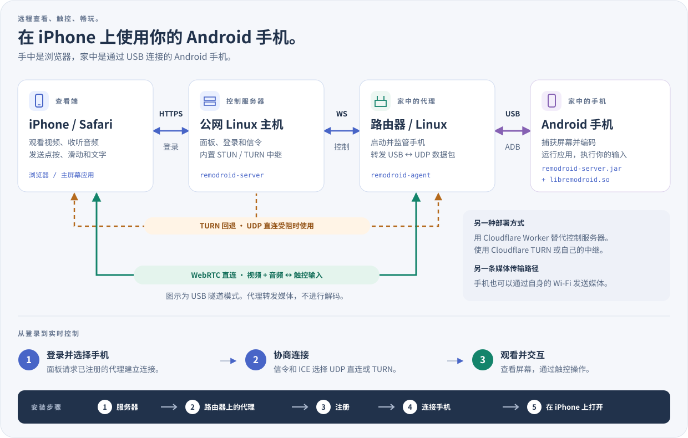

<p align="center"><a href="../../README.md">English</a> | <b>简体中文</b> | <a href="../ja/README.md">日本語</a> | <a href="../ko/README.md">한국어</a> | <a href="../es/README.md">Español</a> | <a href="../pt-BR/README.md">Português (Brasil)</a> | <a href="../de/README.md">Deutsch</a> | <a href="../fr/README.md">Français</a> | <a href="../ru/README.md">Русский</a></p>

# RemoDroid

在 iPhone 的 Safari（或任何浏览器）里低延迟地控制安卓手机，或 Windows、Mac、Linux 电脑，流畅到足以玩云游戏。

## 我需要什么？

**两样东西：一个面板，以及装在被控设备上的 RemoDroid。** 面板是你登录的网页：没有服务器就放在 **Cloudflare** 上（免费，不用维护任何机器），或者放在你自己的 **Linux** 或 **Windows** 服务器上。然后，要控制**安卓手机**，就在手机用 USB 插着的那台路由器（或任何 Linux 设备）上装 *RemoDroid 手机版*；要控制 **Windows、Mac 或 Linux 电脑**，就在那台电脑上装 *RemoDroid 电脑版*。你在 iPhone 的 Safari 或任何浏览器里观看和操作，那一端什么都不用装。

**面板：选一个。**

| 面板放在 | 适合 | 安装方式 |
|---|---|---|
| [**Cloudflare**](#panel-cloudflare) | 你没有服务器。Cloudflare 托管网页，网络挡住直连时替你中转画面（每月 1,000 GB 免费）。 | 在浏览器里几分钟 |
| [**Linux 服务器**](#panel-linux) | 你租了一台有公网 IP 的 VPS。选离家近的地区：需要时由它中转画面。 | 一条命令 |
| [**Windows 服务器**](#panel-windows) | 同上，用 Windows Server 2019 或更新（有公网 IP 的 Windows 10 或 11 也行）。 | 解压后点 *Install and start* |

**然后，在每个要控制的设备上：**

| 要控制 | 安装 | 装在哪里 |
|---|---|---|
| **安卓手机** | [**RemoDroid 手机版**](#for-phones) | 手机用 USB 插着的路由器上（OpenWrt、华硕梅林或任何 Linux 设备）。手机上什么都不装。 |
| **Windows** 电脑 | [**RemoDroid 电脑版**](#for-computers) | 那台电脑上（Windows 10 1809 或更新） |
| **Mac** | [**RemoDroid 电脑版**](#for-computers) | 那台 Mac 上（macOS 13 或更新） |
| **Linux** 电脑 | [**RemoDroid 电脑版**](#for-computers) | 那台电脑上（X11 会话） |

一个面板可以管任意多台手机和电脑。每种组合都是同样的三步：
[1. 面板](#step-panel) → [2. 在被控设备上装 RemoDroid](#step-device) → [3. 在 iPhone 上打开](#step-iphone)。

<p align="center"><a href="https://remodroid.pages.dev/zh/"></a></p>

<p align="center">向导会问同样的两个问题，然后带你一步步完成，每条命令都有复制按钮。</p>

## 工作原理

<p align="center"></p>

**面板**提供网页、你的登录和连接建立。家中路由器上的 **RemoDroid 手机版**用自带的 ADB（不需要 `adb`）通过 USB 与手机通信，并在手机上启动一个小助手。助手捕获屏幕、用硬件编码，再通过 WebRTC 直接发给 Safari，你的触控沿同一路径传回。路由器只转发数据包，中间不做任何解码。**RemoDroid 电脑版**在电脑本身上做同样的事：捕获屏幕、用 GPU 编码，并接收鼠标和键盘。

<details>
<summary>更多细节：媒体路径、TURN、手机上运行什么</summary>

- **媒体路径。** 默认情况下，手机通过 USB 线发送媒体，由路由器上的程序以 UDP 发到网络上，所以手机不需要 Wi-Fi。在 `agent.ini` 里设置 `[phone] path = wifi` 后，手机改用自己的 Wi-Fi，当路由器同时也是 Wi-Fi 接入点时可能更快。
- **TURN。** 当 iPhone 和你家之间找不到直接的 UDP 路径时（运营商 NAT、严格的防火墙），媒体会经过面板的 TURN 中继，仍然不会被解码。
- **手机上：** `remodroid-server.jar`（屏幕捕获、MediaCodec H.265/H.264 编码、输入注入、剪贴板、屏幕电源、文件）和 `libremodroid.so`（C 语言写的 WebRTC 协议栈：ICE、DTLS-SRTP、SCTP 数据通道、拥塞控制）。两者都通过 `app_process` 以 shell 用户身份运行，不会安装成应用。连接期间手机屏幕会关闭以省电，声音改由你的 iPhone 播放。
- 设计说明与决策：[`plan.md`](../../plan.md)。

</details>

## 所需条件

RemoDroid 很轻量：繁重的工作（捕获和硬件编码）由手机或电脑完成，路由器只转发数据包，面板只负责建立连接。最重要的是**家里的上传速度**。

| | 最低 | 推荐 | 消耗 |
|---|---|---|---|
| **面板** | 免费的 Cloudflare 账号，或任何有公网 IP 的 Linux 机器或 Windows Server 2019+：1 个 CPU、128 MB 内存、几 MB 磁盘 | 自建时：选**离你家最近**的云区域的小型虚拟机（需要 TURN 时由它承载视频流），每月流量要够 | 约 2 MB 内存，几乎不占 CPU。只有会话回退到 TURN 时才消耗带宽，此时整条视频流都经过它（10 Mbps 时约每小时 4.5 GB） |
| **路由器**（手机用） | OpenWrt、Linux（Debian、Ubuntu、CentOS、Alpine）或装了 Koolshare 的华硕梅林，一个 USB 口，约 2 MB 可用存储。CPU：x86、ARM 或 MIPS | ARM（aarch64、ARMv7）或 x86 路由器。性能弱的 MIPS 路由器能用，但可能跟不上最高码率 | 约 2 MB 内存。CPU 只用于在 USB 和 UDP 之间搬运数据包，不做任何解码 |
| **安卓手机** | Android 8 或更新，开启 USB 调试，有硬件 H.264 编码器 | Android 12 或更新（才有声音），有硬件 H.265 编码器 | 用它自己的硬件编码器；连接期间屏幕关闭 |
| **电脑** | Windows 10 1809+、macOS 13+，或带 X11 会话的 Linux | 有 GPU 编码器（任何较新的 Intel、AMD、NVIDIA 或 Apple 芯片） | 用它的 GPU 编码器；没有时用软件 H.264，30 fps |
| **iPhone** | Safari | 较新的 iOS，才能通过 WebRTC 使用 H.265（旧 iOS 会自动用 H.264） | 硬件视频解码 |
| **网络** | 家里上传 3–5 Mbps（720p） | 家里上传 10–20 Mbps，iPhone 下载也一样（1080p、60 fps） | 每路流 1–20 Mbps（默认上限 20 Mbps、60 fps）；画质自动调节 |

iPhone 直接连到你家时，预期延迟 40–80 ms；经过 TURN 时约 70–120 ms。内存数据来自运行中的服务器和一台 RT-AC86U 路由器。

## 安装

<a name="step-panel"></a>

### 1. 面板

给它选一个地方：Cloudflare、Linux 服务器或 Windows 服务器。以后可以换，只是路由器和电脑要重新添加到新面板。

<a name="panel-cloudflare"></a>

#### 放在 Cloudflare 上（不需要服务器）

1. **创建 TURN 密钥**（网络挡住直连时用它中转画面）。在 [Cloudflare 控制台](https://dash.cloudflare.com/)：**Realtime → TURN Server → Create**。记下它的 **Turn Token ID** 和 **API Token**；API Token 要马上复制。
2. **部署面板。** fork 本仓库，然后在控制台 **Workers & Pages → Create → Import a repository**，选你的 fork，根目录设为 `worker`。之后每次推送到你的 fork，面板都会自动更新。也可以在电脑上运行：`cd worker && npm install && npx wrangler deploy`。
3. **立即打开并完成设置**，地址是 `https://remodroid.<你>.workers.dev`：在你完成之前，第一个访问的人可以设定登录账号。保险起见，先给 Worker 加一个 secret `SETUP_TOKEN`（Settings → Variables and Secrets → Add，类型选 *Secret*；普通变量会在下次部署时丢失），设置页面就会要求输入它。设置页面会问你的登录账号和 TURN 密钥。

不用在防火墙上开任何端口：中转由 Cloudflare 完成。之后可在面板的**服务器**页修改登录和 TURN 密钥。

<a name="panel-linux"></a>

#### 放在 Linux 服务器上

```sh
curl -fsSL https://remodroid.pages.dev/install_server.sh | sudo sh
```

它会挑选合适的软件包，安装并启动面板，然后输出类似 `http://<ip>:5580/wizard.html?token=…` 的链接。打开它，填写网页端口、你的**域名**（用于 Let's Encrypt 自动 HTTPS）、管理员账号和 STUN/TURN 端口。面板会在你设置的端口上重启，就可以用了。

在防火墙上开放这些端口：**TCP 5580**（仅设置时）、你的网页端口（**80**）和使用域名时的 **443**、**UDP 3478** 以及 **UDP 49152–49252**（TURN）。

如果想手动安装软件包，从下表下载，然后：

```sh
sudo apt install ./remodroid-server_*.deb                  # Debian, Ubuntu
sudo dnf install ./remodroid-server-*.rpm                  # CentOS, Fedora
sudo apk add --allow-untrusted ./remodroid-server_*.apk    # Alpine

sudo systemctl enable --now remodroid-server               # systemd
rc-update add remodroid-server && rc-service remodroid-server start            # Alpine
```

然后打开 `http://<服务器>:5580/wizard.html?token=…`。token 在 `/var/lib/remodroid/setup-token` 里。

<a name="panel-windows"></a>

#### 放在 Windows 服务器上

需要 Windows Server 2019 或更新；Windows 10 和 11 也可以。下载下面的 Windows `.zip`，解压到一个会一直保留的文件夹，运行 **RemoDroidServer.exe**，选择 **Install and start**。它把面板作为 Windows 服务运行，随 Windows 启动（不论有没有人登录），并在 Windows 防火墙里放行。同一个窗口可设置管理员、网页端口、HTTPS 域名和 STUN/TURN，启动和停止面板并显示日志；它的图标留在时钟旁边。也可以在命令提示符里（以管理员身份）运行：`remodroid-server install`。在云服务商的防火墙里开放和 Linux 一样的端口。

<!-- downloads:server -->
#### 下载面板（Linux 或 Windows 服务器） (v0.6.1)

按服务器的 CPU 选行（`uname -m`：`x86_64`、`aarch64` = ARM64、`armv7l` = ARMv7、`i686` = x86），按系统选列。*任意 Linux* 同时包含面板和 RemoDroid 手机版。

| 面板 | Debian · Ubuntu | CentOS · Fedora | Alpine | 任意 Linux |
|:--|:-:|:-:|:-:|:-:|
| **x86_64**<br><sub>Intel / AMD 64 位</sub> | [](https://github.com/yinyue123/RemoDroid/releases/download/v0.6.1/remodroid-server_0.6.1-1_amd64.deb) | [](https://github.com/yinyue123/RemoDroid/releases/download/v0.6.1/remodroid-server-0.6.1-1.x86_64.rpm) | [](https://github.com/yinyue123/RemoDroid/releases/download/v0.6.1/remodroid-server_0.6.1-r1_x86_64.apk) | [](https://github.com/yinyue123/RemoDroid/releases/download/v0.6.1/remodroid-0.6.1-linux-x86_64.tar.gz) |
| **ARM64**<br><sub>aarch64</sub> | [](https://github.com/yinyue123/RemoDroid/releases/download/v0.6.1/remodroid-server_0.6.1-1_arm64.deb) | [](https://github.com/yinyue123/RemoDroid/releases/download/v0.6.1/remodroid-server-0.6.1-1.aarch64.rpm) | [](https://github.com/yinyue123/RemoDroid/releases/download/v0.6.1/remodroid-server_0.6.1-r1_aarch64.apk) | [](https://github.com/yinyue123/RemoDroid/releases/download/v0.6.1/remodroid-0.6.1-linux-aarch64.tar.gz) |
| **ARMv7**<br><sub>32 位 ARM</sub> | [](https://github.com/yinyue123/RemoDroid/releases/download/v0.6.1/remodroid-server_0.6.1-1_armhf.deb) | [](https://github.com/yinyue123/RemoDroid/releases/download/v0.6.1/remodroid-server-0.6.1-1.armv7hl.rpm) | [](https://github.com/yinyue123/RemoDroid/releases/download/v0.6.1/remodroid-server_0.6.1-r1_armv7.apk) | [](https://github.com/yinyue123/RemoDroid/releases/download/v0.6.1/remodroid-0.6.1-linux-armv7.tar.gz) |
| **x86**<br><sub>32 位</sub> | [](https://github.com/yinyue123/RemoDroid/releases/download/v0.6.1/remodroid-server_0.6.1-1_i386.deb) | [](https://github.com/yinyue123/RemoDroid/releases/download/v0.6.1/remodroid-server-0.6.1-1.i686.rpm) | [](https://github.com/yinyue123/RemoDroid/releases/download/v0.6.1/remodroid-server_0.6.1-r1_x86.apk) | [](https://github.com/yinyue123/RemoDroid/releases/download/v0.6.1/remodroid-0.6.1-linux-x86.tar.gz) |

Windows 服务器：解压，运行 **RemoDroidServer.exe**，选择 *Install and start*；同一个窗口可设置管理员、网页端口、HTTPS 域名和 STUN/TURN，并显示日志。

| 面板 | **x86_64**<br><sub>Intel / AMD</sub> | **ARM64**<br><sub>Graviton、骁龙…</sub> |
|:--|:-:|:-:|
| **Windows** Server 2019+, 10 1809+, 11 | [](https://github.com/yinyue123/RemoDroid/releases/download/v0.6.1/RemoDroid-Server-0.6.1-windows-x86_64.zip) | [](https://github.com/yinyue123/RemoDroid/releases/download/v0.6.1/RemoDroid-Server-0.6.1-windows-arm64.zip) |

校验和：[SHA256SUMS](https://github.com/yinyue123/RemoDroid/releases/download/v0.6.1/SHA256SUMS)
<!-- /downloads:server -->

<details>
<summary>任意 Linux（.tar.gz）手动安装</summary>

压缩包里有 `bin/`、`web/`、`phone/` 和 `etc/`（ini 示例文件和服务单元）。安装面板：

```sh
sudo install -m 0755 bin/remodroid-server /usr/bin/
sudo mkdir -p /usr/share/remodroid /etc/remodroid
sudo cp -r web /usr/share/remodroid/web
sudo install -m 0640 etc/server.ini.example /etc/remodroid/server.ini
remodroid-server -c /etc/remodroid/server.ini
```

`etc/remodroid-server.service` 是可以复制到 `/etc/systemd/system/` 的 systemd 单元。

</details>

<details>
<summary>设置完成后的面板设置</summary>

向导会写入 `/etc/remodroid/server.ini`（Windows：`%ProgramData%\RemoDroid\server.ini`）。之后同一个页面（需要登录）可以修改设置，面板的**服务器**页一次修改一项（域名、端口、登录、STUN/TURN 列表）。`remodroid-server -t` 只检查文件、不启动任何东西。HTTPS 证书自动续期。升级软件包会保留你的 `server.ini`。

</details>

<a name="step-device"></a>

### 2. 在被控设备上装 RemoDroid

<a name="for-phones"></a>

#### 安卓手机：RemoDroid 手机版

它装在手机要插的那台路由器上（或任何带 USB 口的 Linux 设备），不是装在手机上。

OpenWrt、Alpine：

```sh
wget -qO- https://remodroid.pages.dev/install_agent.sh | sh
```

Debian、Ubuntu、CentOS、Fedora：

```sh
curl -fsSL https://remodroid.pages.dev/install_agent.sh | sudo sh
```

装了 Koolshare 的华硕梅林：下载下面的梅林安装包，并看后面的 *华硕梅林 / Koolshare*。

<!-- downloads:agent -->
#### 下载 RemoDroid 手机版 (v0.6.1)

按机器的 CPU 选行（`uname -m`：`x86_64`、`aarch64` = ARM64、`armv7l` = ARMv7、`i686` = x86），按系统选列。OpenWrt：选 `opkg print-architecture` 列出的版本。*任意 Linux* 同时包含 RemoDroid 手机版和面板（MIPS 上只有 RemoDroid 手机版）。

| 手机版 | Debian · Ubuntu | CentOS · Fedora | Alpine | OpenWrt | 任意 Linux |
|:--|:-:|:-:|:-:|:-:|:-:|
| **x86_64**<br><sub>Intel / AMD 64 位</sub> | [](https://github.com/yinyue123/RemoDroid/releases/download/v0.6.1/remodroid-agent_0.6.1-1_amd64.deb) | [](https://github.com/yinyue123/RemoDroid/releases/download/v0.6.1/remodroid-agent-0.6.1-1.x86_64.rpm) | [](https://github.com/yinyue123/RemoDroid/releases/download/v0.6.1/remodroid-agent_0.6.1-r1_x86_64.apk) | [](https://github.com/yinyue123/RemoDroid/releases/download/v0.6.1/remodroid-agent_0.6.1-1_x86_64.ipk) | [](https://github.com/yinyue123/RemoDroid/releases/download/v0.6.1/remodroid-0.6.1-linux-x86_64.tar.gz) |
| **ARM64**<br><sub>aarch64</sub> | [](https://github.com/yinyue123/RemoDroid/releases/download/v0.6.1/remodroid-agent_0.6.1-1_arm64.deb) | [](https://github.com/yinyue123/RemoDroid/releases/download/v0.6.1/remodroid-agent-0.6.1-1.aarch64.rpm) | [](https://github.com/yinyue123/RemoDroid/releases/download/v0.6.1/remodroid-agent_0.6.1-r1_aarch64.apk) | [](https://github.com/yinyue123/RemoDroid/releases/download/v0.6.1/remodroid-agent_0.6.1-1_aarch64_generic.ipk)<br>[](https://github.com/yinyue123/RemoDroid/releases/download/v0.6.1/remodroid-agent_0.6.1-1_aarch64_cortex-a53.ipk)<br>[](https://github.com/yinyue123/RemoDroid/releases/download/v0.6.1/remodroid-agent_0.6.1-1_aarch64_cortex-a72.ipk) | [](https://github.com/yinyue123/RemoDroid/releases/download/v0.6.1/remodroid-0.6.1-linux-aarch64.tar.gz) |
| **ARMv7**<br><sub>32 位 ARM</sub> | [](https://github.com/yinyue123/RemoDroid/releases/download/v0.6.1/remodroid-agent_0.6.1-1_armhf.deb) | [](https://github.com/yinyue123/RemoDroid/releases/download/v0.6.1/remodroid-agent-0.6.1-1.armv7hl.rpm) | [](https://github.com/yinyue123/RemoDroid/releases/download/v0.6.1/remodroid-agent_0.6.1-r1_armv7.apk) | [](https://github.com/yinyue123/RemoDroid/releases/download/v0.6.1/remodroid-agent_0.6.1-1_arm_cortex-a7_neon-vfpv4.ipk)<br>[](https://github.com/yinyue123/RemoDroid/releases/download/v0.6.1/remodroid-agent_0.6.1-1_arm_cortex-a9_vfpv3-d16.ipk)<br>[](https://github.com/yinyue123/RemoDroid/releases/download/v0.6.1/remodroid-agent_0.6.1-1_arm_cortex-a15_neon-vfpv4.ipk) | [](https://github.com/yinyue123/RemoDroid/releases/download/v0.6.1/remodroid-0.6.1-linux-armv7.tar.gz) |
| **x86**<br><sub>32 位</sub> | [](https://github.com/yinyue123/RemoDroid/releases/download/v0.6.1/remodroid-agent_0.6.1-1_i386.deb) | [](https://github.com/yinyue123/RemoDroid/releases/download/v0.6.1/remodroid-agent-0.6.1-1.i686.rpm) | [](https://github.com/yinyue123/RemoDroid/releases/download/v0.6.1/remodroid-agent_0.6.1-r1_x86.apk) | [](https://github.com/yinyue123/RemoDroid/releases/download/v0.6.1/remodroid-agent_0.6.1-1_i386_pentium4.ipk) | [](https://github.com/yinyue123/RemoDroid/releases/download/v0.6.1/remodroid-0.6.1-linux-x86.tar.gz) |
| **MIPS LE**<br><sub>mipsel</sub> | — | — | — | [](https://github.com/yinyue123/RemoDroid/releases/download/v0.6.1/remodroid-agent_0.6.1-1_mipsel_24kc.ipk) | [](https://github.com/yinyue123/RemoDroid/releases/download/v0.6.1/remodroid-0.6.1-linux-mipsel.tar.gz) |
| **MIPS BE**<br><sub>mips</sub> | — | — | — | [](https://github.com/yinyue123/RemoDroid/releases/download/v0.6.1/remodroid-agent_0.6.1-1_mips_24kc.ipk) | [](https://github.com/yinyue123/RemoDroid/releases/download/v0.6.1/remodroid-0.6.1-linux-mips.tar.gz) |

Koolshare / KoolCenter 离线安装包：[Merlin armv7](https://github.com/yinyue123/RemoDroid/releases/download/v0.6.1/remodroid-0.6.1-merlin-armv7.tar.gz) · [Merlin aarch64](https://github.com/yinyue123/RemoDroid/releases/download/v0.6.1/remodroid-0.6.1-merlin-aarch64.tar.gz)。RT-AC86U 和 RT-AX88U 选 aarch64。这些只包含 RemoDroid 手机版，是路由器插件（不是 OpenWrt 软件包）。

校验和：[SHA256SUMS](https://github.com/yinyue123/RemoDroid/releases/download/v0.6.1/SHA256SUMS)
<!-- /downloads:agent -->

**该选哪个 OpenWrt 文件？** 在 [openwrt.md](openwrt.md) 里查找你的路由器和它的 CPU，那里也列出了能用的 OpenWrt 版本。

**用 LuCI 的 OpenWrt，不用命令行：** 在 LuCI 打开 **系统 → 软件包 → 上传软件包…**，选择适合你路由器的 `.ipk` 并安装。会出现一个 **服务 → RemoDroid** 页面：它把路由器添加到你的面板（下一步）、启动和停止程序，并显示面板和手机是否已连接。

在其他系统上，安装软件包并启动服务：

```sh
opkg install ./remodroid-agent_*.ipk                       # OpenWrt
sudo apt install ./remodroid-agent_*.deb                   # Debian, Ubuntu
sudo dnf install ./remodroid-agent-*.rpm                   # CentOS, Fedora
sudo apk add --allow-untrusted ./remodroid-agent_*.apk     # Alpine

/etc/init.d/remodroid-agent enable && /etc/init.d/remodroid-agent start        # OpenWrt
sudo systemctl enable --now remodroid-agent                # systemd
rc-update add remodroid-agent && rc-service remodroid-agent start              # Alpine
```

<details>
<summary>任意 Linux（.tar.gz）手动安装</summary>

在解压后的压缩包里：

```sh
sudo install -m 0755 bin/remodroid-agent /usr/bin/
sudo ln -s remodroid-agent /usr/bin/remodroid
sudo mkdir -p /usr/share/remodroid /etc/remodroid
sudo cp -r phone/. /usr/share/remodroid/
sudo install -m 0600 etc/agent.ini.example /etc/remodroid/agent.ini
remodroid-agent -c /etc/remodroid/agent.ini
```

`etc/remodroid-agent.service`（systemd）和 `etc/remodroid-agent.init`（OpenWrt procd）可让它开机启动。

</details>

<details>
<summary>华硕梅林 / Koolshare</summary>

按路由器的 CPU（`uname -m`）选择上面的梅林安装包：

- `remodroid-<版本>-merlin-aarch64.tar.gz` 对应 `aarch64`：64 位 HND 机型，如 RT-AC86U 和 RT-AX88U
- `remodroid-<版本>-merlin-armv7.tar.gz` 对应 `armv7l`：32 位 ARM 机型，如 RT-AC68U

在 **软件中心 → 离线安装** 里安装。CPU 不对的安装包会被拒绝。它会添加一个路由器页面，用于设置、启动/停止、查看日志和可选的开机自启。安装后不会自动启动。不支持没有 Koolshare/KoolCenter 软件中心的原版 Asuswrt-Merlin。构建、迁移和限制：[梅林打包](../../packaging/merlin/README.md)。

</details>

**把路由器添加到面板。** 在面板里打开 **代理 → 添加**。它会显示一条带一次性代码的命令；在路由器上运行：

```sh
remodroid enroll --panel https://your.panel --code X5SX-K3M7
```

在 OpenWrt 上也可以把同一条命令粘贴到 LuCI 的 **服务 → RemoDroid → 配对** 里。代码只能用一次，10 分钟内有效。之后路由器会显示为在线；点它可修改设置。

**插上手机。** 在手机上打开 **开发者选项 → USB 调试**。插到路由器的 USB 口，在“允许 USB 调试吗？”提示里点 **允许**（勾选“始终允许”）。这是你唯一需要碰手机的时候。

<a name="for-computers"></a>

#### 电脑：RemoDroid 电脑版

电脑不需要路由器：在电脑上安装 **RemoDroid** 并启动，然后在托盘（或菜单栏）图标里粘贴面板在 **代理 → 添加 → 电脑** 下显示的那一行，把它添加到面板。它以当前登录用户身份运行，有人连接时会发通知，被查看时图标变红（**Disconnect viewer** 一键断开）。查看者能听到电脑播放的声音（**Sound** 开关，或设 `desktop.audio = false` 永不发送），图标菜单里的 **Show log** 会打开实时日志窗口。需要 Windows 10 1809+ 和 macOS 13+；Linux 需要 X11 会话（GNOME 上选“GNOME on Xorg”）。有 GPU 时画面由 GPU 编码（Media Foundation、VideoToolbox，Linux 上配 AMD 或 Intel GPU 时用 VA-API，Steam Deck 也行：H.265 或 H.264，最高 60 fps）；否则用软件编码（H.264，30 fps）。

<!-- downloads:desktop -->
#### 下载 RemoDroid 电脑版 (v0.6.1)

装在你要控制的电脑上，然后粘贴面板给出的那一行完成配对（代理 → 添加 → 电脑）。macOS 版本同时支持 Apple 芯片和 Intel Mac。

| 电脑 | **x86_64**<br><sub>Intel / AMD</sub> | **ARM64**<br><sub>Apple 芯片、骁龙…</sub> |
|:--|:-:|:-:|
| **Windows** 10 1809+, 11 | [](https://github.com/yinyue123/RemoDroid/releases/download/v0.6.1/RemoDroid-0.6.1-windows-x86_64.zip) | [](https://github.com/yinyue123/RemoDroid/releases/download/v0.6.1/RemoDroid-0.6.1-windows-arm64.zip) |
| **macOS** 13+ | [](https://github.com/yinyue123/RemoDroid/releases/download/v0.6.1/RemoDroid-0.6.1-macos.zip) | [](https://github.com/yinyue123/RemoDroid/releases/download/v0.6.1/RemoDroid-0.6.1-macos.zip) |
| **Linux** （X11 会话） | [](https://github.com/yinyue123/RemoDroid/releases/download/v0.6.1/remodroid-desktop_0.6.1-1_amd64.deb)<br>[](https://github.com/yinyue123/RemoDroid/releases/download/v0.6.1/remodroid-desktop-0.6.1-1.x86_64.rpm)<br>[](https://github.com/yinyue123/RemoDroid/releases/download/v0.6.1/remodroid-desktop-0.6.1-linux-x86_64.tar.gz)<br>[](https://github.com/yinyue123/RemoDroid/releases/download/v0.6.1/RemoDroid-0.6.1-linux-x86_64.AppImage) | [](https://github.com/yinyue123/RemoDroid/releases/download/v0.6.1/remodroid-desktop_0.6.1-1_arm64.deb)<br>[](https://github.com/yinyue123/RemoDroid/releases/download/v0.6.1/remodroid-desktop-0.6.1-1.aarch64.rpm)<br>[](https://github.com/yinyue123/RemoDroid/releases/download/v0.6.1/remodroid-desktop-0.6.1-linux-aarch64.tar.gz)<br>[](https://github.com/yinyue123/RemoDroid/releases/download/v0.6.1/RemoDroid-0.6.1-linux-aarch64.AppImage) |

校验和：[SHA256SUMS](https://github.com/yinyue123/RemoDroid/releases/download/v0.6.1/SHA256SUMS)
<!-- /downloads:desktop -->

- **Windows**：解压后运行 `RemoDroid.exe`。如果还想控制以管理员身份运行的程序窗口（安装程序、任务管理器、面板自己的 Windows 应用），在它的菜单里选一次 **Control administrator windows…** 并以管理员身份确认：它会设置一个小的 `RemoDroidInput` 服务，把查看者的鼠标和键盘传给这些窗口（`remodroid-input install` / `uninstall` 作用相同）。UAC 提示仍然无法操作。**macOS**：把 `RemoDroid.app` 移到“应用程序”并打开（第一次：右键 → 打开），在提示时允许**屏幕录制**和**辅助功能**。**Linux**：安装 `.deb` / `.rpm`，从应用菜单启动 *RemoDroid*。其他发行版用 `.AppImage`：`chmod +x` 后运行（`./RemoDroid-*.AppImage desktopd …` 是无界面版）。它使用系统自带的 GTK 3 和 X11 库，每个桌面环境都有。
- **文件和剪贴板，像 AirDrop 一样**：把文件拖到查看器上，就会放到电脑的 `Downloads/RemoDroid`；把文件拖到电脑上的 RemoDroid 窗口（托盘 / 菜单栏 → *Pairing & status…*），查看者的浏览器就会下载它们。复制的文字在 Chrome 和 Edge 里自动双向同步；Safari 和 Firefox 会显示一个复制按钮。
- 没有屏幕或托盘？在终端里运行同一行（`remodroid-desktopd pair --panel … --code …`），然后运行 `remodroid-desktopd`（Linux 软件包附带 systemd 用户单元）。
- 设置保存在 `desktop.ini`（`%APPDATA%\RemoDroid`、`~/Library/Application Support/RemoDroid`、`~/.config/remodroid`）和面板里。设计：[`multi-platform.md`](../../multi-platform.md)。

<a name="step-iphone"></a>

### 3. 在 iPhone 上打开

在 Safari 里打开你的面板并登录，然后点 **分享 → 添加到主屏幕**。从主屏幕启动时是全屏的（Safari 无法为普通网页隐藏地址栏）。点你的手机或电脑开始连接。

## 使用

- **触控**和在手机上一样，支持多点触控。**悬浮球**打开菜单：锁屏、重新连接、全屏、声音、上传照片、剪贴板和设置。
- **控制电脑时**鼠标和键盘直接传过去（按键是物理按键，所以使用电脑自己的键盘布局；只有一端是 Mac 时 ⌘ 和 Ctrl 会互换）。在 iPhone 上，屏幕下方是一个像 Mac 一样的**触控板**：指针在放大的画面上移动，电脑上的文字也看得清；指针靠近边缘 10% 以内时画面会滚动，直到屏幕自己的边缘。单击轻点，双击连点两下，轻点后拖动即拖拽，双指轻点为右键，双指滑动滚动，双指张开缩放；**⤢** 显示整个屏幕。触控板和键盘是同一个、同样大小的面板：标题栏右角的 **⌨** 把它切换成键盘，同一位置的 **▭** 切回；**⌄** 把它收成一个按钮，拖动标题栏改变大小，**⚙** 设置速度。在 iPad 或电脑浏览器上，面板是一张可以拖动标题栏移动的浮动卡片（[`trackpad.md`](../../trackpad.md)）。菜单里的 **Trackpad** 可在任何设备上开关它，电脑浏览器也行（那里鼠标就是触控板上的手指：点击即在指针处点击，按住移动即移动指针，滚轮滚动，Ctrl + 滚轮缩放）。关闭后是 **Direct** 模式，点哪里就点哪里（长按为右键），这是 iPad 和使用鼠标时的默认模式。在该模式下，**Keyboard** 打开一个浮动屏幕键盘（拖动把手移动它；先点 **ctrl** 再点 **c** 就是 Ctrl+C），它的 **⋯** 可发送文字和快捷键，**Next screen** 切换显示器。
- **在电脑上玩游戏**（Linux，例如桌面模式下的 Steam Deck）：**Gamepad** 在画面上叠加触控按键，布局类似 Steam Link（摇杆、十字键、A/B/X/Y、肩键、扳机）；把手机横过来拿。手指在画面上（按键以外的地方）划过可以转动视角，就像 PUBG：划动的速度会让右摇杆上下左右倾斜。**⚙ → Edit layout** 可移动任何按键并调整大小；每种布局各自保存。它的 **⚙** 选择布局（Steam Link、Simple、Shooter、Racing）、缩放画面（**Fill screen** 裁掉黑边；滑块移动画面）、设置划动速度（或关闭它，让点画面重新变成点击），以及按键的透明度。和 iPhone 或 iPad 配对的手柄（Joy-Con、DualSense、Xbox）也能用；Safari 只在 HTTPS 页面上提供它们。每个手柄在电脑上变成一个虚拟 Xbox 360 手柄，这需要可写的 `/dev/uinput`：SteamOS 自带，其他系统请安装 Steam 的 udev 规则（`steam-devices`）。
- **声音**来自手机（Android 12+），连接期间手机自己的扬声器会静音。在 Safari 里点一下画面即可取消静音；菜单里的 **Sound** 开关把声音交还给手机。
- 之后用一条命令**更新**服务器或路由器。它会把已安装的部分更新到最新版本，保留 `server.ini` / `agent.ini`，并重启它们：

  ```sh
  curl -fsSL https://remodroid.pages.dev/update.sh | sudo sh    # OpenWrt: wget -qO- … | sh
  ```

<details>
<summary>路由器命令</summary>

在路由器上，这些命令与正在运行的程序通信（不需要 adb）：

```sh
remodroid-agent devices | status | shell … | push | pull | logcat | key | restart-server
```

</details>

## 附加功能

<details>
<summary><b>AI 控制</b>：让 AI 读取屏幕并替你点击</summary>

AI 通过 `/api/v1/devices/{id}/` 下的 REST 接口操作手机：

- `GET …/ui` 以 JSON 返回屏幕内容（来自手机上进程内的 UiAutomation；`uiautomator dump` 作为后备）。
- `GET …/screenshot?format=jpeg&max_edge=1280` 返回图片（GPU 缩放，在手机上用 C 压缩，从不写入磁盘）。
- `POST …/actions` 按选择器点击、输入、滚动和等待。

路由器上的程序提供该接口（`agent.ini` 里的 `[api] listen` + `token`），服务器负责转发（`remodroid-server gentoken NAME`）。AI 摸索出来的流程会保存在 `skills/` 下，之后由 Python 重放，无需调用模型；遇到新情况时再把屏幕交回给 AI。

```sh
export PYTHONPATH=python RD_URL=http://192.168.1.1:8790 RD_TOKEN=…
python3 -m remodroid ui                      # the screen as an outline
python3 -m remodroid tap --rid search --wait-change
python3 skills/settings-search/run.py --query wifi
```

设计：[skill-plan.md](../../skill-plan.md)。编写技能：[skills/README.md](../../skills/README.md)。

</details>

<details>
<summary><b>MCP</b>：在 Claude、ChatGPT 等 AI 助手里使用手机和电脑</summary>

每台手机都有一个 MCP 端点 `https://<面板>/mcp/<用户>/<设备>`，带有读取屏幕（`get_ui`、`screenshot`）和操作它（`wake_phone`、`tap`、`type_text`、`swipe`、`scroll`、`press_key`、`launch_app`、`wait_for`）的工具；`wake_phone` 会设法越过锁屏，`swipe` 能一笔画出图案。电脑（Windows、macOS、Linux）有自己的端点和工具：`screenshot`、`click`、`move_mouse`、`drag`、`scroll`、`type_text` 和 `press_key`。助手开始操作时，电脑前的人会收到提示；设为只读的电脑只能被查看。claude.ai 和 ChatGPT 用 OAuth 登录（你在 RemoDroid 页面上点“允许”）；Claude Code、Claude Desktop、Codex 以及 Claude 和 OpenAI 的 API 使用面板里的 API 令牌（服务器 → API 令牌）。每个令牌都可以在那里撤销，没有 `control` 权限的令牌只能查看。

面板的“代理”页链接到 `/mcp/help` 指南，里面显示你的手机的 URL、生成令牌，并给出每个助手的设置方法。remodroid-server 和 Worker 都支持。设计：[mcp.md](../../mcp.md)。

</details>

<details>
<summary><b>手机通知</b>：在 iPhone 上或通过 Bark 收到手机的通知</summary>

手机上的助手轮询 `dumpsys notification`（shell 用户能看到的唯一通知内容），丢掉常驻和低重要性的通知，把每条新通知通过查看器的 WebSocket 发给已连接的客户端，服务器配置了 `bark_url` 时也发给 [Bark](https://github.com/Finb/Bark)。之后你可以调用 AI 控制 API（或一个技能）来处理它。

- 路由器 `agent.ini`：`[notify] enabled = true`，以及 `min_importance` 和 `ignore` 列表。
- 服务器 `server.ini`：`[notify] bark_url = https://api.day.app/<key>`（或在 `[device_notify]` 下按路由器设置）。Bark 密钥只留在服务器上，从不写入日志。WebSocket 推送不需要任何服务器配置。

示例配置在 `deploy/` 里。

</details>

## 状态

下表中的所有测试都能通过，包括以真实 Chrome 作为查看器的测试，声音已在 Sony SO-51A（Android 12）上验证。尚未在真实硬件上验证（计划里程碑 M0）：Java 手机服务在多种手机上的表现（捕获、编码器设置、输入、剪贴板、屏幕电源）、路由器上的 USB ADB、Safari 的特性（H.265 支持、硬件解码），以及真实网络中的拥塞控制。

## 开发

<details>
<summary>仓库内容</summary>

| 路径 | 内容 | 语言 |
|---|---|---|
| `server/` | 控制服务器（面板）：登录页 + Cookie（路由器用 Basic 认证）、REST API、查看端/设备 WebSocket、内置 TURN 中继、可选的 HTTPS 和 Let's Encrypt（ACME）自动证书；在 Windows 上是服务（`win.c`）和带设置窗口的托盘应用（`win/`） | C + libev + mbedTLS |
| `agent/` | RemoDroid 手机版（路由器上）：内置 ADB 客户端（usbfs）、手机进程监管、UDP 中继、WebSocket 客户端、命令行 | C + libev |
| `rtc/` | 手机和电脑共用的 WebRTC 协议栈：ICE + TURN 客户端、DTLS-SRTP、SCTP 数据通道、H.265/H.264 RTP、拥塞控制；`host.c` 在独立线程里运行它，对外是 C 接口（`rd_rtc.h`） | C |
| `desktop/` | RemoDroid 电脑版：`core/`（会话、输入、文件、视频管线、与服务器的连接），`win/`、`mac/`、`linux/` 后端，以及 `app/`（托盘 / 菜单栏应用、无界面的 `remodroid-desktopd`）；编译为 `libremodroid`（.dll / .dylib / .so） | C、Objective-C |
| `android/java/` | 手机服务：屏幕捕获、MediaCodec、输入注入、剪贴板、屏幕电源、文件、logcat | Java（app_process） |
| `web/` | iPhone 客户端（PWA）：视频、声音、多点触控、悬浮球菜单、上传照片、剪贴板、全部设置；`panel.html`（设备、代理、服务器页）和 `wizard.html`（首次设置） | HTML/CSS/JS |
| `worker/` | 运行在 Cloudflare Workers + Durable Object 上的同一个面板，使用 Cloudflare TURN | JS |
| `wizard/` | 安装网站（Cloudflare Pages，remodroid.pages.dev）、`install_server.sh`、`install_agent.sh`、`update.sh`；`i18n/` 用英文页面生成各语言版本 | HTML、sh、Python |
| `common/` | 共用 C 代码：WebSocket 帧、隧道帧、STUN、JSON 封装、ini、工具函数 | C |
| `third_party/` | 随仓库附带、静态链接的库：libev、inih、cJSON、picohttpparser、crypt_blowfish、mbedTLS、libsrtp2、usrsctp、minih264、libopus（电脑的声音） | C |
| `deploy/` | `server.ini` / `agent.ini` 示例、systemd 单元、OpenRC 脚本、路由器程序的 procd 脚本 | |
| `packaging/`、`.github/workflows/` | nFPM 软件包定义（deb、rpm、apk；路由器程序另有 ipk）、Windows 服务器的 zip，以及 CI 构建/发布工作流 | |
| `python/`、`skills/`、`.claude/skills/phone/` | AI 控制：`remodroid` SDK 和 `rd` 命令行、可重放的技能，以及使用它们的 Claude Code 技能 | Python |
| `tests/` | 端到端测试 | Node、Python |
| `demo/` | 最初的模拟面板（离线，无需服务器） | HTML |

</details>

<details>
<summary>构建</summary>

宿主机构建（开发和测试）：

```sh
make            # build/host/remodroid-server, build/host/remodroid-agent
make rtc-tests  # build/host/rtc/rtc_test, rtp_dump (phone stack on the host)
```

路由器和服务器的静态发布二进制（Zig 作为交叉编译器，musl，全部静态链接）：

```sh
make dist                   # inside the build container (build/Dockerfile, needs podman/docker)
./build/dist.sh mipsel      # or directly, with `zig` on PATH; targets: x86 x86_64 armv7 aarch64 mipsel mips
```

结果在 `build/out/<arch>/` 里：每个二进制约 0.8 MB（MIPS 上 1.2 MB，且只有路由器程序）。

Windows 服务器（`remodroid-server.exe` 和托盘应用 `RemoDroidServer.exe`），用 Zig 交叉编译或在 MSYS2 里本地编译：

```sh
make TARGET=win-x86_64 CC="zig cc -target x86_64-windows-gnu" AR="zig ar" WINDRES=llvm-windres
```

手机文件（`remodroid-server.jar` + 每个 ABI 的 `libremodroid.so`）：

```sh
ANDROID_JAR=.../platforms/android-34/android.jar D8=.../build-tools/34.0.0/d8 NDK=.../android-ndk-r27c \
  ./android/build.sh        # build/android/remodroid-server.jar, build/android/<abi>/libremodroid.so
```

</details>

<details>
<summary>测试</summary>

| 命令 | 覆盖范围 |
|---|---|
| `make test` | 控制面端到端：真实的服务器 + 路由器程序、协议精确的模拟 adbd（用 OpenSSL 校验 RSA 认证）、模拟手机；认证、REST、WebSocket、ADB push/shell/sync、隧道、UDP 中继、命令、`agent.ini` 修改、命令行、重连（48 项检查） |
| （在 `make test` 中） | 通知转发：`[notify]` 配置送达手机，捕获的通知通过 WebSocket 送达查看端，服务器以 JSON 推送到模拟的 Bark 端点 |
| `python3 tests/python_sdk.py` | AI 控制 SDK、`rd` 命令行和技能运行器，对接模拟的手机 API：选择器、内存中的截图、交回给 AI（退出码 3）、用 `--from-step` 继续 |
| `QEMU=qemu-mipsel node tests/run.mjs build/mipsel` | 同上，在用户态模拟下运行静态的 MIPS 路由器二进制 |
| `python rtc/test/rtc_interop.py` | 手机 WebRTC 协议栈 ↔ aiortc：ICE、DTLS-SRTP、SCTP、解码后的 H.264 帧、数据通道 |
| `python rtc/test/rtp_depack.py` | H.265 和 H.264 打包器：经独立的解包器 + FFmpeg 逐位往返校验 |
| `python tests/e2e_webrtc.py [--relay]` | 完整路径：查看端 → 服务器 → 路由器程序 → 隧道 → 手机协议栈；`--relay` 强制使用内置 TURN |
| `python tests/e2e_browser.py` | 真实网页客户端在无头 Chrome 中对接完整系统：视频、触控、菜单、协议 |
| `node tests/server_windows.mjs build/win-x86_64` | Windows 上的服务器（CI）：在监管进程下运行，向导在新端口上重启、静态文件、登录、WebSocket、TURN、`settings` / `configure`，以及 Windows 服务（安装、重启、停止、卸载） |
| `node tests/setup.mjs build/host` | 首次设置向导（设置码、保存、在新端口上重启）、登录、用真实的 `enroll` 使用注册码、通过面板修改路由器设置、重命名、移除 |
| `node tests/worker.mjs build/host` | Cloudflare Worker 在 `wrangler dev` 下（先 `cd worker && npm install`）配合真实路由器程序：设置、登录、注册、查看端 WebSocket 和信令、命令、重命名、移除 |
| `sudo tests/openwrt.sh IP [VERSION]` | OpenWrt（19.07–24.10）运行在 podman 中、使用局域网上自己的地址（macvlan），带 LuCI、用本仓库构建的 ipk 和一个服务器；从另一台设备打开 `http://IP/`，在 服务 → RemoDroid 里配对 |
| `make desktop-test && build/host/desktop/desk_test web/app.js` | 无显示器下测试电脑版核心：按键表与查看端的一致性、输入解码、视频尺寸、颜色转换、软件编码器 |
| `python tests/e2e_desktop.py` | Linux 桌面端到端：用代码配对，然后真实查看端在无头 Chrome 中通过服务器和 `remodroid-desktopd` 控制 Xvfb：画面、点击、滚轮、按键、文字、双向剪贴板、上传 |
| `node tests/tls.mjs build/host` | HTTPS、重定向、`Secure` Cookie、查看端和路由器程序走 `wss://`（受信任和不受信任的 CA）、SIGHUP 时重新加载证书；设置 `PEBBLE_DIR` 时，对 Pebble（Let's Encrypt 的测试 CA）测试 ACME 签发、复用和自动续期 |

Python 测试需要 `aiortc`（浏览器测试还需要 `playwright` + Chromium）。

</details>

设计文档：[plan.md](../../plan.md)（架构与决策）、[skill-plan.md](../../skill-plan.md)（AI 控制）、[packaging/merlin/README.md](../../packaging/merlin/README.md)（梅林插件）。
