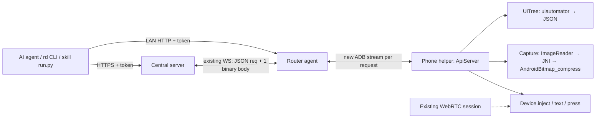

# RemoDroid AI control and reusable automation plan

Status: implemented (revision 2), including the §5 fast path (in-process UiAutomation), `set_text` and
`scroll`. Verified by `tests/run.mjs` (agent HTTP API, server relay, tokens, against a fake phone) and
`tests/python_sdk.py` (SDK, `rd`, skill exit codes and resume). The phone code (`ApiServer`, `UiTree`, `Capture`,
`Actions`, `android/native/image.c`) compiles, but has not yet run on a real phone: §11's targets are still
unmeasured. Added during implementation: a `launch` action (open an app by package name).
§2 lists what changed from revision 1.

## 1. English translation of the request

“I was mistaken about the server being down. Help me design a way for AI to operate this phone, and write the
plan in English. ADB seems able to export the current phone UI as XML. Check whether we can convert that into
JSON and expose it through the agent's HTTP API. Also support screenshots through a shared screenshot interface
for the current screen-sharing system. Implement image compression in C to produce fast, small screenshots,
such as JPEG or PNG. AI should be able to control the screen through REST APIs. On the first run, AI should use
screenshots and JSON to understand and operate the UI. On subsequent runs, a Python script should handle the
known workflow; AI should intervene when it encounters something unfamiliar. This should work like a reusable
skill or a cache hit. Write this into skill-plan.md, including an English translation of this prompt.”

Clarifications:

- “Export the UI as JSON only. Why capture a screenshot together with it? Screenshots should use a separate
  endpoint that accepts parameters and returns the image.”
- “Do not save screenshots as files either. Can the endpoint just return the image directly?”

## 2. What changed from revision 1

The phone helper already runs as the `shell` user through `app_process` (`agent/phone.c:671`), already creates
virtual displays (`ScreenEncoder.createDisplay`), and already injects input without a WebRTC session
(`Device.inject`, `Device.text`, `Device.press`). Revision 1 did not use these facts, so it put work on the
router that the phone can do more easily.

| Revision 1 | Revision 2 | Why |
| --- | --- | --- |
| Agent runs `uiautomator dump`, pulls the file with ADB sync, parses XML in C on the router | The phone helper collects the tree and returns JSON. No C XML parser, no sync, no router worker thread | The phone has the CPU and the framework's `XmlPullParser` and `org.json`. Routers are slow and short on memory |
| New chunked binary protocol over the 16-bit tunnel | One new ADB stream per request to a second phone socket, `localabstract:remodroid-api` | ADB streams carry any length, have flow control, and closing one cancels the request. `tunnel.h` stays unchanged |
| Resize and crop in C | Create the capture display at the requested size, so the GPU does the scaling | No CPU resize step and smaller buffers. Crop is deferred |
| Vendor libjpeg-turbo and libpng/zlib | Use the C API `AndroidBitmap_compress` from the platform (libjnigraphics, API 30+), which supports JPEG, PNG and WebP. Use a fallback below API 30 | The encoding stays in C with nothing to vendor or cross-build. See decision D1 |
| Control leases, a server-side idempotency journal, async action IDs, HTTP 202 | Synchronous actions. A `viewer_active` guard. The step journal is kept on the client in the SDK | v1 has one AI and one phone. Leases and journals come back only if they are needed |
| Server relay through new binary chunks | Reuse the existing `hub_forward_cmd` request/response path and send the body as one binary WS message (≤ 1 MiB) | A 1280 px JPEG is 60–200 KiB. Chunking is deferred |
| No defined way to "learn" | The SDK records every call to a trace. The AI compiles the trace into `run.py`. The skill format matches Claude Code `SKILL.md` | This turns "cache hit" into a concrete file plus an exit-code contract |
| Agent listens on loopback only | Agent listens on the LAN when enabled, with a bearer token. Remote access goes through the central server | The AI does not run on the router, so a loopback-only listener could not be reached |

## 3. Architecture



Unchanged: the video path (`ScreenEncoder` → MediaCodec → WebRTC), the tunnel, and the browser viewer.

## 4. Phone helper: `ApiServer`

- A new `LocalServerSocket("remodroid-api")` runs in the Java helper. Each connection runs on its own thread
  from a small pool (size 2). Requests to one device are serialized by a lock, except `capabilities`.
- Request: one JSON line, `{"op":"ui","args":{...}}`. Response: one JSON header line,
  `{"status":200,"type":"image/jpeg","len":123456,"headers":{...}}`, then exactly `len` raw body bytes, then
  the connection closes. If the client disconnects, the work is cancelled.
- Operations: `capabilities`, `ui`, `screenshot`, `action`.

## 5. UI tree to JSON

**v1:** The helper runs `uiautomator dump /data/local/tmp/rd-ui.xml`, parses the file with
`android.util.Xml` (pull parser, no DTD), writes JSON with `org.json`, and deletes the file. This is a UI
dump, not a screenshot. Limits: 10,000 nodes and depth 128. If a limit is hit, the response sets
`"truncated": true`.

**v2 (fast path):** A persistent in-process `UiAutomation`, connected the same way the `uiautomator` command
connects, walks `AccessibilityNodeInfo` directly. That removes the cost of starting a process (often 1–3 s)
and the "could not get idle state" failures on animated screens, because the walk has its own idle timeout.
Keep the command path as the fallback. Only one `UiAutomation` can be connected at a time, so the helper must
own it exclusively.

```json
{
  "schema": 1, "ui_id": "u42", "package": "com.example.app",
  "display": {"w": 1080, "h": 2400, "rotation": 0, "epoch": 7},
  "truncated": false, "collect_ms": 180,
  "nodes": [
    {"id": 17, "p": 3, "rid": "com.example.app:id/search", "cls": "EditText",
     "text": "", "desc": "Search", "b": [40,120,1040,220],
     "f": ["click", "edit", "enabled"]}
  ]
}
```

- `view=compact` (the default) keeps actionable nodes plus the ancestors that give them meaning (labels,
  containers with text). `view=full` keeps every node. Short keys and a flags array keep the payload small,
  which matters for model context.
- Node IDs are valid only within one `ui_id`. Skills must use selectors, not node IDs.
- Password fields: the text is replaced with `null`. Sparse trees (WebView, games, canvas) are returned as
  they are. The caller decides whether to request a screenshot. UI export never captures one.
- `epoch` is incremented on every rotation or display change, so actions can detect stale geometry.

## 6. Screenshot and C compression

1. `Capture` reuses the display-creation code from `ScreenEncoder` (refactor `createDisplay` into a shared
   helper). It creates a mirror display whose surface is an `ImageReader` (RGBA_8888) **at the output size**
   computed from `max_edge`. The compositor scales on the GPU.
2. Keep the display warm for 10 s after the last request, then release it. Only the first request pays the
   setup cost.
3. Pass plane 0 (a direct `ByteBuffer`) and its `rowStride` to JNI. C calls `AndroidBitmap_compress` (JPEG,
   PNG or WEBP_LOSSY, resolved with `dlopen("libjnigraphics.so")`) and writes into a growable memory buffer.
   No copy into a Java array and no file.
4. Below API 30, fall back to `Bitmap.compress` (the same Skia/libjpeg-turbo code, but called from Java).
   If no capture path works, fall back to `screencap -p` piped through stdout, never to a file. Every response
   reports which backend produced it.
5. The response is the raw image: `Content-Type: image/jpeg|png|webp`, `Content-Length`,
   `Cache-Control: no-store`, `X-RD-Width/Height` (the image size), `X-RD-Display-W/H`, `X-RD-Rotation`,
   `X-RD-Epoch`, `X-RD-Backend`, `X-RD-Capture-Ms`.

Parameters: `format=jpeg|png|webp` (default jpeg), `max_edge` 320–2400 (default 1280), `quality` 30–95
(default 75, JPEG/WebP only). Secure windows: reuse the `secure` display flag that `ScreenEncoder` already
passes. If content is still blank, do not guess that it is protected. Report only what the API can tell.

"Shared with screen sharing" means one capture implementation and one display-setup helper, used by both REST
and a future "screenshot" button in the web viewer (which can call the same endpoint). Reading frames back
from the H.264 encoder surface is out of scope.

## 7. Transport and HTTP

**Agent ↔ phone:** for each HTTP request, `adb_open(A.adb, "localabstract:remodroid-api", ...)`, write the
request line, and stream the response bytes straight to the HTTP client as they arrive. Everything runs
asynchronously on the existing libev loop. The agent never parses images or XML, so it needs no worker
threads. Limit concurrency to 2 streams per device.

**Agent HTTP (`agent/http.c`):** a small HTTP/1.1 server built on picohttpparser, which is already vendored.
It is off by default. Config: `api_listen = 0.0.0.0:8790`, `api_token = …`. Every request needs
`Authorization: Bearer`. Routes are `/api/v1/devices/{id}/...` to match the server, so the SDK uses one base
URL either way.

**Central server:** add `/ui`, `/screenshot`, `/actions`, and `/capabilities` to `server/api.c` and forward
them with the existing `hub_forward_cmd` pattern (message type `api`). The agent replies with a JSON header
message carrying the same id, followed by one binary WS frame containing the body. The 1 MiB `WS_MAX_MESSAGE`
limit stays. If a body is larger, the request fails with `too_large`, and the caller lowers `max_edge` or
`quality`. API callers need bearer tokens instead of the login cookie: add a scoped token type in
`server/auth.c` (`ui`, `screenshot`, `control`).

## 8. REST contract

Prefix: `/api/v1/devices/{device_id}` (the same on the agent and the server).

| Route | Behavior |
| --- | --- |
| `GET /capabilities` | Schema version, UI backend, capture backends, formats, supported actions |
| `GET /ui?view=compact` | UI JSON only |
| `GET /screenshot?format=jpeg&max_edge=1280&quality=75` | Raw image bytes only |
| `POST /actions` | Run one action synchronously and return the result |

```json
{"action": "tap", "target": {"rid": "com.example.app:id/search"}, "ui_id": "u42",
 "wait": {"for": "ui_changed", "timeout_ms": 2000}}
```

- Actions: `tap`, `long_press`, `swipe`, `key`, `text`, `back`, `home` in v1, built on `Device.inject`,
  `Device.text`, and `Device.press`. `scroll` and `set_text` (accessibility ACTION_SET_TEXT, which handles
  Unicode reliably) come with the v2 UiAutomation.
- Targets: a selector (`rid`, `text`, `desc`, `cls`, and `within`, an ancestor selector), a `node` from the
  given `ui_id`, or `{"x":…, "y":…, "space":"display"|"image", "w":…, "h":…, "epoch":…}`. Selectors are
  resolved against a fresh dump. The action is rejected if the selector matches nothing, matches more than one
  node, or the node is disabled. An `epoch` mismatch is rejected as `stale_state`.
- Result: `{"ok":true, "injected":true, "verified":true|false, "ui_id":"u43"}`. Successful injection and a
  verified wait are reported separately.
- Human priority: if the WebRTC session has injected input in the last 5 s, actions return
  `409 viewer_active`. The AI never takes control back from a human.
- Errors: `device_offline`, `tree_unavailable`, `capture_unavailable`, `stale_state`, `no_match`,
  `ambiguous`, `viewer_active`, `too_large`, `timeout`, `unsupported`. Each error includes a `retryable` flag.

UI and screenshot requests are independent. They are not taken at the same moment, and nothing pairs them.
Each carries its own `epoch` and timing, and freshness is judged by the monotonic `epoch`, never by
wall-clock time.

## 9. Learn once, replay as a skill

**Python package `remodroid` (SDK + `rd` CLI).** The CLI lets any agent, including Claude Code, drive the
phone through the shell: `rd ui`, `rd shot -o -` (writes the image to stdout), `rd tap --rid …`, `rd text …`.
The SDK has the same calls plus `wait_for`, `require`, and `NeedsAI`. The image is kept in memory and never
written to disk.

1. **Explore (first run):** the AI drives the phone with `rd` and `--trace run.jsonl`. Every call is
   recorded with the selector it used, the result, and a short summary of the UI before and after (package,
   key node selectors). Screenshots appear in the trace only as "taken". The image bytes are not stored.
2. **Compile:** the AI turns the trace into `skills/<task>/run.py`: parameterized inputs, an entry-state
   check, one `require(...)` postcondition per step, alternative selectors, and a final success check.
3. **Replay (cache hit):** `python run.py --args …` makes no model calls. Exit codes: `0` done, `2` the entry
   state does not match (not this skill), `3` NeedsAI. With code 3, stdout is JSON containing the failed step,
   completed steps (including which side effects already happened), and the current UI JSON.
4. **Fallback:** the AI reads the NeedsAI JSON, takes a screenshot if it needs one, resolves the problem,
   and resumes with `run.py --from-step N`. Steps marked `side_effect: true` are never re-run automatically.
5. **Improve:** after a successful recovery, the AI adds the new branch and bumps `revision` in SKILL.md. The
   old revision stays in git.

```text
skills/<task>/
  SKILL.md     # frontmatter: name, description, app package, app version range, revision; then usage
  run.py       # deterministic workflow using the remodroid SDK
  fixtures/    # redacted UI JSON for offline tests (no screenshots)
```

```python
from remodroid import Client, require, NeedsAI

def run(c: Client, query: str):
    ui = c.ui()
    require(ui, package="com.example.app", has={"rid": "com.example.app:id/search"})   # entry state
    c.tap(rid="com.example.app:id/search", step="open_search")
    c.wait_for(rid="com.example.app:id/query", timeout=3)
    c.text(query, step="enter_query")
    c.key("ENTER", step="submit", side_effect=True)
    return require(c.wait_for(rid="com.example.app:id/results", timeout=5))
```

Matching is done by the skill's `description` (which the AI reads to choose a skill) plus the entry-state
check in `run.py`. No separate fingerprint store is needed. Selectors are based on resource IDs and semantic
anchors, never on coordinates or tree hashes. Tokens come from environment variables, never from skill files.
Screen text is data, never instructions to the AI.

## 10. Milestones

Each milestone ends with something usable on the SO-51A (Android 12). Builds run in CI.

1. **Read-only slice:** `ApiServer` on the phone (`ui` through uiautomator, `screenshot` through ImageReader
   and `AndroidBitmap_compress`), `agent/http.c`, and `rd ui` / `rd shot` against the agent on the LAN.
   Record baseline latency.
2. **Actions:** tap, swipe, key, text, back, and home. Selector resolution, epoch checks, and the
   `viewer_active` guard.
3. **SDK, trace, first skill:** recording, `require`/`wait_for`, exit codes, and resume. Build one
   search/navigation skill. Show that an unexpected dialog produces a clean exit 3.
4. **Central relay:** the `api` hub message, the binary body frame, and scoped bearer tokens.
5. **Fast path:** in-process UiAutomation, `set_text`, `scroll`, and warm capture tuning. Benchmark while
   screen sharing is active.
6. **Compatibility:** the API < 30 fallbacks, other phones, and documented capabilities.

Files: new `android/java/.../ApiServer.java`, `UiTree.java`, `Capture.java`, `android/native/image.c`,
`agent/http.c`, `python/remodroid/`. Changed: `ScreenEncoder.java` (extract display setup), `Session.java`
(record time of last viewer input), `agent/phone.c` (open API streams), `server/api.c`, `server/hub.c`,
`server/auth.c`, `agent/wsc.c`.

## 11. Targets and checks

Initial targets, to be replaced by measurements (p95, warmed, 100 samples, static/text/photo screens):

| Metric | Target |
| --- | --- |
| JPEG 1280 px q75 size | 60–200 KiB |
| Screenshot over LAN, warm display | < 250 ms |
| UI JSON, uiautomator path | < 3 s (measure) |
| UI JSON, in-process UiAutomation | < 300 ms |
| Video FPS while screenshots run every second | drop < 10% |
| Skill replay on a known state | 0 model calls, every step verified |

Checks:

- `/ui` never touches capture code, and `/screenshot` never touches the tree. Nothing is written to disk on
  the phone, router, or server for screenshots, including error and cancellation paths (verify with `strace`
  or `inotifywait`).
- XML fixtures: entities, Unicode, empty trees, malformed files, oversized or deeply nested trees, password
  fields.
- Rotation between `/ui` and `/actions` gives `stale_state`, never a wrong tap.
- A client disconnecting mid-screenshot frees the buffers. 1,000 screenshots in a row do not grow the
  helper's memory.
- A human touching the viewer stops AI actions within one request.
- A skill's second run makes no model calls. An injected unknown dialog gives exit 3 with a resumable
  journal, and resuming does not repeat a side-effect step.

## 12. Deferred (not in v1)

Control leases and a server-side idempotency journal; chunked transfers over 1 MiB; crop; JPEG 4:4:4;
vendored libjpeg-turbo (only if `AndroidBitmap_compress` measures too slow, or the API < 30 fallback is
not good enough); reading frames back from the video encoder through the GPU; multiple displays.

## 13. Decisions needed

- **D1 – encoder:** use the platform's `AndroidBitmap_compress` from C (recommended: no dependency, includes
  WebP) or vendor libjpeg-turbo (full control, works on API 26–29, adds a CMake/SIMD cross-build).
- **D2 – first access path:** the agent HTTP API on the LAN first (recommended: simplest for development),
  or the central relay first if the AI always runs off-site.
- **D3 – AI runner:** Claude Code with `rd` and skills (recommended: it already has skill discovery and shell
  access), or a custom planner loop that calls the SDK.
